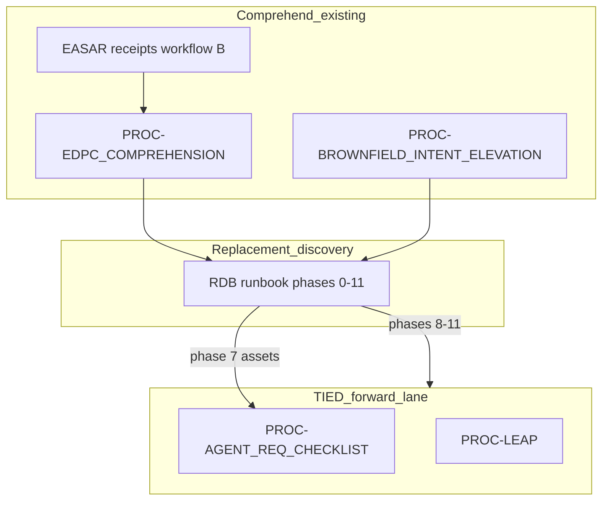

# Plan: Replacement Discovery Baseline (RDB) import and TIED self-re-engineering

**Slug:** `replacement-discovery-baseline`  
**Track:** `@non-tied-plan` → `@non-tied-refine` (this revision) → `@non-tied-build` → optional `@non-tied-close`  
**Linked Cursor plan:** [import_rdb_runbook_4f73f621.plan.md](../../../.cursor/plans/import_rdb_runbook_4f73f621.plan.md)  
**Source runbook (v1.0):** sponsor attachment `agent_reengineering_deconstruction_runbook.md` (deconstruct working system → design successor)

---

## Sponsor intent (locked)

Give TIED a **generic, git-tracked** process for deconstructing a working system to design a simpler successor—not a module-for-module rewrite spec. **Wave 1** imports the runbook under `docs/methodologies/` only (no REQ/ARCH/IMPL minting). **Wave 2** applies full TIED so the process can document **TIED’s own** behavior and participate in building the next generation of TIED-like tools.

**Proof boundary:** Doc-only under [`docs/methodologies/replacement-discovery-baseline-runbook.md`](../../../docs/methodologies/replacement-discovery-baseline-runbook.md) plus this plan folder. No product code, no project TIED YAML writes, no `tied_verify` updates. See [non-tied-boundary.md](../../../tools/bundled-prompt-type-skills/prompt-shared/non-tied-boundary.md).

**Placement (locked):** Canonical runbook body lives **only** in `docs/methodologies/`—not duplicated under `non-tied-plans/`.

---

## RESOLVE (Touchpoint 1)

| Sponsor term | Resolved meaning |
| --- | --- |
| **RDB** | **Replacement Discovery Baseline**—required output package (`replacement-discovery/` tree + `registry/*` YAML) from the runbook. |
| **Re-engineering** | Preserve **value and contracts**; challenge **mechanisms** and accidental complexity. Success = demonstrably better outcomes, not parity rewrite. |
| **TIED self-re-engineering** | **Pilot subject** = this store repo (`stdd`: `tied-bundle/`, `mcp-server/`, `tools/`, checklist/MCP, harness readouts). RDB is the **umbrella** over comprehension + replacement; it does **not** retire EDPC/EASAR/BFIE. |
| **Five views** | PURPOSE, CONTRACT, REALITY, MECHANISM, OPPORTUNITY—discovery lenses **orthogonal** to REQ→ARCH→IMPL; wave 2 maps views to artifacts and PROC tokens. |
| **Discriminant vs EDPC** | EDPC optimizes **comprehension and SCM** of what exists. RDB optimizes **successor sufficiency** (phases 8–11: target spec, alternatives, migration, readiness). Use EDPC (or overlap) for 0–7; use RDB when a **replacement** is in scope. |

---

## Refinements applied (`@non-tied-refine`)

1. **Path locked:** `docs/methodologies/replacement-discovery-baseline-runbook.md` (filenames and single canonical copy).
2. **Discriminant locked:** RDB ≠ EDPC duplicate; successor phases and migration gates are the differentiator.
3. **Phase ↔ EDPC workflow map** added (below)—compose, do not fork checklist ownership in wave 1.
4. **Provenance header template** specified for `@non-tied-build` (non-normative until wave 2 PROC).
5. **RDB record IDs ≠ TIED tokens** reiterated; elevation path = BFIE dispositions, not auto `[REQ-*]` from `OUT-*` / `CAP-*`.
6. **Vocab RECORD** optional on build (`replacement-discovery.md` in `tied-project/vocab/`)—not required for wave 1.

---

## Positioning vs TIED brownfield stack



| Concern | Primary TIED anchor |
| --- | --- |
| Evidence-backed claims | [brownfield-intent-elevation.md](../../../tied-bundle/docs/brownfield-intent-elevation.md) Track C vs intent elevation |
| Program comprehension | [EDPC_Methodology_and_Workflows.md](../../../tied-bundle/docs/EDPC_Methodology_and_Workflows.md), `[PROC-EDPC_COMPREHENSION]` |
| Architecture recovery receipts | [evidence-assured-software-architecture-recovery.md](../../../docs/methodologies/evidence-assured-software-architecture-recovery.md) workflow **B** |
| Forward implementation | `[PROC-AGENT_REQ_CHECKLIST]`, `[PROC-LEAP]` |
| Artifact placement | [working-artifact-placement.md](../../../tied-bundle/docs/working-artifact-placement.md) |

**EDPC / EASAR** heavily overlap RDB **phases 0–7**. **Phases 8–11** (target requirements, design alternatives, transition, readiness) are **not** a single enrolled PROC today.

### RDB phase → EDPC workflow (compose, wave 2 normative)

| RDB phase | EDPC workflow (indicative) | Notes |
| --- | --- | --- |
| 0 Scope, safety, evidence inventory | **A** Charter / access | Align `evidence_access_tier`, read-only default |
| 1 Purpose, user value | **C** / narrative in SCM | Outcomes without implementation names |
| 2 Capabilities, workflows | **D**–**E** modeling | Capability registry ↔ SCM capabilities |
| 3 Contracts, observed behavior | **F** publish + claims | Intended vs observed separation |
| 4 Data, integrations | SCM data / dependency facets | Migration inputs for phase 10 |
| 5 As-built, as-operated | **B** baseline + EASAR receipts | Topology, not successor design |
| 6 Quality, failures, health | Claims + adversarial (when enabled) | FAIL / QUA registries |
| 7 Verification baseline | Checklist TDD + characterization | Reusable VER assets |
| 8–11 Replacement | *No EDPC letter* | RDB-specific; wave 2 PROC or EDPC **H+** extension |

---

## Wave 1 deliverables

### 1. Canonical runbook

**Path:** [`docs/methodologies/replacement-discovery-baseline-runbook.md`](../../../docs/methodologies/replacement-discovery-baseline-runbook.md)

| Item | Rule |
| --- | --- |
| Body | Phases 0–11, record conventions, artifact tree, anti-patterns—**verbatim** from v1.0 source; preserve `Version: 1.0` in body or header |
| Front matter | Thin **TIED alignment (non-normative)** block only—see template below |
| Links | Point to this `PLAN.md` and pilot statement |
| Forbidden in header | Minting `[REQ-*]`, `[ARCH-*]`, `[IMPL-*]`, `[PROC-*]`; implying enrolled checklist branching |

**Provenance header template (prepend before runbook title):**

```markdown
# Replacement Discovery Baseline — agent runbook

**Status:** Generic methodology (v1.0 body below). Not a TIED `[PROC-*]` token until wave 2 enrollment.

**Plan:** [replacement-discovery-baseline/PLAN.md](../../tied-project/non-tied-plans/replacement-discovery-baseline/PLAN.md)

**Pilot (declared):** TIED methodology store (`stdd`) self-re-engineering—subject boundaries in PLAN § Stdd pilot.

**Non-claims:** RDB record prefixes (OUT, CAP, CON, EV, …) are **not** TIED semantic tokens. Observed behavior does not become requirements without brownfield intent elevation / sponsor decision.

**Related TIED docs:** [brownfield-intent-elevation.md](../../tied-bundle/docs/brownfield-intent-elevation.md) · [EDPC](../../tied-bundle/docs/EDPC_Methodology_and_Workflows.md) · [EASAR](../../../docs/methodologies/evidence-assured-software-architecture-recovery.md)

---
```

### 2. Plan folder (this tree)

| File | Role |
| --- | --- |
| `PLAN.md` | This document |
| `test-strategy.md` | Doc-only QA for wave 1 |
| `CITDP-replacement-discovery-baseline.yaml` | Optional; `tied_tokens_new: []` |
| `evidence/session-handoff.md` | Plan execution steps |

---

## Stdd pilot boundary (Phase 0 sketch — wave 2 execution)

| In scope (initial) | Out of scope (initial) |
| --- | --- |
| `tied-bundle/` methodology corpus, `mcp-server/`, bootstrap/install, checklist/gates, `docs/agent-harness-evaluation/` | Full factory/client matrix; unrelated product repos |
| Read-only discovery; committed evidence under `tied-project/working/{REQ}/` per placement policy | Production secrets; live credential mutation |

---

## Wave 2 outline (TIED enrollment — not wave 1)

| RDB element | Likely TIED direction |
| --- | --- |
| Phase gates + governing rules | `[PROC-REPLACEMENT_DISCOVERY]` **or** EDPC workflow extension past **H** |
| `replacement-discovery/` layout | `tied-project/working/{REQ-TOKEN}/replacement-discovery/` + local proof under `tied-bundle/working/` |
| Registries (`capabilities.yaml`, …) | Report-only MCP validators (brownfield-validator pattern) |
| ID mapping | IMPL table: RDB ID ↔ elevation path ↔ optional `[REQ-*]` after adjudication |
| Phase 10 migration | Request-evidence envelope + checklist close-out; no default big-bang |
| Program REQ | Sponsor-led `REQ-TIED_*` after `@citdp-promote`—not invented in wave 1 |

**Deferred until tokens exist:** `client-development-index.md` row, `tied-project/vocab/routing.md` keywords, `processes.md` PROC entry, optional `tied-install` copy into `tied-bundle/docs/`.

---

## `@non-tied-build` execution steps

1. Create `docs/methodologies/replacement-discovery-baseline-runbook.md` (header template + verbatim v1.0).
2. Ensure `test-strategy.md` and `evidence/session-handoff.md` exist; run QA checklist.
3. Optional: `CITDP-replacement-discovery-baseline.yaml`, `tied-project/vocab/replacement-discovery.md`.
4. Mutual links: PLAN ↔ runbook header; runbook ↔ EDPC/EASAR/BFIE docs as in template.
5. Optional `@non-tied-close`: single scoped commit when sponsor requests.

No `.gitignore` allowlist required—`docs/methodologies/` is tracked (except ignored Kirk doc).

---

## Wave 2 entry

- `@add-feature` or `@citdp-promote` with scoped REQ (e.g. TIED self-re-engineering).
- CITDP with real `tied_tokens_new`, checklist slug map, minimal Phase 0–1 pilot scaffold under `tied-project/working/{REQ}/replacement-discovery/`.

---

## Risks / costly choices

| Choice | Consequence ladder |
| --- | --- |
| New PROC vs EDPC extension | **Costly**—checklist branching, client index, MCP surface |
| Early `REQ-TIED_SELF_REENGINEERING` | **Costly**—multi-release program commitment |
| Promote runbook to `tied-bundle/docs/` on install | **Reversible**—wave 1 stays store `docs/methodologies/` until decided |