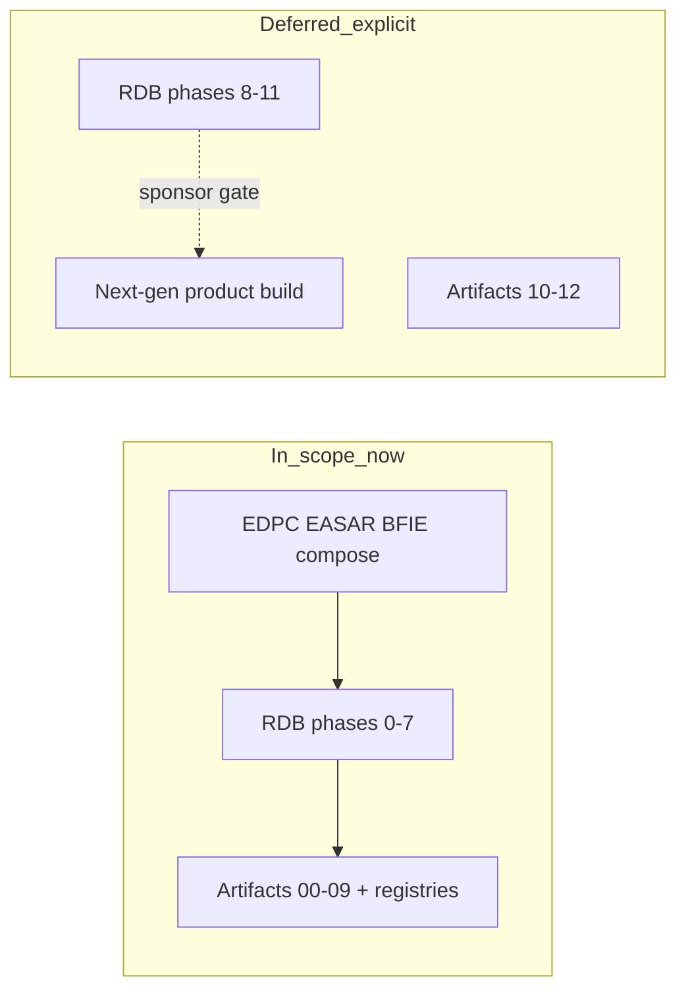
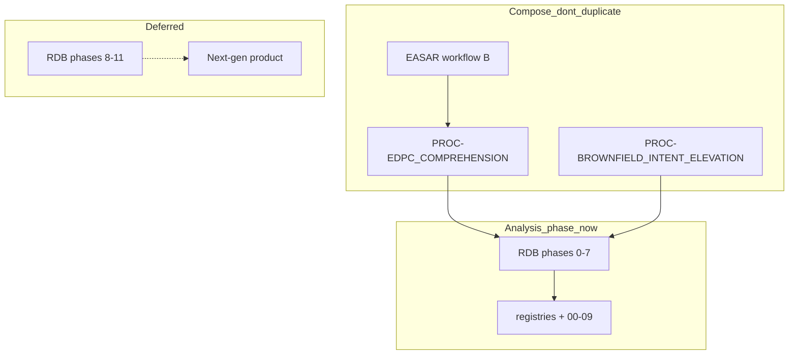

# Plan: Replacement Discovery Baseline — analysis phase (TIED store)

**Slug:** `replacement-discovery-baseline`  
**Wave 2 working token (locked):** `DOC-TIED-RDB-ANALYSIS` — committed analysis under [`tied-project/working/DOC-TIED-RDB-ANALYSIS/`](../../working/DOC-TIED-RDB-ANALYSIS/) (**no REQ mint** unless sponsor later opens `@add-feature`).  
**Track:** Wave 1 import **closed** (`9aa6b278`). **Current phase:** **Analysis & documentation** of current TIED behavior (defer successor/replacement).  
**Runbook:** [`docs/methodologies/replacement-discovery-baseline-runbook.md`](../../../docs/methodologies/replacement-discovery-baseline-runbook.md) (full v1.0 text; phases 8–11 read **deferred** until Wave 3+)

---

## Sponsor intent (locked)

**Long-term horizon (deferred):** A future generation product may **replace** TIED as the primary methodology platform. That replacement program is **out of scope** until analysis is complete and explicitly authorized.

**Current program phase — analysis only:** Discover and document **what TIED is today**: outcomes, contracts, observed behavior, mechanisms, data and integrations, quality and failures, and a **verification baseline**. Produce an evidence-backed **Replacement Discovery Baseline (RDB)** in the **analysis slice** only—sufficient for review, comprehension, and informed planning—**without** target successor design, cutover, or implementation.

**Wave 1 (done):** Import generic runbook to `docs/methodologies/` (no REQ/ARCH/IMPL minting).

**Wave 2 (next):** Apply TIED (or aligned non-TIED working structure) to **execute analysis phases** on the `stdd` store per this plan—not to build a replacement product.

**Proof boundary:** Committed artifacts under plan folder + future `tied-project/working/{REQ}/` or `replacement-discovery/` **analysis subset**; read-only discovery on the codebase. No successor implementation, no migration execution, no project REQ/ARCH/IMPL minting unless sponsor opens a separate TIED lane.

**Placement (locked):** Canonical runbook remains in `docs/methodologies/` only.

---

## RESOLVE (Touchpoint 1)

| Sponsor term | Resolved meaning |
| --- | --- |
| **RDB (this phase)** | Analysis-time baseline: registries + artifacts **00–09** and phase **7 gate** outputs; may use `replacement-discovery/` layout but **must not** treat 10–12 or phases 8–11 as required deliverables yet. |
| **Analysis phase** | Runbook **phases 0–7** plus supporting records (OUT, ACT, CAP, WF, CON, EV, GAP, …). Emphasis on **REALITY**, **CONTRACT**, **MECHANISM** documentation; **OPPORTUNITY** / HYP entries are **optional sketches** only (no disposition decisions). |
| **Replacement phase (deferred)** | Runbook **phases 8–11**, artifacts **10–12**, migration/cutover (`MIG-*`), successor REQ, and “next generation product” build. **Forbidden** as completion criteria until sponsor reopens scope. |
| **TIED self-study** | **Pilot subject** = `stdd` (`tied-bundle/`, `mcp-server/`, `tools/`, checklist/MCP, harness readouts). Goal = **accurate documentation of current behavior**, not redesign. |
| **Five views** | Still apply as **lenses for analysis**; do not use OPPORTUNITY view to authorize removal or replacement in this phase. |
| **vs EDPC** | Prefer **composing** EDPC/EASAR/BFIE for phases 0–7 where already enrolled; RDB artifact names may hold **analysis exports** EDPC does not standardize. EDPC remains comprehension authority; this plan adds RDB-shaped **analysis packaging** for a future replacement program. |
| **Analysis complete** | Phase **7 gate** met + registries populated for **critical** CAP/CON paths + `09-evidence-uncertainties-and-questions.md` lists residual GAPs with owners; **no** phase 8–11 artifacts required. |
| **Current behavior** | Externally observable or reproducible from repo revision (code, tests, docs, MCP tool schemas, checklist YAML). Distinct from **declared intent** in REQ/IMPL indexes until BFIE `approved`. |
| **DOC working token** | Same pattern as [`DOC-STDD-TIED-PROJECT-BROWNFIELD`](../../working/DOC-STDD-TIED-PROJECT-BROWNFIELD/): process evidence in `tied-project/working/`, dispositions **`observed`** / **`inferred`** / **`unknown`** only in analysis phase. |

---

## Refinements applied (`@non-tied-refine`)

1. **Working root locked:** `tied-project/working/DOC-TIED-RDB-ANALYSIS/replacement-discovery/` (not “TBD”).
2. **Default lane locked:** non-TIED **DOC** working engagement first; `@add-feature` only if sponsor wants enrolled REQ/PROC for analysis tooling.
3. **Stdd slice order** locked (breadth before depth): charter → actors/outcomes → **checklist + MCP + install** capabilities → YAML two-folder contracts → topology (bootstrap, agentstream) → harness/quality → verification inventory.
4. **Analysis completion gates** defined (below)—distinct from runbook §9 replacement checklist.
5. **Phase reports** land in `working/.../evidence/phase-{n}-report.md`; registries remain canonical in `replacement-discovery/registry/`.
6. **EDPC compose rule:** re-use [DOC-STDD-TIED-PROJECT-BROWNFIELD](../../working/DOC-STDD-TIED-PROJECT-BROWNFIELD/) claims where still valid; extend, do not contradict without new EV-*.

---

## Phase scope gate



| Runbook phase | This plan | Primary outputs |
| --- | --- | --- |
| 0 — Scope, safety | **In scope** | Mission, boundary, evidence inventory, read-only charter |
| 1 — Purpose, user value | **In scope** | Actors, outcomes, journeys (technology-agnostic where possible) |
| 2 — Capabilities, workflows | **In scope** | CAP/WF registries, entry-point inventory |
| 3 — Contracts, observed behavior | **In scope** | CON registry; intended vs observed (no auto-REQ) |
| 4 — Data, integrations | **In scope** | DAT/INT; **migration** fields = notes only, not execution |
| 5 — As-built, as-operated | **In scope** | Topology, ops patterns |
| 6 — Quality, failures, health | **In scope** | FAIL/QUA, risk catalog |
| 7 — Verification baseline | **In scope** | VER registry, characterization gap list |
| 8 — Replacement specification | **Deferred** | — |
| 9 — Design alternatives | **Deferred** | — |
| 10 — Transition / migration | **Deferred** | — |
| 11 — Readiness for replacement | **Deferred** | — |

**Artifact tree (analysis slice):** Root = `tied-project/working/DOC-TIED-RDB-ANALYSIS/replacement-discovery/`:

```text
tied-project/working/DOC-TIED-RDB-ANALYSIS/
  PLAN.md
  test-strategy.md
  evidence/
    phase-0-report.md … phase-7-report.md
  replacement-discovery/
  00-mission-boundary-and-assumptions.md
  01-users-outcomes-and-domain.md
  02-capabilities-and-workflows.md
  03-contracts-and-observed-behavior.md
  04-as-built-and-as-operated.md
  05-data-state-and-integrations.md
  06-quality-operations-security.md
  07-failure-risk-and-historical-decisions.md
  08-verification-and-characterization.md
  09-evidence-uncertainties-and-questions.md
  registry/
    capabilities.yaml
    contracts.yaml
    evidence.yaml
    gaps.yaml
    verification.yaml
```

**Not in scope for analysis phase:** `10-replacement-opportunities.md` through `13-decision-log-and-readiness-review.md` (except **DEC** entries that record *analysis* decisions, not successor authorization). Optional **draft** HYP in `09-*` or a scratch `opportunities-inbox.md` with banner **not approved for replacement**.

---

## Positioning vs TIED brownfield stack



| Concern | Primary TIED anchor (analysis) |
| --- | --- |
| Evidence-backed claims | [brownfield-intent-elevation.md](../../../tied-bundle/docs/brownfield-intent-elevation.md) — Track C and matrix dispositions |
| Program comprehension | [EDPC_Methodology_and_Workflows.md](../../../tied-bundle/docs/EDPC_Methodology_and_Workflows.md) |
| Architecture recovery | [EASAR](../../../docs/methodologies/evidence-assured-software-architecture-recovery.md) workflow **B** |
| Artifact placement | [working-artifact-placement.md](../../../tied-bundle/docs/working-artifact-placement.md) |

### RDB phase → EDPC workflow (analysis execution)

| RDB phase | EDPC workflow (indicative) | Analysis note |
| --- | --- | --- |
| 0 | **A** Charter / access | Read-only; `stdd` scope only |
| 1 | **C** / SCM narrative | Sponsors, operators, client vs store roles |
| 2 | **D**–**E** | MCP tools, checklist, install surfaces as capabilities |
| 3 | **F** publish + claims | YAML/MCP/checklist **observed** behavior |
| 4 | SCM data facets | Indexes, detail files, two-folder layout |
| 5 | **B** + EASAR | Repo topology, bootstrap, agentstream |
| 6 | Claims / adversarial (optional) | Harness trials, failure modes |
| 7 | Existing tests + `tied_validate_consistency` | Characterization gaps |
| 8–11 | *Deferred* | Do not schedule |

---

## Stdd analysis boundary (Phase 0)

| In scope | Out of scope (analysis phase) |
| --- | --- |
| Methodology `tied-bundle/`, `mcp-server/`, `tools/bootstrap`, prompt-type skills, checklist/MCP gates, `docs/agent-harness-evaluation/` | Implementing a **replacement** codebase |
| Documenting client install behavior **as specified today** | Rewriting install for next-gen product |
| READ-only discovery; evidence with revision IDs | Production secrets; credential stores |
| Gaps and questions in `registry/gaps.yaml` | Sponsor-approved **elimination** or contract changes |

### Priority slices (stdd — execution order)

| Order | Slice | RDB phase emphasis | Starter entry points |
| --- | --- | --- | --- |
| 1 | **Governance & scope** | 0 | This PLAN, runbook header, `AGENTS.md`, working placement |
| 2 | **Actors & outcomes** | 1 | Sponsor, client operator, agent, MCP consumer — no implementation names in outcome statements |
| 3 | **Operator surfaces** | 2–3 | `[PROC-AGENT_REQ_CHECKLIST]`, prompt-type skills, `tied-yaml` MCP, `tied-install` |
| 4 | **Data & traceability** | 4 | Two-folder layout, index/detail YAML, merged view, MCP write boundaries |
| 5 | **Runtime topology** | 5 | `mcp-server/`, bootstrap layers, `@tied/agentstream`, factory tests |
| 6 | **Quality & trials** | 6 | Harness readouts, gate receipts, known failure patterns |
| 7 | **Verification inventory** | 7 | `mcp-server` test suites, `tied_validate_consistency`, characterization gaps |

---

## Analysis completion gates (Wave 2 exit)

All must hold before calling analysis **complete** (still **not** replacement-ready):

| Gate | Criterion |
| --- | --- |
| **G-0** | `00-mission-boundary-and-assumptions.md` signed with git revision, deferral of phases 8–11, and stdd boundary table |
| **G-1** | ≥3 **ACT** and ≥5 **OUT** records with technology-agnostic outcome wording |
| **G-2** | ≥10 **CAP** records covering checklist, MCP, install, and at least one harness workflow |
| **G-3** | ≥15 **CON** records with `status` and intended-vs-observed split where docs/code disagree |
| **G-4** | **DAT/INT** covers `tied-project/` vs `tied-bundle/` and external MCP consumers |
| **G-5** | As-built diagram or narrative for store repo deploy/test path |
| **G-6** | **FAIL** or **GAP** entries for top 5 operational risks (from trials, incidents, or cited issues) |
| **G-7** | **VER** registry lists existing tests/checks per critical CAP; gaps named |
| **G-9** | `09-evidence-uncertainties-and-questions.md` — no silent unknowns on critical paths |

**Adapted runbook §9 (analysis phase):** Apply items 1–8 and 14–15 of the readiness checklist; **skip** items 9–13 (opportunity dispositions, sponsor replacement approvals, alternatives comparison, migration, successor trace). Item 10 may list **draft** HYP only under `not_approved_for_replacement`.

---

## Wave 2 — execute analysis (next)

| Step | Action |
| --- | --- |
| 1 | Scaffold `tied-project/working/DOC-TIED-RDB-ANALYSIS/` (`PLAN.md` symlink or copy spine link to this plan, `test-strategy.md`, empty `replacement-discovery/` tree). |
| 2 | Phase 0 → `00-*` + `evidence/phase-0-report.md`; lock read-only charter and MCP `TIED_BASE_PATH` for sessions. |
| 3 | Execute slices **1→7** in table order; one phase report per RDB phase minimum. |
| 4 | Each **EV-*** cites `git rev` + path (or test id); use `tied_source_graph_*` / EDPC MCP **read-only** where faster than manual survey. |
| 5 | BFIE: **report_only** — matrix dispositions `observed` / `unresolved` only (no `approved` promotion in this wave). |
| 6 | Exit: sponsor review against **Analysis completion gates**; optional `@non-tied-close` for working tree commit. |

**Lane switch:** `@add-feature` only if sponsor needs REQ-scoped MCP validators or PROC enrollment for analysis automation—not for replacement build.

**TIED enrollment (optional in wave 2):** PROC/analysis tokens only if sponsor promotes; never `REQ-TIED_SELF_REENGINEERING` in analysis wave.

---

## Wave 3+ — replacement program (deferred)

Reserved for: phases 8–11, artifacts 10–13, `HYP` dispositions with sponsor authority, next-generation product definition, migration. Requires **new sponsor gate** and separate PLAN/CITDP; **not** implied by completing wave 2 analysis.

---

## Refinements log

| Date | Change |
| --- | --- |
| 2026-11-18 | Wave 1 import + plan package (`@non-tied-close`) |
| 2026-11-18 | **Sponsor steer:** analysis only; replacement deferred |
| 2026-11-18 | **@non-tied-refine:** `DOC-TIED-RDB-ANALYSIS` path, slice order, completion gates G-0–G-9, wave 2 steps |

---

## Risks / costly choices

| Choice | Ladder |
| --- | --- |
| Starting phase 8–11 before analysis sign-off | **Costly** — solution bias, wasted successor design |
| Treating analysis HYP as approved elimination | **Costly** — bypasses BFIE / sponsor |
| Minting `REQ-TIED_*` replacement program now | **Costly** — implies build commitment; defer |
| Skipping phase 7 verification baseline | **Reversible** but weakens later replacement phase (when authorized) |