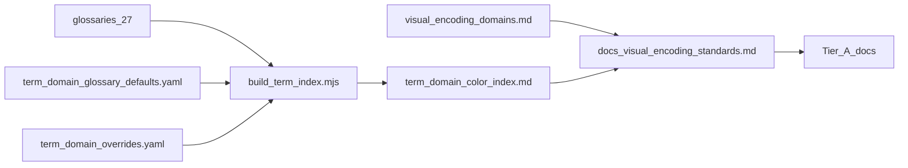
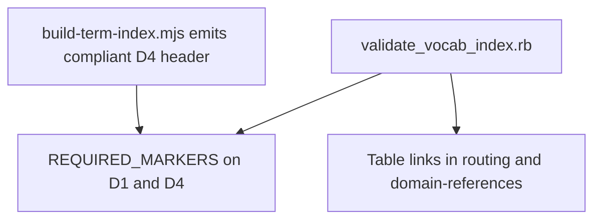

# Non-TIED plan: STDD vocabulary visual encoding

**Slug:** `stdd-vocab-visual-encoding`  
**plan_phase:** `post-build` (slice **D9** — `validate_vocab` hotfix; V11 pass 2026-11-17)  
**Source:** Cursor plan `stdd_vocab_visual_encoding_25af366b` (refined 2026-11-16 via `@non-tied-refine`)  
**Handoff:** `@non-tied-build` on slice D9, then `@non-tied-close` when V11 passes  
**Parent encoding:** [@informative-color-coding](../../../../.cursor/skills/informative-color-coding/SKILL.md)  
**Reference client:** [hl7receiver vocab-domain-color-map](https://github.com/fareedst/hl7receiver/blob/main/tied-project/non-tied-plans/vocab-domain-color-map/PLAN.md) (pattern only; paths differ)

---

## 0. Refine locks

| Topic | Decision |
| --- | --- |
| **Vocabulary source** | **27** glossary files under [`tied-project/vocab/`](../../vocab/) — all `*.md` except `routing.md`, `domain-references.md`, and the new `visual-encoding-domains.md` / index artifacts |
| **Meta index terms** | Only **Alphabetical index** rows from `routing.md` and `domain-references.md` (not routing table prose) → `dom.metaVocab` |
| **Term inventory (pre-dedupe)** | **~1003** preferred-table `| **Term** |` rows (grep 2026-11-16) plus alphabetical-index bullets; **~750–850** canonical rows post-dedupe (build reports exact count in D4 header) |
| **Domain budget** | **7** top-level `dom.*` ids — one hue per cluster in [routing.md](../../vocab/routing.md), not per glossary file |
| **Orthogonal axes** | `layer.*` (stack diagrams), `plan.*` (planning figures), `edge.*` (workflow evidence class) — **not** counted toward the 7 hue budget |
| **Term grain** | One primary `dom.*` per canonical term; optional `sub-role`; optional `layer` / `edge` only on diagram-specific index notes |
| **Extraction** | Preferred-term table **first column**; **Canonical terms** bullets; **Alphabetical index** `- **term** —`; skip `config-discovery` rows marked `(proposed)` in term text |
| **Build assistance** | [`evidence/build-term-index.mjs`](./evidence/build-term-index.mjs) reads glossaries + [`term-domain-glossary-defaults.yaml`](../../vocab/term-domain-glossary-defaults.yaml) + [`term-domain-overrides.yaml`](../../vocab/term-domain-overrides.yaml) |
| **Color authority** | Hex fills/strokes in D1/D1b; Mermaid `classDef` names are **stable API** (see §2.1) |
| **Tier A** | Sponsor-locked: hub + T1–T4 diagrams; T5 optional if T1–T4 complete |
| **Glossary edits** | No color columns in source glossaries; parallel map in D1/D4 only |
| **TIED track** | No REQ/ARCH/IMPL minting; no product/CSS changes except **docs-only** Tier A Mermaid |
| **D8 catalog depth (refined 2026-11-17)** | `[PROC-VOCABULARY_INDEX]` membership requires **table rows** in `routing.md` (`## Glossary routing table`) and `domain-references.md` (`## Canonical glossaries`) — cross-topic prose in § Cross-topic notes does **not** satisfy `validate_vocab_index.rb` |
| **D1/D4 glossary skeleton (refined 2026-11-17)** | `visual-encoding-domains.md` and `term-domain-color-index.md` are glossary `*.md` files — must match `scripts/validate_vocab_index.rb` `REQUIRED_MARKERS` (canonical H1, Traceability, See also, `## Alphabetical index`) |

### Costly choices (accepted)

| Choice | Ladder | Decision |
| --- | --- | --- |
| Seven domains vs 27 glossaries | Reversible | Defaults file maps each glossary → one `dom.*`; overrides for cross-topic terms |
| `dom.governanceChoice` rose family | Reversible | Keeps sponsor/Jev/investigation separate from assurance purple and corpus blue (CVD vs green) |
| Automated index + YAML overrides | Reversible | Required at ~1000 rows; overrides stay human-reviewable |
| D8 cross-links: index files only | Reversible | **Do not** add See-also to all 27 glossaries in v1 — only `routing.md`, `domain-references.md`, and D1 hub (deferred D8b) |
| BBCE under `dom.evidenceAssurance` | Reversible | Proof/boundary vocabulary aligns with QA/fidelity, not CASE practice selection |

---

## 1. Resolved terms (meta-vocabulary)

| Term | Meaning |
| --- | --- |
| **Semantic domain** | Stable id `dom.<name>` for where a concept “lives” in diagrams and tables |
| **Sub-role** | Finer fill under a parent `dom.*` (e.g. `methodologyBundle`, `projectYaml`, `tokenRegistry`, `proofBoundary`, `junction`) |
| **Layer axis** | `layer.*` — vocabulary / CITDP / REQ / ARCH / IMPL / tests / LEAP stack (orthogonal to `dom.*`) |
| **Plan axis** | `plan.*` — proposed / pending / reference planning figures |
| **Edge axis** | `edge.*` — verified / derived / declared workflow evidence (stroke style) |
| **Term-domain index** | Glossary term → primary `dom.*` (+ optional sub-role / notes) |
| **Glossary default** | File-level primary domain when term has no override |

### Glossary → default domain (D2 seed)

| Glossary file | Default `dom.*` |
| --- | --- |
| `tied-methodology.md` | `dom.tiedCorpus` |
| `tied-yaml-mcp.md` | `dom.tiedCorpus` |
| `tied-product-configuration.md` | `dom.tiedCorpus` |
| `async-methodology.md` | `dom.tiedCorpus` |
| `feature-orchestration.md` | `dom.tiedCorpus` |
| `leap-proposal-queue.md` | `dom.tiedCorpus` |
| `feedback-to-tied.md` | `dom.tiedCorpus` |
| `config-discovery.md` | `dom.tiedCorpus` |
| `agentstream.md` | `dom.agentSurface` |
| `agent-stream-ruby.md` | `dom.agentSurface` |
| `prompt-composer.md` | `dom.agentSurface` |
| `project-operations-mcp.md` | `dom.agentSurface` |
| `harness-platform-taxonomy.md` | `dom.harnessBench` |
| `harness-model-eval.md` | `dom.harnessBench` |
| `harness-metering-canary.md` | `dom.harnessBench` |
| `quality-assurance.md` | `dom.evidenceAssurance` |
| `fidelity-research.md` | `dom.evidenceAssurance` |
| `easar-recovery.md` | `dom.evidenceAssurance` |
| `edpc-comprehension.md` | `dom.evidenceAssurance` |
| `process-certification-readiness.md` | `dom.evidenceAssurance` |
| `behavior-bounded-change-engineering.md` | `dom.evidenceAssurance` |
| `operating-environment-externalities.md` | `dom.adaptivePractice` |
| `context-adaptive-engineering.md` | `dom.adaptivePractice` |
| `residuality.md` | `dom.adaptivePractice` |
| `pseudocode-and-citdp.md` | `dom.adaptivePractice` |
| `external-investigation-mcp.md` | `dom.governanceChoice` |
| `decision-copilot.md` | `dom.governanceChoice` |
| `sponsor-agent-relationship.md` | `dom.governanceChoice` |

---

## 2. Semantic domains (7) and Mermaid anchors

| Domain ID | Fill | Stroke | Mermaid `classDef` (stable) |
| --- | --- | --- | --- |
| `dom.tiedCorpus` | `#e7f0ff` | `#003366` | `domTiedCorpus` |
| `dom.agentSurface` | `#e0f7fa` | `#006064` | `domAgentSurface` |
| `dom.harnessBench` | `#fff3e0` | `#e65100` | `domHarnessBench` |
| `dom.evidenceAssurance` | `#f3e5f5` | `#7b1fa2` | `domEvidenceAssurance` |
| `dom.adaptivePractice` | `#e8f5e9` | `#2e7d32` | `domAdaptivePractice` |
| `dom.governanceChoice` | `#fce4ec` | `#880e4f` | `domGovernanceChoice` |
| `dom.metaVocab` | `#f5f5f5` | `#616161` | `domMetaVocab` |

### 2.1 Sub-roles (`dom.tiedCorpus` and others)

| Parent | Sub-role | Fill | Stroke |
| --- | --- | --- | --- |
| `dom.tiedCorpus` | `methodologyBundle` | `#eceff1` | `#455a64` |
| `dom.tiedCorpus` | `projectYaml` | `#e7f0ff` | `#003366` |
| `dom.tiedCorpus` | `tokenRegistry` | `#c5cae9` | `#283593` |
| `dom.evidenceAssurance` | `proofBoundary` | `#ede7f6` | `#6a1b9a` |
| `dom.metaVocab` | `junction` | `#f5f5f5` | `#616161` |

### 2.2 Orthogonal axes (locked literals)

**`layer.*` (vocabulary-layer diagram)**

| Layer id | Fill | Stroke | `classDef` |
| --- | --- | --- | --- |
| `layer.vocab` | `#e8f5e9` | `#2e7d32` | `layerVocab` |
| `layer.citdp` | `#fff9c4` | `#f9a825` | `layerCitdp` |
| `layer.req` | `#e7f0ff` | `#003366` | `layerReq` |
| `layer.arch` | `#e1bee7` | `#6a1b9a` | `layerArch` |
| `layer.impl` | `#ffe0b2` | `#ef6c00` | `layerImpl` |
| `layer.tests` | `#b2dfdb` | `#00695c` | `layerTests` |
| `layer.leap` | `#f8bbd0` | `#c2185b` | `layerLeap` |

**`plan.*`**

| Plan id | Fill | Stroke | `classDef` |
| --- | --- | --- | --- |
| `plan.proposed` | `#e7f0ff` | `#003366` | `planProposed` |
| `plan.pending` | `#fff3e0` | `#e65100` | `planPending` |
| `plan.reference` | `#eceff1` | `#455a64` | `planReference` |

**`edge.*` (stroke only — no fill hue)**

| Edge id | Stroke style | Mermaid |
| --- | --- | --- |
| `edge.verified` | solid 2px | default link |
| `edge.derived` | dashed | `-.->` |
| `edge.declared` | dotted | `-.->` with comment in legend |

### 2.3 Term → domain precedence

1. **Override file** (`term-domain-overrides.yaml`) beats glossary default.
2. **Where persistence / write authority** is the distinction → `dom.tiedCorpus` + sub-role (`projectYaml` vs `methodologyBundle` vs MCP tool surface).
3. **Operator execution** (`tied agentstream`, bundled skills, prompt-type router) → `dom.agentSurface`.
4. **Harness benchmarking / HMEP** → `dom.harnessBench`.
5. **Proof, gates, fidelity, EDPC/EASAR/certification, BBCE** → `dom.evidenceAssurance`.
6. **CITDP, pseudo-code, CASE, residuality, OEE** → `dom.adaptivePractice`.
7. **Sponsor agency, Jev, external investigation MCP** → `dom.governanceChoice`.
8. **Cross-glossary duplicates** → one index row; **Notes** lists both sources.

### 2.4 Fixed edge cases (override seed — D3)

Build must ship these rows in `term-domain-overrides.yaml` (extend when V1 finds gaps).

| Term | Primary domain | Sub-role / notes |
| --- | --- | --- |
| **dual MCP seam** | `dom.governanceChoice` | Distinct from harness/platform seam (matrix §2 row 13) |
| **harness/platform seam** | `dom.harnessBench` | Traefik comparison vocabulary — not TIED MCP write authority |
| **harness profile** | `dom.agentSurface` | Prompt-type / prompt-composer sense; taxonomy “vendor harness” stays in `dom.harnessBench` when term is **vendor agent harness** |
| **vendor agent harness** | `dom.harnessBench` | Sponsor taxonomy term |
| **tied agentstream** | `dom.agentSurface` | TypeScript default operator path |
| **agent-stream** | `dom.agentSurface` | Historical Ruby — same domain, note in index |
| **run-feature-batch** | `dom.agentSurface` | Shell driver; not vendor harness |
| **Domain vocabulary** | `dom.adaptivePractice` | Vs IMPL **grammar** vocabulary → stays in same glossary file default |
| **IMPL grammar vocabulary** | `dom.adaptivePractice` | INPUT/OUTPUT/DATA — not `dom.tiedCorpus` token registry |
| **vocabulary layer** | `dom.tiedCorpus` | Agent-control / vocab index concepts in `tied-methodology.md` |
| **agent-control layer** | `dom.tiedCorpus` | PROC-VOCABULARY_INDEX touchpoints |
| **checker-backed claim** | `dom.evidenceAssurance` | QA glossary owns definition |
| **theorem statement** | `dom.evidenceAssurance` | Same |
| **REA Evidence** | `dom.governanceChoice` | External investigation seam |
| **evidence chain profile** | `dom.evidenceAssurance` | Not EDPC claims ledger |
| **claims-ledger** | `dom.evidenceAssurance` | EDPC glossary |
| **EASAR** | `dom.evidenceAssurance` | Mode C receipts |
| **edpc_full** | `dom.evidenceAssurance` | Deprecated alias noted in index |
| **reversible choice** / **costly choice** | `dom.governanceChoice` | Sponsor-agent glossary |
| **PROC-*** process names** | `dom.tiedCorpus` | `tokenRegistry` when diagrammed as tokens |

---

## 3. Problem and placement

Authors of diagrams, comparison docs, and workflow hubs need **one project-wide** mapping from the committed STDD vocabulary corpus to accessible colors—without minting TIED tokens or editing product CSS. Hue alone is insufficient; domain id + label + stroke/shape carry meaning per [@informative-color-coding](../../../../.cursor/skills/informative-color-coding/SKILL.md).



---

## 4. Deliverables (`@non-tied-build`)

| # | Artifact | Path |
| --- | --- | --- |
| D1 | Domain registry + encoding sheet + accessibility gate | [`tied-project/vocab/visual-encoding-domains.md`](../../vocab/visual-encoding-domains.md) |
| D1b | Machine-readable palette | [`tied-project/vocab/visual-encoding-domains.v1.yaml`](../../vocab/visual-encoding-domains.v1.yaml) |
| D2 | Glossary defaults | [`tied-project/vocab/term-domain-glossary-defaults.yaml`](../../vocab/term-domain-glossary-defaults.yaml) |
| D3 | Term overrides | [`tied-project/vocab/term-domain-overrides.yaml`](../../vocab/term-domain-overrides.yaml) |
| D4 | Term index | [`tied-project/vocab/term-domain-color-index.md`](../../vocab/term-domain-color-index.md) |
| D5 | Index builder | [`evidence/build-term-index.mjs`](./evidence/build-term-index.mjs) |
| D6 | Docs hub | [`docs/visual-encoding-standards.md`](../../../docs/visual-encoding-standards.md) |
| D7 | Tier A diagram edits | §5 |
| D8 | Catalog links | `routing.md` + `domain-references.md` cross-topic note → D1/D6 |
| D9 | Vocab gate compliance | D1/D4 skeleton + catalog **tables** + builder regen — closes `test-all` **`validate_vocab`** |

---

## 4b. Slice D9 — `validate_vocab` hotfix (2026-11-17)

**Trigger:** `ruby scripts/validate_vocab_index.rb .` fails after D1–D8 close-out (`test-all` step 7). Methodology layer (`tied-bundle/vocab/` stubs) resolves to client canonical text — fix **`tied-project/vocab/`** only.

**Root cause:** D8 wired cross-topic prose and one `routing.md` row for D1 but treated D4 as a data artifact, not a glossary. V6 in `test-strategy.md` did not run the repo vocab gate.



### D9 satisfaction criteria

| Id | Criterion | Evidence |
| --- | --- | --- |
| SC-D9-01 | `ruby scripts/validate_vocab_index.rb .` exit **0** | Command output |
| SC-D9-02 | D4 regen via `build-term-index.mjs` keeps **1083** rows (±0) | `**Row count:**` header |
| SC-D9-03 | Second regen produces **zero diff** on D4 after builder template lock | V5 + V11 |
| SC-D9-04 | `tied-bundle/vocab/` stub resolution passes without stub-only edits | Implicit when SC-D9-01 passes |

### D9 execution order (do not reorder)

1. **`patch-index-builder-template`** — In [`evidence/build-term-index.mjs`](./evidence/build-term-index.mjs) `buildMarkdown()`: H1 `# Term domain color index (canonical)`; add `**Traceability:**` + `**See also:**`; emit `domain-references` / `routing` source sections; full table under `## Master index (alphabetical)`; compact `## Alphabetical index` (`Term | Section`) for `validate_vocab_index.rb`.
2. **`patch-visual-encoding-domains-skeleton`** — Hand-edit [`tied-project/vocab/visual-encoding-domains.md`](../../vocab/visual-encoding-domains.md): `# Visual encoding semantic domains (canonical)`; Traceability / See also blocks (mirror D9 traceability pattern in step 1); `## Alphabetical index` with `Term \| Section` rows only for strings **present** in the file body (seven `dom.*` ids, sub-roles in § Sub-roles, `layer.*` / `plan.*` / `edge.*` axis labels, legend names **TiedCorpus** … **PlanFigure**). Follow [`harness-metering-canary.md`](../../vocab/harness-metering-canary.md) shape.
3. **`regenerate-term-index`** — `node tied-project/non-tied-plans/stdd-vocab-visual-encoding/evidence/build-term-index.mjs`
4. **`patch-vocab-catalog-tables`** — [`routing.md`](../../vocab/routing.md): add row for `term-domain-color-index.md` (keywords: term domain color map, `dom.*` lookup, diagram coloring, `build-term-index.mjs`). [`domain-references.md`](../../vocab/domain-references.md): add **Canonical glossaries** table rows for `visual-encoding-domains.md` and `term-domain-color-index.md` (priority `—`, aligned with routing).
5. **`verify-vocab-gate`** — `ruby scripts/validate_vocab_index.rb .`; update [`test-strategy.md`](./test-strategy.md) V11 row.

### D9 traceability copy (paste into D1/D4)

```markdown
**Traceability:** [`[PROC-VOCABULARY_INDEX]`](../../tied-bundle/docs/processes.md) · [stdd-vocab-visual-encoding PLAN](../non-tied-plans/stdd-vocab-visual-encoding/PLAN.md) · [@informative-color-coding](../../../../.cursor/skills/informative-color-coding/SKILL.md)

**See also:** [`routing.md`](routing.md) · [`domain-references.md`](domain-references.md) · [`visual-encoding-domains.md`](visual-encoding-domains.md) · [`term-domain-color-index.md`](term-domain-color-index.md) · [`docs/visual-encoding-standards.md`](../../docs/visual-encoding-standards.md)
```

Adjust relative links per file (D4 See also must link D1; D1 See also must link D4).

### D9 out of scope

- Changing `validate_vocab_index.rb` to exempt D4 or skip alphabetical validation
- npm audit / `install-scripts` warnings from `test-all` step 6
- D8b per-glossary See also on all 27 files

---

## 5. Tier A diagram apply (docs only)

After each fence: palette comment `%% palette: docs/visual-encoding-standards.md`, applicable `classDef` lines, `:::className` on nodes, **Visual encoding** legend (domain ids + edge styles).

| Id | File | Fences | Focus |
| --- | --- | ---: | --- |
| T1 | [`docs/stdd-workflows.md`](../../../docs/stdd-workflows.md) | 14 | W1–W6: corpus/MCP, agentstream, verify/gates; `edge.*` in prose |
| T2 | [`docs/vocabulary-layer-tied-leap-citdp.md`](../../../docs/vocabulary-layer-tied-leap-citdp.md) | 1 | `layer.*` on stack nodes |
| T3 | [`docs/tied-domain-vocabulary-architecture.md`](../../../docs/tied-domain-vocabulary-architecture.md) | 2 | steward/client/bundle partitions → `dom.tiedCorpus` sub-roles |
| T4 | [`docs/comparisons/traefik-harness-platform-vs-tied-agent-management.md`](../../../docs/comparisons/traefik-harness-platform-vs-tied-agent-management.md) | 1 | `dom.harnessBench` vs `dom.tiedCorpus` |
| T5 | [`docs/tied-experience/engineer-agent-lens.md`](../../../docs/tied-experience/engineer-agent-lens.md) | 3 | Optional |

**Out of scope:** bulk `docs/comparisons/*`, `tied-project/working/**/PLAN.md`, decks, vendored trees.

---

## 6. Non-goals

- Mass Mermaid rollout (future slug `docs-visual-encoding-stdd`)
- Product `classDef`, CSS tokens, workflow-visualization skill edits in this slug
- REQ/ARCH/IMPL minting for color roles
- `(proposed)` config-discovery terms as committed obligations

---

## 7. Verification

See [`test-strategy.md`](./test-strategy.md). Build fills result table when complete.

---

## 8. Handoff

**Next:** `@non-tied-build` on slice **D9** (this folder). When V11 passes, `@non-tied-close` scoped to D9 files.

**Optional later:** D8b — one-line **See also** on each glossary pointing to D1; Tier B/C doc inventory; `@informative-color-coding` Apply on named product paths.