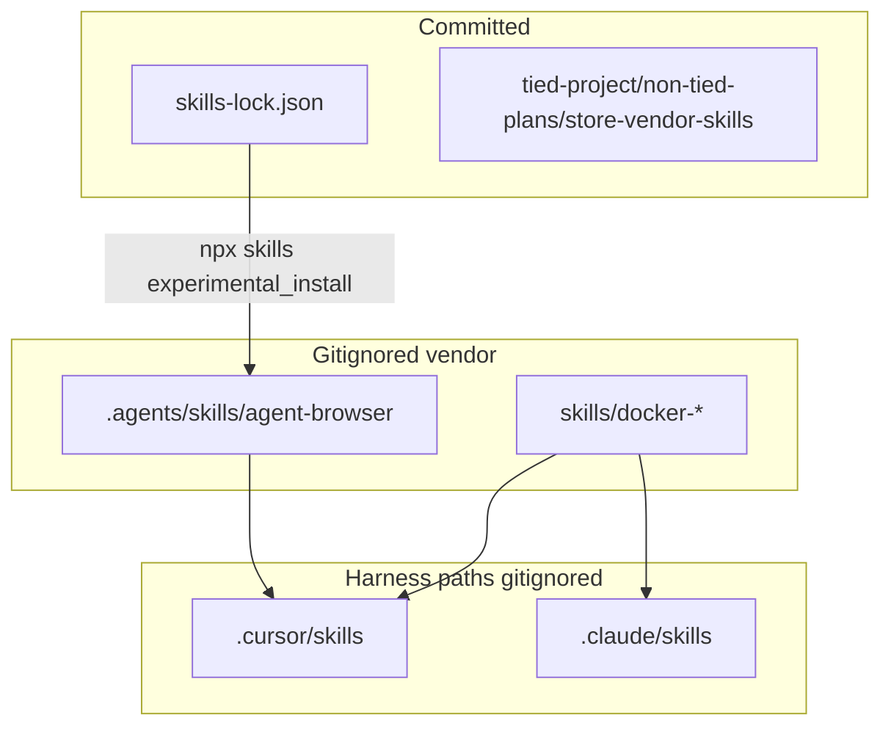

# Plan: Store vendor skills (TIED store only)

**Slug:** `store-vendor-skills`  
**Track:** `@non-tied-plan` → `@non-tied-refine` → `@non-tied-build` → optional `@non-tied-close`  
**Supersedes catalog:** unifies [docker-official-skills-import](../docker-official-skills-import/PLAN.md) (Track A) with **skills.sh** vendor skills (Track B)

## Scope

**TIED methodology store checkout only.** Gitignored third-party skill payloads plus committed **operator** docs and **`skills-lock.json`**. **Not** shipped via `tied-install`, [`tools/bootstrap/manifest.json`](../../../tools/bootstrap/manifest.json), `STORE_FACILITATOR_SKILLS`, or client-facing docs.

## Architecture

Two install tracks coexist by design (no forced unification under one directory tree):

| Track | Source | Canonical on disk | Harness discovery |
| --- | --- | --- | --- |
| **A — Docker official** | [docker/skills](https://github.com/docker/skills) (manual `cp` or release tarball) | `skills/docker-*/` (gitignored) | Symlink `.cursor/skills/<name>` and `.claude/skills/<name>` → `../../skills/<name>` |
| **B — skills.sh** | [vercel-labs/agent-browser](https://github.com/vercel-labs/agent-browser) | `.agents/skills/agent-browser/` (gitignored) | [skills CLI](https://skills.sh) installs to `.agents/skills/`; Cursor lists project skill there |



## Inventory

### Track A — Docker (12)

`docker-project-foundations`, `docker-build-strategies`, `docker-compose-patterns`, `docker-sandboxes-lifecycle`, `docker-sandboxes-network-credentials`, `docker-sandboxes-env`, `docker-sandboxes-kits`, `docker-agent-config`, `docker-agent-run`, `docker-agent-deploy`, `docker-docs`, `docker-destructive-guardrails`

Refresh: see [docker-official-skills-import evidence](../docker-official-skills-import/evidence/session-handoff.md) (`cp` + `ln -sfn` block).

### Track B — agent-browser (1)

Discovery stub from:

```bash
npx --yes skills use "https://github.com/vercel-labs/agent-browser" --skill "agent-browser"
```

(`use` emits inline `SKILL.md` only — no repo `supporting-files/` tree. Runtime workflow content comes from the **agent-browser CLI**: `agent-browser skills get core`.)

Install / refresh:

```bash
npx --yes skills add "https://github.com/vercel-labs/agent-browser" \
  --skill "agent-browser" -a cursor -y --copy
```

Operator CLI (store machine, not clients):

```bash
npm install -g agent-browser
agent-browser install
agent-browser doctor   # optional
```

Fresh clone restore:

```bash
npx --yes skills experimental_install
```

## Deliverables (`@non-tied-build`)

| Artifact | Action |
| --- | --- |
| [`.gitignore`](../../../.gitignore) | Add `.agents/skills/` under `# BEGIN TIED INSTALL MANAGED` |
| [`skills-lock.json`](../../../skills-lock.json) | Commit pin for Track B |
| This folder | `PLAN.md`, `test-strategy.md`, `evidence/session-handoff.md` |
| [docker-official-skills-import/PLAN.md](../docker-official-skills-import/PLAN.md) | One-line superseded-by pointer to this slug |
| Optional | Single sentence + link in [operator-lens.md](../../../docs/tied-experience/operator-lens.md) or store [README.md](../../../README.md) Install section — only if a natural hook exists |

## Build phases

1. **track-b-agent-browser** — `skills use` capture; `skills add`; `skills list` sanity.
2. **git-hygiene** — `.gitignore` entry; commit `skills-lock.json`; confirm vendor dirs stay untracked.
3. **track-a-verify** — Confirm existing `skills/docker-*` + symlinks still valid (no re-import unless missing).
4. **operator-cli** — `agent-browser install` on operator host; smoke `agent-browser skills get core | head`.
5. **bootstrap-coexistence** — `./tied-install.sh --refresh` from store root; docker symlinks + `.agents/skills/agent-browser` survive.
6. **client-boundary** — Disposable client from `test-new-tied-client` lacks docker-* and agent-browser unless operator copies manually.

## Verification

See [test-strategy.md](test-strategy.md). Rolling log: [evidence/session-handoff.md](evidence/session-handoff.md).

## Forbidden

- Client propagation via bootstrap manifest or bundled `tools/bundled-*` skills.
- New REQ/ARCH/IMPL tokens (promote later via `@citdp-promote` if needed).
- Committed skill bodies under `skills/` or `.agents/skills/`.
- Changes to `tools/bootstrap/lib/skills.mjs` for vendor skills (bootstrap stays TIED-managed inventory only).

## Costly choices

| Choice | Consequence |
| --- | --- |
| **Commit `skills-lock.json`** | Reproducible `experimental_install`; occasional `npx skills update agent-browser` + commit on version bumps |
| **Dual layout (A vs B)** | Operators read one plan doc; two refresh procedures — acceptable to avoid re-homing 12 Docker skills into skills.sh |
| **Global `agent-browser` CLI** | Store-operator machine state; not pinned in repo (document in handoff) |

## Security / review

Skills.sh install prints a security assessment for `agent-browser` (Gen/Socket/Snyk). Operators review [skills.sh/vercel-labs/agent-browser](https://skills.sh/vercel-labs/agent-browser) before relying on the stub in production agent sessions.

## Handoff

Next: `@non-tied-build` using Plan execution steps in [evidence/session-handoff.md](evidence/session-handoff.md).
