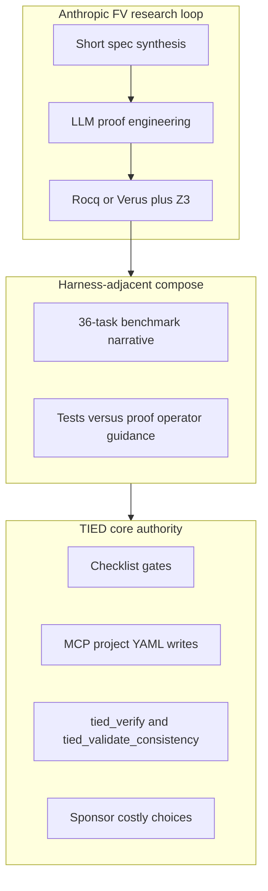

# Anthropic LLM formal verification appendix × TIED — refined plan (pass 1)

| Field | Value |
| --- | --- |
| **Working token** | `DOC-ANTHROPIC-FORMAL-VERIFICATION-COMPARISON` (outreach doc bundle; **no REQ mint**) |
| **Refined** | 2026-10-25 |
| **Source** | [Anthropic CDN PDF — Appendix: LLMs are making formal software verification feasible at a much larger scale](https://www-cdn.anthropic.com/files/4zrzovbb/website/6867eadf760258fa8b42a504600cd3c036d16358.pdf) (**2026-10-22**) — metrics **Anthropic-reported** unless stdd reproduces |
| **Process** | [external-service-three-wave-comparison-template.md](../../../tied-bundle/docs/external-service-three-wave-comparison-template.md) + [@external-service-comparison](../../../tools/bundled-prompt-type-skills/external-service-comparison/SKILL.md) |
| **Sibling pattern** | [AI-SDLC Factory × TIED](../../../docs/comparisons/ai-sdlc-atdd-software-factory-vs-tied.md) (executable proof / tests); [LangChain harness × TIED](../../../docs/comparisons/langchain-harness-engineering-vs-tied-agent-management.md) (external benchmarks); [Claude code review × TIED](../../../docs/comparisons/claude-code-team-code-review-vs-tied.md) (Anthropic engineering, different surface) |

---

## Refine (Touchpoint 1 — RESOLVE)

**PRELOAD (session):** [quality-assurance.md](../../../tied-project/vocab/quality-assurance.md) (**proof boundary**, test adequacy), [pseudocode-and-citdp.md](../../../tied-project/vocab/pseudocode-and-citdp.md) (PRE/POST, three-way alignment), [fidelity-research.md](../../../tied-project/vocab/fidelity-research.md) (advisory inquiry vs machine proof), [sponsor-agent-relationship.md](../../../tied-project/vocab/sponsor-agent-relationship.md) (consequence ladder, **RESOLVE charter**).

| Sponsor / Anthropic term | TIED canonical term | Layer | Notes |
| --- | --- | --- | --- |
| **Formal verification** (Rocq/Verus/Z3) | **Not TIED core** — research/harness-adjacent analogy | Outreach | TIED uses empirical TDD + gates, not SMT discharge |
| **Proof checker pass** | **`tied_verify`** / gate receipts (**different claim class**) | Process | Checker = theorem; TIED = test + consistency + checklist |
| **Crash** (fault, abort, unmodeled syscall) | Test failure, assert abort, unhandled error in client code | Tests | No binary RISC-V semantics in methodology |
| **ASan / mini-ASan equivalence** | Assurance profiles, build variants | Quality | **Gap** for IO/fs trace equivalence theorems |
| **Short specification** (~110 lines median, **Anthropic-reported**) | REQ criteria + IMPL **essence_pseudocode** contracts | Traceability | **Composable** — same epistemic role, different logic |
| **Verbose agent proof** | Verbose agent IMPL/YAML without abstraction | Process | Remedy: `[PROC-PSEUDOCODE_VALIDATION]`, module validation, LEAP |
| **Fuzzing displaced for proved binary** | RED tests + optional client fuzz policy | Process | **Defer** product integration; **Tension** on coverage vs proof |
| **requires / ensures / loop invariants** (Verus) | IMPL PRE/POST/EFFECTS on Active blocks | Implementation | **Align** vocabulary; **Gap** for automated proof |
| **36-task LLM benchmark** | External research bench (Terminal Bench analog) | Outreach | **Defer** TIED-hosted reproduction |
| **Assertion never fires** (LZO, p11-kit) | REQ-linked tests + property-style assertions | Tests | **Align** intent; **Gap** for branch-level proof |
| **Empirical CPython bridge** (1.7M programs, **Anthropic-reported**) | Evaluation corpus / three-way alignment sampling | Quality | **Composable**; not `[PROC-TOKEN_VALIDATION]` substitute |
| **Agent proof tooling** (encodings, tables) | Agent-generated MCP/tooling in stdd | Harness | Different artifact class (Rocq vs YAML/tests) |

**Ambiguity cleared:** Deliverables are **Wave 1 full appendix capture** (sponsor text + PDF metadata; LangChain-style body in repo, not Heimsbakk stub) + **Wave 2 analysis** with all **14** template sections. Scope is **appendix PDF only**—do not claim capture of a separate main blog post unless sponsor adds URL later. No Rocq/Verus runs in stdd.

**Adversarial / depth:** `profile_depth: **minimal**` — read-only doc outreach; no auth/network/persistence behavior change. Integrated **`tied_adversarial_inquiry_run`** **Defer**.

**Consequence ladder:**

| Decision | Class | Default |
| --- | --- | --- |
| Publish Wave 1+2 + `.gitignore` allowlist | Reversible | Proceed at **build-plan** |
| Optional read-only PDF fetch to fix headings | Reversible | Proceed if bytes differ from paste |
| P1 bundle doc “tests vs checker-backed claims” subsection | Reversible | **Defer** unless same PR scope expanded |
| `client-development-index` external-comparison row | Reversible | **Defer** |
| Matrix §2 row (formal methods / FV) | Costly | **Defer** |
| Vocab RECORD (`checker-backed claim`, `theorem statement`) | Costly | **Defer** unless sponsor asks |
| REQ: evidence envelope field for external proof artifacts | Costly | **Defer** → scoped **add-feature** |

**Gate (refine-plan):** `pre_implementation` validated with [checklist-tracker-refine.yaml](./checklist-tracker-refine.yaml); refine pass does **not** write comparison deliverables—**build-plan** / `@external-service-comparison` executes Implement section.

---

## Plan (CITDP-lite)

**Change class:** Methodology outreach — **`docs/comparisons/`** Wave 1–2 only (**no** `tied-project` REQ/ARCH/IMPL index mutation).

**Impact:**

| Area | Blast radius |
| --- | --- |
| `docs/comparisons/anthropic-llm-formal-verification-appendix.md` | New Wave 1 capture |
| `docs/comparisons/anthropic-llm-formal-verification-vs-tied-agent-management.md` | New Wave 2 analysis |
| `.gitignore` | Two new `!docs/comparisons/…` lines |
| `tied-bundle/docs/client-development-index.md` | **Defer** optional one-line link |
| `tied-project/citdp/CITDP-*.yaml` | **Defer** until Wave 3 behavior |

**Risk:**

| Risk | Mitigation |
| --- | --- |
| Anthropic metrics cited as TIED effectiveness | **Anthropic-reported** + **not_measured** on all TIED outcomes |
| Replace **`tied_checklist_gate_validate`** with “model proved it” | Authority boundary § + anti-patterns |
| Mint `[REQ-*]` from comparison prose | Token grep in test strategy; reference-only citations OK |
| Conflate **`pseudocode_validate`** with crash-freeness | Explicit non-adoptions + proof boundary |

**LEAP / CITDP persist:** **Defer** — no CITDP YAML until Wave 3 REQ.

**Out-of-scope capture:** Wave 3 table in analysis §11–12; optional `tied_feedback_operational_add` after P0 ships (**Defer**).

---

## Test strategy (doc-only)

1. **Section parity:** Wave 2 includes all **14** sections in [template order](../../../tied-bundle/docs/external-service-three-wave-comparison-template.md#required-sections-in-order).
2. **Claim labels:** Every metric (Rocq line counts, proof checker CPU time, 5/7 vs 7/7, 1.7M programs, 36 tasks, median spec size) labeled **Anthropic-reported**; TIED effectiveness **not_measured**.
3. **Token grep:** `rg` on Wave 2 body — no **new** REQ/ARCH/IMPL mint in prose (existing token **references** OK, e.g. `[REQ-TIED_ADVERSARIAL_INQUIRY]`).
4. **Links:** Relative links capture ↔ analysis, Traefik/LangChain/AI-SDLC/Claude-review siblings, bundle anchors resolve from `docs/comparisons/`.
5. **Evidence boundary:** Document states Rocq/Verus/OSS-Fuzz tasks **not** run in stdd workspace.
6. **Lint:** No `lint_yaml` / skip **`tied_validate_consistency`** when no project YAML changed.

---

## Implement (execution order — build-plan / @external-service-comparison)

### Phase 0 — Working folder + git allowlist

1. Confirm `tied-project/working/DOC-ANTHROPIC-FORMAL-VERIFICATION-COMPARISON/` (this plan, tracker, evidence).
2. Add to [`.gitignore`](../../../.gitignore) after latest comparison exceptions:

   ```gitignore
   !docs/comparisons/anthropic-llm-formal-verification-appendix.md
   !docs/comparisons/anthropic-llm-formal-verification-vs-tied-agent-management.md
   ```

### Phase 1 — Wave 1 capture

Create [docs/comparisons/anthropic-llm-formal-verification-appendix.md](../../../docs/comparisons/anthropic-llm-formal-verification-appendix.md):

- Metadata table (Source PDF, **2026-10-22**, Captured **2026-10-25**, sibling analysis link)
- **TL;DR** (5–7 bullets, **Anthropic-reported**)
- Normalized appendix sections: OSS-Fuzz proof story; Python-in-Rust/Verus; generated proof scale; human FV expert review; 36-task benchmark; assertion examples (LZO, p11-kit)
- **Notes for stdd readers:** proof boundary; link Wave 2

Optional: read-only fetch PDF to reconcile page breaks only—no proof-checker execution.

### Phase 2 — Wave 2 analysis (14 sections)

Create [docs/comparisons/anthropic-llm-formal-verification-vs-tied-agent-management.md](../../../docs/comparisons/anthropic-llm-formal-verification-vs-tied-agent-management.md):

1. Metadata table (**Purpose**, **Audience**, **Source URL**, **Article capture**, **Status**, **Executable follow-up**, **Distinct from**, **TIED anchors**)
2. Executive summary + center-of-gravity table (FV/proof-checker vs TIED traceability + empirical proof)
3. Source summary (**Anthropic-reported** bullets only)
4. Relationship to sibling comparisons (own **LLM formal verification / binary proofs**; cross-link Claude review, LangChain bench, AI-SDLC factory, Open Ontologies validation tools)
5. Harness lessons → TIED agent management (thematic subsections + mapping tables below)
6. Touchpoint 1 — RESOLVE (vocabulary table + disposition key + claim labeling)
7. Primary capability matrix (~12–15 rows; draft table in this plan)
8. Authority boundary (mermaid: proof-checker loop → harness-adjacent → TIED core)
9. Anti-patterns table
10. Compose-don’t-replace table
11. Bounded operator recommendations (numbered, **Recommendation-only**)
12. Phased recommendations (Phase 0 = this doc; P1+ **Defer** defaults)
13. Explicit non-adoptions (mandatory Rocq gate, binary-only verification replacing source tests, ASan equivalence as TIED guarantee)
14. Proof boundary + Related documents

**Harness lesson subsections (mapping table columns: External pattern | TIED surface | Notes):**

- Binary RISC-V/Linux semantics vs source traceability
- Three-theorem ASan / trace equivalence
- Short synthesized specifications vs IMPL/REQ
- Proof checker wall-clock vs `[PROC-TIED_DEV_CYCLE]` inner loop
- Verbose proofs vs modular IMPL abstractions
- Tests vs proofs (5/7 vs 7/7 injection story)
- Verus contracts vs IMPL PRE/POST
- Empirical semantics bridge (1.7M programs)
- 36-task research benchmark
- Assertions as crashes (LZO round-trip, p11-kit bounds)
- Agent-emitted proof libraries / tooling

**Back-links:** Wave 1 **Analysis (sibling)** → Wave 2 path.

### Phase 3 — Verification (P0)

Run test strategy checks; record results in `evidence/build-plan-handoff.md` when build-plan completes.

### Phase 4 — Optional P1 (Defer unless sponsor expands PR)

- Subsection in [pseudocode-writing-and-validation.md](../../../tied-bundle/docs/pseudocode-writing-and-validation.md) or quality-assurance cross-ref: **tests vs checker-backed claims**
- [client-development-index.md](../../../tied-bundle/docs/client-development-index.md) external comparison table row

---

## Wave 2 — Primary capability matrix (draft rows for analysis)

| Concern | TIED COG | Disposition | One-line rationale |
| --- | --- | --- | --- |
| Machine-checked binary crash-freeness | — | **Gap** | No RISC-V process semantics in methodology |
| Direct binary interpretation vs fuzz translation | Tests on built artifacts in clients | **Tension** | Same “ship binary” intent; different proof class |
| ASan vs normal IO/fs trace equivalence | Assurance profiles | **Gap** | No equivalence theorems in core |
| Proof checker as acceptance gate | `tied_checklist_gate_validate`, **`tied_verify`** | **Tension** | Gates = checklist/test truth, not Rocq |
| LLM as proof engineer | LLM as IMPL/test implementer | **Composable** | Different artifacts, same agent harness |
| Short formal spec synthesis | REQ criteria + concise IMPL blocks | **Composable** | **Anthropic-reported** median ~110 lines |
| Verbose proof / missing abstractions | Bloated agent pseudo-code | **Tension** | `[PROC-PSEUDOCODE_VALIDATION]` + LEAP refactor |
| Random tests miss bugs; proofs catch | RED tests + **`pseudocode_validate`** + inquiry when integrated | **Composable** | **Non-implication:** tests ≠ crash-freeness |
| Verus requires/ensures | IMPL PRE/POST/EFFECTS | **Align** | Shared contract vocabulary |
| Z3/SMT discharge | — | **Gap** | Not in TIED toolchain |
| Fuzzing elimination for proved targets | Client security/fuzz policy | **Defer** | Not TIED product scope |
| 36-task agent FV benchmark | LangChain Terminal Bench class | **Defer** | External research only |
| **`proof boundary`** on evidence claims | [quality-assurance.md](../../../tied-project/vocab/quality-assurance.md) | **Align** | Required when citing 5/7 vs 7/7 |
| Sponsor defines “what theorem counts” | Consequence ladder, CITDP scope | **Align** | Person-branch authority |
| **`tied_adversarial_inquiry_run`** | Advisory findings, not LEAP auto | **Partial align** | Not machine-checked proof |

---

## Authority boundary (reference mermaid for Wave 2 §7)



---

## Wave 3 handoff (analysis only — no execution in P0)

| Finding | Change class | Default |
| --- | --- | --- |
| Tests ≠ checker-backed claims narrative | doc-only | P1 **Defer** |
| Formal methods row in [methodology-composition-matrix.md](../../../docs/comparisons/methodology-composition-matrix.md) | matrix + sponsor | **Defer** |
| Request evidence envelope: external proof receipt type | REQ-behavior | **Defer** → **add-feature** |
| In-repo 36-task-style agent FV bench | research | **Defer** |

---

## Proof boundary (unchanged)

Anthropic appendix describes **Anthropic-reported** research outcomes. TIED does not ship Rocq/Verus/Z3 gates. Wave 3 REQ only via scoped **add-feature**. Comparison prose does not mint tokens.
