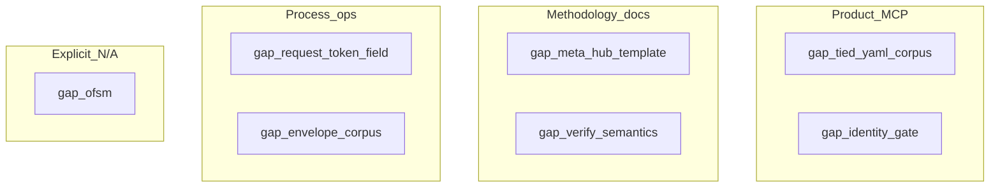

# Gap planning handoff — DOC-STDD-TIED-PROJECT-BROWNFIELD

**Purpose:** Turn [edpc-publish-manifest.v1.json](./edpc/edpc-publish-manifest.v1.json) `gaps[]` into sponsor-ready **plan seeds** (workflow, token, entry prompt).  
**Baseline:** `cf321c96` · **Close-out commit:** `944f0666`  
**Authority:** Publish gaps are **backlog**, not approved REQ scope until `@add-feature` / `@refine-plan` locks tokens.

---

## How to use this handoff

| Step | Action |
| --- | --- |
| 1 | Pick a gap row below (or batch by **theme**). |
| 2 | Open the suggested **plan folder** (create if missing). |
| 3 | Run **`@refine-plan`** on a one-page PLAN stub, then **`@build-plan`** or **`@add-feature`** when REQ/ARCH/IMPL are in scope. |
| 4 | For doc-only methodology, **`@non-tied-plan`** remains valid when no index writes are needed. |

**Themes (parallel tracks):**



---

## Gap → plan matrix

| # | Manifest gap | Class | Suggested plan token | Prompt type | Depends on | Plan seed (create) |
| --- | --- | --- | --- | --- | --- | --- |
| G1 | `minimum_field_gap:request_token` | Process / EDPC F | `PLAN-EDPC-PUBLISH-MINIMUM-FIELDS` | **Done (2026-10-31)** — hoist top-level `request_token` in publish build + DOC-shaped test | `[REQ-TIED_EDPC_COMPREHENSION]` | Manifest republished without G1 gap; see `mcp-server/src/edpc/publish-build.ts` |
| G2 | `ofsm:bundle_missing` | **N/A** (charter) | — | — | Workflow D not chartered | Document in charter: `production_touch: none` → OFSM optional; re-open only with `@add-feature` on EDPC Slice D |
| G3 | `methodology:tied_yaml_corpus_not_in_source_graph` | **Costly** product | `REQ-TIED_CORPUS_COMPREHENSION` (proposed) | `add-feature` → `refine-plan` → `build-plan` | `[REQ-TIED_SOURCE_GRAPH_COMPREHENSION]`, `[REQ-TIED_SCOPED_ANALYSIS]` | Extend static index: YAML/Markdown under `tied-project/` (token refs, detail paths); proof boundary: no runtime |
| G4 | `methodology:meta_hub_edpc_template_deferred` | Reversible methodology | `PLAN-EDPC-META-HUB-ENGAGEMENT` | `non-tied-plan` then optional `citdp-promote` | `[PROC-EDPC_COMPREHENSION]`, DOC dogfood artifacts | Template: charter + bounded_paths for `tied-project/` hub; checklist slugs A–F; link [corpus-map](./reports/tied-project-corpus-map.md) |
| G5 | `process:envelope_sample_ten_tokens_not_full_corpus` | Reversible ops | `PLAN-EVALUATION-ENVELOPE-CORPUS-FULL` | **Done (2026-10-31)** — 133-row store corpus + gap report | `[REQ-REQUEST_EVIDENCE_ENVELOPE]`, `request_evidence_envelope_batch_collect` | [envelope-corpus-manifest.v1.yaml](../../evaluation/envelope-corpus-manifest.v1.yaml), [README](../../evaluation/README.md); manifest gap may remain until republish |
| G6 | `gate:project_config_identity_key_blocks_checklist_gate_tools` | **Costly** if schema wrong | `REQ-TIED_PROJECT_CONFIG_IDENTITY` or Wave 6 follow-on | `debug` / `add-feature` | `[REQ-TIED_PROJECT_IDENTITY_MARKER_ROUTING]`, [Wave 6 plan](../REQ-TIED_INTENT_CONTROL_PLANE/PLAN-WAVE6-PATH3-MARKER-ONLY-ROUTING.md) | Reproduce: `tied_gate_check` + `tied_checklist_gate_validate` on store `tied-project/config.yaml`; align **built** MCP `tied-project-config.ts` allowlist with gate loaders; e2e gate with `identity.routing: marker_only` |
| G7 | `comprehension:req_implementation_status_requires_tied_verify` | Process / docs | `PLAN-EDPC-VERIFY-STATUS-BOUNDARY` | **Done (2026-10-31)** — sponsor docs + publish/CAM boundary | `[PROC-TIED_VERIFICATION_GATED]`, `[PROC-EDPC_COMPREHENSION]` | [PLAN-EDPC-VERIFY-STATUS-BOUNDARY](../../PLAN-EDPC-VERIFY-STATUS-BOUNDARY/PLAN.md); gap emitted by `buildEdpcPublishManifest`; manifest row may remain until republish |

---

## Per-gap plan outlines (copy into PLAN.md stubs)

### G1 — `minimum_field_gap:request_token`

**Problem:** `tied_edpc_publish_build` emitted `minimum_field_gap:request_token` when SCM shell omitted token in minimum_fields passed to the tool.

**Done when:**

- Store dogfood SCM shell includes `request_token` in `minimum_fields` (already in committed shell; enforce in tool input contract).
- Unit test in `mcp-server/src/edpc/publish-build.test.ts` for DOC-shaped shell.
- Republish manifest for DOC engagement shows gap **absent**.

**Non-goals:** New REQ unless publish schema version bumps.

---

### G2 — `ofsm:bundle_missing`

**Disposition:** **Accept / document N/A** for DOC-STDD engagement.

**Re-open when:** Sponsor charters Workflow D with `production_touch` ≠ `none` on a target repo → use existing [PLAN-slice-d-workflow-d-prod-ops.md](../REQ-TIED_EDPC_COMPREHENSION/PLAN-slice-d-workflow-d-prod-ops.md) pattern under `[REQ-TIED_EDPC_COMPREHENSION]`.

---

### G3 — `methodology:tied_yaml_corpus_not_in_source_graph`

**Problem:** Comprehension cannot trace REQ→file→IMPL sidecar via `tied_source_graph_*` alone (TS/JS only).

**Plan sketch:**

1. **Refine:** Scope — index-only vs index+detail; languages (YAML only vs + markdown pseudo-code sidecars).
2. **ARCH:** Evidence model extension (receipt kind `corpus_graph` or extend source-graph schema).
3. **IMPL:** Parser/walker under `mcp-server/src/` (new module or `source-graph` plugin); `tied_scoped_analysis_run` roots include `tied-project/requirements.yaml` references.
4. **Tests:** Fixture mini-repo with 3 REQ tokens and broken cross-ref.
5. **Dogfood:** Re-run DOC engagement slice C; replace code-only map with corpus edges in [code-to-token-map.md](./reports/code-to-token-map.md).

**LEAP touchpoints:** `[REQ-TIED_SOURCE_GRAPH_COMPREHENSION]`, possibly new `[REQ-TIED_CORPUS_COMPREHENSION]` (mint in add-feature).

---

### G4 — `methodology:meta_hub_edpc_template_deferred`

**Problem:** Full-repo + `tied-project/` hub engagements are ad hoc (this DOC folder is the first complete example).

**Deliverables (non-tied-plan friendly):**

- `tied-bundle/templates/edpc-meta-hub-engagement-charter.v1.example.yaml`
- Methodology subsection in [EDPC_Methodology_and_Workflows.md](../../../tied-bundle/docs/EDPC_Methodology_and_Workflows.md) or `tied-bundle/docs/edpc-meta-hub-engagement.md`
- Checklist slug mapping table (A–F) referencing `[PROC-EDPC_COMPREHENSION]`

**Promote when:** Template stabilizes after second dogfood (another store slice or client).

---

### G5 — `process:envelope_sample_ten_tokens_not_full_corpus`

**Problem:** [envelope-gap-report.v1.yaml](../evaluation/envelope-gap-report.v1.yaml) reflects **10** REQ tokens; ~247 working folders unaudited at batch layer.

**Plan sketch:**

1. Generate `working/evaluation/envelope-corpus-manifest.v1.yaml` — `{ request_token, envelope_artifact, tied_base_path }` per folder (script in `tools/` or MCP one-shot).
2. Run `request_evidence_envelope_batch_collect` (opt-in MCP) with full manifest; partition reports if YAML size is an issue.
3. Fix **WrongTiedBasePath** for tokens missing envelopes (e.g. `REQ-LEAP_PROPOSAL_QUEUE`, `REQ-TIED_LAYERED_CLIENT_INSTALL`) — align batch row `tied_base_path` / envelope path with [working-artifact-placement.md](../../../tied-bundle/docs/working-artifact-placement.md).
4. Add evaluation README under `tied-project/working/evaluation/README.md` (how to refresh, privacy tier).

**Non-goals:** Blocking every REQ close-out on full-corpus batch (stay advisory unless sponsor elevates).

---

### G6 — `gate:project_config_identity_key_blocks_checklist_gate_tools`

**Problem:** During DOC refine/build, `tied_checklist_gate_validate` / `tied_gate_check` returned `Unknown project config key: identity` while store `config.yaml` sets `identity.routing: marker_only`.

**Investigation order:**

1. Confirm IDE MCP uses **current** `mcp-server/dist` (rebuild if needed).
2. Source already allows `identity` in `PROJECT_CONFIG_TOP_LEVEL_KEYS` ([tied-project-config.ts](../../../mcp-server/src/tied-project-config.ts)) — if gate still fails, trace **alternate config load path** in gate validator.
3. Add regression test: store fixture config + gate `pre_implementation` minimal tracker.

**Link:** [refine-pass1-gate-note.md](./refine-pass1-gate-note.md) · Intent control plane [session-handoff](../REQ-TIED_INTENT_CONTROL_PLANE/evidence/session-handoff.md).

**Done when:** Gate tools run on store repo with committed `tied-project/config.yaml` without CONFIG_UNKNOWN_KEY.

---

### G7 — `comprehension:req_implementation_status_requires_tied_verify`

**Problem:** EDPC matrices and sponsor docs can be misread as implementation sign-off.

**Deliverables:**

- EDPC publish builder or template adds default gap string (already in manifest) + **sponsor-facing** paragraph in [tied-project-corpus-map.md](./reports/tied-project-corpus-map.md) / [stdd-workflows.md](../../../docs/stdd-workflows.md) Verification gaps.
- Optional: `tied_edpc_client_assessment_render` footnote when CAM cites REQ status.
- Claims ledger guidance in `[PROC-EDPC_COMPREHENSION]` doc: status claims → **Unknown** unless `tied_verify` receipt attached.

**Non-goals:** Auto-run `tied_verify` for all REQs during comprehension (too heavy); batch verify is separate program.

---

## Suggested sprint order (sponsor-adjustable)

| Priority | Gap | Rationale |
| --- | --- | --- |
| 1 | **G6** | Unblocks honest gates for all subsequent TIED work on store |
| 2 | **G1** | Cheap; cleans EDPC F dogfood signal |
| 3 | **G5** | Improves ops visibility without product schema |
| 4 | **G4** | Reuses DOC folder as template; lowers cost of next brownfield |
| 5 | **G7** | Doc/process; reduces misinterpretation risk |
| 6 | **G3** | Largest product slice; depends on G4 learnings |
| — | **G2** | Explicit defer until Workflow D chartered |

---

## Invocation cheat sheet

```text
@refine-plan  Plan PLAN-EDPC-META-HUB-ENGAGEMENT from tied-project/working/DOC-STDD-TIED-PROJECT-BROWNFIELD/evidence/gap-planning-handoff.md § G4

@add-feature  REQ-TIED_CORPUS_COMPREHENSION — YAML index in source graph (gap G3)

@non-tied-plan  Full evaluation envelope corpus manifest + batch (gap G5)

@debug  tied_gate_check fails with Unknown project config key identity on stdd store (gap G6)
```

---

## Related artifacts

| Artifact | Path |
| --- | --- |
| Publish manifest | [edpc-publish-manifest.v1.json](./edpc/edpc-publish-manifest.v1.json) |
| Claims ledger | [claims-ledger.v1.yaml](./edpc/claims-ledger.v1.yaml) |
| Corpus map | [tied-project-corpus-map.md](./reports/tied-project-corpus-map.md) |
| Program PLAN | [PLAN-refine-pass1.md](../PLAN-refine-pass1.md) |
| Close-out | [close-out-handoff.md](./close-out-handoff.md) |

**Feedback capture:** N/A (internal store backlog).
