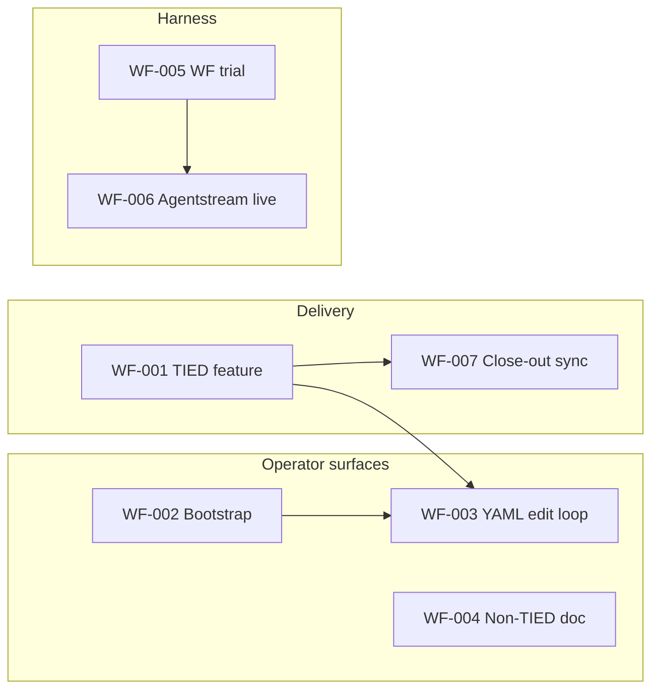

# 02 — Capabilities and workflows

| Field | Value |
| --- | --- |
| **Engagement** | `DOC-TIED-RDB-ANALYSIS` |
| **RDB phases** | 2 (capabilities) + slice 3 operator surfaces |
| **Completed** | 2026-11-18 |
| **Revision** | `c8353309` |

## Scope (slice 3)

Inventory **operator-facing capabilities** for the methodology store: requirement checklist, layered install, MCP/CLI data plane, prompt-type skills, and harness/agentstream trials. Mechanism depth for YAML topology and runtime deploy paths remains slice 4–5.

Canonical registries: `registry/capabilities.yaml`, `registry/workflows.yaml`.

## Capability summary

| ID | Capability | Serves OUT | Primary actors |
| --- | --- | --- | --- |
| CAP-001 | Agent REQ implementation checklist | OUT-001, OUT-006 | ACT-003, ACT-005 |
| CAP-002 | Layered client install | OUT-002 | ACT-002 |
| CAP-003 | MCP index read/filter | OUT-003, OUT-007 | ACT-003, ACT-004 |
| CAP-004 | MCP project index/detail write | OUT-001, OUT-004 | ACT-003, ACT-004 |
| CAP-005 | Stack consistency validation | OUT-003 | ACT-004, ACT-005 |
| CAP-006 | Prompt-type skill dispatch | OUT-006 | ACT-003, ACT-001 |
| CAP-007 | Agentstream checklist orchestration | OUT-006, OUT-007 | ACT-004, ACT-005 |
| CAP-008 | Harness WF trial execution | OUT-005, OUT-007 | ACT-005, ACT-004 |
| CAP-009 | IMPL pseudo-code validation | OUT-001, OUT-006 | ACT-003 |
| CAP-010 | Verification-gated status update | OUT-001, OUT-003 | ACT-003, ACT-004 |
| CAP-011 | Methodology refresh | OUT-002 | ACT-002 |
| CAP-012 | CLI tied-yaml without IDE MCP | OUT-007, OUT-004 | ACT-002, ACT-004 |

## Workflow map

| WF | Name | Critical CAP |
| --- | --- | --- |
| WF-001 | TIED-tracked feature delivery | CAP-001, CAP-009 |
| WF-002 | Client methodology bootstrap | CAP-002, CAP-011 |
| WF-003 | MCP YAML edit loop | CAP-003–005, CAP-012 |
| WF-004 | Non-TIED documented engagement | CAP-006 |
| WF-005 | Disposable harness WF trial | CAP-008 |
| WF-006 | Agentstream live checklist | CAP-007 |
| WF-007 | Close-out validation sync | CAP-005, CAP-010 |

## Entry-point inventory (observed)

| Surface | Representative paths / tools |
| --- | --- |
| Checklist | `tied-bundle/docs/agent-req-implementation-checklist.{md,yaml}` |
| Install | `tied-install.sh`, `tools/bootstrap/install-layers.mjs` |
| MCP | `mcp-server/src/tools/index.ts` tool names (`yaml_*`, `tied_*`, `pseudocode_*`) |
| CLI parity | `.cursor/skills/tied-yaml/scripts/tied-cli.sh` (installed to clients) |
| Prompt types | `tools/bundled-prompt-type-skills/*/SKILL.md` |
| Harness | `workflow_trial_agentstream`, `docs/agent-harness-evaluation/` |
| Agentstream | `tied agentstream`, `mcp-server/packages/agentstream/` |

## Capability ↔ outcome matrix (partial)

| OUT | CAP anchors |
| --- | --- |
| OUT-001 | CAP-001, CAP-004, CAP-010 |
| OUT-002 | CAP-002, CAP-011 |
| OUT-003 | CAP-003, CAP-005, CAP-010 |
| OUT-004 | CAP-004, CAP-012 |
| OUT-005 | CAP-008 |
| OUT-006 | CAP-001, CAP-006, CAP-007 |
| OUT-007 | CAP-003, CAP-007, CAP-008, CAP-012 |

## Gate G-2

| Criterion | Met |
| --- | --- |
| ≥10 **CAP** | Yes — 12 |
| Covers checklist | Yes — CAP-001, CAP-009 |
| Covers MCP | Yes — CAP-003–005, CAP-012 |
| Covers install | Yes — CAP-002, CAP-011 |
| ≥1 harness workflow | Yes — CAP-008, WF-005 |

## Uncertainty

| Item | Note |
| --- | --- |
| CAP coverage of every MCP tool | Slice 4+ may split CAP-003/004 by tool family |
| WF branching / cancellation | Deferred to phase 3 characterization in slice 4 |