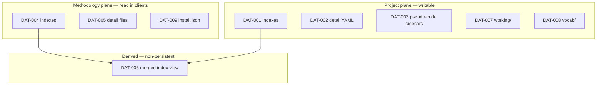

# 05 — Data, state, and integrations

| Field | Value |
| --- | --- |
| **Engagement** | `DOC-TIED-RDB-ANALYSIS` |
| **RDB phase** | 4 (slice 4 — data & traceability) |
| **Completed** | 2026-11-18 |
| **Revision** | `c8353309` |

## Data ownership model

| Plane | Directory (typical client) | Store (`stdd`) note |
| --- | --- | --- |
| **Methodology** | `tied-bundle/` | Also git-tracked at **repo root** `tied-bundle/`; MCP merge uses sibling of `tied-project/` |
| **Project** | `tied-project/` | Store project indexes + `working/` evidence (includes this RDB tree) |
| **Machine working** | `tied-bundle/working/` | Regenerable gate evidence; not client obligation data |

Canonical registries: `registry/data.yaml`, `registry/integrations.yaml`.

## Index merge semantics (observed)

Per `mcp-server/src/yaml-loader.ts` (`loadIndex`):

1. Load methodology index from resolved methodology root (`tied-bundle/`, env override, or store root).
2. Load project index from `TIED_BASE_PATH` (`tied-project/`).
3. **Shallow merge:** project token rows override methodology rows on key collision.
4. **Writes** persist **project index files only** — never the merged map.

**Linked mode:** When `.linked-methodology-view` is present and no bundle indexes are materialized, methodology root may be **null**; reads are project-only until install or env points at a bundle (DAT-009).

## State and lifecycle highlights

| Transition | Authority | Trigger |
| --- | --- | --- |
| Install / refresh | Operator | `tied-install`, `--mode linked\|full`, `--refresh` |
| Index insert/update | MCP/CLI | `yaml_index_*`, `yaml_updates_apply` |
| Detail body (IMPL) | MCP or direct edit | Sidecar `.md` preferred for large pseudo-code |
| Consistency check | MCP/CLI | `tied_validate_consistency` after edit loop |
| Methodology refresh | Operator | Overwrites `tied-bundle/` only (client); never `tied-project/` indexes |

**Migration fields (analysis):** No cutover execution in this engagement; future replacement would need DAT-004/005 fidelity proofs — noted only.

## Integration map (external MCP consumers)

| INT | Consumer | Touches |
| --- | --- | --- |
| INT-001 | Cursor IDE MCP | DAT-001–003, DAT-006 |
| INT-002 | tied-cli.sh | DAT-001–003 |
| INT-003 | Linked client → store binary | DAT-009, DAT-004 |
| INT-004 | Claude harness `.mcp.json` | DAT-001 |
| INT-005 | Agentstream | DAT-007 (evidence paths) |
| INT-006 | lint_yaml / validate_tokens | DAT-001–002 |
| INT-007 | MCP `tied://` resources | DAT-006 reads |
| INT-008 | Bundle path env overrides | DAT-004–005 |

Environment resolution for writes: `tied_config_get_base_path` reports `base_path`, `project_root`, `binding_status` (EV-005).

## Contract deepening (slice 4)

New/updated contracts in `registry/contracts.yaml`:

| ID | Theme |
| --- | --- |
| CON-016 | Shallow merge; project overrides methodology |
| CON-017 | IMPL essence in sidecar, not embedded in detail YAML |
| CON-018 | tied-cli install path authority fail-closed |
| CON-019 | Refresh scope limited to methodology tree |
| CON-020 | Detail path routing: methodology vs project token |
| CON-021 | Store mode methodology root at repo `tied-bundle/` |
| CON-022 | Linked view may yield project-only reads |

## Gate G-4

| Criterion | Met |
| --- | --- |
| DAT covers `tied-project/` vs `tied-bundle/` | Yes — DAT-001–005, DAT-010 |
| INT covers external MCP consumers | Yes — INT-001–008 |
| Traceability to CAP/WF | DAT linked to CAP-002–005 in registry |

## Residual uncertainty

| ID | Note |
| --- | --- |
| GAP-004 | Full MCP tool ↔ CAP map still open |
| GAP-005 | Per-client identity routing (`config.yaml`) not fully surveyed |