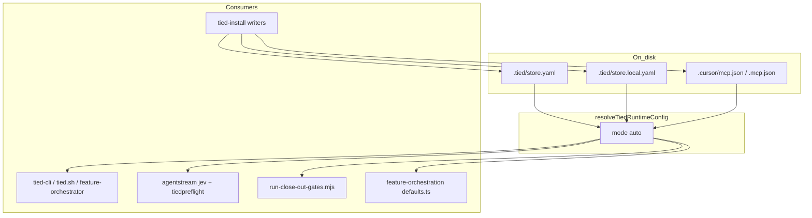

# On-disk TIED runtime configuration (refined, non-TIED)

**Workflow:** `non-tied-plan` + `refine-plan` (non-TIED boundary — no TIED YAML/vocab/CITDP writes)  
**Refine pass:** 1 (2026-11-03)  
**Prior draft:** Cursor plan `on-disk_tied_runtime_config_b2430d79`

---

## Refine (resolved intent)

| Sponsor term | Resolved meaning |
|--------------|------------------|
| **Global TIED store configuration** | Paths that identify the methodology **store root**, **MCP server dist**, client **`tied-project/`**, and linked **`tied-bundle/`**. Operators must not configure these via shell export. |
| **On-disk configuration** | Files written/maintained by **`tied-install` / `--refresh`**, read by all first-party tools at process entry. MCP IDE spawn may inject the same values as child env (transport only). |
| **Dual store + client** (sponsor choice) | **Store root:** `.tied/store.yaml` (+ gitignored local overlay). **Client checkout:** `.cursor/mcp.json` then `.mcp.json` (`tied-yaml` entry). One shared **resolver** merges by context. |
| **Feature env** | Metrics, diagnostics, agentstream bypass flags, IMPL essence stdin/file — remain env-OK. |
| **Bootstrap engine location** | Which TIED **checkout runs** `tied-install` — resolved from **`constants.mjs` / script anchor**, not operator `TIED_REPO_ROOT` (optional one-release diagnostic if set). |

**Non-goals (unchanged):** TIED REQ/ARCH/IMPL in this pass; removing MCP JSON as Cursor transport; deleting `TIED_STORE_ROOT` inside mcp.json env until all readers derive store root from `args[0]` + store yaml.

---

## Goal and policy

| Class | Examples | Policy |
|-------|----------|--------|
| **Global runtime paths** | store root, `mcp-server/dist/index.js`, `tied-project/`, linked `tied-bundle/` | **On-disk only**; **ignore** shell `TIED_MCP_BIN`, `TIED_REPO_ROOT`, `TIED_STORE_ROOT` |
| **Corpus path (existing)** | `TIED_CLIENT_PROJECT_PATH`, legacy `TIED_BASE_PATH` | Already **mcp.json-only** for `tied-cli` ([REQ-TIED_CLI_MCP_JSON_BASE_PATH](../requirements/REQ-TIED_CLI_MCP_JSON_BASE_PATH.yaml)) |
| **Feature / session toggles** | `TIED_MCP_COLLECT_METRICS`, `TIED_MCP_DIAGNOSTICS`, `AGENTSTREAM_*`, `TIED_CLI_IMPL_ESSENCE_*` | **Env OK** |

---

## Configuration surfaces

### Store — `.tied/` at methodology repo root

| File | Role |
|------|------|
| **`store.yaml`** | Committed template: `schema: tied-store-config.v1`, **relative** paths (`mcp_server.dist: mcp-server/dist/index.js`, `methodology.bundle: tied-bundle`) |
| **`store.local.yaml`** | Gitignored; **`tied-install` refresh** writes absolutes (`store_root`, resolved `mcp_server.dist`) |

Add to repo **`.gitignore`**: `.tied/store.local.yaml`

Ship template from **`tools/bootstrap/templates/.tied/store.yaml`**.

### Client — MCP JSON (unchanged writer)

[tools/bootstrap/lib/mcp-config.mjs](../../../tools/bootstrap/lib/mcp-config.mjs) / [layers/mcp.mjs](../../../tools/bootstrap/lib/layers/mcp.mjs) continue to refresh `tied-yaml` + `tied-yaml-optin`. Linked mode keeps `TIED_CLIENT_BUNDLE_PATH` + `TIED_STORE_ROOT` in **env block** (disk, not shell) until a later deprecation pass.

---

## Resolver contract

**Module:** [tools/bootstrap/lib/tied-runtime-config.mjs](../../../tools/bootstrap/lib/tied-runtime-config.mjs) (new)

```js
resolveTiedRuntimeConfig({ cwd, mode?: "auto" | "client" | "store" })
// → {
//   projectRoot,           // client git/mcp root (when client context)
//   storeRoot,
//   mcpDistPath,           // absolute, must exist for mutating tools
//   clientProjectPath?,    // when client context
//   clientBundlePath?,
//   sources: string[],     // e.g. ["mcp:.cursor/mcp.json", "store:.tied/store.yaml"]
// }
```

### Merge and precedence (`mode: auto`)

1. **Resolve client project root** — [resolveProjectRootFromCwd](../../../tools/bootstrap/lib/mcp-base-path.mjs) (git toplevel or walk-up to mcp sentinel).
2. **If valid `tied-yaml` MCP entry** at `.cursor/mcp.json` or `.mcp.json`:
   - Read full entry: `command`, `args[0]`, `env`.
   - `clientProjectPath` / `clientBundlePath` — [tied-path-env.mjs](../../../tools/bootstrap/lib/tied-path-env.mjs).
   - `mcpDistPath` = absolute `args[0]`; **fail closed** if missing or not a file.
   - `storeRoot` = `env.TIED_STORE_ROOT` if set, else **derive** from dist (`…/mcp-server/dist/index.js` → three parents up).
   - **Mismatch guard:** if both explicit `TIED_STORE_ROOT` and derived root differ → `DIAGNOSTIC: TIED_RUNTIME_CONFIG_MISMATCH`.
3. **Else locate store root** (walk up for `.tied/store.yaml` or store git markers).
4. **Load store yaml:** merge `store.yaml` + `store.local.yaml` (local wins on path keys).
5. **Monolithic store (e.g. stdd):** client mcp **and** store yaml may both exist — **client paths from mcp**; **store artifacts** from store yaml if mcp does not define them; `storeRoot` must agree with derived dist or fail closed.
6. **Else** → `DIAGNOSTIC: TIED_RUNTIME_CONFIG_MISSING` + run `./tied-install.sh`.

### Shell global env

Before resolve, CLI wrappers **unset** `TIED_MCP_BIN`, `TIED_REPO_ROOT`, `TIED_STORE_ROOT`. Optional: if any were non-empty, print **`DIAGNOSTIC: TIED_RUNTIME_IGNORED_SHELL_ENV`** (one release).

### TypeScript mirror

**`mcp-server/packages/agentstream/src/tied-runtime-config.ts`** — same logic, no runtime import from `tools/bootstrap`. **Parity:** fixture-driven tests in JS + TS (`tools/bootstrap/fixtures/tied-runtime/`).

---

## Architecture



---

## Consumer inventory (must migrate off operator env)

| Area | Files |
|------|--------|
| CLI | [tied-cli.sh](../../../tools/bundled-tied-yaml-skill/scripts/tied-cli.sh), [tied.sh](../../../tools/bundled-tied-yaml-skill/scripts/tied.sh), [feature-orchestrator.sh](../../../tools/bundled-tied-yaml-skill/scripts/feature-orchestrator.sh), [resolve-tied-cli-env.mjs](../../../tools/bundled-tied-yaml-skill/scripts/resolve-tied-cli-env.mjs) |
| Bootstrap | [bootstrap.mjs](../../../tools/bootstrap/lib/bootstrap.mjs), [mcp.mjs](../../../tools/bootstrap/lib/layers/mcp.mjs), [new-tied-client-pipeline.mjs](../../../tools/bootstrap/lib/new-tied-client-pipeline.mjs) (`resolveSourceRoot` env arm), remove **`_patch_tied_cli_repo_root`** from copy/install path |
| Agentstream | [jev-harness-shared.ts](../../../mcp-server/packages/agentstream/src/jev-harness-shared.ts), [tiedpreflight.ts](../../../mcp-server/packages/agentstream/src/tiedpreflight.ts) |
| MCP / features | [defaults.ts](../../../mcp-server/src/feature-orchestration/defaults.ts) (`TIED_MCP_BIN` / `TIED_BASE_PATH` env arms → resolver or mcp read) |
| Operator | [run-close-out-gates.mjs](../../../tools/bootstrap/templates/run-close-out-gates.mjs), [build-commands.sh](../../../scripts/build-commands.sh), [_build_commands_cli_guide.inc.sh](../../../scripts/_build_commands_cli_guide.inc.sh) |
| Introspection | [tools/index.ts](../../../mcp-server/src/tools/index.ts) `tied_config_get_base_path` — expose `store_root`, `mcp_dist`, `config_sources` from injected install env |
| Scripts (audit in implement) | [tasd.sh](../../../scripts/tasd.sh), [feature-relay.sh](../../../scripts/feature-relay.sh), [update_client.sh](../../../scripts/update_client.sh) — replace export patterns or document store-yaml-only |

**Explicitly not changing:** `constants.mjs` **`TIED_REPO_ROOT`** as **engine repo path for tests** (computed from file location); bootstrap **uses that**, not `process.env.TIED_REPO_ROOT`, for install source.

---

## Implementation phases (TDD)

**Gate (non-TIED):** RED tests for each phase before production changes.

### Phase 1 — Resolver + store yaml I/O

- Fixtures under `tools/bootstrap/fixtures/tied-runtime/`.
- `tied-runtime-config.test.mjs`: monolithic mcp-only; linked mcp; store-yaml-only; merge local overlay; derive store root; mismatch fail-closed; ignored shell env.
- `writeStoreRuntimeConfig` / `refreshStoreRuntimeLocal` called from install layer (test via `mcp-layer.test.mjs`).

### Phase 2 — CLI spawn path

- Extend `resolve-tied-cli-env.mjs` exports: `TIED_MCP_BIN`, `TIED_STORE_ROOT` (spawn only).
- Update three shell wrappers; remove baked `TIED_REPO_ROOT` from bundled scripts + stop patching in install.
- Extend `mcp-base-path.test.mjs` / `tied-cli-invoke.test.mjs`.

### Phase 3 — Agentstream + feature defaults

- TS resolver + `jev-harness-shared.test.ts` / `tiedpreflight` tests.
- `defaults.ts`: prefer disk resolver from `projectRoot`; env fallback **removed** for global paths (keep explicit API options).

### Phase 4 — Operator tooling + docs

- `run-close-out-gates.mjs`, `validate_tied`, SKILL.md, bootstrap README, README/mcp-server README snippets.
- `bootstrap-and-load.test.ts`: replace baked-`TIED_REPO_ROOT`-in-script assertions with mcp + store yaml expectations.

### Phase 5 — Migration hygiene

- Document: `./tied-install.sh --refresh` on store + each client.
- Add committed `.tied/store.yaml` to **stdd** store root on refresh.

---

## Test strategy (acceptance)

| ID | Criterion |
|----|-----------|
| AC-RESOLVE-MCP | Client with only mcp.json resolves dist + corpus without any global shell env |
| AC-RESOLVE-STORE | Store checkout with only `.tied/store.yaml` + local resolves dist for store-native scripts |
| AC-IGNORE-ENV | Setting `TIED_MCP_BIN` / `TIED_REPO_ROOT` / `TIED_STORE_ROOT` in shell does not change resolved paths |
| AC-LINKED | Linked client: store root from mcp env matches derived dist; harness finds `mcp-server/dist/jev` |
| AC-FAIL-CLOSED | Missing both surfaces → diagnostic + non-zero before MCP spawn |
| AC-INSTALL-WRITES | Refresh creates/updates `store.local.yaml` and mcp path fields |

**Commands (implement pass):**

```bash
node --test tools/bootstrap/lib/tied-runtime-config.test.mjs
node --test tools/bootstrap/lib/mcp-base-path.test.mjs tools/bootstrap/lib/tied-cli-invoke.test.mjs
cd mcp-server/packages/agentstream && npx tsx --test src/jev-harness-shared.test.ts src/tiedpreflight.test.ts
cd mcp-server && npm test -- --test-path-pattern=bootstrap-and-load
```

---

## Security mitigations

- Resolver only reads **`.cursor/mcp.json`**, **`.mcp.json`**, **`.tied/store.yaml`**, **`.tied/store.local.yaml`** under resolved project/store roots — no arbitrary path from env.
- Reject **relative** `args[0]` that escape store root after resolution (normalize + `path.relative` guard).
- Do not execute commands from config — only **`node`** + dist path already validated as existing file under store root.

---

## Documentation (same PR)

- [tools/bundled-tied-yaml-skill/SKILL.md](../../../tools/bundled-tied-yaml-skill/SKILL.md)
- [tools/bootstrap/README.md](../../../tools/bootstrap/README.md)
- Pointers only (no full tied-bundle sweep): link “runtime config” from SKILL

---

## Risks

| Risk | Mitigation |
|------|------------|
| TS/JS drift | Shared fixtures + parity test |
| Brownfield clients | Fail closed + refresh |
| `feature-orchestration/defaults` used offline | Resolver from `projectRoot`; corrective_command points to tied-install |
| Factory `TIED_REPO_ROOT` env in docs | README: engine path = checkout running install; remove env override |

---

## Implement checklist (non-TIED)

1. RED tests per phase above.
2. Implement resolver → writers → CLI → agentstream → operators → docs.
3. `npm run lint:ts` / `node --test` on touched bootstrap tests.
4. **No** TIED YAML, vocab RECORD, or CITDP writes in this work item.

---

## Todos

| ID | Content | Phase |
|----|---------|-------|
| schema-resolver | Store yaml schema, gitignore, template, `tied-runtime-config.mjs` + tests | 1 |
| mirror-ts | agentstream TS mirror + jev/preflight wiring | 3 |
| cli-bootstrap | resolve-tied-cli-env, shell scripts, remove repo-root bake, install writes store local | 2 |
| operators-docs | close-out gates, build-commands, SKILL, READMEs | 4 |
| e2e-migration | bootstrap-and-load, mcp-layer, rollout note | 5 |

**Optional follow-up:** `add-feature` for `[REQ-TIED_RUNTIME_DISK_CONFIG]` if sponsor wants TIED traceability.

---

## Implement status (2026-11-03)

Delivered: `tools/bootstrap/lib/tied-runtime-config.mjs`, store template **`.tied/store.yaml`**, install refresh via **`installMcpLayer`**, CLI/shell resolver exports, agentstream disk resolution, close-out gates, **`validate_tied`**, docs (SKILL + bootstrap README). Run **`./tied-install.sh --refresh`** on store and clients to materialize **`.tied/store.local.yaml`** and refresh mcp paths.
