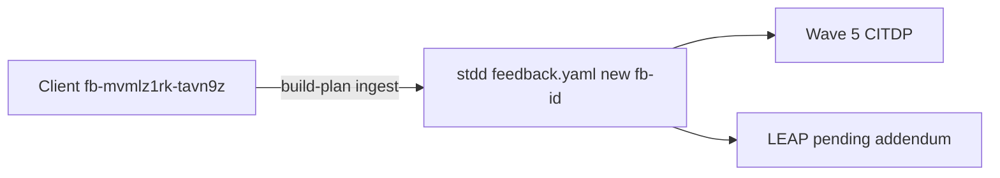

# PLAN-CLOSE-OUT-W5-FIELD-FEEDBACK

| Field | Value |
| --- | --- |
| **Token** | `PLAN-CLOSE-OUT-W5-FIELD-FEEDBACK` |
| **Depth** | `profile_depth` / `depth_tier`: **minimal** · `gate_policy`: **advisory** |
| **Profiles** | `research_profile`: read-only · `assurance_profile`: baseline-functional · `eligibility_triggers_matched`: [] |
| **Client source** | `/Users/fareed/Documents/dev/test/1792857852` (TIED 4.0.0 greenfield demo) |
| **Source feedback id** | `fb-mvmlz1rk-tavn9z` (client-local; store copy gets new `fb-*` id) |
| **Status** | **traceable-commit** pending (2026-10-24) — verification complete; git commit in progress |
| **Related REQ** | [REQ-TIED_CHECKLIST_GATE_ENFORCEMENT](../../requirements/REQ-TIED_CHECKLIST_GATE_ENFORCEMENT.yaml) (Wave 5 field evidence, not owner) |

---

## Refine (Touchpoint 1 — RESOLVE)

| Term | Resolution |
| --- | --- |
| **feedback entry** | Client row `fb-mvmlz1rk-tavn9z` in client `tied-project/feedback.yaml` — full **methodology_improvement** body (not placeholder). |
| **feedback store** | Project YAML `tied-project/feedback.yaml` under `{TIED_BASE}` — not a central SQL DB ([ARCH-FEEDBACK_STORAGE](../../architecture-decisions/ARCH-FEEDBACK_STORAGE.yaml)). |
| **close-out completion pass** | Normative recovery within **traceable-commit** when machine **close_out** passes early but **sub-close-out-evidence-sync** (disposition sync, reconcile, dual-write) does not — sponsor term from client feedback item 1. |
| **Track A + B (lightweight)** | **Reversible default:** ingest store copy with `context` links only (**Track A**); open **pending** LEAP for doc/skill addendum (**Track B**). Wave 5 tooling CITDP remains primary implementation owner. |

**Vocabulary PRELOAD:** [feedback-to-tied.md](../../vocab/feedback-to-tied.md) — `methodology_improvement`, `promotion_status`, `tied_feedback_add`, `tied_feedback_export`, Kaizen **review bridge** (explicit only).

**Consequence ladder:**

| Choice | Ladder | Disposition |
| --- | --- | --- |
| Store ingest via MCP | Reversible | Default for build-plan |
| Git commit of `feedback.yaml` | Costly | Sponsor-only at **traceable-commit** |
| New REQ slice for completion pass | Costly | Only after LEAP **approve**; defer to post-ingest |
| Wave 5 code changes in this token | Costly | **Out of scope** |

**Ambiguity cleared:** Client already captured feedback; this PLAN only upstream **tracking** into `stdd`, not re-capture on client.

**Alignment (field → methodology):**

- Same failure mode as [CITDP-REQ-TIED_CHECKLIST_GATE_ENFORCEMENT-wave5-process-adherence.yaml](../../citdp/CITDP-REQ-TIED_CHECKLIST_GATE_ENFORCEMENT-wave5-process-adherence.yaml).
- Client evidence: `.../1792857852/tied-project/working/REQ-GLOSSARY_RENAME_CHECK/evidence/close-out-handoff.md`.
- Dogfood cross-link: [PLAN-TIED-4.0-RESPONSE-STAMP](../PLAN-TIED-4.0-RESPONSE-STAMP/PLAN.md) integrated close-out at v4.0.0 tag.

**Gap vs Wave 5 CITDP:** Items 1, 4, 5 in client body (checklist handoff slug, tied-yaml **close-out recovery**, optional kaizen hook) are **documentation/skill addendum** — tag as LEAP scope, not Wave 5-D1–D11 alone.

---

## Plan process tools (refine-plan — DAE)

| Check | Result |
| --- | --- |
| `tied-project/config.yaml` `dae.crap_threshold` | CRAP adjunct inactive for this PLAN (no diff-scoped CRAP) |
| BBCE | **not_applicable** |
| `tied_gate_check` `pre_implementation` | **allowed: true** (2026-10-24 refine-plan) |
| JEV vocab shadow | Advisory; keywords: feedback-to-tied, close-out |

**Skill boundary:** Refine pass stops before **Implement** — no `tied_feedback_add` until `@build-plan`.

---

## Plan (CITDP + Tracker)

Full record: [CITDP-PLAN-CLOSE-OUT-W5-FIELD-FEEDBACK.yaml](./CITDP-PLAN-CLOSE-OUT-W5-FIELD-FEEDBACK.yaml) · Tracker: [checklist-tracker.yaml](./checklist-tracker.yaml)

| Item | Disposition |
| --- | --- |
| CITDP persist to `tied-project/citdp/` | **Skip** — non-behavior-changing; working copy only ([citdp-policy.md](../../../tied-bundle/docs/citdp-policy.md)) |
| Adversarial inquiry | **minimal** — `sub-adversarial-inquiry-pass` **not_applicable** |
| Test strategy | MCP add + export; no unit RED |

### Test strategy (outline)

1. `tied_config_get_base_path` → `/Users/fareed/Documents/dev/chatgpt/stdd/tied-project`.
2. `tied_gate_check` `pre_implementation` → `allowed: true`.
3. `tied_feedback_add` once with:
   - `type`: `methodology_improvement`
   - `title` / `description`: mirror client entry (or shortened description + `context.full_description_ref` if size limits)
   - `promotion_status`: `promotion_pending`
   - `context`: `source_feedback_id`, `client_repo`, `tied_version`, `related_req`, `evidence_links`, `plan_token`
4. `tied_feedback_export` (json) → row with `context.source_feedback_id: fb-mvmlz1rk-tavn9z`.
5. Optional: `tied_leap_proposal_add` pending proposal titled *close-out completion pass* (doc/skill addendum).
6. `tied_gate_check` `verification` → `allowed: true` at minimal depth.

### Traceability flow

---

## Implement (build-plan — 2026-10-24)

| Step | Action | Result |
| --- | --- | --- |
| 1 | Confirm `tied_config_get_base_path` = stdd `tied-project/` | `/Users/fareed/Documents/dev/chatgpt/stdd/tied-project` |
| 2 | `tied_gate_check` `pre_implementation` | **allowed: true** (2026-10-24 build-plan) |
| 3 | Single `tied_feedback_add` — duplicate guard via `context.plan_token` | Store id **`fb-mvmmb3lp-723euw`** @ `2026-10-24T16:33:07.837Z`; `promotion_status: promotion_pending` |
| 4 | `tied_feedback_export` | JSON in [evidence/feedback-export.v1.json](./evidence/feedback-export.v1.json); export confirms `source_feedback_id: fb-mvmlz1rk-tavn9z` |
| 5 | `tied_leap_proposal_add` (Track B) | **`lp-2026-10-24T16-33-13-575Z-707c63d33f60`** pending; linked in entry `context.leap_proposal_pending` |
| 6 | `tied_gate_check` `verification` | **allowed: true** (2026-10-24 build-plan) |
| 7 | PLAN + CITDP evidence row | This table + CITDP matrix `result: pass` |
| 8 | **Close-out** | **Deferred** — sponsor **traceable-commit** only (no `sub-close-out-evidence-sync` at minimal depth) |

**Non-goals honored:** No Wave 5 code; no new REQ without LEAP; no client `feedback.yaml` mutation.

---

## Answer summary (original question)

| Question | Answer |
| --- | --- |
| In DB? | **Yes** on client and store (`fb-mvmmb3lp-723euw`) |
| Track improvement? | **Yes** — this PLAN + ingest + Wave 5 / LEAP linkage |

---

## Gate receipts (refine-plan)

| Phase | Result | When |
| --- | --- | --- |
| `pre_implementation` | **allowed: true** | 2026-10-24 refine-plan (`tied_gate_check`, Tracker + CITDP paths) |
| `verification` | **allowed: true** | 2026-10-24 build-plan |
| `close_out` | **traceable-commit** | Git commit records store ingest + PLAN evidence (minimal depth; no integrated envelope sync) |
