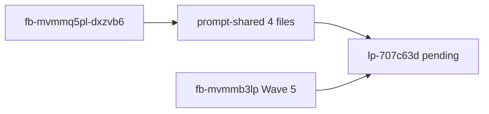

# PLAN-CLOSE-OUT-WORKSPACE-IN-PASS

| Field | Value |
| --- | --- |
| **Token** | `PLAN-CLOSE-OUT-WORKSPACE-IN-PASS` |
| **Depth** | `profile_depth` / `depth_tier`: **minimal** · `gate_policy`: **advisory** |
| **Profiles** | `research_profile`: read-only · `assurance_profile`: baseline-functional · `eligibility_triggers_matched`: [] |
| **Source feedback id** | `fb-mvmmq5pl-dxzvb6` (store; `tied-project/feedback.yaml`) |
| **Status** | **Close-out complete** — traceable-commit **`9506e55e`** (2026-10-24) |
| **Related REQ** | [REQ-TIED_CLEAR_WORKSPACE_SKILL](../../requirements/REQ-TIED_CLEAR_WORKSPACE_SKILL.yaml), [REQ-TIED_GIT_HYGIENE](../../requirements/REQ-TIED_GIT_HYGIENE.yaml), [REQ-TIED_CHECKLIST_GATE_ENFORCEMENT](../../requirements/REQ-TIED_CHECKLIST_GATE_ENFORCEMENT.yaml), [REQ-PROMPT_TYPE_GLOBAL_SKILLS](../../requirements/REQ-PROMPT_TYPE_GLOBAL_SKILLS.yaml) |
| **Sibling PLAN** | [PLAN-CLOSE-OUT-W5-FIELD-FEEDBACK](../PLAN-CLOSE-OUT-W5-FIELD-FEEDBACK/PLAN.md) |
| **Pending LEAP** | `lp-2026-10-24T16-33-13-575Z-707c63d33f60` — *Close-out completion pass (doc/skill addendum)*; **this PLAN is a second doc slice** (workspace hygiene narrative), merge summary at build-plan |

---

## Refine (Touchpoint 1 — RESOLVE)

| Term | Resolution |
| --- | --- |
| **feedback entry** | `fb-mvmmq5pl-dxzvb6` — `methodology_improvement`, *Treat workspace cleanup as part of close-out, not a separate management step* (`2026-10-24T16:44:50.409Z`). |
| **integrated workspace hygiene** | **Traceable-commit / `@close-out`** normatively includes scoped staging, **`tied_git_hygiene`** preview, **gitignore-close-out-hygiene**, and regenerable restore **for the active REQ** — not a follow-on operator habit. |
| **`@clear-workspace` role** | **Router / recovery** when scope is ambiguous, close-out stopped mid-flight, or sponsor did not name a REQ — **not** required after a **complete** close-out on a named REQ. |
| **post-REQ workspace clean** | **(a)** Scoped REQ artifacts committed or classified in the staging map; **(b)** regenerable noise under that REQ restored or deleted **in the same close-out pass**. **Unrelated** REQ trackers, CITDP drafts, and `tied-bundle/working/` gate JSON may remain dirty until those REQs close. |
| **feedback-ingest handoff** | Minimal-depth feedback PLAN complete ≠ entire store repo clean; handoff must say orthogonal REQ dirt is **expected**. |

**Vocabulary PRELOAD:** [feedback-to-tied.md](../../vocab/feedback-to-tied.md); [PLAN-HANDOFF-CLEAR-WORKSPACE-SKILLS](../PLAN-HANDOFF-CLEAR-WORKSPACE-SKILLS/PLAN.md).

**Ambiguity cleared:** Feedback body is explicit; no sponsor questions open. **Depth** stays **minimal** (prose-only; no auth/network/persistence triggers).

**Consequence ladder:**

| Choice | Ladder | Disposition |
| --- | --- | --- |
| Prompt-shared markdown edits (store `tools/bundled-prompt-type-skills/prompt-shared/`) | Reversible | **build-plan default** |
| Checklist slug bullet in `tied-bundle/docs/agent-req-implementation-checklist.yaml` | Reversible | Include if traceable-commit slug still silent on excluded drift |
| LEAP summary append on pending proposal | Reversible | build-plan step 7 |
| `context.plan_token` on feedback row via MCP | Reversible | build-plan step 6 |
| `tied_git_hygiene` summary fields | Costly | **Stretch / Wave 5** — out of default scope |
| New REQ token | Costly | LEAP approve only |

**Alignment:**

| Source | Link |
| --- | --- |
| Feedback `context.links` | `completion-signals-handoff.md`, `tied-close-out-process.md`, `traceable-commit-close-out.md`, `clear-workspace-routing.md` |
| Wave 5 field feedback | `fb-mvmmb3lp-723euw` item 1 (completion pass) — this PLAN clarifies **cleanliness semantics**; LEAP Track B should list **both** PLAN tokens after build-plan |
| Existing prose | `traceable-commit-close-out.md` already excludes unrelated drift at stage — gap is **definition + operator messaging**, not missing stage rule |

---

## Plan process tools (refine-plan — DAE + JEV)

| Check | Result |
| --- | --- |
| `tied-project/config.yaml` `dae.crap_threshold` | `30` — **CRAP adjunct inactive** (`diff_scoped_crap` not set on CITDP) |
| BBCE | **not_applicable** |
| Methodology surface enrollment | **not_applicable** — `gate_policy` unchanged; prompt-shared prose only |
| `tied_gate_check` `pre_implementation` | **allowed: true** (2026-10-24 refine-plan pass 2) |
| `tied_jev_vocab_shadow` (`skill: refine-plan`) | Advisory; `keyword_glossaries`: project-operations-mcp; service locally skipped |

**Skill boundary:** Refine stops before **Implement** — no prompt-shared edits until `@build-plan`.

---

## Plan (CITDP + Tracker)

Full record: [CITDP-PLAN-CLOSE-OUT-WORKSPACE-IN-PASS.yaml](./CITDP-PLAN-CLOSE-OUT-WORKSPACE-IN-PASS.yaml) · Tracker: [checklist-tracker.yaml](./checklist-tracker.yaml)

| Item | Disposition |
| --- | --- |
| CITDP persist to `tied-project/citdp/` | **Skip** — working copy only ([citdp-policy.md](../../../tied-bundle/docs/citdp-policy.md)) |
| Adversarial inquiry | **minimal** — `sub-adversarial-inquiry-pass` **not_applicable** |
| IMPL pseudo-code | **not_applicable** — no Active blocks |
| Client install | After merge, clients refresh prompt-shared via **`tied-install.sh --refresh`** (linked mode pulls store stubs) |

### Doc gap → build target

| File (store source) | Gap today | Build-plan acceptance |
| --- | --- | --- |
| [completion-signals-handoff.md](../../../tools/bundled-prompt-type-skills/prompt-shared/completion-signals-handoff.md) | Three signals only; no scoped workspace rule | New subsection **Workspace cleanliness (scoped REQ)** — separate from the three signals; copy-safe handoff bullet |
| [traceable-commit-close-out.md](../../../tools/bundled-prompt-type-skills/prompt-shared/traceable-commit-close-out.md) | Stage rule exists; no post-REQ clean definition | Short **Post-REQ workspace clean** + table **When `@clear-workspace` is redundant vs router** |
| [clear-workspace-routing.md](../../../tools/bundled-prompt-type-skills/prompt-shared/clear-workspace-routing.md) | Tree starts at scope; no upfront ownership | Opening **Primary hygiene lives in `@close-out`**; step 7 clarifies redundant path when close-out complete |
| [tied-close-out-process.md](../../../tools/bundled-prompt-type-skills/prompt-shared/tied-close-out-process.md) | Hygiene steps listed | One cross-link bullet to scoped vs repo-wide clean |
| [agent-req-implementation-checklist.yaml](../../../tied-bundle/docs/agent-req-implementation-checklist.yaml) `traceable-commit` | Hygiene implied via gitignore slug | Optional bullet: hygiene receipt + **document excluded unrelated drift** (minimal depth warn only) |
| [PLAN-CLOSE-OUT-W5-FIELD-FEEDBACK/PLAN.md](../PLAN-CLOSE-OUT-W5-FIELD-FEEDBACK/PLAN.md) handoff pattern | Feedback ingest implied repo clean | Add cross-link in build-plan evidence only if W5 PLAN gets a one-line note (optional) |

### Build-plan scope (ordered)

1. Edit **completion-signals-handoff.md** — scoped workspace subsection + handoff template line.
2. Edit **traceable-commit-close-out.md** — post-REQ clean definition + clear-workspace redundancy table.
3. Edit **clear-workspace-routing.md** — upfront ownership + refine step 6–7 wording.
4. Edit **tied-close-out-process.md** — single cross-link bullet.
5. **Optional:** `tied-bundle/docs/agent-req-implementation-checklist.yaml` traceable-commit slug bullet (only if step 2–3 insufficient for checklist authority).
6. **Feedback traceability** — MCP update `fb-mvmmq5pl-dxzvb6` `context.plan_token: PLAN-CLOSE-OUT-WORKSPACE-IN-PASS` and `context.related_plan_tokens` including W5 PLAN token (prefer MCP over hand-edit).
7. **LEAP cross-link** — `tied_leap_proposal_update` append to `lp-2026-10-24T16-33-13-575Z-707c63d33f60` summary: implemented slice via this PLAN (status stays **pending** until tied-yaml recovery doc lands).
8. **CHANGELOG.md** — one line under Unreleased (close-out / prompt-shared).
9. **Stretch (sponsor opt-in):** feedback item 5 tooling — defer.

### Test strategy (outline)

| # | Step | Pass criterion |
| --- | --- | --- |
| 1 | `tied_config_get_base_path` | stdd `tied-project/` |
| 2 | `tied_gate_check` `pre_implementation` | `allowed: true` (already at refine) |
| 3 | Apply markdown diffs per table above | Manual review vs acceptance column |
| 4 | `cd mcp-server && npm test -- prompt-type-skills` | SHARED_REFERENCES resolve; skill contracts pass |
| 5 | `tied_gate_check` `verification` | `allowed: true` |
| 6 | `tied_validate_consistency` | If `feedback.yaml` updated via MCP |
| 7 | `@close-out` / traceable-commit | Sponsor when ready — scoped PLAN artifacts only |

**RED policy:** No mandatory new e2e assertions unless sponsor wants phrase lock-in; existing catalog test is sufficient gate for this wave.

### Traceability flow

---

## Implement (build-plan — 2026-10-24)

| Step | Action | Result |
| --- | --- | --- |
| 1 | `tied_gate_check` `pre_implementation` | **allowed: true** |
| 2 | Prompt-shared edits (4 files) + checklist `traceable-commit` bullet | Done |
| 3 | `npm test -- prompt-type-skills` | exit 0 |
| 4 | `feedback.yaml` context `plan_token` + `related_plan_tokens` | `fb-mvmmq5pl-dxzvb6` |
| 5 | `tied_leap_proposal_update` `lp-2026-10-24T16-33-13-575Z-707c63d33f60` | Summary appended (status **pending**) |
| 6 | `CHANGELOG.md` Unreleased | Done |
| 7 | `tied_project_lint` | ok |
| 8 | `tied_gate_check` `verification` | **allowed: true** |
| 9 | Evidence | [evidence/build-plan-evidence.md](./evidence/build-plan-evidence.md) |
| 10 | **Close-out / traceable-commit** | **`9506e55e`** — [plan-close-out-handoff.md](./evidence/plan-close-out-handoff.md) |

**Non-goals honored:** No auto-restore of unrelated WIP; no repo-wide single commit; no `tied_git_hygiene` summary tooling.

---

## Gate receipts

| Phase | Result | When |
| --- | --- | --- |
| `pre_implementation` | **allowed: true** | 2026-10-24 build-plan |
| `verification` | **allowed: true** | 2026-10-24 build-plan |
| `close_out` | **complete** | **`9506e55e`** — unified gates + scoped traceable-commit |
