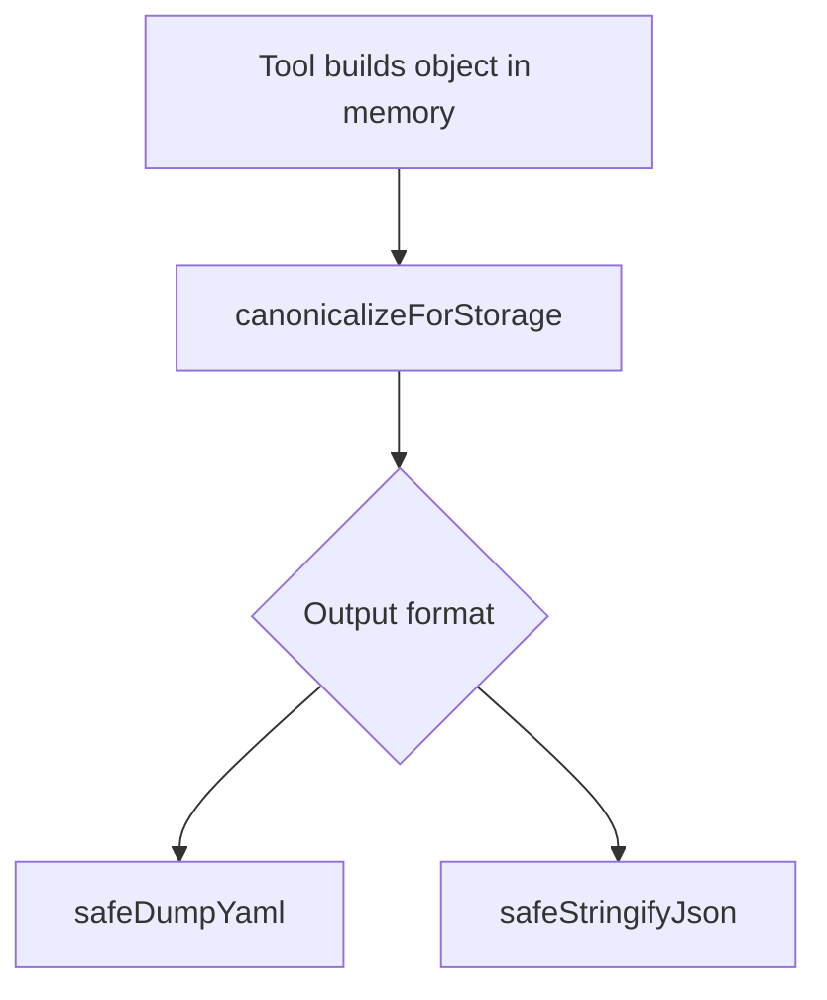

# Deterministic keys, sets, and ordered lists — refined plan (pass 1)

**Refined:** 2026-10-23  
**Working token:** `PLAN-DATA-FILE-ORDERING`  
**Parent requirement:** [REQ-TIED_YAML_CANONICALIZATION](../../requirements/REQ-TIED_YAML_CANONICALIZATION.yaml)  
**Tracker:** [checklist-tracker-refine.yaml](./checklist-tracker-refine.yaml)  
**CITDP:** [CITDP-PLAN-DATA-FILE-ORDERING.yaml](./CITDP-PLAN-DATA-FILE-ORDERING.yaml)

## Refine — sponsor intent (RESOLVE)

**Canonical terms**

| Sponsor term | TIED meaning |
| --- | --- |
| **Alphabetical keys** | Recursive map key order via `compareLexical` in [canonicalizeValue](../../../mcp-server/src/yaml-canonicalizer.ts) |
| **String set** | All-string YAML/JSON list whose order is not semantic; canonicalizer sorts on write |
| **Ordered list** | List whose document order is semantic; parent map key must match **ordered-list key** patterns |
| **Generation-time** | When MCP/tools/agents **choose field names** and assemble in-memory arrays before marshalling |

**Ambiguity resolved**

1. **`tdd_sequence` and `*_sequence`** — Adding suffix `*_sequence` makes keys like `tdd_sequence` **order-preserving**. That matches CITDP/workflow usage (ordered TDD steps). Accept as **intended**, with explicit test `ORD-TDD-SEQUENCE`.
2. **No mass rename** — Existing keys keep behavior via extended patterns; neutral names (`cross_references`, `depends_on`) remain **sets** sorted on write.
3. **JSON scope** — Sponsor chose **YAML + shared JSON profile**; ~42 production `mcp-server/src/**/*.ts` files use raw `JSON.stringify` for disk. Phase **slice 1** (hashed gate/EASAR/bounded-composition) in this change; remaining files in a follow-up slice to limit churn.
4. **TIED tracking** — `/refine-plan` supersedes the earlier non-tied-plan note: LEAP [REQ-TIED_YAML_CANONICALIZATION](../../requirements/REQ-TIED_YAML_CANONICALIZATION.yaml) is **in scope**, not optional.

**Depth and gates**

- `profile_depth`: **minimal**
- `gate_policy`: **advisory**
- Integrated adversarial inquiry **not** activated (serialization extension on existing REQ; no new external auth surface).

**Consequence ladder**

| Decision | Class | Note |
| --- | --- | --- |
| Extend ordered-key regex | Reversible | Additive patterns + tests |
| JSON byte canonicalization | **Costly** | May change pinned hashes — CHANGELOG + fixture updates |
| Mass YAML key renames | **Costly** | Out of scope |

---

## Plan — CITDP summary

### Target profile (unchanged id: `tied-yaml-canonical-v1`)

### 1. Ordered-list key detection (single contract)

**Location:** Keep `isOrderedListKey` exported from [yaml-canonicalizer.ts](../../../mcp-server/src/yaml-canonicalizer.ts); document pattern table in ARCH + metadata string.

| Family | Examples (preserve list order) |
| --- | --- |
| Existing | `order`, `order_*`, `*_order`, `*_order_*`, `steps`, `steps_*`, `*_steps`, `*_steps_*` |
| New | `_order`, `_order_*`, `_seq`, `_seq_*`, `_sequence`, `_sequence_*`, `*_seq`, `*_sequence`, `seq_*`, `sequence_*` |

**Ruby parity (same release):**

- [scripts/yaml_list_sorter.rb](../../../scripts/yaml_list_sorter.rb) `order_preserving_key?`
- [scripts/yaml_semantic_compare.rb](../../../scripts/yaml_semantic_compare.rb) `ordered_list_key?` — **fix** missing `steps*` parity while extending patterns

**LEAP before code:** Update [IMPL-TIED_YAML_CANONICALIZER-pseudocode.md](../../implementation-decisions/IMPL-TIED_YAML_CANONICALIZER-pseudocode.md) `IS_ORDERED_LIST_KEY` POST clause to include seq/sequence families and `steps*`.

### 2. Shared marshalling module

Add [mcp-server/src/storage-dump.ts](../../../mcp-server/src/storage-dump.ts):

- `canonicalizeForStorage` → `canonicalizeValue`
- `safeDumpYaml` → delegate to [safeDump](../../../mcp-server/src/yaml-dump.ts) (re-export; avoid breaking imports)
- `safeStringifyJson(obj)` → `JSON.stringify(canonicalizeForStorage(obj), null, 2) + '\n'`
- `sortStringSet(items)` → `[...items].sort(compareLexical)` for generators

### 3. Writer migration inventory

**YAML (this change — complete list)**

| Module | File |
| --- | --- |
| Request evidence batch | [batch-collect.ts](../../../mcp-server/src/request-evidence-envelope/batch-collect.ts) |
| Evidence chain report | [evidence-chain-report.ts](../../../mcp-server/src/fidelity-research/evidence-chain-report.ts) |
| Feature orchestration | [store.ts](../../../mcp-server/src/feature-orchestration/store.ts), [constitution.ts](../../../mcp-server/src/feature-orchestration/constitution.ts), [clarification.ts](../../../mcp-server/src/feature-orchestration/clarification.ts) |
| EASAR recovery | [recovery-export-v1.ts](../../../mcp-server/src/easar-receipts/recovery-export-v1.ts) |
| Methodology cohort | [methodology-learning-cohort-export/run.ts](../../../mcp-server/src/methodology-learning-cohort-export/run.ts) |
| Agentstream tracker | [tracker-atomic-write.ts](../../../mcp-server/packages/agentstream/src/tracker-atomic-write.ts) |

**JSON slice 1 (hashed / diffed artifacts)**

- [mcp-server/src/easar-receipts/](../../../mcp-server/src/easar-receipts/) MCP writers (inventory, graph-matrix, claim-matrix, reflexion, validation-results, recovery-export-mcp)
- [bounded-composition/trajectory-manifest.ts](../../../mcp-server/src/bounded-composition/trajectory-manifest.ts)
- [claims-evidence-review/run-claims-evidence-review.ts](../../../mcp-server/src/claims-evidence-review/run-claims-evidence-review.ts) (if writing canonical JSON reports)

**JSON slice 2 (follow-up)** — Remaining ~35 production files from grep inventory; do not block slice 1 on full sweep.

**Explicitly unchanged:** Test fixtures that assert pre-canonical bytes unless test purpose is determinism.

### 4. Authoring / generation conventions

| Audience | Document | Action |
| --- | --- | --- |
| Schema authors | [detail-files-schema.md](../../../tied-bundle/docs/detail-files-schema.md) | New § **Set vs ordered list keys** |
| Operators | [processes.md](../../../tied-bundle/docs/processes.md) § yaml_tool | Cross-link + JSON note |
| Agents | [tools/bundled-tied-yaml-skill/SKILL.md](../../../tools/bundled-tied-yaml-skill/SKILL.md) | Sort token sets before write; name ordered lists with `_seq_*` / `*_seq` / `*_order` |

Optional: one-line pointer in sponsor user store (`u154918804/files`) — not blocking.

### 5. Test strategy (RED-first)

| Id | Layer | Expectation |
| --- | --- | --- |
| ORD-SEQ-* | Unit TS | Prefix/suffix seq/sequence keys preserve order; ordinary keys sort |
| ORD-TDD-SEQUENCE | Unit TS | `tdd_sequence` preserves order |
| SET-SORT | Unit TS | `cross_references` sorts |
| JSON-STABLE | Unit TS | Double `safeStringifyJson` identical |
| RUBY-PARITY | Ruby | yaml_list_sorter_test.rb mirrors TS matrix |
| WRITER-SMOKE | Composition | One migrated path emits sorted keys in output |
| REC-ORDERED-KEY-PRESERVE | Regression | Existing order/steps cases still pass |

Run: `npm test --prefix mcp-server`, `ruby scripts/yaml_list_sorter_test.rb`.

### 6. REQ LEAP (required)

Add satisfaction criteria to [REQ-TIED_YAML_CANONICALIZATION](../../requirements/REQ-TIED_YAML_CANONICALIZATION.yaml) (via tied-cli / MCP):

- Ordered-list keys include `_seq` / `_sequence` naming families (documented in `yaml_format.ordered_list_key_pattern`).
- Supported JSON writers use the same canonical tree as YAML for deterministic bytes.

Update [ARCH-TIED_YAML_CANONICAL_PROFILE.yaml](../../architecture-decisions/ARCH-TIED_YAML_CANONICAL_PROFILE.yaml) `decision` text accordingly.

---

## Implement — execution order (when build-plan runs)

1. **Pseudo-code** — LEAP `IS_ORDERED_LIST_KEY`; run `pseudocode_validate` on IMPL-TIED_YAML_CANONICALIZER.
2. **RED tests** — Ordered-key + JSON stability cases.
3. **GREEN** — Pattern extension + `storage-dump.ts`.
4. **Writers** — YAML list, then JSON slice 1; update tests that pin hashes.
5. **Docs** — detail-files-schema, processes, SKILL.
6. **REQ/ARCH LEAP** — MCP writes only to `tied-project/`; `lint_yaml`; `tied_validate_consistency`.
7. **Verification gate** — `tied_verify` if tests tagged; `tied_checklist_gate_validate` phase `verification`.
8. **Close-out** — Persist CITDP to `tied-project/citdp/`; envelope sync per checklist.

**Forbidden in implement:** direct edits to index/detail YAML bypassing tied-cli; methodology `tied-bundle/` REQ edits.

---

## Gate status (refine pass)

`pre_implementation` gate (**2026-10-23**): **`allowed: true`**, `depth: minimal`, diagnostics `[]`.

Evidence: [evidence/gate-pre_implementation-refine-pass1.json](./evidence/gate-pre_implementation-refine-pass1.json)  
Invoke pattern: `tied_checklist_gate_validate` with `tracker_path: tied-project/working/PLAN-DATA-FILE-ORDERING/checklist-tracker-refine.yaml` and unwrapped CITDP inner record (not the top-level token key wrapper).

**Still pending before RED/code:** `resolve-pseudocode` → `gate-pseudocode-validation` on [IMPL-TIED_YAML_CANONICALIZER-pseudocode.md](../../implementation-decisions/IMPL-TIED_YAML_CANONICALIZER-pseudocode.md) `IS_ORDERED_LIST_KEY`.

**Next prompt type:** `@build-plan` with link to this PLAN and tracker path.
