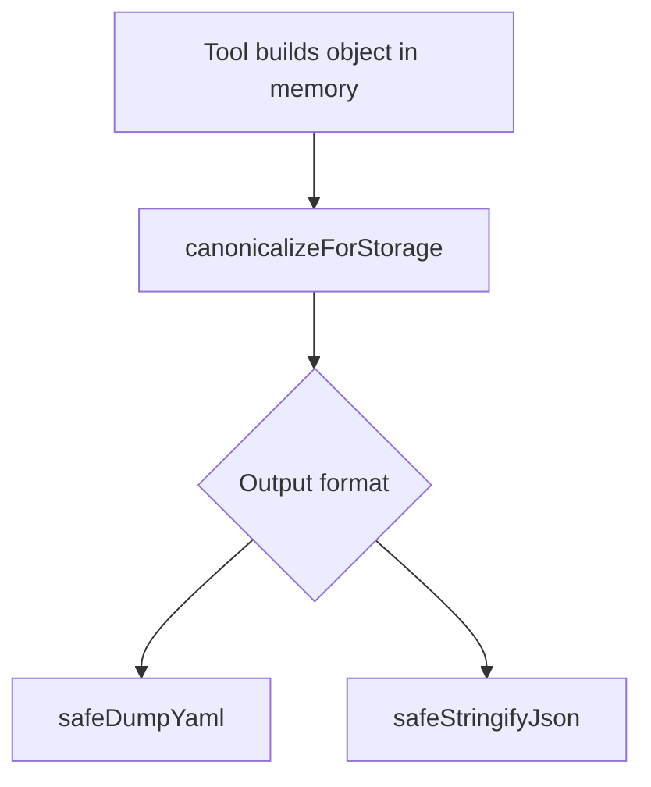

# Deterministic keys, sets, and ordered lists — refined plan (pass 2)

**Refined:** 2026-10-23 (pass 2 — inventory verified against repo)  
**Working token:** `PLAN-DATA-FILE-ORDERING`  
**Prior pass:** [PLAN-refine-pass1.md](./PLAN-refine-pass1.md)  
**Parent requirement:** [REQ-TIED_YAML_CANONICALIZATION](../../requirements/REQ-TIED_YAML_CANONICALIZATION.yaml)  
**Tracker:** [checklist-tracker-refine.yaml](./checklist-tracker-refine.yaml)  
**CITDP:** [CITDP-PLAN-DATA-FILE-ORDERING.yaml](./CITDP-PLAN-DATA-FILE-ORDERING.yaml)

## Refine — pass 2 deltas (RESOLVE)

Pass 1 intent stands (`profile_depth`: **minimal**, `gate_policy`: **advisory**). Pass 2 tightens **inventory**, **pseudo-code drift**, and **falsification** vectors after a repo read (allowed for plan accuracy).

| Topic | Pass 1 | Pass 2 correction |
| --- | --- | --- |
| YAML writer count | “11 production paths” | **8 modules, 9 `yaml.dump` call sites** (see §3); excludes tests and already-canonical paths |
| `featurespec-load-turns.ts` | Unlisted | **Out of slice** — nested scalar formatting for agentstream prompts, not TIED storage marshalling |
| `yaml-dump.ts` / `yaml-canonicalizer.ts` | Implicit | **No migration** — already call `canonicalizeValue` before `yaml.dump` |
| CITDP counterexample `resource_sequence_id` | Suffix false match | **Rejected** — suffix rule is `*_sequence` (ends with `_sequence`); `resource_sequence_id` ends with `_id` and stays a **set** |
| IMPL `IS_ORDERED_LIST_KEY` POST | seq/sequence only | Also **drifts from code today**: runtime includes `steps*` but pseudo-code POST still lists **order*** only |

**Costly choices (unchanged — sponsor confirm at build if needed)**

- JSON byte / hash churn on slice 1 artifacts  
- Any future key named `*_sequence` that was intentionally unsorted (document in CHANGELOG if discovered in fixtures)

---

## Plan — CITDP summary

### Target profile (unchanged id: `tied-yaml-canonical-v1`)

### 1. Ordered-list key detection (single contract)

**Location:** `isOrderedListKey` in [yaml-canonicalizer.ts](../../../mcp-server/src/yaml-canonicalizer.ts); mirror in Ruby; update `formatYamlMetadata().ordered_list_key_pattern`.

| Family | Examples (preserve list order) |
| --- | --- |
| Existing | `order`, `order_*`, `*_order`, `*_order_*`, `steps`, `steps_*`, `*_steps`, `*_steps_*` |
| New (sponsor) | `_order`, `_order_*`, `_seq`, `_seq_*`, `_sequence`, `_sequence_*`, `*_seq`, `*_sequence`, `seq_*`, `sequence_*` |

**Implementation note (build-plan):** extend the existing anchored regex in TS; keep Ruby `order_preserving_key?` / `ordered_list_key?` logically equivalent (semantic compare today lacks **both** `steps*` and seq families — fix in one change set).

**Draft metadata string (replace `ordered_list_key_pattern` in tests + ARCH):**

`order|order_*|*_order|*_order_*|steps|steps_*|*_steps|*_steps_*|_order|_order_*|_seq|_seq_*|_sequence|_sequence_*|*_seq|*_sequence|seq_*|sequence_*`

**LEAP before code:** [IMPL-TIED_YAML_CANONICALIZER-pseudocode.md](../../implementation-decisions/IMPL-TIED_YAML_CANONICALIZER-pseudocode.md) — rewrite `IS_ORDERED_LIST_KEY` POST to list **order**, **steps**, and **seq/sequence** families (match TS + metadata string above).

### 2. Shared marshalling module

Add [mcp-server/src/storage-dump.ts](../../../mcp-server/src/storage-dump.ts):

- `canonicalizeForStorage` → `canonicalizeValue`
- `safeDumpYaml` → delegate to [safeDump](../../../mcp-server/src/yaml-dump.ts) (re-export for migration ergonomics)
- `safeStringifyJson(obj)` → `JSON.stringify(canonicalizeForStorage(obj), null, 2) + '\n'`
- `sortStringSet(items)` → `[...items].sort(compareLexical)` for generators (export `compareLexical` from canonicalizer if not already public)

### 3. Writer migration inventory (verified 2026-10-23)

**Production YAML — migrate to `safeDumpYaml` / `safeDump`**

| Module | File | Call sites |
| --- | --- | --- |
| Request evidence batch | [batch-collect.ts](../../../mcp-server/src/request-evidence-envelope/batch-collect.ts) | 1 |
| Evidence chain report | [evidence-chain-report.ts](../../../mcp-server/src/fidelity-research/evidence-chain-report.ts) | 1 |
| Feature orchestration | [store.ts](../../../mcp-server/src/feature-orchestration/store.ts) | 2 |
| Feature orchestration | [constitution.ts](../../../mcp-server/src/feature-orchestration/constitution.ts) | 1 |
| Feature orchestration | [clarification.ts](../../../mcp-server/src/feature-orchestration/clarification.ts) | 1 |
| EASAR recovery | [recovery-export-v1.ts](../../../mcp-server/src/easar-receipts/recovery-export-v1.ts) | 1 |
| Methodology cohort | [run.ts](../../../mcp-server/src/methodology-learning-cohort-export/run.ts) | 1 |
| Agentstream tracker | [tracker-atomic-write.ts](../../../mcp-server/packages/agentstream/src/tracker-atomic-write.ts) | 1 |

**Explicitly not in YAML slice**

| File | Reason |
| --- | --- |
| [yaml-dump.ts](../../../mcp-server/src/yaml-dump.ts), [yaml-canonicalizer.ts](../../../mcp-server/src/yaml-canonicalizer.ts) | Already canonical |
| [featurespec-load-turns.ts](../../../mcp-server/packages/agentstream/src/featurespec-load-turns.ts) | Prompt scalar helper only |
| `**/*.test.ts` using `yaml.dump` for fixtures | Unless test asserts determinism profile |

**JSON slice 1 (hashed / diffed artifacts)**

| Area | Files |
| --- | --- |
| EASAR MCP | [inventory-receipt-mcp.ts](../../../mcp-server/src/easar-receipts/inventory-receipt-mcp.ts), [graph-matrix-receipt-mcp.ts](../../../mcp-server/src/easar-receipts/graph-matrix-receipt-mcp.ts), [claim-matrix-map-mcp.ts](../../../mcp-server/src/easar-receipts/claim-matrix-map-mcp.ts), [reflexion-report-mcp.ts](../../../mcp-server/src/easar-receipts/reflexion-report-mcp.ts), [validation-results-mcp.ts](../../../mcp-server/src/easar-receipts/validation-results-mcp.ts), [recovery-export-mcp.ts](../../../mcp-server/src/easar-receipts/recovery-export-mcp.ts) |
| EASAR v1 helpers | [recovery-export-v1.ts](../../../mcp-server/src/easar-receipts/recovery-export-v1.ts) (JSON segments), [validation-results-v1.ts](../../../mcp-server/src/easar-receipts/validation-results-v1.ts), [validation-suite.ts](../../../mcp-server/src/easar-receipts/validation-suite.ts) where writing receipt JSON |
| Bounded composition | [trajectory-manifest.ts](../../../mcp-server/src/bounded-composition/trajectory-manifest.ts) |
| Claims review | [run-claims-evidence-review.ts](../../../mcp-server/src/claims-evidence-review/run-claims-evidence-review.ts) (on-disk report JSON only) |

**JSON slice 2 (follow-up)** — remaining production `JSON.stringify` under `mcp-server/src/**` (~35+ files per grep); do not block slice 1.

### 4. Authoring / generation conventions

| Audience | Document | Action |
| --- | --- | --- |
| Schema authors | [detail-files-schema.md](../../../tied-bundle/docs/detail-files-schema.md) | New § **Set vs ordered list keys** |
| Operators | [processes.md](../../../tied-bundle/docs/processes.md) § yaml_tool | Cross-link + JSON note |
| Agents | [tools/bundled-tied-yaml-skill/SKILL.md](../../../tools/bundled-tied-yaml-skill/SKILL.md) | Sort token sets before write; name ordered lists with `_seq_*` / `*_seq` / `*_order` |

Optional: one-line pointer in sponsor user store — not blocking.

### 5. Test strategy (RED-first)

| Id | Layer | Expectation |
| --- | --- | --- |
| ORD-SEQ-* | Unit TS | Prefix/suffix seq/sequence keys preserve order; ordinary keys sort |
| ORD-TDD-SEQUENCE | Unit TS | `tdd_sequence` preserves order |
| ORD-NEG-SUFFIX-ID | Unit TS | `resource_sequence_id` string list **sorts** (does not match `*_sequence`) |
| SET-SORT | Unit TS | `cross_references` sorts |
| JSON-STABLE | Unit TS | Double `safeStringifyJson` identical |
| RUBY-PARITY | Ruby | yaml_list_sorter_test.rb mirrors TS matrix incl. steps + seq |
| WRITER-SMOKE | Composition | One migrated path emits profile-stable YAML |
| REC-ORDERED-KEY-PRESERVE | Regression | Existing order/steps fixtures unchanged |

Run: `npm test --prefix mcp-server`, `ruby scripts/yaml_list_sorter_test.rb`.

### 6. REQ LEAP (required)

Add satisfaction criteria to [REQ-TIED_YAML_CANONICALIZATION](../../requirements/REQ-TIED_YAML_CANONICALIZATION.yaml) (MCP / tied-cli):

- Ordered-list keys include `_seq` / `_sequence` naming families (documented in `yaml_format.ordered_list_key_pattern`).
- Supported JSON writers use the same canonical tree as YAML for deterministic bytes.

Update [ARCH-TIED_YAML_CANONICAL_PROFILE.yaml](../../architecture-decisions/ARCH-TIED_YAML_CANONICAL_PROFILE.yaml) `decision` text accordingly.

---

## Implement — execution order (when build-plan runs)

1. **Pseudo-code** — LEAP `IS_ORDERED_LIST_KEY` (order + steps + seq); `pseudocode_validate` on IMPL-TIED_YAML_CANONICALIZER.
2. **RED tests** — Ordered-key matrix + ORD-NEG-SUFFIX-ID + JSON stability.
3. **GREEN** — Pattern extension + `storage-dump.ts` + metadata string.
4. **Writers** — YAML table above, then JSON slice 1; update hash-pinned tests.
5. **Docs** — detail-files-schema, processes, SKILL.
6. **REQ/ARCH LEAP** — project YAML only; `lint_yaml`; `tied_validate_consistency`.
7. **Verification gate** — `tied_verify` if tagged; `tied_checklist_gate_validate` `phase: verification`.
8. **Close-out** — Persist CITDP to `tied-project/citdp/`; envelope sync per checklist.

**Forbidden in implement:** direct index/detail YAML edits bypassing tied-cli; methodology REQ edits in client trees (this repo: edit `tied-bundle/` methodology docs only where listed in scope_in).

---

## Gate status (refine pass 2)

`pre_implementation` gate (**2026-10-23**): **`allowed: true`**, `depth: minimal`, diagnostics `[]`.

Evidence:

- [gate-pre_implementation-refine-pass2.json](./evidence/gate-pre_implementation-refine-pass2.json)
- Machine receipt: [pre_implementation-2026-10-23T18-05-32-721Z.json](./evidence/pre_implementation-2026-10-23T18-05-32-721Z.json)

**Still pending before RED/code:** `resolve-pseudocode` → `gate-pseudocode-validation` on IMPL-TIED_YAML_CANONICALIZER `IS_ORDERED_LIST_KEY`.

**Next prompt type:** `@build-plan` with link to **this** PLAN and `checklist-tracker-refine.yaml`.
