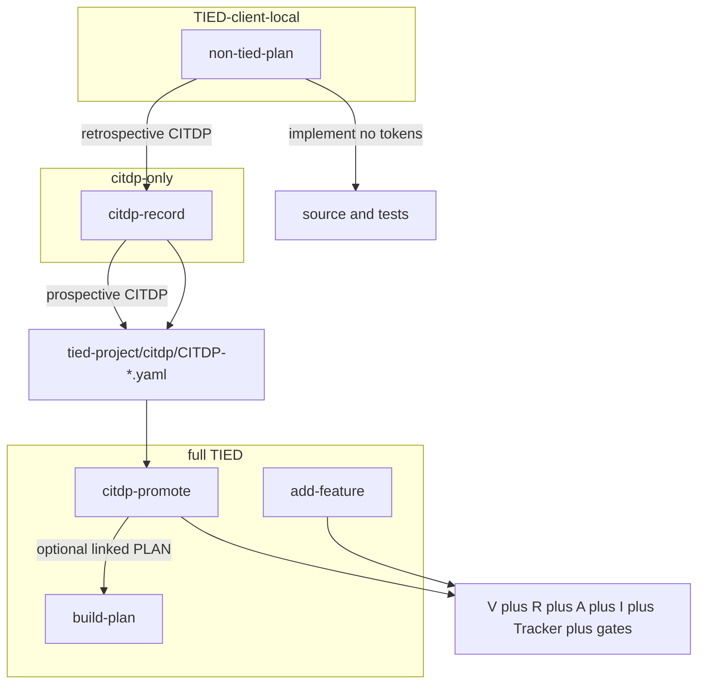

# CITDP record and promote prompt-type skills (refined)

**Refined:** 2026-10-29 via `@refine-plan`  
**Cursor plan source:** `citdp_record_promote_skills_e5f3f776.plan.md`  
**Feature token (proposed):** [REQ-PROMPT_TYPE_CITDP_RECORD_PROMOTE]  
**Parent stack:** [REQ-PROMPT_TYPE_GLOBAL_SKILLS] · [REQ-PROMPT_TYPE_SUBAGENT]

---

## Problem and intent

The taxonomy today collapses to two poles for “how much TIED?”:

| Path | CITDP | V+R+A+I | Implement | Typical use |
|------|-------|---------|-----------|-------------|
| [`non-tied-plan`](../../../tools/bundled-prompt-type-skills/non-tied-plan/SKILL.md) | **Forbidden** | No writes | Yes (code/tests) | Work that does **not** merit CITDP or tokens |
| [`add-feature`](../../../tools/bundled-prompt-type-skills/add-feature/SKILL.md) | Yes | Full stack | Yes (gated) | Greenfield REQ from the start |
| [`refine-plan`](../../../tools/bundled-prompt-type-skills/refine-plan/SKILL.md) + [`build-plan`](../../../tools/bundled-prompt-type-skills/build-plan/SKILL.md) | Yes | **Full TIED** (read/update stack via LEAP) | Yes (gated) | Execute a **linked PLAN** under enforcement — **not** token-free |

Sponsors need a **middle lane**:

1. **`@citdp-record`** — persist a **standalone CITDP** (analysis, risk, test strategy, evidence plan) for a change disclosed **prospectively** or **retrospectively**, with **`impact_analysis.tied_tokens_new: []`** and **no** project V+R+A+I mutations in that pass.
2. **`@citdp-promote`** — given a **named** `tied-project/citdp/CITDP-*.yaml`, enter **full TIED enforcement** (populate tokens as needed, Tracker, gates, implement, close-out).

**Does `citdp-record` replace `non-tied-plan`?** **No.** Non-tied work that does not merit a change record stays on `@non-tied-plan`. **`citdp-record` does not implement code**; pair with `@non-tied-plan` when implementation must stay off the V+R+A+I stack.

**Is there a skill to refine a non-tied plan?** **No separate leaf.** Refinement is the first phase of `@non-tied-plan` ([`non-tied-refine.md`](../../../tools/bundled-prompt-type-skills/prompt-shared/non-tied-refine.md)). Do **not** use `@refine-plan` for non-tied refinement — that leaf is **full TIED**.

Precedent: [`CITDP-PLAN-TIED-KAIZEN-FEEDBACK-LOOP.yaml`](../../citdp/CITDP-PLAN-TIED-KAIZEN-FEEDBACK-LOOP.yaml) — `tied_tokens_new: []`, `citdp_record_write`, docs-only.

### Recommended sponsor sequences

| Goal | Sequence |
|------|----------|
| Code only, no TIED artifacts | `@non-tied-plan` |
| Code only, later audit trail | `@non-tied-plan` → `@citdp-record` (retrospective) |
| Analyze first, code without tokens | `@citdp-record` → `@non-tied-plan` |
| Analyze first, then enforced delivery | `@citdp-record` → `@citdp-promote CITDP-…` |
| Full stack from day one | `@add-feature` (skip standalone CITDP phase) |

---

## Scope for this implementation pass

### In scope

- Two new leaf skills: **`citdp-record`**, **`citdp-promote`**
- Shared boundary + procedure docs (see below)
- Extend leaf inventory **13 → 15** across bundle, bootstrap, taxonomy, enrollment, e2e/subagent tests, activation map, router, vocab
- Project TIED records for this feature + CITDP for the feature work itself

### Out of scope

- MCP changes to `citdp_record_write`
- Auto-promotion hooks
- Merging `citdp-promote` into `build-plan`
- New **`non-tied-refine-plan`** leaf (future only if demand persists)
- Implementing feature code in this refine pass (hand off to `@build-plan` on this document)

---

## TIED traceability (this feature)

| Layer | Action |
|-------|--------|
| **REQ** | Add **`REQ-PROMPT_TYPE_CITDP_RECORD_PROMOTE`** (feature-scoped criteria for the two leaves and boundaries). **Also** extend **`REQ-PROMPT_TYPE_GLOBAL_SKILLS`** and **`REQ-PROMPT_TYPE_SUBAGENT`** satisfaction criteria: “15 leaf prompt types” and subagent wrapper coverage. |
| **ARCH** | Extend **`ARCH-PROMPT_TYPE_GLOBAL_SKILLS`**: applicability dimension **`citdp-only`** (distinct from **`client-local`** / **`minimal`** / **`full`**). Document that `citdp-record` performs **partial sync** (CITDP + working evidence only). |
| **IMPL** | Extend **`IMPL-PROMPT_TYPE_GLOBAL_SKILLS`** + pseudo-code sidecar; optional **`IMPL-PROMPT_TYPE_CITDP_RECORD_PROMOTE`** if logic grows beyond inventory bumps. |
| **Vocab** | RECORD in [`prompt-composer.md`](../../vocab/prompt-composer.md): **standalone CITDP**, **CITDP-only boundary**, **CITDP promotion**, **prospective CITDP**, **retrospective CITDP**. Add routing row in [`routing.md`](../../vocab/routing.md) → preload `prompt-composer.md` for keywords `citdp-record`, `citdp-promote`, `standalone CITDP`. |
| **CITDP** | `tied-project/citdp/CITDP-REQ-PROMPT_TYPE_CITDP_RECORD_PROMOTE.yaml` |
| **Working** | `tied-project/working/REQ-PROMPT_TYPE_CITDP_RECORD_PROMOTE/` (Tracker copy at implement time) |

### Risk / depth (this feature)

- **`depth_tier`:** `minimal` (skills, docs, static tests; no new runtime auth/network/persistence)
- **`gate_policy`:** `advisory`
- **Eligibility triggers:** none expected; re-check at `risk-assessment` if scope expands

### Costly choice (sponsor default unless overridden)

**Token creation during `@citdp-promote`:** New REQ/ARCH/IMPL tokens are created only when the CITDP **`impact_analysis.tied_tokens_new`** (updated during promotion refine) lists them explicitly and the sponsor confirms slugs in-session. No silent `tied_token_create_with_detail` from free-text remainder alone.

---

## New shared references

Under [`tools/bundled-prompt-type-skills/prompt-shared/`](../../../tools/bundled-prompt-type-skills/prompt-shared/):

### 1. `citdp-only-boundary.md`

- **Allowed:** Read merged TIED; **`citdp_record_write`**; `tied-project/working/{change_request_id}/` evidence; optional **analysis-only** Tracker copy limited to slugs: `change-definition`, `impact-discovery`, `risk-assessment`, `test-strategy`, `persist-citdp-record` (not full implement Tracker).
- **Forbidden:** Project index/detail YAML; IMPL pseudo-code sidecars; `tied_token_create_with_detail`; `tied_verify` with update; LEAP proposal writes; vocab **RECORD** (RESOLVE/PRELOAD read OK).
- **Invariants:** `tied_tokens_new` / `tied_tokens_affected` empty for `@citdp-record` unless session escalates to `@citdp-promote` or `@add-feature`. `change_definition.non_goals` includes “no new project REQ/ARCH/IMPL tokens in this pass.”
- **Retrospective:** CITDP must cite diff summary, paths, or session evidence — no invented tokens.

### 2. `tied-refine-citdp-record.md`

- Refine variant for **`citdp-record` only**: same RESOLVE steps as [`tied-refine.md`](../../../tools/bundled-prompt-type-skills/prompt-shared/tied-refine.md) but **gate** is “ambiguity cleared” — **do not** require pre-existing Tracker/CITDP for `pre_implementation` (record may not exist yet).

### 3. `tied-plan-citdp-record.md`

- CITDP analysis per [`citdp-policy.md`](../../../tied-bundle/docs/citdp-policy.md) + [`citdp-record-template.yaml`](../../../tied-bundle/docs/citdp-record-template.yaml).
- **No RED/code** in this leaf.
- Persist via **`citdp_record_write`**; basename `CITDP-{change_request_id}.yaml`; use `PLAN-*` / `SPIKE-*` when no REQ yet.
- Mark `leap_feedback.record_status: draft` (or project norm) until promotion.
- Handoff: path + “use `@citdp-promote` when enforcement wanted; `@non-tied-plan` when code without tokens.”

### 4. `tied-promote-citdp.md`

- **Required input:** `citdp-file:` or remainder naming `CITDP-*.yaml`.
- **Preconditions:** File exists; promotion scope refined; costly-choice gate on new token slugs.
- **Procedure:** Update CITDP impact + identity → create V+R+A+I via MCP as listed → full Tracker → [`tied-plan-citdp-build.md`](../../../tools/bundled-prompt-type-skills/prompt-shared/tied-plan-citdp-build.md) + [`tied-implement.md`](../../../tools/bundled-prompt-type-skills/prompt-shared/tied-implement.md) (same gates as `build-plan`).
- If a **linked PLAN** exists post-promotion, **`@build-plan`** may execute it; promote remains the entry from **CITDP**, build-plan from **PLAN markdown**.
- Update CITDP `leap_feedback` on divergence.

### Boundary cross-links

- [`tied-boundary.md`](../../../tools/bundled-prompt-type-skills/prompt-shared/tied-boundary.md): list `citdp-promote` under explicit full-TIED types; cite `citdp-only-boundary.md` for `citdp-record`.
- [`non-tied-boundary.md`](../../../tools/bundled-prompt-type-skills/prompt-shared/non-tied-boundary.md): “Need CITDP but not V+R+A+I → `@citdp-record` (not `@non-tied-plan`).”

---

## Leaf skills

| Skill | TIED applicability | Procedure |
|-------|-------------------|-----------|
| **`citdp-record`** | **citdp-only** | Refine [`tied-refine-citdp-record.md`] → Plan [`tied-plan-citdp-record.md`] → **no Implement** |
| **`citdp-promote`** | **full** | Refine → [`guiding-vocab.md`] → Plan [`tied-promote-citdp.md`] → Implement [`tied-implement.md`] |

Descriptions: explicit-only; `disable-model-invocation: true`; quoted YAML `description`.

**Do not** describe `citdp-record` as “non-TIED” — it **writes CITDP**. Tests should introduce **`CITDP_ONLY_LEAVES`** (or similar), not fold into `NON_TIED_LEAVES`.

---

## Inventory sync (13 → 15)

Update every canonical list, including at minimum:

| Location |
|----------|
| [`tools/bootstrap/manifest.json`](../../../tools/bootstrap/manifest.json) `PROMPT_TYPE_SKILL_DIRS` |
| [`mcp-server/src/e2e/prompt-type-skills.test.ts`](../../../mcp-server/src/e2e/prompt-type-skills.test.ts) `LEAF_SKILLS`, `SHARED_REFERENCES` |
| [`mcp-server/src/e2e/prompt-type-subagent.test.ts`](../../../mcp-server/src/e2e/prompt-type-subagent.test.ts) — add agents; `citdp-promote` ∈ `REFINE_PLAN_IMPLEMENT_LEAVES`; `citdp-record` writable, citdp-only boundary in body |
| [`mcp-server/src/jev/prompt-type-taxonomy.ts`](../../../mcp-server/src/jev/prompt-type-taxonomy.ts) |
| [`mcp-server/src/methodology-production-system-enrollment/constants.ts`](../../../mcp-server/src/methodology-production-system-enrollment/constants.ts) `PROMPT_TYPE_LEAF_IDS` |
| [`prompt-type-router/SKILL.md`](../../../tools/bundled-prompt-type-skills/prompt-type-router/SKILL.md) (taxonomy **15** leaves) |
| [`.cursor/agents/citdp-record.md`](../../../.cursor/agents/citdp-record.md), [`.cursor/agents/citdp-promote.md`](../../../.cursor/agents/citdp-promote.md) |
| [`tied-bundle/docs/fresh-client-prompt-activation-map.md`](../../../tied-bundle/docs/fresh-client-prompt-activation-map.md) rows for both leaves |
| [`tied-bundle/docs/prompt-type-skills.md`](../../../tied-bundle/docs/prompt-type-skills.md) |
| Repo-wide grep for **`13 leaf`** / **`LEAF_SKILLS`** stale strings (SUBAGENT REQ/ARCH/IMPL detail prose) |

**Methodology surface enrollment:** After adding leaf ids, run enrollment validator tests / advisory path per [`methodology-surface-enrollment-advisory.md`](../../../tools/bundled-prompt-type-skills/prompt-shared/methodology-surface-enrollment-advisory.md) for `prompt_type_workflow` surface.

---

## Test strategy (implement phase — TDD)

1. **RED:** Extend `prompt-type-skills.test.ts` and `prompt-type-subagent.test.ts` for 15 leaves + new shared refs (tests fail before skills exist).
2. **GREEN:** Add SKILL.md, shared refs, agents, manifest entries, taxonomy constants.
3. **Regression:** `prompt-type-advisory` / JEV tests importing `LEAF_PROMPT_TYPES`; bootstrap `skills-linked.test.mjs` loop over `PROMPT_TYPE_SKILL_DIRS`.
4. **Command:** From `mcp-server/`:  
   `npx tsx --test src/e2e/prompt-type-skills.test.ts src/e2e/prompt-type-subagent.test.ts`

---

## Sponsor-facing “when to use” (docs blurb)

- **`@non-tied-plan`** — implement without any TIED writes (including CITDP).
- **`@citdp-record`** — CITDP-only change record; before or after work; empty token lists.
- **`@citdp-promote`** + filename — enforce V+R+A+I + gates from that CITDP.
- **`@add-feature`** — full stack when standalone CITDP is unnecessary.
- **`@refine-plan` / `@build-plan`** — linked **PLAN** under **full TIED**, not token-free implementation.

---

## Validation close-out

- `tied_config_get_base_path` → this repo `tied-project/`
- `lint_yaml` on changed project YAML
- `tied_validate_consistency`
- CHANGELOG when feature closes; commit only on sponsor request

---

## Refine-plan handoff

- **Implement:** `@build-plan` with this file as linked plan (or copy to Cursor plan if preferred).
- **Gate before code:** Copy Tracker to working folder; draft CITDP for this feature; `tied_checklist_gate_validate` `pre_implementation` when Tracker + CITDP exist.
- **Do not implement** in the refine-plan turn unless sponsor asks to continue into build in the same session.
