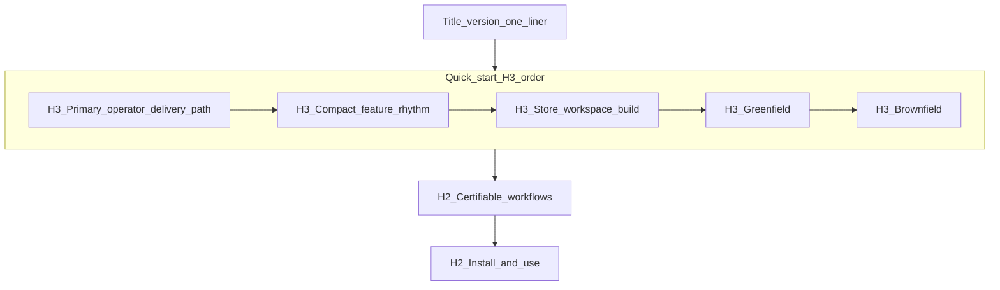
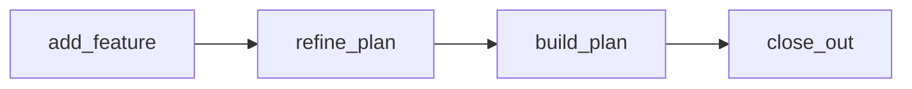

# PLAN-README-DUAL-RHYTHMS — refine pass 1

| Field | Value |
| --- | --- |
| **Request** | Surface **configuration rhythm** (clone → build → install/MCP) and **compact feature rhythm** (`add-feature` → `refine-plan` → `build-plan` → `close-out`) at the top of root [README.md](../../README.md); suggest GitHub About copy. |
| **Workflow** | Originated as `non-tied-plan`; refined via `@refine-plan` (doc-only, no new REQ index). |
| **profile_depth** | `minimal` |
| **gate_policy** | Structure test + manual skim; no integrated adversarial inquiry |
| **Branch** | (set at `@build-plan`) |

---

## Refine — resolved decisions

| Topic | Resolution |
| --- | --- |
| Step 1 “close” vs clone | **Clone** the TIED store (`git clone …`), then store-root `./build-workspace.sh`, then `./tied-install.sh` to the client and MCP confirm. |
| Four H2 bands vs three | **Keep three normative H2 bands** ([REQ-TIED_STORE_README_CERTIFIABLE_ONBOARDING](../../requirements/REQ-TIED_STORE_README_CERTIFIABLE_ONBOARDING.yaml) SC-README-BANDS; [store-readme-structure.test.ts](../../../mcp-server/src/store-readme-structure.test.ts)). Put **compact feature rhythm** as a new **`###` under Quick start**, immediately after **`### Primary operator delivery path`**. Reader order: intro → configure (H3) → code (H3) → certifiable H2 → install H2. |
| Rename “Primary operator delivery path” | **Keep exact H3 string** ([REQ-TIED_STORE_README_OPERATOR_DELIVERY_SPINE](../../requirements/REQ-TIED_STORE_README_OPERATOR_DELIVERY_SPINE.yaml)); lead with prose label **configuration rhythm** inside that subsection. |
| “Two CLI entry points” | **Fix copy bug** in README line ~13: spine is **three configuration steps** (clone + two CLI steps + MCP confirm as step 3, or clone + build + install with MCP as sub-step of install—pick one numbering and stay consistent). |
| `@` vs `/` skill invocation | README body: **`/add-feature`** style (matches greenfield catalog and Cursor Composer); table may note `@add-feature` alias. |
| `plan-new-feature` | **Out of scope** for this README pass (trial catalog only); compact rhythm normative path is the four global prompt types. |
| TIED YAML LEAP | **Deferred** unless sponsor wants four-band IA recorded in ARCH/REQ/IMPL. |
| GitHub About | Operator applies in GitHub UI; recommended copy below (fix spacing on em dash). |

---

## Problem (unchanged intent)

Operators landing on the store README see certifiable/EDSE narrative before the **day-to-day Prompt Composer loop**. GitHub About duplicates a traceability tagline instead of **configure → ship**. The delivery spine omits **clone** as step 1.

---

## Target information architecture (three H2 bands)



---

## CITDP (minimal — persist after implement if sponsor wants audit trail)

| Phase | Notes |
| --- | --- |
| **change-definition** | Doc-only README + structure test + one index row; no runtime behavior. |
| **impact** | [client-development-index.md](../../tied-bundle/docs/client-development-index.md) scenario table; any external links to `#quick-start-macos` unchanged. |
| **risk-assessment** | Renaming normative H3 **Primary operator** → blocked by operator-spine REQ. New H3 **Compact feature rhythm** is **reversible**. |
| **test-strategy** | Extend `store-readme-structure.test.ts`; run `node --import tsx --test mcp-server/src/store-readme-structure.test.ts`. |

---

## Implementer scaffold — README edits

### Intro (lines ~5–6)

Replace traceability-first hero with operator landing (keep TIED expansion + store role + Core seven link). Optional one sentence on semantic tokens under **Where to read next** or Band 2—not opening paragraph.

### `### Primary operator delivery path` — configuration rhythm

Replace opening “two CLI entry points” with **configuration rhythm** framing. Numbered list (exact commands):

1. **Clone** — `git clone` the TIED store (link to GitHub repo); `cd` to store root.
2. **Store workspace build** — `./build-workspace.sh` (anchor `#store-workspace-build`, `--help`).
3. **Client install** — `./tied-install.sh /path/to/client` (or linked primary from Greenfield table; `--help`, `--refresh`).
4. **Confirm MCP** — `tied_config_get_base_path` → client `tied-project/` (anchor `#2-optionally-enable-the-mcp-server`).

Windows: one line pointer to [Install and use](#install-and-use).

### New `### Compact feature rhythm`

Insert **after** Primary operator H3, **before** Store workspace build.

Content:

- One sentence: REQ-scoped **compact feature** in Cursor after client bootstrap (`tied-install` installs skills).
- Numbered list or table:

| Step | Invoke | Purpose |
| --- | --- | --- |
| 1 | `/add-feature` | New requirement + linked plan (Refine, CITDP Plan, Implement inside skill) |
| 2 | `/refine-plan` | Improve linked plan before execution |
| 3 | `/build-plan` | Execute approved plan (TDD, checklist; no Refine section) |
| 4 | `/close-out` | LEAP sync, `close_out` gate, CHANGELOG, traceable commit when allowed |

- Links: bundled skills under `tools/bundled-prompt-type-skills/{add-feature,refine-plan,build-plan,close-out}/SKILL.md`, [AGENTS.md](../../AGENTS.md), optional [catalog-greenfield add-feature](../../../docs/demos/catalog-greenfield-add-feature-prompts.md).
- One line: FEAT lifecycle vs REQ work → [multi-harness matrix](../../tied-bundle/docs/client-development-index.md#multi-harness-entry-matrix-cursor-vs-claude-code).

Optional small mermaid (linear only):



### Greenfield table footnote

Change “for example `/add-feature`” to “follow [Compact feature rhythm](#compact-feature-rhythm)” (add HTML anchor `<a id="compact-feature-rhythm"></a>` on the H3 if GitHub slug is unstable).

### Band 2 — `### REQ-scoped prompt types`

Replace bullet list with: “See [Compact feature rhythm](#compact-feature-rhythm) in Quick start.” Keep AGENTS.md authoritative sentence.

---

## Structure test contract updates

File: [mcp-server/src/store-readme-structure.test.ts](../../../mcp-server/src/store-readme-structure.test.ts)

| Change | Detail |
| --- | --- |
| **NORMATIVE_QUICK_START_H3** | Insert `"### Compact feature rhythm"` after `"### Primary operator delivery path"`, before `"### Store workspace build"`. |
| **REQUIRED_SUBSTRINGS** | Add: `/add-feature`, `/refine-plan`, `/build-plan`, `/close-out`, `git clone` (or `Clone the TIED store` if prose-only). |
| **H2 array** | **Unchanged** three-band order. |
| **Test description** | Optionally rename it() string to mention compact rhythm H3 (cosmetic). |

**Optional LEAP (out of scope unless requested):** update [IMPL-TIED_STORE_README_SECTIONS-pseudocode.md](../../implementation-decisions/IMPL-TIED_STORE_README_SECTIONS-pseudocode.md) POST comment to mention compact H3.

---

## client-development-index.md

In **Scenario → start here**, add row:

| Compact feature in Cursor (store README) | Root README § [Compact feature rhythm](#compact-feature-rhythm) | Multi-harness matrix; **Checklist** for semantics |

Use path link `../../README.md#compact-feature-rhythm`.

---

## GitHub About — recommended text

> Clone the TIED store, run `./build-workspace.sh`, install to your client with `./tied-install.sh`. Ship compact features in Cursor: `/add-feature` → `/refine-plan` → `/build-plan` → `/close-out`. REQ→ARCH→IMPL→tests→code with checklist gates and evidence—not a certification claim.

Alternates remain in cursor plan file; sponsor picks at apply time.

---

## Acceptance criteria (build-plan)

1. README top: configuration steps visible in **Primary operator** H3 including **clone**.
2. **Compact feature rhythm** H3 is the next H3 before Store workspace build.
3. `store-readme-structure.test.ts` passes.
4. Band 2 no longer duplicates the four-skill list.
5. client-development-index scenario row present.

---

## Verification commands

```bash
node --import tsx --test mcp-server/src/store-readme-structure.test.ts
```

Manual: first screenful of README = configure then code; certifiable EDSE not required to see coding rhythm.

---

## Out of scope

- GitHub About field update (human).
- Skill or prompt catalog changes.
- REQ/ARCH/IMPL index LEAP for four H2 bands.
- `CHANGELOG.md` unless `@close-out` requests it.

---

## build-plan handoff

Execute scaffold in order: README → structure test → client-development-index → run test. No MCP YAML writes required for minimal doc pass.
