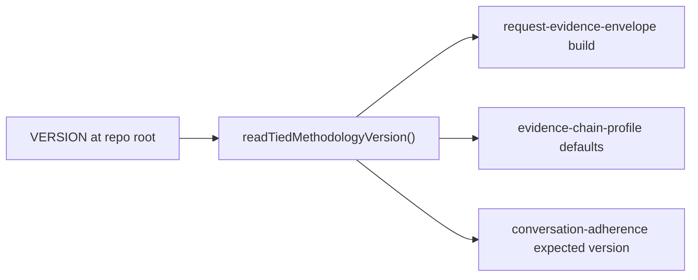
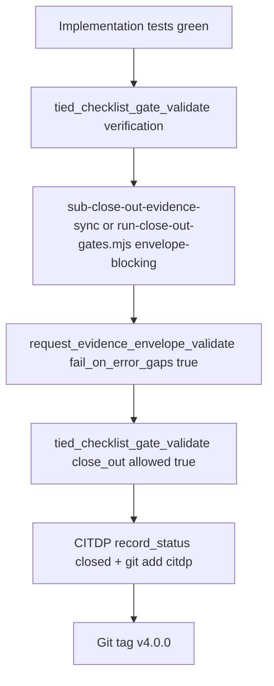

# TIED 4.0.0 response stamp — refined plan

**Plan token:** `PLAN-TIED-4.0-RESPONSE-STAMP` (use as `--request-token` / envelope scope; owner obligation remains [REQ-TIED_SETUP])  
**Owner REQ:** [REQ-TIED_SETUP] (amend validation criterion — no new REQ)  
**Workflow:** `@non-tied-plan` or `@build-plan` for implementation → **`@close-out`** before **v4.0.0** tag (integrated close-out is mandatory per sponsor decision)  
**Depth / gates:** `profile_depth: minimal`, `gate_policy: advisory` (implementation wave); tag uses **integrated close-out** (envelope-blocking; inquiry waiver in CITDP)  
**Pre-implementation gate:** `allowed: true` — latest receipt `tied-bundle/working/PLAN-TIED-4.0-RESPONSE-STAMP/gates/pre_implementation-2026-10-24T15-39-48-434Z.json` (CITDP: `tied-project/citdp/CITDP-REQ-TIED_SETUP-RESPONSE-STAMP.yaml`).

### Sponsor decisions (recorded 2026-10-24)

| Choice | Decision | Implication |
|--------|----------|-------------|
| Close-out at tag | **Integrated close-out** | Before **v4.0.0** tag: `@close-out` / `sub-close-out-evidence-sync`, `run-close-out-gates.mjs --envelope-blocking --sync-dispositions`, envelope validate with `fail_on_error_gaps: true`, `tied_checklist_gate_validate` `phase: close_out` with `allowed: true`. Build wave may stay minimal/advisory; tag is not “tests green only.” |
| W7 legacy phrase | **Warn-only** | `Observing AI principles!` in transcripts → advisory W7 finding, not error severity; missing/wrong stamp still scored per new dimensions. Document in ai-principles for client `--refresh` lag. |
| CITDP record | **Persist** | Canonical copy: [tied-project/citdp/CITDP-REQ-TIED_SETUP-RESPONSE-STAMP.yaml](../../citdp/CITDP-REQ-TIED_SETUP-RESPONSE-STAMP.yaml); working draft kept in sync until `record_status: closed`. |

**Gate hygiene:** Changing close-out policy invalidates prior **verification** / **close_out** tracker dispositions and gate receipts — re-run those phases at tag; pre_implementation receipt above remains valid for starting implementation.

---

## Refine (RESOLVE)

| Term | Resolution |
|------|------------|
| **Response stamp** | First line of every assistant turn: `TIEDv{semver}:` (regex `^TIEDv(\d+\.\d+\.\d+):\s*`), semver from root `VERSION` / AGENTS **TIED Methodology Version**. Weak loader signal only; gates/envelopes/reconcile remain authority. |
| **Legacy phrase** | `Observing AI principles!` — deprecate in authoritative loaders; W7 **warn-only** for legacy phrase (sponsor decision; not fail during refresh lag). |
| **Traceability** | Amend [REQ-TIED_SETUP] `validation_criteria`; code comments stay on [REQ-REQUEST_EVIDENCE_ENVELOPE] (envelope) and [REQ-TIED_CHECKLIST_GATE_ENFORCEMENT] (W7). |
| **Methodology edit locus** | TIED **store**: primary `tied-bundle/requirements/REQ-TIED_SETUP.yaml`; dogfood mirror `tied-project/requirements/REQ-TIED_SETUP.yaml` **and** embedded criterion in `tied-project/requirements.yaml` (~L3328). |

**Remaining reversible default:** skip optional `scripts/sync-tied-methodology-version.mjs` unless header drift recurs.

**Vocab RECORD (Touchpoint 3):** add **response stamp** / **TIED response stamp** to `tied-project/vocab/tied-methodology.md` when implementing (agent-control layer; distinct from IMPL grammar).

---

## Plan (CITDP summary)

Working copy: [CITDP-REQ-TIED_SETUP-RESPONSE-STAMP.yaml](./CITDP-REQ-TIED_SETUP-RESPONSE-STAMP.yaml) · **Persisted:** [tied-project/citdp/CITDP-REQ-TIED_SETUP-RESPONSE-STAMP.yaml](../../citdp/CITDP-REQ-TIED_SETUP-RESPONSE-STAMP.yaml)

| Area | Notes |
|------|--------|
| **Impact** | Docs/loaders, SETUP REQ YAML (3 surfaces), `mcp-server` envelope + fidelity defaults, W7 adherence script. |
| **Risks** | RISK-LEAP-SETUP-001 (criterion lags agents); RISK-FIXTURE-001 (hardcoded 3.0.0 in tests/fixtures); RISK-CLIENT-LAG-001 (refresh lag). |
| **Out of scope** | Mass-edit `tied-project/working/**` historical checklist snapshots; live IDE hooks; new REQ token. |

### Refinement gaps found (vs original linked plan)

1. **`tied-project/requirements.yaml`** duplicates SETUP `validation_criteria` — must LEAP with detail files (not detail-only).
2. **`mcp-server/src/fidelity-research/evidence-chain-profile.ts`** hardcodes `tied_methodology_version: "3.0.0"` (~L687) — include in `readTiedMethodologyVersion` wiring (with `evidence-chain-profile.test.ts`, `manifest.test.ts`, `pilot.test.ts`).
3. **`tools/bootstrap/lib/tied-baseline-commit-message.mjs`** — no acknowledgment text; update **fallback** `"TIED 3.0.0"` when bumping version (AGENTS-driven path already correct).
4. **Envelope / adversarial fixtures** — multiple JSON under `mcp-server/test/fixtures/**` still `"methodology_snapshot_id": "3.0.0"`.
5. **`.ai-agent-instructions`** — no legacy phrase today; only update if loader snippet is added for stamp.
6. **Gate tracker hygiene** — minimal pre_implementation requires `sub-adversarial-inquiry-pass` on main **`steps:`** with `not_applicable` + policy (see [checklist-tracker.yaml](./checklist-tracker.yaml)).
7. **Tracker template lag** — the copied tracker still embeds legacy `session-bootstrap` text until canonical `agent-req-implementation-checklist.yaml` is updated in step 3; that is expected. Do not patch hundreds of archived working trackers.
8. **`--expected-methodology-version`** — not present on `conversation-adherence-score.mjs` today; add in W7 work (plan step 6).

---

## Version: 4.0.0

**Current:** `VERSION` = `3.0.0`; AGENTS **TIED Methodology Version** = 3.0.0; envelope build hardcodes `"3.0.0"`.

**Release cut:**

1. `VERSION` → `4.0.0`.
2. `CHANGELOG.md`: `[Unreleased]` → `## [4.0.0] - <date>`; footer link `v4.0.0`.
3. Sync **TIED Methodology Version** headers (grep baseline `3.0.0` → `4.0.0`):

   - Root: `README.md`, `AGENTS.md`
   - `tied-bundle/docs/`: `ai-principles.md`, `processes.md`, `client-development-index.md`, `agent-req-implementation-checklist.md`, `requirements.md`, `architecture-decisions.md`, `implementation-decisions.md`, `semantic-tokens.md`, `methodology-diagrams.md` (and any other index doc that carries the header line)

   Do **not** mass-edit archived `tied-project/working/**/checklist-tracker.yaml` snapshots.

Optional: `scripts/sync-tied-methodology-version.mjs` (allowlisted header lines from `VERSION`).

---

## Response stamp contract

| Old | New |
|-----|-----|
| `Observing AI principles!` | **`TIEDv4.0.0:`** first line (full semver) |

**AGENTS.md target blockquote:**

> Preface **every** assistant response with a single first line: **`TIEDv4.0.0:`** (use the semver from **TIED Methodology Version** in this file). The stamp confirms the TIED operating guide is active for that turn; checklist gates and evidence artifacts remain the authority for whether work complied with principles.

### Authoritative file set

| Layer | Paths |
|-------|--------|
| Loaders | `AGENTS.md` §1, §3.1, §6; `tied-bundle/docs/ai-principles.md` § Mandatory Acknowledgment |
| Checklists | `tied-bundle/docs/agent-req-implementation-checklist.yaml` (`session-bootstrap` ~L732), `.md`, `documentation-first-checklist.yaml` |
| REQ | `tied-bundle/requirements/REQ-TIED_SETUP.yaml`; `tied-project/requirements/REQ-TIED_SETUP.yaml`; `tied-project/requirements.yaml` SETUP block |
| Agents | `.cursor/agents/*.md` (14 files); `mcp-server/src/e2e/prompt-type-subagent.test.ts` |
| Bootstrap | `tools/bootstrap/lib/tied-baseline-commit-message.mjs` fallback semver |
| Secondary prompts | `impl-pseudocode-from-code-agent-prompt.md`, `pseudocode-fidelity-audit-agent-prompt.md` |

**Do not** mass-edit `tied-project/working/**/checklist-tracker.yaml` archives.

---

## Centralize methodology version

- Add `mcp-server/src/tied-methodology-version.ts` (read root `VERSION`, cache per process; resolve repo root from MCP/store layout).
- Wire `mcp-server/src/request-evidence-envelope/build.ts` `methodology_snapshot_id`.
- Wire `mcp-server/src/fidelity-research/evidence-chain-profile.ts` default `tied_methodology_version`.
- Keep `tools/bootstrap/lib/install-layers-core.mjs` `readTiedVersionFromAgents` for **client** installs.

---

## Test strategy

| Layer | Action |
|-------|--------|
| **Unit** | `readTiedMethodologyVersion` — missing file, trim, cache |
| **Envelope** | Update `request-evidence-envelope.test.ts`, batch/process-adherence tests; refresh adversarial mini-project fixtures |
| **Fidelity** | `evidence-chain-profile.test.ts`, `manifest.test.ts`, `pilot.test.ts` |
| **E2E** | `prompt-type-subagent.test.ts` — assert `TIEDv` semver pattern instead of legacy phrase |
| **W7** | Extend `scripts/lib/conversation-adherence-dimensions.mjs`: e.g. `response_stamp_present`, `response_stamp_version_mismatch`, `response_stamp_legacy_phrase` (**warn-only** — `flagged` without error-tier rollup); wire CLI **`--expected-methodology-version`** (default: read root `VERSION`); `conversation-adherence-score.test.mjs` + fixtures under `scripts/fixtures/conversation-adherence/` |
| **Regression** | `npm test` in `mcp-server`; `node scripts/conversation-adherence-score.test.mjs` |
| **TIED** | After REQ LEAP: `tied_validate_consistency`; `tied_verify` with update when SETUP criterion text changes |
| **Close-out** | `@close-out` battery per section below; envelope validate `fail_on_error_gaps: true` |

**RED-first order:** W7 + envelope/fidelity tests before production wiring; then doc/REQ LEAP in same PR as agent stamp text to avoid RISK-LEAP-SETUP-001.

### W7 severity contract (sponsor: warn-only legacy)

| Signal | Severity | Notes |
|--------|----------|--------|
| Missing / wrong-version `TIEDv…:` first line | Score in `response_stamp_*` dimensions | Normal W7 observation; may contribute to rubric numerators |
| Legacy `Observing AI principles!` present | **Warn-only** | Record in report; do **not** map to error-tier blocking; document in `ai-principles.md` |

---

## Integrated close-out playbook (before v4.0.0 tag)

Per [working-artifact-placement.md](tied-bundle/docs/working-artifact-placement.md) and [completion-signals-handoff.md](tools/bundled-prompt-type-skills/prompt-shared/completion-signals-handoff.md).

**Request token:** `PLAN-TIED-4.0-RESPONSE-STAMP` everywhere (`tied gate check`, envelope build, adherence reconcile).

| Tier | Path |
|------|------|
| Committed process | `tied-project/working/PLAN-TIED-4.0-RESPONSE-STAMP/` (PLAN, tracker, draft CITDP sync) |
| Envelope (committed) | `tied-project/working/PLAN-TIED-4.0-RESPONSE-STAMP/evidence/request-evidence-envelope.v1.json` (tracker `execution_evidence.envelope_path` set) |
| Regenerable gates | `tied-bundle/working/PLAN-TIED-4.0-RESPONSE-STAMP/gates/` |
| Canonical CITDP | `tied-project/citdp/CITDP-REQ-TIED_SETUP-RESPONSE-STAMP.yaml` → `record_status: closed` at tag |

**Handoff must report three completion signals** (machine close-out, process contract, adherence ledger) — do not claim “ready to tag” from tests alone.

**CITDP waiver:** `close_out_inquiry_waiver` documents integrated envelope close-out without full adversarial-inquiry artifact set (minimal build depth).

---

## Implement (build-plan handoff)

**Tracker:** [checklist-tracker.yaml](./checklist-tracker.yaml) (`execution_evidence.request: PLAN-TIED-4.0-RESPONSE-STAMP`)  
**Prompt type:** `@non-tied-plan` (velocity) unless sponsor switches to `@build-plan` on this committed plan.

1. ~~Persist plan/CITDP~~ (done); commit when sponsor requests git commit.
2. `VERSION` + CHANGELOG + canonical version headers (+ baseline commit message fallback).
3. Stamp semantics in AGENTS, ai-principles, checklists, `.cursor/agents`, AGENTS §6 snippet.
4. LEAP [REQ-TIED_SETUP] on all three YAML surfaces (bundle detail, project detail, requirements index).
5. `readTiedMethodologyVersion` + envelope/fidelity wiring (TDD).
6. W7 dimensions + CLI flag + fixtures (TDD).
7. Full test battery; manual agent turn check; `tied_validate_consistency` (+ `tied_verify` on SETUP criterion if gated).
8. **`@close-out`** (integrated): verification gate → evidence sync → envelope validate → close_out gate → CITDP `record_status: closed` → stage `tied-project/citdp/` + committed envelope/manifest artifacts per placement doc → tag **v4.0.0**.

**IMPL pseudo-code:** No new [IMPL-*] unless SETUP/IMPL-TIED_FILES narrative must mention stamp grammar; prefer SETUP criterion + ai-principles + checklist.

**BBCE / locality:** Out of scope unless envelope or CITDP gains `declared_change_surface`; stamp change is methodology-wide doc surface (no slice-map required).

---

## Done when

- [ ] `VERSION` and AGENTS **TIED Methodology Version** = `4.0.0`.
- [ ] All three SETUP criterion surfaces describe `TIEDv4.0.0:` (not legacy phrase).
- [ ] `prompt-type-subagent.test.ts` asserts stamp pattern.
- [ ] Envelope build emits `methodology_snapshot_id: "4.0.0"` from reader.
- [ ] Fidelity profile default uses same reader.
- [ ] Adherence tests cover stamp present / mismatch / optional legacy warn.
- [ ] Manual: fresh agent turn starts with `TIEDv4.0.0:`.
- [ ] W7 tests assert legacy phrase is **warn-only**, not error.
- [ ] Integrated **close_out** gate `allowed: true` with envelope validation (no error gaps).
- [ ] CITDP persisted and closed in `tied-project/citdp/`.

---

## Linked Cursor plan

Source linked plan: `~/.cursor/plans/tied_4.0_response_stamp_76a64e9d.plan.md` — keep in sync with this committed copy for `@build-plan`.
