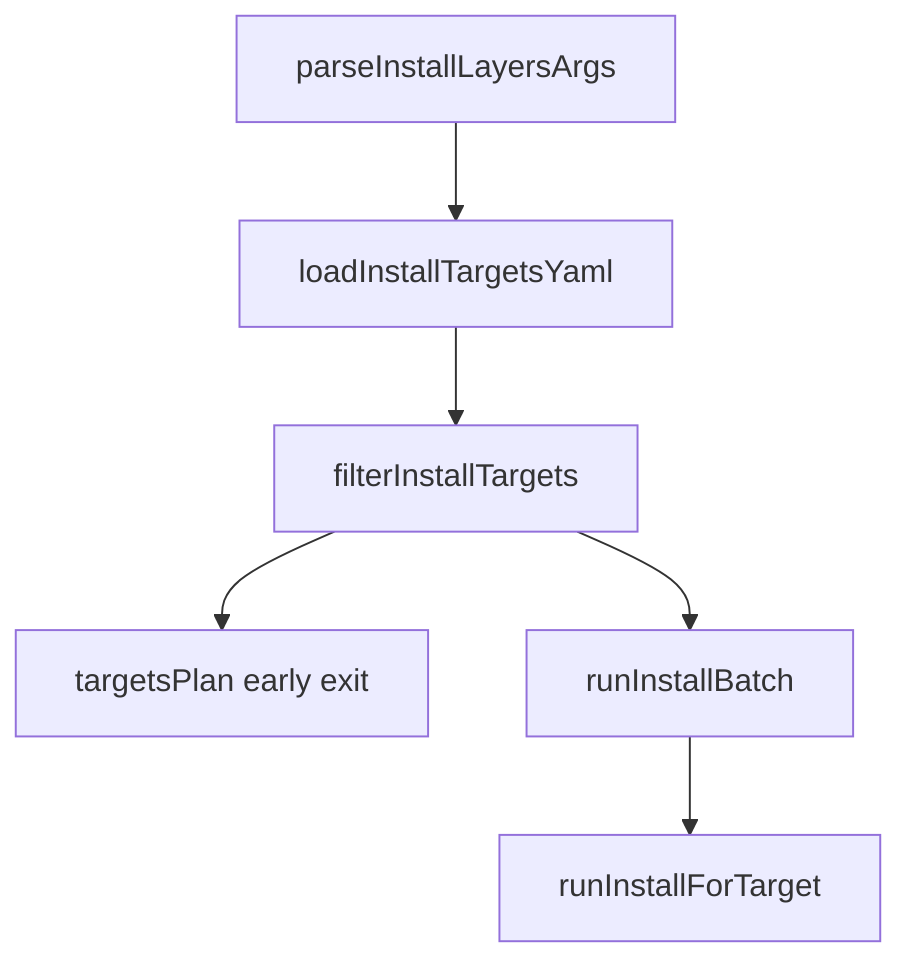

# tied-install: batch `--targets` (refined pass 1)

**Refined:** 2026-10-27  
**Working token:** `PLAN-TIED-INSTALL-BATCH-TARGETS`  
**Related tokens:** [REQ-TIED_LAYERED_CLIENT_INSTALL], [ARCH-TIED_LAYERED_CLIENT_INSTALL], [IMPL-TIED_LAYERED_CLIENT_INSTALL]  
**CITDP (draft):** [CITDP-PLAN-TIED-INSTALL-BATCH-TARGETS.yaml](./CITDP-PLAN-TIED-INSTALL-BATCH-TARGETS.yaml)  
**Tracker:** [agent-req-implementation-checklist.yaml](./agent-req-implementation-checklist.yaml)  
**Depth:** `profile_depth: minimal`, `gate_policy: advisory` (local CLI batch orchestration)

**Pre-implementation gate:** `tied_checklist_gate_validate` → `allowed: true` (2026-10-27) after Tracker dispositions for `risk-assessment`, `sub-adversarial-inquiry-pass` (not_applicable), and `gate-pseudocode-validation`.

## Refine — pass 1 deltas (RESOLVE)

| Topic | Draft plan | Pass 1 correction |
| --- | --- | --- |
| TIED stack | “No REQ/ARCH/IMPL” | **Bootstrap slice under existing [REQ-TIED_LAYERED_CLIENT_INSTALL]** — LEAP **IMPL** pseudo-code blocks before RED tests; optional new satisfaction criterion + `citdp_record_write` after green tests (defer dedicated REQ token unless sponsor wants fleet traceability) |
| `parsed.target` | Replace with `targets[]` only | **`targets: string[]` always**; internal helpers use `targets`; migrate-ordered tests updated in same PR — no dual field |
| `globMatch` import | From `stale-layout-allowlist.mjs` | **Reversible default:** import existing `globMatch` export to minimize diff. **Costly choice:** extract `lib/simple-glob.mjs` shared by allowlist + install-targets if coupling feels wrong |
| `--targets-plan` without file | Unspecified | **Requires `--targets`** (or `TIED_INSTALL_TARGETS`); error if plan mode with single-target-only argv — avoids surprising “plan cwd” |
| Env vs flag | Both listed | **`--targets` wins over `TIED_INSTALL_TARGETS`** when both set |
| `main()` refactor | `runForTarget` private | **Export `runInstallForTarget` and `runInstallBatch`** from `install-layers.mjs` for composition tests (inject `runOne` in options) |
| Migrate + batch | In scope | **Same legacy-layout guard per target** — first failing target stops batch unless `--targets-continue-on-error` |
| Doctor + batch | In scope | **Doctor runs per target**; does not short-circuit batch on success (each target independent) |
| Windows | Implicit | No shim changes — dispatch forwards new flags unchanged |
| Stdin `-` | Listed | Read YAML once at start; **baseDir = process.cwd()** for relative entries when source is stdin |

**Sponsor choices (accepted earlier)**

- Batch applies to **all target-scoped ops** (install, refresh, doctor, both migrate flags).

**Costly choices (confirm at build if deviating)**

- Auto-generating `--targets` from `client-inventory-manifest.v1.yaml` (defer adapter script)
- Parallel batch (rejected)
- New REQ token `REQ-TIED_INSTALL_BATCH_TARGETS` (optional LEAP after slice)

---

## Goal

Operators maintaining **multiple TIED client trees** (fleet refresh, brownfield migrate passes) run **one** `tied-install` invocation with a **YAML list of directories** instead of shell loops.

**Primary use case:** `./tied-install.sh --refresh --targets ~/clients.yaml --targets-only-installed`

---

## UX summary

| Flag | Behavior |
| --- | --- |
| `--targets PATH` | YAML list file; `PATH` may be `-` (stdin) |
| `TIED_INSTALL_TARGETS` | Same as `--targets` when flag absent |
| Positional + `--targets` | **Error** (mutually exclusive) |
| No positional, no `--targets` | Unchanged: `targets = [cwd]` |
| `--targets-plan` | Print resolved absolute paths (one per line); exit 0; **no install side effects** |
| `--targets-include` / `--targets-exclude GLOB` | Filter resolved paths (`globMatch` semantics: `*` and `**`) |
| `--targets-skip-missing` | Drop non-directories instead of failing |
| `--targets-only-installed` | Keep dirs where `readInstallManifest` succeeds |
| `--targets-continue-on-error` | Run all; exit 1 if any failed; log `DIAGNOSTIC: batch ok/total` |

**YAML shapes (v1):**

```yaml
- /abs/client-a
- ../client-b

# or
targets:
  - path: ../client-b
    label: optional-log-only
```

Optional `schema_version: tied-install-targets.v1` documented in help; not required to parse.

Relative path entries resolve against **YAML file directory**; for stdin, **cwd**.

---

## Plan — CITDP summary (analysis)

| Question | Expected after slice |
| --- | --- |
| Can operators refresh a fleet without shell `for` loops? | Yes — documented `--targets` + filters |
| Single-client scripts break? | No — default argv path unchanged |
| Wrong client path | Default fail-fast on missing; explicit `--targets-skip-missing` |
| Refresh without manifest | Per-target `INSTALL_MANIFEST_MISSING`; filter with `--targets-only-installed` |
| Falsification | Unit tests on load/filter/parse; batch test on fail-fast vs continue; `test-bootstrap-layered-install` green |

Persist canonical CITDP under `tied-project/citdp/` **after implementation** ([PROC-CITDP] persist step).

---

## IMPL pseudo-code LEAP (before RED)

Add to [IMPL-TIED_LAYERED_CLIENT_INSTALL-pseudocode.md](../../../tied-project/implementation-decisions/IMPL-TIED_LAYERED_CLIENT_INSTALL-pseudocode.md):

```
// [IMPL-TIED_LAYERED_CLIENT_INSTALL] — batch target list from YAML
PROCEDURE LOAD_INSTALL_TARGETS_YAML(sourcePath, baseDir)
  PRE: sourcePath is readable file path or "-" for stdin
  POST: ordered list of absolute directory paths
  FAILURE_MODES: TARGETS_YAML_INVALID; TARGETS_LIST_EMPTY

PROCEDURE FILTER_INSTALL_TARGETS(paths, filterOptions)
  PRE: paths normalized absolute
  POST: subset after include/exclude/missing/installed filters
  FAILURE_MODES: TARGETS_FILTER_EMPTY

PROCEDURE RUN_INSTALL_BATCH(targets, parsedOptions, runOne)
  PRE: targets non-empty unless plan-only; runOne invokes existing per-target install/migrate/doctor
  POST: all targets processed per continue-on-error policy
  EFFECTS: sequential; prefixed log lines [i/n]
  FAILURE_MODES: BATCH_ABORTED_FIRST_ERROR; BATCH_PARTIAL_FAILURE
  TERMINATION: exit 0 all ok; exit 1 any failure (or plan mode success)
```

Extend `PARSE_INSTALL_ARGS` in existing block to mention `--targets*` and `TIED_INSTALL_TARGETS`.

---

## Test strategy

| ID | Layer | Intent |
| --- | --- | --- |
| BATCH-UNIT-001 | `lib/install-targets-list.test.mjs` | YAML shapes, wrapper `targets:`, `{ path }` entries, dedupe, `~` expand, file-relative paths |
| BATCH-UNIT-002 | same | include/exclude globs, skip-missing, only-installed (mock manifest reader inject) |
| BATCH-UNIT-003 | `install-layers-migrate-ordered.test.mjs` | `--targets`, env `TIED_INSTALL_TARGETS`, positional conflict, `--targets-plan` requires list source |
| BATCH-COMP-001 | `install-layers-batch.test.mjs` | Inject `runOne` — order, fail-fast stops, continue-on-error runs all, plan stdout |
| BATCH-REG-001 | `test-bootstrap-layered-install` | No regression on existing install-layers / dispatch tests |

**TDD order:** BATCH-UNIT-001/002 RED → module → BATCH-UNIT-003 → refactor `main` → BATCH-COMP-001 → help/docs → IMPL LEAP finalize → `test-bootstrap-layered-install`.

---

## Implementation architecture



### 1. [`tools/bootstrap/lib/install-targets-list.mjs`](../../../tools/bootstrap/lib/install-targets-list.mjs)

- `loadInstallTargetsYaml(source, { baseDir, readFile, stdin })`
- `normalizeInstallTargetEntry(entry, baseDir)`
- `dedupeInstallTargets(paths)`
- `filterInstallTargets(paths, { includeGlob, excludeGlob, skipMissing, onlyInstalled, existsSync, readManifest })`

### 2. [`tools/bootstrap/install-layers.mjs`](../../../tools/bootstrap/install-layers.mjs)

- Parse new flags in `parseInstallLayersArgs`
- Resolve `targets` after parity parse: load file when `--targets` or env set
- `export async function runInstallForTarget(target, parsed)` — body of current `main` branches
- `export async function runInstallBatch(parsed, { runOne = runInstallForTarget } = {})`
- `main()` → `runInstallBatch`

### 3. Docs

- [`tools/bootstrap/lib/tied-install-help.mjs`](../../../tools/bootstrap/lib/tied-install-help.mjs) — Examples section
- [`tools/bootstrap/README.md`](../../../tools/bootstrap/README.md) — “Batch targets” subsection
- Fixture: `tools/bootstrap/fixtures/install-targets/sample.v1.yaml`

**No changes** to `tied-install.sh`, `tied-install-dispatch.mjs`, or Windows shims.

---

## Risk notes

| Risk | Mitigation |
| --- | --- |
| Mid-batch failure | Default fail-fast; summary line with index; re-run with `--targets-plan` |
| globMatch coupling | Import from allowlist or extract shared helper (see Refine table) |
| Empty filter result | Exit 1 + `sayErr` “no targets after filters” |
| Large fleet runtime | Document sequential expectation; no timeout in v1 |

---

## Implement gate (for build-plan)

1. LEAP IMPL pseudo-code blocks (token comments) — gate `gate-pseudocode-validation` before RED.  
2. RED → GREEN unit tests → parse tests → batch composition tests.  
3. Help + README + fixture.  
4. Run `test-bootstrap-layered-install`.  
5. `persist-citdp` + optional REQ satisfaction criterion LEAP.  
6. No git commit unless sponsor asks.

---

## Verification commands

```bash
node --test tools/bootstrap/lib/install-targets-list.test.mjs
node --test tools/bootstrap/install-layers-migrate-ordered.test.mjs
node --test tools/bootstrap/install-layers-batch.test.mjs
source scripts/build-commands.sh && test-bootstrap-layered-install
```

---

## Operator examples

```bash
./tied-install.sh --targets-plan --targets-only-installed --targets ~/clients.yaml
./tied-install.sh --refresh --targets ~/clients.yaml --targets-only-installed
./tied-install.sh --migrate-ordered-list-keys --targets ./brownfield-clients.yaml
./tied-install.sh --refresh --targets clients.yaml --targets-skip-missing --targets-continue-on-error
cat clients.yaml | ./tied-install.sh --refresh --targets -
```

---

## Out of scope (unchanged)

- Per-target `--mode` / `--layers` in YAML  
- Parallel installs  
- Direct fleet inventory manifest adapter  
- Dedicated REQ token (unless promoted post-slice)
