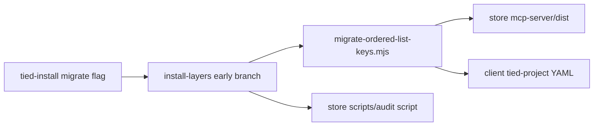

# tied-install: migrate ordered list keys (refined pass 1)

**Refined:** 2026-10-23  
**Working token:** `PLAN-TIED-INSTALL-ORDERED-KEYS`  
**Related tokens:** [REQ-CITDP_ORDERED_LIST_KEYS], [ARCH-CITDP_ORDERED_LIST_KEYS], [IMPL-CITDP_ORDERED_KEY_VALIDATE], [REQ-TIED_LAYERED_CLIENT_INSTALL], [REQ-TIED_YAML_CANONICALIZATION]  
**Prior audit:** [ORDERED-LIST-AUDIT-2026-10-23](../ORDERED-LIST-AUDIT-2026-10-23/audit-report.md) (store rename + audit scripts landed)  
**Workflow:** bootstrap feature slice — **no new REQ/ARCH/IMPL** unless sponsor wants install-surface traceability in `tied-project/`  
**Depth:** `profile_depth: minimal`, `gate_policy: advisory` (local YAML rewrite; no auth/network)

## Refine — pass 1 deltas (RESOLVE)

| Topic | Draft plan | Pass 1 correction |
| --- | --- | --- |
| CI exit semantics | Generic `--check` on tied-install | Use **`--fail-if-pending`** (only with migrate flag); avoids future global `--check` collision and mirrors rename script `--check` semantics |
| `--dry-run` vs pending | Unclear exit code | **`--dry-run`:** preview, exit 0; **`--fail-if-pending`:** no writes, exit 1 if migration needed (apply + audit gate for CI) |
| Audit integration | “Optional” extract | **V1:** spawn `{storeRoot}/scripts/audit-ordered-yaml-lists.mjs --check <roots…>` (absolute paths); linked clients have no `scripts/` — do not import from client tree |
| js-yaml | Unstated | **`@tied/bootstrap`** already depends on `js-yaml` ([`tools/bootstrap/package.json`](../../../tools/bootstrap/package.json)) — migration lib lives under bootstrap |
| parseInstallLayersArgs tests | tied-install-help.test only | **New** `install-layers-migrate-ordered.test.mjs` imports exported `parseInstallLayersArgs` from [`install-layers.mjs`](../../../tools/bootstrap/install-layers.mjs) (no existing parse tests) |
| Store self-target | Mentioned | Default store = [`TIED_REPO_ROOT`](../../../tools/bootstrap/lib/constants.mjs) via `resolveStoreRoot({ store, projectRoot: target })`; store repo already **0** pending renames with `--include-trackers` |
| Windows | Implicit | **No** cmd/ps1 changes — [`tied-install-dispatch.mjs`](../../../tools/bootstrap/tied-install-dispatch.mjs) forwards argv unchanged |
| Auto on refresh | User choice | **Standalone only** (confirmed) — never hook `installTiedLayers` / `refreshInstallFromManifest` |

**Costly choices (confirm at build if deviating)**

- Auto-running migration on `--refresh` (rejected for this slice)
- Extracting audit into bootstrap lib (defer; spawn store script first)
- Adding REQ-TIED_INSTALL_ORDERED_KEY_MIGRATE to `tied-project/` (optional LEAP later)

---

## Goal

Brownfield **TIED 3.0** clients run a one-shot fix for deprecated ordered-command keys (`commands`, `verification_commands`, … → `command_seq`, `verification_command_seq`, …) under **project-owned** YAML in `tied-project/`, executed from the **TIED store** (built `mcp-server/dist`).

**Operator contract:** explicit flag only — never on plain install or `--refresh`.

---

## UX (mirror `--migrate-layout`)

| Invocation | Behavior |
| --- | --- |
| `./tied-install.sh --migrate-ordered-list-keys /path/to/client` | Apply renames + `writeCanonicalValueAtomic` |
| `./tied-install.sh --migrate-ordered-list-keys --dry-run /path/to/client` | Log `would change:`; no writes; exit **0** |
| `./tied-install.sh --migrate-ordered-list-keys --fail-if-pending /path/to/client` | No writes; exit **1** if any file still needs migration |
| `./tied-install.sh --migrate-ordered-list-keys --fail-if-pending --dry-run …` | Same as `--fail-if-pending` (dry-run implied) |

**Misuse:** `--fail-if-pending` without `--migrate-ordered-list-keys` → fail closed with clear error (do not treat as unknown global flag).

Docs: [`tools/bootstrap/lib/tied-install-help.mjs`](../../../tools/bootstrap/lib/tied-install-help.mjs), [`tools/bootstrap/README.md`](../../../tools/bootstrap/README.md).  
**CLI parity:** `tied install --migrate-ordered-list-keys …` → same entry ([`install-layers.mjs`](../../../tools/bootstrap/install-layers.mjs)).

---

## Scope

**In scope (client `tied-project/` only):**

| Root | Globs |
| --- | --- |
| `{tiedDir}/citdp/` | `CITDP-*.yaml`, `citdp.yaml`, `citdp-inline.yaml`, `citdp-record-body.yaml` |
| `{tiedDir}/working/` | Trackers, `agent-req-implementation-checklist*.yaml`, `citdp-doc-*.yaml`, `checklist-tracker*.yaml`, bootstrap integrity filename (same as [`scripts/rename-citdp-command-keys.mjs`](../../../scripts/rename-citdp-command-keys.mjs) `shouldProcessTracker`) |

**Always `includeTrackers: true`** for client migration.

**Out of scope:**

- `tied-bundle/` in client (methodology refresh overwrites)
- Repo-root `working/` alias (scan only `tied-project/working`)
- `phases` / `dispositions` / metrics `sample_args_summary.commands` (object metadata)
- Store-only roots (`tied-bundle/docs/citdp-record-template.yaml`, root `working/`) — remain **rename script** defaults for store maintainers

**Layout guard:** if [`detectLegacyLayout`](../../../tools/bootstrap/lib/layout.mjs) → require `--migrate-layout` first (same as normal install).

**Empty client:** missing `tied-project/citdp` and `working` → **0** scanned, exit 0, message `nothing to migrate`.

---

## Plan — CITDP summary (analysis-only)

| Question | Expected after slice |
| --- | --- |
| Can operators fix brownfield clients without hand-editing YAML? | Yes, one documented tied-install flag |
| Same transform as MCP write-time validation? | Yes — `transformCitdpOrderedListKeys` from store dist |
| Store repo regression | `rename-citdp-command-keys.mjs` thin-wrap still passes `--check` / `--include-trackers` |
| Falsification | Post-apply audit `--check` on client roots fails if legacy ordered-command keys remain |

No `citdp_record_write` or MCP changes in this slice.

---

## Test strategy

| ID | Layer | Intent |
| --- | --- | --- |
| MIG-UNIT-001 | bootstrap | Legacy tracker fixture → `command_seq` + nested `operator_evidence` / `close_out_evidence` paths |
| MIG-UNIT-002 | bootstrap | `parseInstallLayersArgs` flag combinations + misuse of `--fail-if-pending` |
| MIG-INT-001 | bootstrap | Temp client dir + `TIED_REPO_ROOT` dist; dry-run then apply |
| MIG-INT-002 | bootstrap | `--fail-if-pending` exit 1 on fixture with legacy keys, 0 after apply |
| MIG-REG-001 | mcp-server | Existing `citdp-ordered-keys.test.ts` unchanged green |
| MIG-REG-002 | scripts | `rename-citdp-command-keys.mjs --check --include-trackers` exit 0 on store |

**Optional follow-up:** assert flag appears in `windows-bootstrap-smoke` (not in this slice).

---

## Implementation architecture



### 1. Shared module [`tools/bootstrap/lib/migrate-ordered-list-keys.mjs`](../../../tools/bootstrap/lib/migrate-ordered-list-keys.mjs)

**Export:** `migrateOrderedListKeys(projectRoot, { storeRoot, dryRun, failIfPending, includeTrackers })`

- Preflight: `storeRoot/mcp-server/dist/citdp-ordered-keys.js` + `yaml-canonicalizer.js`
- Resolve roots via [`resolveTiedLayout`](../../../tools/bootstrap/lib/layout.mjs)
- Move logic from rename script: `collectFiles`, `shouldProcess*`, `transformDocument`, apply loop
- Dynamic `import()` dist modules from **storeRoot** (supports store version ≠ client age)
- Return `{ ok, changed, scanned, changedPaths, skippedParse, code? }`

Refactor [`scripts/rename-citdp-command-keys.mjs`](../../../scripts/rename-citdp-command-keys.mjs) → call lib with **store profile** roots (`working/` alias + template yaml).

### 2. Install wiring [`tools/bootstrap/install-layers.mjs`](../../../tools/bootstrap/install-layers.mjs)

- Add `migrateOrderedListKeysFlag` + `migrateFailIfPending` to `parseInstallLayersArgs`
- Early branch (before legacy layout block for **normal** install — same ordering as `--migrate-layout`): run migration, then `process.exit` with appropriate code
- **Post-apply:** if `!dryRun && changed > 0`, spawn audit:

  `node {storeRoot}/scripts/audit-ordered-yaml-lists.mjs --check {tiedDir}/citdp {tiedDir}/working`

  Non-zero audit → `sayErr` + exit 1

### 3. Documentation

- Help examples + “Set vs ordered list keys” pointer ([`detail-files-schema.md`](../../../tied-bundle/docs/detail-files-schema.md))
- README: “Brownfield ordered YAML keys (TIED 3.0)” subsection after migrate-layout

---

## Risk notes

| Risk | Mitigation |
| --- | --- |
| Unbuilt store | Preflight dist check → hint `./build-workspace.sh` |
| Canonicalizer side effects | Write only when transform changes JSON; audit after apply |
| Wrong storeRoot | `resolveStoreRoot` + optional `--store PATH` |
| Spawn audit on Windows | Use `process.execPath` + absolute script path (same as other bootstrap spawns) |

---

## Implement gate (for build-plan)

1. Extract lib + rename script wrap **before** install flag (reuse in tests).  
2. Wire flag + tests green in `node --test tools/bootstrap/…`.  
3. Manual smoke: `./tied-install.sh --migrate-ordered-list-keys --dry-run .` on store repo.  
4. No git commit unless sponsor asks.

---

## Verification commands

```bash
./build-workspace.sh
node --test tools/bootstrap/lib/migrate-ordered-list-keys.test.mjs
node --test tools/bootstrap/install-layers-migrate-ordered.test.mjs
node scripts/rename-citdp-command-keys.mjs --check --include-trackers
./tied-install.sh --migrate-ordered-list-keys --fail-if-pending .
```
