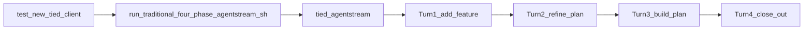

# PLAN-TRADITIONAL-FOUR-PHASE-AGENTSTREAM — refine pass 1

| Field | Value |
| --- | --- |
| **Request** | One shell command (via `tied agentstream`) that runs **add-feature → refine-plan → build-plan → close-out** against a disposable client, exercisable on **Cursor** first and **Claude** second, with an **explicit LLM model slug** for reproducible WF-style trials. |
| **Workflow** | Prior `@non-tied-plan` discovery; refined via `@refine-plan` (operator tooling + docs; no new REQ index unless sponsor promotes). |
| **profile_depth** | `minimal` |
| **gate_policy** | Dry-run oracle + optional disposable-client smoke; no integrated adversarial inquiry for scaffold-only delivery |
| **Contrast** | [Traditional four-phase trial catalog](../../../docs/demos/catalog-traditional-workflow-trial-prompts.md) (IDE turns); [run-feature-batch-agentstream.sh](../../../scripts/run-feature-batch-agentstream.sh) (full checklist — **not** this rhythm) |

---

## Refine — resolved decisions

| Topic | Resolution |
| --- | --- |
| **Orchestration engine** | **`tied agentstream`** live driver (`--harness cursor` \| `claude`), not IDE `@add-refine-build` (3 phases, no close-out, not CLI). |
| **Turn shape** | **Four-turn feature-spec batch** (`-b`): each record → one turn, **`chainFromPrevious: false`** → new agent session per prompt-type phase (matches trial choreography). |
| **Avoid** | Default **`run-feature-batch*.sh`** path: always attaches full **`agent-req-implementation-checklist.yaml`** — wrong scope. |
| **LLM enforcement** | **`tied agentstream --model` / `-m`** is **authoritative** for the subprocess; one slug applies to **all four turns** in a single invocation ([`agentArgv`](../../../mcp-server/packages/agentstream/src/executor-dry-run.ts), [`parseDryRunConfig`](../../../mcp-server/packages/agentstream/src/dry-run-config.ts)). Default if omitted: **`Auto`**. |
| **LLM audit trail** | **Also** record **Model config** (bucket) + **Model slug** (exact id) in client **`PLAN.md`** header and `trial-workflow-interaction-inventory.v1.json` per [catalog model configurations](../../../docs/demos/catalog-traditional-workflow-trial-prompts.md). Pass slug/config into turn 1 via **`--checklist-var MODEL_SLUG=…`** / **`MODEL_CONFIG=…`** embedded in batch template — **evidence**, not a second enforcement path. |
| **Prompt-only model text** | **Insufficient** — prose in feature `goal`/`behavior` does not set CLI `--model`. |
| **`--harness`** | Selects **AgentDriver** (`cursor` vs `claude`); **orthogonal** to `--model`. Claude live requires **`AGENTSTREAM_CLAUDE_LIVE_OK=1`** after local tests green. |
| **Per-phase different models** | **Out of scope** for single command; use **four separate** agentstream runs with **`-o N`** (one batch record each) and different **`--model`** if ever required. |
| **Per-record `model` in batch YAML** | **Not implemented** — future enhancement would need `featurespec-load-turns` + executor changes. |
| **Interactive IDE trials** | Unchanged: operator picks model in UI; document slug in PLAN only (catalog: tooling does not enforce). |

---

## Problem

Facilitators running **PROMPT-WF-*** matrix work today use **four manual IDE turns**. There is no repo artifact that automates the same rhythm through **`cursor agent`** / Claude CLI while pinning **model slug** for cross-run comparison (e.g. [wf-02 nine-model readout](../../../docs/demos/wf-02-nine-model-implementation-comparison.md)).

---

## Target operator flow



**Wrapper inputs (env or flags):** `WORKSPACE`, `BATCH_YAML`, `HARNESS`, **`MODEL_SLUG`**, optional **`MODEL_CONFIG`**, optional **`FEATURE_REMAINDER`** (or path to PROMPT-WF block).

---

## Model control — normative (single command)

### Layer A — enforcement (required for automation)

| Input | Maps to |
| --- | --- |
| `MODEL_SLUG` | `tied agentstream --model "$MODEL_SLUG"` |
| `HARNESS` | `--harness cursor` or `--harness claude` |
| (Claude only) | `export AGENTSTREAM_CLAUDE_LIVE_OK=1` |

**Dry-run proof before live:**

```bash
node "$REPO/mcp-server/packages/cli/dist/index.js" agentstream -d \
  -w "$CLIENT" \
  --harness "$HARNESS" \
  --model "$MODEL_SLUG" \
  --skip-tied-mcp-preflight \
  -b "$BATCH" \
  | rg '"--model"'
```

Every rendered turn must include `"--model" "<MODEL_SLUG>"` on Cursor harness (Claude omits flag when slug is `Auto` — document operator choice).

### Layer B — evidence (required for WF grading)

| Artifact | Content |
| --- | --- |
| `working/{REQ-TOKEN}/PLAN.md` header (turn 1) | `**Model config:**`, `**Model slug:**` (must match Layer A) |
| `…/evidence/trial-workflow-interaction-inventory.v1.json` | `analysis_label`: `traditional-workflow-trial.v1`; harness + slug |
| Batch turn 1 prompt | Instruct agent to write headers using `{{MODEL_CONFIG}}` / `{{MODEL_SLUG}}` when vars supplied |

### Layer C — matrix runs (Cursor then Claude)

Same **`BATCH`** and product remainder; change **`HARNESS`**, **`MODEL_SLUG`**, and Claude gate env between cells. One fresh disposable client per **(PROMPT-WF-NN × model configuration × harness)** per catalog fairness rules.

---

## Deliverables (implement scaffold)

| # | Path | Purpose |
| --- | --- | --- |
| 1 | `docs/demos/traditional-four-phase-agentstream.yaml` | Four `order: 1..4` records; vars `{{FEATURE_REMAINDER}}`, `{{MODEL_CONFIG}}`, `{{MODEL_SLUG}}`; each turn names target skill (`add-feature`, `refine-plan`, `build-plan`, `close-out`) and `.cursor/skills/<type>/SKILL.md` |
| 2 | `scripts/run-traditional-four-phase-agentstream.sh` | Resolves `REPO`, requires `WORKSPACE` + `MODEL_SLUG`; forwards `--model`, `--harness`, `--checklist-var`, `-b`, `-p` preload; **must not** pass default `-c` full checklist |
| 3 | `docs/demos/catalog-traditional-workflow-trial-prompts.md` | Short § **Automated agentstream path** linking batch + wrapper + model layers A/B |
| 4 | Optional | `mcp-server/packages/agentstream/testdata/oracle/traditional-four-phase-dry-run.txt` golden fragment after first `-d` run |

### Example wrapper invocation (refined)

```bash
REPO=/Users/fareed/Documents/dev/chatgpt/stdd
CLIENT=/path/to/disposable-client
export MODEL_CONFIG=composer-2.5
export MODEL_SLUG=composer-2.5-fast
export HARNESS=cursor
WF_ID=WF-02
export FEATURE_REMAINDER="$(
  gawk -v wf="${WF_ID#PROMPT-}" '
    BEGIN { hdr = "### PROMPT-" wf }
    $0 == hdr { insec = 1; next }
    insec && /^### PROMPT-WF-/ { exit }
    insec && /^```text$/ { intext = 1; next }
    insec && intext && /^```$/ { exit }
    insec && intext { print }
  ' "$REPO/docs/demos/catalog-traditional-workflow-trial-prompts.md"
)"

"$REPO/scripts/run-traditional-four-phase-agentstream.sh"
```

Script body (contract):

```bash
node "$REPO/mcp-server/packages/cli/dist/index.js" agentstream \
  -w "$CLIENT" \
  --harness "${HARNESS:-cursor}" \
  --model "${MODEL_SLUG:?MODEL_SLUG required}" \
  -y --skip-tied-mcp-preflight \
  -p "$CLIENT/tied-project/agent-preload-contract.yaml" \
  -b "$REPO/docs/demos/traditional-four-phase-agentstream.yaml" \
  --checklist-var "MODEL_CONFIG=${MODEL_CONFIG:-}" \
  --checklist-var "MODEL_SLUG=${MODEL_SLUG}" \
  --checklist-var "FEATURE_REMAINDER=${FEATURE_REMAINDER:?}"
```

---

## Batch record sketch (turn 1 — add-feature)

```yaml
features:
  - order: 1
    feature_name: "Phase 1 — add-feature"
    goal: |
      Explicitly follow `.cursor/skills/add-feature/SKILL.md` (/add-feature).
      Write PLAN.md under tied-project/working/{REQ-TOKEN}/ with header lines:
      Trial, Model config ({{MODEL_CONFIG}}), Model slug ({{MODEL_SLUG}}), Workflow.
      No production code or RED tests this turn.
    behavior: |
      Product requirement (invocation remainder):
      {{FEATURE_REMAINDER}}
  - order: 2
    feature_name: "Phase 2 — refine-plan"
    goal: |
      Follow `.cursor/skills/refine-plan/SKILL.md`. Linked plan from phase 1.
  # … orders 3–4: build-plan, close-out (git preamble per prompt-shared)
```

---

## CITDP (minimal — persist at `@build-plan` if sponsor wants audit)

| Phase | Notes |
| --- | --- |
| **change-definition** | Operator docs + shell + YAML batch; extends demo/facilitator surface only. |
| **impact** | [agentstream vocab](../../../tied-project/vocab/agentstream.md); no change to feature-spec schema until per-record `model` is proposed. |
| **risk-assessment** | Live runs spawn real **`cursor agent`** / Claude — **costly** for long builds; default disposable clients; dry-run first. |
| **test-strategy** | `agentstream -d` golden or rg `--model`; optional one disposable smoke with `MODEL_SLUG=Auto` only in CI if added later. |

---

## Jev W5 harness (refine pass 2 — linked slice)

WF four-phase trials are **not** W5 harness tests by default. Operator-global **`AGENTSTREAM_JEV_HARNESS`** otherwise forces [REQ-TIED_JEV_DECISION_COPROCESSOR] preflight and fails on linked disposable clients (dist probed under `WORKSPACE`, not the store).

| Policy | Mechanism |
| --- | --- |
| **Default** | [`run-traditional-four-phase-agentstream.sh`](../../../scripts/run-traditional-four-phase-agentstream.sh) **`unset AGENTSTREAM_JEV_HARNESS`** before exec |
| **W5 trial** | Set **`TRADITIONAL_FOUR_PHASE_JEV_HARNESS=1`**; requires green **`./build-workspace.sh`** on store + store-dist resolution fix |

Full design: [PLAN-store-dist-linked-client-refine-pass2.md](../REQ-TIED_JEV_DECISION_COPROCESSOR/PLAN-store-dist-linked-client-refine-pass2.md).

---

## Out of scope (this plan)

- Per-turn **`--model`** in one agentstream process (needs product change).
- Replacing **`@record-wf-trial`** facilitator flow.
- Full **`agent-req-implementation-checklist`** automation.
- **`@add-refine-build-close-out`** Task subagent (store-only; not CLI).

---

## `@build-plan` entry checklist

- [x] `./build-workspace.sh` green (operator)
- [x] Author batch YAML + wrapper; link from catalog
- [x] Dry-run verify **`--model`** on all four turns
- [x] One manual smoke: `test-new-tied-client --tag wf-agentstream` → `1793597183-wf-agentstream` ([evidence](evidence/smoke-1793597183-wf-agentstream.md))
- [ ] Optional: Claude cell with `AGENTSTREAM_CLAUDE_LIVE_OK=1`
- [ ] **`tied_checklist_gate_validate`** `pre_implementation` when REQ token assigned and Tracker copied
- [x] Four-phase wrapper clears W5 harness env unless **`TRADITIONAL_FOUR_PHASE_JEV_HARNESS=1`** (see Jev W5 harness section — spec in linked PLAN pass 2; implement in JEV slice)

---

## Sponsor notes (refine pass)

- **Reversible:** docs + script + batch YAML.
- **Costly:** unattended live agentstream on non-disposable repos — wrapper should **`require_directory`** disposable or explicit `WORKSPACE` opt-in.
- Promote to tracked REQ only if sponsor wants MCP/feature-spec **`model`** field or CI matrix enrollment.
