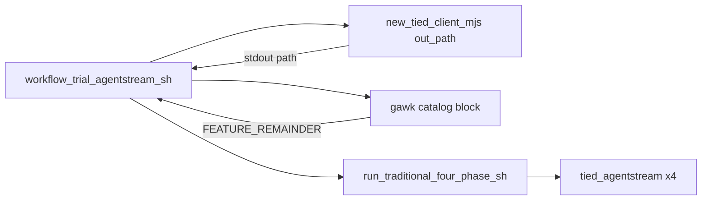

# PLAN-WF-TRIAL-AGENTSTREAM-ORCHESTRATOR — refine pass 1

| Field | Value |
| --- | --- |
| **Request** | Operator one-liner: bootstrap disposable client, extract **PROMPT-WF-** block, run four-phase agentstream — `workflow-trial-agentstream wf-02`. Plus **`test-new-tied-client --out-path`** for scriptable `WORKSPACE=$(…)`. |
| **Parent** | [PLAN-TRADITIONAL-FOUR-PHASE-AGENTSTREAM](../PLAN-TRADITIONAL-FOUR-PHASE-AGENTSTREAM/PLAN-refine-pass1.md) (batch + wrapper **done**); sponsor sketch [TODO.md](../../../TODO.md) (2026-11-01) |
| **profile_depth** | `minimal` |
| **gate_policy** | Advisory; **`tied_checklist_gate_validate`** `pre_implementation` at **`@build-plan`** when Tracker copied (no integrated adversarial inquiry) |
| **TIED LEAP** | Append [REQ-TIED_SETUP](../../../requirements/REQ-TIED_SETUP.yaml) SC; update [IMPL-TIED_FILES](../../../implementation-decisions/IMPL-TIED_FILES.yaml) disposable CLI pseudo-code — no new REQ index unless sponsor promotes |

---

## 1. Refine — resolved decisions

| Topic | Resolution |
| --- | --- |
| **Problem** | Facilitators must manually chain `test-new-tied-client`, `gawk` catalog extract, env exports, and `run-traditional-four-phase-agentstream.sh`. No machine path from factory; WF matrix runs repeat boilerplate. |
| **Path capture** | **`--out-path`** on [`tools/bootstrap/new-tied-client.mjs`](../../../tools/bootstrap/new-tied-client.mjs) only (Windows: [`scripts/test-new-tied-client.cmd`](../../../scripts/test-new-tied-client.cmd) forwards argv). Bash [`make_new_tied_client`](../../../scripts/build-commands.sh) already passes `"$@"` — no wrapper logic. |
| **Stdout contract** | [`sayOk`/`sayWarn`](../../../tools/bootstrap/lib/console.mjs) today write to **stdout** → breaks `$(test-new-tied-client --out-path)`. When **`TIED_BOOTSTRAP_OUT_PATH=1`** (set by CLI for entire disposable run): route **sayOk/sayWarn → stderr**; on success emit **one line**: absolute `clientDir` on stdout (no ANSI). Failure: non-zero exit, **empty stdout path**. |
| **`--out-path` guard** | Requires **`--disposable`**; reject otherwise with usage (same as **`--tag`**). |
| **Orchestrator entry** | [`scripts/workflow-trial-agentstream.sh`](../../../scripts/workflow-trial-agentstream.sh) + sourced alias **`workflow-trial-agentstream`** in `build-commands.sh`. |
| **WF id** | Positional arg: `wf-02`, `WF-02`, `PROMPT-WF-02` → normalize to **`WF-02`** (uppercase `WF-` + digits). Validate against catalog range **`WF-01`…`WF-08`** ([catalog headers](../../../docs/demos/catalog-traditional-workflow-trial-prompts.md)). |
| **Catalog extract** | GNU **`gawk`** required (document macOS `brew install gawk`). **Empty extract → exit 2** before agentstream (bad id or catalog drift). |
| **FEATURE_REMAINDER** | `PROMPT_PREFACE` + catalog body (preface text from TODO: *"Without pausing for user approval…"*). Env **`MODEL_SLUG`**, **`MODEL_CONFIG`**, **`HARNESS`** overridable; script supplies Composer 2.5 defaults. |
| **Run mode** | **Live four-phase agentstream by default** (sponsor choice). **`--dry-run`** forwards to wrapper `-d`. Help stderr warns: run **`--dry-run`** first; live = four agent sessions + API cost. |
| **Bootstrap skip** | **`--workspace ABS_PATH`**: skip factory; require absolute dir (same rule as wrapper). For CI: temp dir under **`TIED_TEST_ROOT`** + `--dry-run`. |
| **Factory tag** | `wf-agentstream-<wf-id-lower>` e.g. `wf-agentstream-wf-02` (matches prior smoke `wf-agentstream` pattern). |
| **Built store** | Live/dry-run both need **`mcp-server/packages/cli/dist/index.js`** (wrapper already fails with build hint). Disposable bootstrap needs **built store** for linked install (existing factory constraint). |
| **Jev W5** | Unchanged: wrapper **`unset AGENTSTREAM_JEV_HARNESS`** unless **`TRADITIONAL_FOUR_PHASE_JEV_HARNESS=1`** ([parent PLAN Jev section](../PLAN-TRADITIONAL-FOUR-PHASE-AGENTSTREAM/PLAN-refine-pass1.md)). |
| **Fair comparison** | One fresh disposable client per **`(PROMPT-WF-NN × model × harness)`** — orchestrator always creates new client unless **`--workspace`**. |
| **Reversible** | Docs, shell, bootstrap CLI flag, tests. |
| **Costly** | Default **live** agentstream on new disposable client; mitigated by wrapper disposable guard + **`--dry-run`**. |

---

## 2. Problem (contrast)

| Today | Target |
| --- | --- |
| Manual env + gawk + separate factory | `workflow-trial-agentstream wf-02 [--dry-run]` |
| Human-only factory success line on stdout | `WORKSPACE=$(test-new-tied-client --out-path --tag …)` |
| Catalog documents raw gawk one-liner | Catalog links orchestrator + `--out-path` |

**In scope:** glue on top of existing [batch YAML](../../../docs/demos/traditional-four-phase-agentstream.yaml) and [four-phase wrapper](../../../scripts/run-traditional-four-phase-agentstream.sh).

**Out of scope:** per-turn model in one process; **`@record-wf-trial`** automation; full checklist batch; changing feature-spec schema; Windows **`.sh`** orchestrator (operators use Git Bash or document WSL — same as other store shell wrappers).

---

## 3. Target operator flow



---

## 4. Deliverables

| # | Path | Purpose |
| --- | --- | --- |
| D1 | `tools/bootstrap/new-tied-client.mjs` + `lib/console.mjs` + `lib/new-tied-client-pipeline.mjs` | **`--out-path`**, **`TIED_BOOTSTRAP_OUT_PATH`**, final stdout path line |
| D2 | `scripts/workflow-trial-agentstream.sh` | WF normalize, bootstrap or `--workspace`, extract, exec wrapper |
| D3 | `scripts/build-commands.sh` | **`workflow-trial-agentstream`** alias |
| D4 | `tools/bootstrap/new-tied-client-out-path.test.mjs` | Machine stdout contract (+ parse tests in existing e2e) |
| D5 | `tools/bootstrap/workflow-trial-agentstream-sh.test.mjs` | Help, errors, `--workspace` + `--dry-run` oracle |
| D6 | Docs | `tools/bootstrap/README.md`, `_build_commands_cli_guide.inc.sh` (`how smoke`), catalog § Automated agentstream path |
| D7 | TIED | REQ-TIED_SETUP SC append; IMPL-TIED_FILES pseudo-code; CITDP at close-out |

---

## 5. Implementation contract

### 5.1 `--out-path` (D1)

1. **`parseNewTiedClientArgs`**: add `outPath: boolean`.
2. **`main()`**: if `outPath`, set `process.env.TIED_BOOTSTRAP_OUT_PATH = "1"` before `runDisposableClient`.
3. **`console.mjs`**: if `process.env.TIED_BOOTSTRAP_OUT_PATH === "1"`, `sayOk`/`sayWarn` → **stderr**.
4. **`runDisposableClient`**: accept `outPath`; on success with `outPath`, **do not** `sayOk` disposable line to stdout; **`main()`** prints `path.resolve(result.clientDir)` + `\n` to stdout.
5. Usage string documents flag (disposable-only).

### 5.2 `workflow-trial-agentstream.sh` (D2)

**Usage:**

```text
workflow-trial-agentstream.sh WF_ID [--dry-run] [--workspace ABS_PATH] [-h|--help]
```

**Behavior:**

1. Resolve **`REPO_ROOT`** (`tied-install.sh` marker), **`cd`** store root.
2. Parse flags; **`WF_ID`** required unless `--help`.
3. **`normalize_wf_id`** → `WF-NN`; reject invalid.
4. **`command -v gawk`** or exit 2 with hint.
5. If **`--workspace`**: export **`WORKSPACE`** (absolute check). Else:
   ```bash
   WORKSPACE="$(node "$REPO_ROOT/tools/bootstrap/new-tied-client.mjs" \
     --disposable --out-path \
     --source-root "$REPO_ROOT" \
     --test-root "${TIED_TEST_ROOT:-$HOME/Documents/dev/test}" \
     --tag "wf-agentstream-$(normalize_wf_id_lower "$WF_ID")")"
   ```
6. Build **`FEATURE_REMAINDER`** (gawk block + preface); fail if empty.
7. Export **`WORKSPACE`**, **`MODEL_SLUG`**, **`MODEL_CONFIG`**, **`HARNESS`**, **`FEATURE_REMAINDER`** (respect pre-set env).
8. **`exec`** `"$REPO_ROOT/scripts/run-traditional-four-phase-agentstream.sh"` **`--dry-run`** when flag set.

**Operator texture (minimal v1):** `--help` on stderr; **`NO_COLOR`/`--plain`** optional follow-up — not blocking if help is short plain text.

### 5.3 Alias (D3)

```bash
workflow_trial_agentstream() {
  "${_BUILD_COMMANDS_REPO_ROOT}/scripts/workflow-trial-agentstream.sh" "$@"
}
alias workflow-trial-agentstream=workflow_trial_agentstream
```

---

## 6. CITDP (minimal — persist at close-out)

| Phase | Notes |
| --- | --- |
| **change-definition** | Factory machine output + WF trial orchestrator shell; extends demo operator surface. |
| **impact** | [REQ-TIED_SETUP](../../../requirements/REQ-TIED_SETUP.yaml), [REQ-TIED_CLI_OPERATOR_OUTPUT_TEXTURE](../../../requirements/REQ-TIED_CLI_OPERATOR_OUTPUT_TEXTURE.yaml), [REQ-GOAGENT-FEATURESPEC-BATCH](../../../requirements/REQ-GOAGENT-FEATURESPEC-BATCH.yaml) (consumer only). |
| **risk-assessment** | **Costly:** default live runs; **reversible:** flag + docs. |
| **test-strategy** | Unit: out-path parse + stdout contract. Composition: workflow `--workspace` + `--dry-run` rg `"--model"`. Manual: full bootstrap + dry-run once. |

**CITDP file (at implement close-out):** `tied-project/citdp/CITDP-REQ-TIED_SETUP-wf-trial-orchestration.yaml`

---

## 7. Test strategy (TDD order)

| Order | Test | RED asserts |
| --- | --- | --- |
| 1 | `parseNewTiedClientArgs` `--out-path` + disposable | flag; error without disposable |
| 2 | `new-tied-client-out-path.test.mjs` | With `TIED_BOOTSTRAP_OUT_PATH=1`, mocked success → stdout one path line; sayOk not on stdout |
| 3 | `workflow-trial-agentstream-sh.test.mjs` | `--help`; bad WF id; missing gawk (mock PATH); `--workspace` + `--dry-run` → status 0, stdout matches `--model` |
| 4 | Extend `new-tied-client.test.ts` (optional) | Integration `--out-path` with `--skip-git --skip-lint --skip-onboarding-audit` if runtime acceptable in CI |

**Run locally:**

```bash
node --test tools/bootstrap/new-tied-client-out-path.test.mjs
node --test tools/bootstrap/workflow-trial-agentstream-sh.test.mjs
node --test tools/bootstrap/run-traditional-four-phase-agentstream-sh.test.mjs
```

---

## 8. Manual smoke

```bash
# Cheap oracle (existing client or after bootstrap):
source scripts/build-commands.sh
workflow-trial-agentstream wf-02 --dry-run 2>/dev/null | rg '"--model"'

# Factory path capture:
WORKSPACE="$(test-new-tied-client --out-path --skip-git --skip-onboarding-audit --tag wf-orchestrator-smoke)"
test -d "$WORKSPACE" && echo OK

# Live (costly — sponsor):
# workflow-trial-agentstream wf-02
```

---

## 9. `@build-plan` entry checklist

- [x] RED tests for D4/D5 + D1–D3 implemented; docs D6
- [x] Dry-run oracle on `wf-02` with `--workspace` (workflow-trial-agentstream-sh.test.mjs)
- [x] LEAP REQ-TIED_SETUP SC + IMPL-TIED_FILES pseudo-code; CHANGELOG.md
- [ ] `./build-workspace.sh` green on store (operator)
- [ ] `lint_yaml` on changed YAML; **`tied_validate_consistency`**
- [ ] **`tied_checklist_gate_validate`** `pre_implementation` when Tracker copied (minimal advisory)
- [ ] Manual full bootstrap smoke optional

---

## 10. Sponsor notes

- **Default live** is intentional; use **`--dry-run`** for matrix prep and CI.
- **`--out-path`** is the supported automation surface — do not parse the human `Disposable TIED client:` line.
- Promote to dedicated REQ (e.g. WF orchestrator) only if CI matrix enrollment or MCP tooling is required later.
