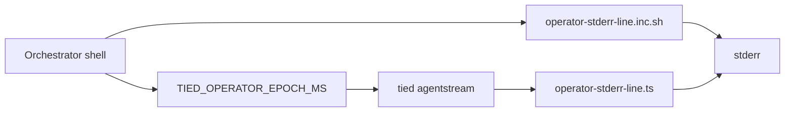

# PLAN — [REQ-AGENTSTREAM_OPERATOR_STDERR_ELAPSED] (refine-plan)

**Status:** close-out complete  
**plan_phase:** `complete`
**Workflow:** add-feature → **refine-plan** → build-plan → close-out  
**Request token:** `REQ-AGENTSTREAM_OPERATOR_STDERR_ELAPSED`  
**plan_phase:** `pre-implementation`  
**profile_depth:** `minimal` · **gate_policy:** `advisory`  
**Origin:** Sponsor add-feature — elapsed second prefix + category color on agentstream / WF trial `DEBUG:` / `DIAGNOSTIC:` lines; clock anchored at orchestrator start ([informative-color-coding](../../../../.cursor/skills/informative-color-coding/SKILL.md)).

**CITDP (working draft):** [CITDP-REQ-AGENTSTREAM_OPERATOR_STDERR_ELAPSED.yaml](./CITDP-REQ-AGENTSTREAM_OPERATOR_STDERR_ELAPSED.yaml)  
**Test strategy:** [test-strategy.md](./test-strategy.md)  
**Tracker:** [checklist-tracker.yaml](./checklist-tracker.yaml)  
**Cursor plan:** [operator_stderr_elapsed_offset_0469ddd8.plan.md](../../../../.cursor/plans/operator_stderr_elapsed_offset_0469ddd8.plan.md)

---

## 1. Refine (Touchpoint 1 — RESOLVE) — closed

| Sponsor term | Resolved concept | Disposition |
| --- | --- | --- |
| Offset from start | **Operator stderr elapsed offset** — whole seconds since shared epoch, 4-digit zero-padded prefix | **Locked** |
| Start time | **Orchestrator epoch** — one `TIED_OPERATOR_EPOCH_MS` for full WF cell; subprocess `tied agentstream` inherits env | **Locked** (sponsor) |
| Categories | Prefix `DEBUG:` and `DIAGNOSTIC:` only; not `ERROR:`, `agentstream:`, harness passthrough | **Locked** |
| Color | Offset (dim cyan) + category label (DEBUG dim yellow; DIAGNOSTIC dim label); plain when `NO_COLOR` / non-TTY / `TIED_CLI_PLAIN` | **Locked** |
| Example shape | `0042 DIAGNOSTIC: harness=…` (plain); ANSI wraps offset + label on textured TTY | **Locked** |
| Standalone agentstream | If `TIED_OPERATOR_EPOCH_MS` unset, epoch = TS process start | **Locked** |
| Opt-out | `AGENTSTREAM_OPERATOR_ELAPSED=0` for golden tests / legacy grep | **Locked** |
| Process logs | `process.stderr.log` tee sees same bytes as live stderr (may include ANSI when interactive); plain mode tests assert prefix without ANSI | **Locked** |

**Charter lane:** Operator observability only. No harness semantics, gate outcomes, or batch ordering changes.

### Costly choices (accepted)

- **Wide call-site migration** in agentstream package (~15 source files) vs single exit-time rewriter (rejected: wrong timestamps for buffered `stderrAcc`).
- **Shared shell + TS formatting** (two implementations) vs Node-only (rejected: orchestrator banners must share orchestrator clock).

---

## 2. Problem (evidence)

| Gap | Today | After change |
| --- | --- | --- |
| Timeline in terminal | `DIAGNOSTIC:` lines lack relative time; long WF cells hard to correlate with phases | Monotonic `SSSS` prefix across orchestrator + subprocess |
| Category scan | DEBUG vs DIAGNOSTIC differ only by token text | Color + label channel per `REQ-TIED_CLI_OPERATOR_OUTPUT_TEXTURE` |
| Facilitator grading | `@record-wf-trial` / process logs rely on line order only | Grep `^[0-9]{4} DIAGNOSTIC:` for friction timing |

Baseline emitters: [`live-executor.ts`](../../../mcp-server/packages/agentstream/src/live-executor.ts), [`executor-dry-run.ts`](../../../mcp-server/packages/agentstream/src/executor-dry-run.ts), [`run-traditional-four-phase-agentstream.sh`](../../../scripts/run-traditional-four-phase-agentstream.sh) `_diag`, [`wf-trial-interleaved-four-phase.inc.sh`](../../../scripts/lib/wf-trial-interleaved-four-phase.inc.sh).

---

## 3. Normative contract

### Plain line

```text
SSSS LEVEL: body\n
```

- `SSSS` = `max(0, floor((now_ms - epoch_ms) / 1000))`, width 4 (`0000`–`9999`; document rollover ≥10000 s).
- Idempotent: skip re-prefix if body already matches `/^\d{4} (DEBUG|DIAGNOSTIC):/`.

### Environment

| Variable | Role |
| --- | --- |
| `TIED_OPERATOR_EPOCH_MS` | Wall ms at orchestrator start; exported to child agentstream |
| `AGENTSTREAM_OPERATOR_ELAPSED=0` | Disable prefix (tests) |
| `NO_COLOR`, `TIED_CLI_PLAIN=1`, `--plain` | No ANSI (existing precedence) |

### Epoch init order (build-plan MUST)

1. **`workflow-trial-agentstream.sh`** — `operator_stderr_epoch_init` before bootstrap stderr and before [`wf_trial_process_log_bind_workspace`](../../../scripts/lib/wf-trial-process-log.inc.sh) (so tee + bootstrap append get offsets).
2. **`run-traditional-four-phase-agentstream.sh`** — epoch in `main` before `print_launch_banner` when not already set (nested call inherits parent epoch).
3. **Direct append to log files** — e.g. `tied_methodology_version` in `wf-trial-process-log.inc.sh` must use `operator_stderr_line`, not raw `printf DIAGNOSTIC`.

### Out of scope

- Turn operator banners (`--- turn N/M ---`), `session_id=`
- Subprocess agent stderr passthrough
- Sub-second precision (v1)

---

## 4. Architecture



| Module | Path |
| --- | --- |
| TS formatter | `mcp-server/packages/agentstream/src/operator-stderr-line.ts` |
| Bash formatter | `scripts/lib/operator-stderr-line.inc.sh` |
| Epoch portable ms | `node -p 'Date.now()'` (macOS-safe; no `date +%s%3N` reliance) |

**TIED stack (build-plan):** `REQ-AGENTSTREAM_OPERATOR_STDERR_ELAPSED`, `ARCH-AGENTSTREAM_OPERATOR_STDERR_ELAPSED`, `IMPL-AGENTSTREAM_OPERATOR_STDERR_ELAPSED` + pseudo-code sidecar.

**Relations:** depends_on `REQ-TIED_CLI_OPERATOR_OUTPUT_TEXTURE`, `REQ-GOAGENT-FEATURESPEC-BATCH`; related_to `REQ-WF_TRIAL_ORCHESTRATOR_PROCESS_LOG`.

---

## 5. Build wave (`@build-plan`)

| ID | Deliverable |
| --- | --- |
| B0 | TIED REQ/ARCH/IMPL indexes + pseudo-code; `semantic-tokens.yaml` |
| B1 | `operator-stderr-line.ts` + `operator-stderr-line.test.ts` (T-OSEL-01, T-OSEL-02) |
| B2 | Migrate agentstream emitters (grep `DIAGNOSTIC:` / `DEBUG:` under `src/`) |
| B3 | `operator-stderr-line.inc.sh`; wire `_diag` + interleaved phase banners + workflow-trial epoch |
| B4 | `wf-trial-process-log.inc.sh` methodology line + any raw orchestrator `DIAGNOSTIC:` printf |
| B5 | Shell tests T-OSEL-04, T-OSEL-05; update agentstream tests for optional prefix / opt-out |
| B6 | README + vocab RECORD **operator stderr elapsed line** in [`agentstream.md`](../../vocab/agentstream.md) |
| B7 | Optional `env-allowlist.v1.yaml` row for `TIED_OPERATOR_EPOCH_MS` |
| B8 | `lint:ts`, `node --test`, `tied_validate_consistency`, persist CITDP under `tied-project/citdp/` |

### Satisfaction criteria (REQ draft)

| ID | Criterion |
| --- | --- |
| SC-OSEL-PREFIX | Every agentstream-emitted `DEBUG`/`DIAGNOSTIC` line uses `SSSS LEVEL:` unless opt-out |
| SC-OSEL-ORCH-CLOCK | Interleaved four-phase: phase N+1 offset ≥ phase N under one `TIED_OPERATOR_EPOCH_MS` |
| SC-OSEL-PLAIN | Plain mode: no ANSI; prefix digits present |
| SC-OSEL-COLOR | TTY: offset cyan-dim; DEBUG yellow-dim; DIAGNOSTIC dim label |
| SC-OSEL-TEST | T-OSEL-01..05 green |

---

## 6. Risk assessment

| Item | Ladder | Mitigation |
| --- | --- | --- |
| Fixture / doc grep `DIAGNOSTIC:` | Reversible | Opt-out env; substrings still match |
| 4-digit rollover | Reversible | Document in README |
| Burst append same second | Reversible | Accept second resolution |
| Bash/TS drift | Costly if wrong | Shared contract table in PLAN + parallel unit tests |

---

## 7. Verification (build-plan)

```text
node --test mcp-server/packages/agentstream/src/operator-stderr-line.test.ts
node --test mcp-server/packages/agentstream  # package suite
node --test tools/bootstrap/run-traditional-four-phase-agentstream-sh.test.mjs
```

---

## Do next

**`@build-plan`** — implement B0–B8 per [test-strategy.md](./test-strategy.md). Do not `@close-out` until verification manifest green.