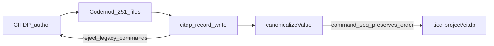

# PLAN — CITDP ordered-list key naming (`command_seq`)

**Status:** Refine pass 1 complete — ready for `@build-plan` (TIED stack + TDD + migration).

## Session handoff

| Artifact | Path |
| --- | --- |
| **Working CITDP** | [CITDP-REQ-CITDP_ORDERED_LIST_KEYS.yaml](./CITDP-REQ-CITDP_ORDERED_LIST_KEYS.yaml) |
| **Tracker (refine)** | [checklist-tracker-refine.yaml](./checklist-tracker-refine.yaml) |
| **Test strategy** | [test-strategy.md](./test-strategy.md) |
| **Linked Cursor plan** | `~/.cursor/plans/citdp_command_seq_naming_7cc6f66e.plan.md` |

**Primary REQ/ARCH/IMPL:** Created during build-plan (tokens reserved below).

---

## Refine pass 1 — RESOLVE deltas

Pass 0 (Cursor plan) intent stands. Pass 1 re-verifies inventory against the repo and tightens build sequencing.

| Topic | Pass 0 | Pass 1 correction |
| --- | --- | --- |
| File count | ~180 unique | **251** YAML files with at least one deprecated command key |
| `evidence.commands` | ~157 | **216** occurrences (includes working-tree duplicates) |
| `test_strategy.commands` | ~30 | **46** |
| `verification_commands` | ~11 | **13** (all under `test_strategy`) |
| Validator vs migration | Same PR, order unspecified | **Migration before enabling write reject** in one commit: codemod all scoped files, then land validator so `citdp_record_write` never sees legacy keys |
| `test_strategy.unit` / `.verification` | Not listed | **Out of scope** — treat as unordered test-path sets unless a file documents explicit run order (none found in citdp scan) |
| ARCH token name | `ARCH-CITDP_RECORD_SHAPE` | **`ARCH-CITDP_ORDERED_LIST_KEYS`** — narrower; avoids implying full CITDP JSON-schema |

### Sponsor decisions (accepted)

| Decision | Choice | Consequence ladder |
| --- | --- | --- |
| Ordered evidence battery key | `evidence.command_seq` | Reversible until validator ships |
| Scope | All `CITDP*.yaml`, `citdp.yaml` snapshots, `citdp-record-template.yaml` | Costly — large diff, one-time hash churn |
| Write path | Reject `commands` under `evidence` / `test_strategy` | Reversible with LEAP if alias needed (not planned) |
| `depth_tier` | **minimal** | Reversible |
| `gate_policy` | **advisory** | Reversible |

### Naming contract (normative for build)

| Deprecated | Parent | Replacement |
| --- | --- | --- |
| `commands` | `evidence` | `command_seq` |
| `commands` | `test_strategy` | `command_seq` |
| `verification_commands` | `test_strategy` | `verification_command_seq` |
| `integration_commands` | `test_strategy` | `integration_command_seq` |
| `regression_commands` | `test_strategy` | `regression_command_seq` |

**Unchanged (sorted sets):** `proof_boundaries`, token inventories, `success_criteria`, adversarial string lists, `checklist_gate.phases` / `dispositions`, `test_strategy.unit` / `unit_tests` where present. **`tdd_sequence`** already ordered.

### Non-goals

- Renaming non-CITDP YAML (REQ detail files, indexes)
- Changing `ORDERED_LIST_KEY_PATTERN` in `yaml-canonicalizer.ts`
- Backward-compat read alias in gate tools for `evidence.commands`

---

## Plan — CITDP summary

### Problem

[`tied-yaml-canonical-v1`](../../../mcp-server/src/yaml-canonicalizer.ts) sorts all-string lists unless the key matches ordered-list patterns (`*_seq`, etc.). **`evidence.commands`** is semantically an ordered verification battery; lint reorders it.

### Target behavior

### TIED stack (build-plan)

| Token | Role |
| --- | --- |
| **REQ-CITDP_ORDERED_LIST_KEYS** | Normative CITDP ordered-key names; forbid deprecated keys on write |
| **ARCH-CITDP_ORDERED_LIST_KEYS** | Validation at `citdp_record_write`; docs in template + `detail-files-schema.md` |
| **IMPL-CITDP_ORDERED_KEY_VALIDATE** | `validateCitdpOrderedListKeys` module + tests |

Cross-ref: [REQ-TIED_YAML_CANONICALIZATION](../../requirements/REQ-TIED_YAML_CANONICALIZATION.yaml) — canonicalizer already preserves `*_seq`; this REQ fixes author naming.

### Implementation slices (build-plan)

1. **TIED** — REQ/ARCH/IMPL indexes + details; IMPL pseudo-code sidecar with `[PROC-IMPL_PSEUDOCODE_TOKENS]` comments; `pseudocode_validate` gate mode.
2. **RED** — `mcp-server/src/citdp-ordered-keys.test.ts` (+ writer integration): accept `command_seq`, reject `evidence.commands` / `test_strategy.commands`.
3. **GREEN** — `citdp-ordered-keys.ts`; hook in [`citdp-writer.ts`](../../../mcp-server/src/citdp-writer.ts) after `validateCitdpDaeSizingFields`.
4. **Migration** — Parent-aware script: `scripts/rename-citdp-command-keys.mjs` (or equivalent); roots: `tied-project/citdp`, `tied-project/working/**`, `working/**`, `tied-bundle/docs/citdp-record-template.yaml`; idempotent second run.
5. **Docs** — CITDP subsection in [`detail-files-schema.md`](../../../tied-bundle/docs/detail-files-schema.md); pointer in [`citdp-policy.md`](../../../tied-bundle/docs/citdp-policy.md); grep fix `evidence.commands` prose (~10 paths under `docs/`, working notes, one QEM `command_or_test` string).
6. **Regression** — `yaml-canonicalizer.test.ts` case: `evidence.command_seq: ["z","a"]` order preserved.
7. **Close-out** — `lint_yaml`, `npm test --prefix mcp-server`, `tied_validate_consistency`, persist final CITDP under `tied-project/citdp/`.

### Test strategy (summary)

See [test-strategy.md](./test-strategy.md). E2E: **not applicable** (MCP unit + composition + mechanical YAML).

### Risk analysis (minimal)

| Id | Risk | Mitigation |
| --- | --- | --- |
| R1 | Agents/docs still say `evidence.commands` | Template + checklist prose + CHANGELOG |
| R2 | Partial migration | Validator + grep CI optional follow-up |
| R3 | Large git diff noise | Single-purpose commit; no functional code change in CITDP bodies beyond keys |

### Adversarial inquiry

`depth_tier: minimal`, `sub_adversarial_inquiry_pass: not_applicable`, `gate_policy: advisory`. No integrated activation artifacts required.
