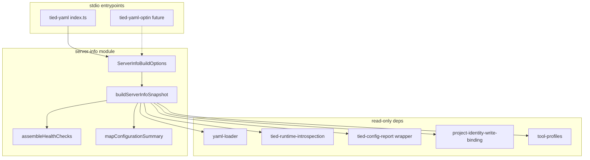

# PLAN — REQ-MCP_SERVER_INFO (refined)

**Prompt type:** refine-plan (pass 1 — 2026-11-06)  
**Delivery posture:** Plan-only; implementation via `@build-plan`  
**Tracker:** [`checklist-tracker.yaml`](checklist-tracker.yaml)  
**CITDP (working):** [`CITDP-REQ-MCP-SERVER-INFO.yaml`](CITDP-REQ-MCP-SERVER-INFO.yaml)  
**Test strategy:** [`test-strategy.md`](test-strategy.md)  
**Linked add-feature plan:** [`.cursor/plans/mcp_server_info_tool_ab829f25.plan.md`](../../../.cursor/plans/mcp_server_info_tool_ab829f25.plan.md) (IDE copy; **this file is canonical**)

---

## 1. Refine (Touchpoint 1 — RESOLVE)

| Sponsor / field term | Resolved meaning |
| --- | --- |
| **`server_info`** | Zero-argument, read-only MCP tool name (generic contract; not `tied_server_info`). |
| **Response `schema_version`** | Semver of **payload contract** only (`1.0.0` at ship); independent of MCP protocol, `@tied/mcp` package version, or `tool_contract_version`. |
| **`tool_contract_version`** | Application semver for the **TIED YAML MCP tool surface** as a whole; bump on breaking handler I/O for any registered tool. Initial ship: **`1.0.0`**. |
| **`supported_operations`** | TIED **capability verbs** for agents (`read`, `validate`, `write`, `verify`) — not `tools/list` names, not caller authorization. |
| **`mcp_protocol_version`** | Version negotiated for the active session when the SDK exposes it on the tool handler `extra` context; otherwise emit best-known supported version with `health` context — never invent a fake negotiation. |
| **Configurable reuse** | **`server-info` module** is MCP-agnostic; **tied-yaml** stdio wires it in v1; **tied-yaml-optin** may adopt later with different `Implementation` metadata. |
| **Separation from discovery** | Do **not** duplicate `tools/list` or resource catalogs; supplement MCP discovery with app identity, readiness, and compatibility ([user REQ 14–15]). |
| **`tied_config_get_base_path` / `tied_config_report`** | **Retained**; `server_info` summarizes and aligns with them; tool descriptions cross-link. |

**Vocabulary PRELOAD:** [tied-yaml-mcp.md](../../vocab/tied-yaml-mcp.md), [tied-product-configuration.md](../../vocab/tied-product-configuration.md).

**Consequence ladder**

| Choice | Ladder | Disposition |
| --- | --- | --- |
| Reusable `server-info` module + tied-yaml wire-up only | **Reversible** | **Accepted** (sponsor) |
| `structuredContent` + `outputSchema` on first tool | **Costly** | **Accepted** — schema conformance tests + single schema source |
| Full `tied_validate_consistency` on every `server_info` call | **Costly** | **Reject** — too heavy; optional future `server_diagnostics` |
| Deprecate `tied_config_get_base_path` | **Costly** | **Reject** |
| Build commit/time via CI-injected env | **Reversible** | **Defer** — `null` until build pipeline sets `TIED_MCP_BUILD_*` |

**Related tokens:** [REQ-TIED_CONFIG_REPORT](../../requirements/REQ-TIED_CONFIG_REPORT.yaml), [REQ-MCP_USAGE_METRICS](../../requirements/REQ-MCP_USAGE_METRICS.yaml), [REQ-TIED_RUNTIME_DISK_CONFIG](../../citdp/CITDP-REQ-TIED_RUNTIME_DISK_CONFIG.yaml) (CITDP), [REQ-TIED_SETUP](../../requirements/REQ-TIED_SETUP.yaml).

---

## 2. Architecture



### 2.1 Files (planned)

| Path | Role |
| --- | --- |
| `mcp-server/contracts/server_info/server_info.{contract.md,response.schema.json,response.example.json}` | Normative contract (from sponsor attachments) |
| `mcp-server/src/server-info/constants.ts` | `RESPONSE_SCHEMA_VERSION`, `TOOL_CONTRACT_VERSION`, `SUPPORTED_OPERATIONS`, process `startedAt` anchor |
| `mcp-server/src/server-info/build.ts` | Pure `buildServerInfoSnapshot(options)` |
| `mcp-server/src/server-info/health.ts` | Stable check IDs + authoritative `health.state` |
| `mcp-server/src/server-info/configuration.ts` | Redacted `configuration` slice from config report |
| `mcp-server/src/server-info/types.ts` | TypeScript mirror of v1 payload (optional props explicit) |
| `mcp-server/src/server-info/tool-handler.ts` | MCP adapter: `structuredContent` + canonical JSON text |
| `mcp-server/src/server-info/server-info.test.ts` | Unit + schema conformance |
| `mcp-server/src/server-info-mcp.composition.test.ts` | Handler registered in `allTools` (optional) |
| `mcp-server/src/types.ts` | `structuredToolResult()` helper |
| `mcp-server/src/index.ts` | Pass `Implementation` + profile metadata into options; widen handler result type |
| `mcp-server/src/tools/index.ts` | Register `server_info` (**core** profile, not in `OPTIN_TOOL_NAMES`) |

### 2.2 `ServerInfoBuildOptions` (reusable entry contract)

```ts
// Illustrative — build-plan implements
type ServerInfoBuildOptions = {
  implementation: { name: string; version: string };
  toolProfile: "core" | "optin" | "full";
  activeToolCount: number;
  resourcesRegistered: boolean;
  negotiatedProtocolVersion?: string | null;
  processEnv?: NodeJS.ProcessEnv;
};
```

### 2.3 MCP SDK wiring (first `outputSchema` in repo)

- **Input:** `z.object({})`, `additionalProperties: false` equivalent.
- **Output:** import `server_info.response.schema.json` into `registerTool` `outputSchema` (JSON Schema object; SDK validates on successful calls).
- **Annotations:** `readOnlyHint: true`, `destructiveHint: false`.
- **Result:** `{ structuredContent, content: [{ type: "text", text: prettyCanonicalJson(snapshot) }] }`.
- **Handler signature:** use `(args, extra)` for `server_info` only; thread `negotiatedProtocolVersion` from `extra` when typed fields exist; other tools unchanged.
- **Usage metrics:** extend `ToolHandlerResult` with optional `structuredContent`; `wrapToolHandler` unchanged (empty args, no blob logging).

---

## 3. Payload mapping (v1)

### 3.1 `server`

| Field | Source |
| --- | --- |
| `name` | `Implementation.name` (`tied-yaml` today) |
| `version` | `Implementation.version` / `package.json` aligned at startup |
| `build_commit` / `build_time` | `TIED_MCP_BUILD_COMMIT`, `TIED_MCP_BUILD_TIME` env or `null` |

### 3.2 `compatibility`

| Field | Source |
| --- | --- |
| `mcp_protocol_version` | Negotiated from handler `extra` when available; else newest entry from static supported list bundled with builder |
| `supported_mcp_protocol_versions` | Static array maintained beside builder (update when SDK bumps); minimum one date entry |
| `tool_contract_version` | `TOOL_CONTRACT_VERSION` constant |
| `api_schema_version` | `tied-yaml-canonical-v1` / detail-files schema token from docs |
| `intent_schema_version` | `null` v1 (no separate intent plane) |
| `database_schema_version` | `null` (filesystem corpus, not SQL) |
| `minimum_client_version` | `null` v1 |
| `supported_operations` | `["read","validate","write","verify"]` constant |

### 3.3 `configuration` (redacted summary)

When `resolveTiedConfigReport` succeeds, map:

| Field | Report path (conceptual) |
| --- | --- |
| `schema_version` | `tied-config-report.v1` |
| `revision` | report generation stamp / operator revision when present |
| `environment` | sanitized `environment` label (e.g. `client` / `store`) |
| `operating_mode` | `normal` unless operator toggles imply maintenance (future) |
| `storage_backend` | constant `filesystem` |

On report `unavailable` / `error`: section present with **null** scalars where supported; never embed secrets catalog or `include_secrets` paths.

### 3.4 `runtime`

| Field | Source |
| --- | --- |
| `instance_id` | Short opaque id (e.g. first 12 hex of sha256(pid + startedAt + anonymized project id when resolved)) |
| `platform` / `architecture` | `process.platform`, `process.arch` |
| `started_at` | ISO UTC from `constants.ts` module load |
| `uptime_seconds` | `floor((now - startedAt) / 1000)` |

### 3.5 `health` (authoritative state)

**Check catalog (stable `id`s)**

| `id` | `required` | Probe |
| --- | --- | --- |
| `writable_corpus` | `true` | `getBasePath()` + `requirements.yaml` readable |
| `identity_binding` | `true` | `resolveBindingStatus` not blocking writes unexpectedly (degraded if mismatch warn) |
| `runtime_introspection` | `false` | `resolveRuntimeIntrospection` status |
| `index_syntax` | `false` | `validateIndex("requirements")` only (sync, no full graph) |
| `methodology_corpus` | `false` | `getMethodologyBasePath()` + install layout when client mode |

**`health.state` rules (authoritative, not mechanical OR of checks)**

| State | When |
| --- | --- |
| `ready` | `writable_corpus` ok and `identity_binding` ok; no required check `failed` |
| `degraded` | Core ops possible but required check `degraded` or optional required dependency impaired |
| `unavailable` | `writable_corpus` or `identity_binding` `failed` |
| `unknown` | Cannot resolve base path or insufficient evidence (e.g. cwd-only test with no corpus) |

Messages/codes: stable machine `code` values only (e.g. `CORPUS_NOT_FOUND`, `BINDING_MISMATCH`); no paths with secrets.

### 3.6 `features` (advertised subset)

| Key | Derivation |
| --- | --- |
| `yaml_io` | `enabled` when core/full profile includes index tools |
| `consistency_validation` | `enabled` when `tied_validate_consistency` in active tool set |
| `usage_metrics` | `enabled` / `disabled` from `TIED_MCP_COLLECT_METRICS` |
| `mcp_resources` | `enabled` / `disabled` from `resourcesRegistered` |
| `optin_tool_surface` | `disabled` on core profile; `enabled` on full |

Omit keys not advertised (per contract §8).

### 3.7 `diagnostics`, `extensions`

- **`diagnostics`:** omit in v1 default path (optional schema property) OR `{ pending_operations: 0, active_errors: 0 }` if always including simplifies tests — **build-plan:** include only when values known (prefer omit).
- **`extensions`:** required key, value `{}`; future `io.tied.yaml.*` namespace.

---

## 4. CITDP impact (summary)

| Boundary | Change |
| --- | --- |
| MCP tools | +1 core tool `server_info` |
| Transport | First `structuredContent` + `outputSchema`; handler typing widen |
| Bootstrap | Optional future `TIED_MCP_BUILD_*` in install doc only |
| TIED YAML | New REQ / ARCH / IMPL + semantic-tokens rows |
| Vocab | `tied-yaml-mcp.md` rows for `server_info`, `tool_contract_version`, response contract |
| Docs | `mcp-server/README.md` tools table |

**Non-goals:** `server_diagnostics` tool; metrics schema v2; agentstream automatic preflight calling `server_info` (agents may call manually).

See [CITDP-REQ-MCP-SERVER-INFO.yaml](CITDP-REQ-MCP-SERVER-INFO.yaml).

---

## 5. Depth and gates

- **`depth_tier`:** `minimal`
- **`gate_policy`:** `advisory`
- **`sub-adversarial-inquiry-pass`:** `not_applicable` (read-only introspection)

**Advisory gate:** Run `tied_checklist_gate_validate` with `phase: pre_implementation` during `@build-plan` once tracker steps through `test-strategy`; expect `allowed: false` until verification evidence exists — normal in plan phase.

---

## 6. Implementation sequence (`@build-plan`)

1. Copy contract trio to `mcp-server/contracts/server_info/`.
2. Author TIED REQ/ARCH/IMPL (+ pseudo-code sidecar) via MCP/`tied-cli`.
3. **RED:** `server-info.test.ts` (builder fixtures + Ajv conformance per contract § Conformance tests).
4. **GREEN:** module + handler + registration + `types.ts` / `index.ts` wiring.
5. **Composition:** optional stdio `tools/call` smoke or `allTools` handler test.
6. Vocab + README.
7. `tied_validate_consistency`; `cd mcp-server && npm test`.

---

## 7. Handoff

**Next:** `@build-plan` with this `PLAN.md` as the linked plan.

**Open items for build (no blocker):**

- Confirm static `supported_mcp_protocol_versions` list against installed `@modelcontextprotocol/sdk` release notes when implementing.
- Decide whether `index_syntax` check stays in v1 or moves to `server_diagnostics` if latency measurable in CI.
