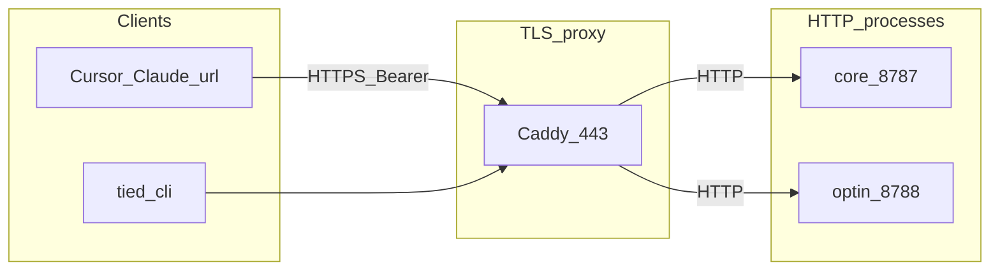

# [REQ-MCP_HTTPS_REMOTE_ACCESS] — dual MCP over HTTPS (refined)

**Refined:** 2026-11-06 (`refine-plan` from add-feature plan)  
**CITDP:** [CITDP-REQ-MCP_HTTPS_REMOTE_ACCESS.yaml](./CITDP-REQ-MCP_HTTPS_REMOTE_ACCESS.yaml)  
**Tracker:** [agent-req-implementation-checklist.yaml](./agent-req-implementation-checklist.yaml)  
**Test strategy:** [test-strategy.md](./test-strategy.md)

**Depth / gates:** `profile_depth: minimal`, `gate_policy: advisory`, `depth_tier: minimal`  
**Pre-implementation gate:** advisory `tied_checklist_gate_validate` (`phase: pre_implementation`) after Tracker/CITDP on disk.

---

## Refine — RESOLVE and decisions

### Sponsor choices (locked)

| Decision | Choice |
| --- | --- |
| **Servers** | **`tied-yaml`** (core, ~92 tools) and **`tied-yaml-optin`** (optin, ~37 tools) — mirror [`buildTiedMcpServerEntry`](../../../tools/bootstrap/lib/mcp-config.mjs). |
| **Clients v1** | Cursor / Claude **remote MCP `url`** entries **and** headless (**tied-cli**, Docker agents). |
| **TLS** | Terminate at **reverse proxy** (Caddy preferred in examples); Node serves **plain HTTP** on internal/LAN bind. |
| **Auth** | **`TIED_MCP_HTTP_BEARER_TOKEN`** — constant-time verify; **401** without valid `Authorization: Bearer …`. |

### Canonical terms (RECORD → vocab on build)

| Preferred | Meaning |
| --- | --- |
| **streamable HTTP transport** | MCP Streamable HTTP per SDK (`StreamableHTTPServerTransport` / client twin). |
| **remote MCP URL** | `mcpServers.*.url` + optional `headers` (not `stdio`). |
| **bearer gate** | App-layer auth before MCP JSON-RPC reaches transport handler. |
| **proxy TLS seam** | HTTPS client → proxy → HTTP backend; aligns with harness/platform seam doc. |

### Reversible choices (implement defaults)

| Decision | Default | Rationale |
| --- | --- | --- |
| HTTP entrypoint | **`tied mcp serve`** subcommand + optional `node mcp-server/dist/http-entry.js` shim | Matches [REQ-TIED_UNIFIED_TOOLCHAIN](../../../tied-project/requirements/REQ-TIED_UNIFIED_TOOLCHAIN.yaml); keep `dist/index.js` = stdio-only. |
| Session mode | **Stateful** `StreamableHTTPServerTransport` (`sessionIdGenerator: randomUUID`) | IDE clients expect session headers; stateless reserved for future load-test doc only. |
| Mount path | **`POST /mcp`** on each process | One profile per process; no path-multiplexing in v1. |
| Core / optin URLs at proxy | **Two vhosts** (`mcp-core.local`, `mcp-optin.local`) not path mux | Matches two IDE MCP toggles; simpler Caddy blocks. |
| Default ports (plain HTTP) | **8787** core, **8788** optin | Document override via `TIED_MCP_HTTP_PORT`. |
| Default bind | **127.0.0.1** in dev; **0.0.0.0** in Docker with token **required** | Fail closed: `DIAGNOSTIC: TIED_MCP_HTTP_BIND_REJECTED` if wide bind without token. |
| DNS rebinding | **`TIED_MCP_HTTP_ALLOWED_HOSTS`** when bind ≠ loopback | Passed to `createMcpExpressApp({ host, allowedHosts })`. |
| Bootstrap remote entries | **Docs + copy-paste** only in v1 | Preserve [MCP config preservation](../../../tied-project/vocab/tied-yaml-mcp.md); no refresh overwrite of stdio. |
| `tied_config_report` | **Extend catalog** with HTTP listen/bind/token **configured** flags (never token value) | Same redaction rules as secrets policy parent. |
| SDK dependencies | Add **`express`** (and peers if `npm ls` shows optional) as **direct** `mcp-server` dependencies | Reproducible Docker build; express already present transitively today. |

### Costly choices (accepted)

| Risk | Mitigation in scope |
| --- | --- |
| **Network exposure of YAML write tools** | Bearer mandatory for non-loopback; operator warning in README; proxy TLS; no anonymous LAN. |
| **Wrong corpus in container** | Smoke uses `tied_config_get_base_path`; compose documents volume mount of client `tied-project/`. |
| **`server_info` contract change** | LEAP [REQ-MCP_SERVER_INFO](../../../tied-project/requirements/REQ-MCP_SERVER_INFO.yaml) with schema bump + golden tests. |

### Non-goals (v1)

- OAuth / MCP SDK auth server.
- mTLS, IP allowlists (follow-on REQ).
- Auto-inject remote `url` on every `tied-install --refresh`.
- Replacing stdio in CI or default Cursor config.

---

## Architecture (build-plan target)

### Module boundaries

| Module | Path | Responsibility |
| --- | --- | --- |
| `tied-mcp-server-factory` | `mcp-server/src/tied-mcp-server-factory.ts` | `createTiedYamlMcpServer(profile)` — tools, resources, metrics, `server_info` context. |
| `mcp-stdio-entry` | `mcp-server/src/index.ts` (thin) | `StdioServerTransport` only. |
| `mcp-http-server` | `mcp-server/src/mcp-http-server.ts` | Express app, bearer middleware, `StreamableHTTPServerTransport.connect`. |
| `mcp-http-entry` | `mcp-server/src/http-entry.ts` | CLI argv + env resolve; calls `runTiedYamlMcpHttp`. |
| CLI dispatch | `mcp-server/packages/cli/src/index.ts` | `tied mcp serve [--host] [--port]`. |
| Client transport | `tools/bundled-tied-yaml-skill/scripts/tied-mcp-stdio-client.cjs` | Branch on `TIED_CLI_MCP_URL` → Streamable HTTP client. |

### Data flow



---

## CITDP summary

| | |
| --- | --- |
| **Current** | MCP only on stdio; no LAN/Docker/remote IDE path without custom forks. |
| **Desired** | Same tool surface over Streamable HTTP behind HTTPS proxy; dual profile processes; tied-cli HTTP; stdio unchanged. |

### Success criteria (REQ draft)

| ID | Criterion | Metric |
| --- | --- | --- |
| **SC-MHR-STDIO** | `node dist/index.js` stdio behavior unchanged | `npm test --prefix mcp-server` includes existing profile/stdio tests |
| **SC-MHR-HTTP-TOOLS** | HTTP core lists ~92 tools, optin ~37 | `mcp-http-server.test.ts` tools/list counts |
| **SC-MHR-BEARER** | Missing/wrong bearer → 401; valid → initialize OK | unit tests |
| **SC-MHR-BIND** | `0.0.0.0` without token → process exit ≠ 0 | unit test on entry |
| **SC-MHR-CLI** | `TIED_CLI_MCP_URL` + bearer calls `yaml_index_read` | `test/tied-cli-http.test.cjs` |
| **SC-MHR-SERVER-INFO** | `server_info` reports `transport: streamable_http` when HTTP | contract golden |
| **SC-MHR-DOCKER** | `docker compose up` smoke doc + optional CI `--dry-run` | working evidence checklist |
| **SC-MHR-DOCS** | mcp-server README + adding-tied-mcp section for remote url | doc structure test or grep fixture |

---

## Implementation phases (@build-plan)

### Phase A — TIED stack

1. `tied_token_create_with_detail` (or staged MCP writes): **REQ-MCP_HTTPS_REMOTE_ACCESS**, **ARCH-MCP_HTTPS_REMOTE_TRANSPORT**, **IMPL-MCP_HTTP_SERVER**, **IMPL-TIED_CLI_HTTP_TRANSPORT**.
2. IMPL pseudocode sidecars with [PROC-IMPL_PSEUDOCODE_TOKENS](../../../tied-bundle/docs/implementation-decisions.md); `pseudocode_validate` before tests.

### Phase B — RED tests

See [test-strategy.md](./test-strategy.md).

### Phase C — GREEN (order)

1. Factory extraction + thin stdio entry.
2. HTTP server + `tied mcp serve`.
3. Compose + Caddyfile under `mcp-server/deploy/`.
4. tied-cli HTTP client branch.
5. `server_info` + env allowlist + vocab RECORD + docs.

### Phase D — Verification

```text
cd mcp-server && npm run build && npm test
node --test tools/bootstrap/lib/tied-env-allowlist-inventory.test.mjs   # after allowlist keys
tied-cli.sh server_info '{}'
tied_validate_consistency
```

Manual: LAN HTTPS, Docker client → proxy, enable two remote MCP servers in Cursor.

---

## LEAP / dependencies

| Token | Relationship |
| --- | --- |
| [REQ-TIED_UNIFIED_TOOLCHAIN](../../../tied-project/requirements/REQ-TIED_UNIFIED_TOOLCHAIN.yaml) | Additive transport; stdio unchanged |
| [REQ-MCP_SERVER_INFO](../../../tied-project/requirements/REQ-MCP_SERVER_INFO.yaml) | Extend health/runtime for HTTP |
| [REQ-MCP_STDIO_CONSOLE_GUARD](../../../tied-project/requirements/REQ-MCP_STDIO_CONSOLE_GUARD.yaml) | Stdio only; HTTP uses stderr diagnostics |
| [REQ-TIED_CLI_MCP_JSON_BASE_PATH](../../../tied-project/requirements/REQ-TIED_CLI_MCP_JSON_BASE_PATH.yaml) | Stdio spawn path authority unchanged |
| [REQ-TIED_ENVIRONMENT_VARIABLE_POLICY](../../../tied-project/requirements/REQ-TIED_ENVIRONMENT_VARIABLE_POLICY.yaml) | New allowlisted `TIED_MCP_HTTP_*`, `TIED_CLI_MCP_URL` |

---

## Handoff

**Next:** `@build-plan` with linked [PLAN-refine.md](./PLAN-refine.md).

Paths: `tied-project/working/REQ-MCP_HTTPS_REMOTE_ACCESS/PLAN-refine.md`, `evidence/session-handoff.md`, `CITDP-REQ-MCP_HTTPS_REMOTE_ACCESS.yaml`, `agent-req-implementation-checklist.yaml`, `test-strategy.md`.
