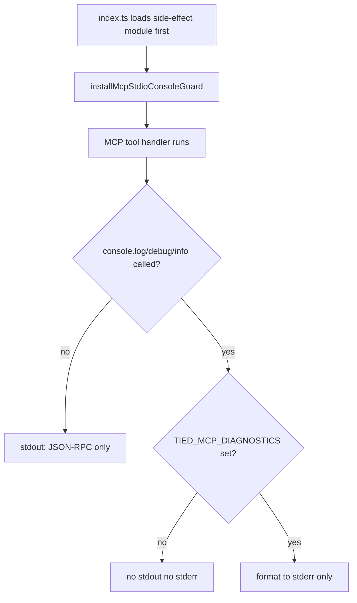

# PLAN — REQ-MCP_STDIO_CONSOLE_GUARD (refined)

**Prompt type:** refine-plan (pass 1 — 2026-10-25)  
**Delivery posture:** **Code on disk** (add-feature turn); **machine close-out pending**  
**Tracker:** [`checklist-tracker.yaml`](checklist-tracker.yaml)  
**CITDP (working):** [`CITDP-REQ-MCP_STDIO_CONSOLE_GUARD.yaml`](CITDP-REQ-MCP_STDIO_CONSOLE_GUARD.yaml)  
**CITDP (persisted):** [`../../citdp/CITDP-REQ-MCP_STDIO_CONSOLE_GUARD.yaml`](../../citdp/CITDP-REQ-MCP_STDIO_CONSOLE_GUARD.yaml)

---

## 1. Refine (Touchpoint 1 — RESOLVE)

| Sponsor / field term | Resolved meaning |
| --- | --- |
| **Kaizen feedback** | Store capture **`fb-mvnztbmv-ez5nep`** — Cursor MCP log `Unexpected token 'D', "DEBUG: [IM"... is not valid JSON` plus follow-on lines from pretty-printed object dumps |
| **stdio transport** | MCP **JSON-RPC on stdout only**; host parses each line as a message |
| **Root cause class** | Node **`console.debug` → stdout** (alias of `console.log`); tool paths emit `DEBUG: [IMPL-…]` with object args during MCP tool calls |
| **Fix direction (locked)** | **Never** emit `console.log` / `console.debug` / `console.info` on stdout in the **MCP server process**; diagnostics **stderr-only** and **env-gated** |
| **`TIED_MCP_DIAGNOSTICS`** | Opt-in (`1` / `true` / `yes`): format diagnostic lines to **stderr**; unset → guarded methods are **no-ops** (stdout stays clean) |
| **MCP entry vs CLI** | Guard installed only via **`mcp-server/src/index.ts`** first import; CLI entrypoints that **own stdout for JSON** unchanged |
| **Startup line** | `TIED YAML MCP Server running on stdio` uses **`console.error`** — noisy in Cursor UI but **not** JSON-RPC corruption |

**Vocabulary PRELOAD:** [tied-yaml-mcp.md](../../vocab/tied-yaml-mcp.md) (stdio diagnostics row), [feedback-to-tied.md](../../vocab/feedback-to-tied.md).

**Consequence ladder:**

| Choice | Ladder | Disposition |
| --- | --- | --- |
| Central guard at MCP entry | **Reversible** | **Delivered** (as-built) |
| Rewrite every `console.debug` call site | **Costly** | **Reject** — guard covers runtime |
| Always-on stderr DEBUG (no env gate) | **Reversible** | **Reject** — match opt-in pattern ([REQ-MCP_USAGE_METRICS]) |
| Patch `console.error` / MCP SDK logging | **Costly** | **Out of scope** — only log/debug/info |

**Related tokens:** [REQ-MCP_USAGE_METRICS](../../requirements/REQ-MCP_USAGE_METRICS.yaml), [REQ-FEEDBACK_TO_TIED](../../requirements/REQ-FEEDBACK_TO_TIED.yaml), [REQ-TIED_SETUP](../../requirements/REQ-TIED_SETUP.yaml).

---

## 2. Plan (CITDP)

### 2.1 Guard behavior (normative — matches as-built)



**Module placement (as-built):**

| File | Role |
| --- | --- |
| `mcp-server/src/mcp-stdio-console-guard.ts` | `mcpDiagnosticsEnabled`, `installMcpStdioConsoleGuard`, test reset |
| `mcp-server/src/mcp-stdio-console-guard-side-effect.ts` | Calls install on module load |
| `mcp-server/src/index.ts` | First static import = side-effect module |
| `mcp-server/src/mcp-stdio-console-guard.test.ts` | stdout/stderr capture tests |

### 2.2 Impact

| Boundary | Change |
| --- | --- |
| MCP stdio server | Console patch at load; no per-tool handler edits |
| Operator | Rebuild `mcp-server`, restart IDE MCP; optional `TIED_MCP_DIAGNOSTICS` in `.cursor/mcp.json` `env` |
| Vocab | `tied-yaml-mcp.md` naming-bridge row |
| TIED YAML | REQ / ARCH / IMPL + persisted CITDP |
| Feedback | **`fb-mvnztbmv-ez5nep`** → countermeasure **REQ-MCP_STDIO_CONSOLE_GUARD** |

### 2.3 Depth

**minimal** / **advisory** — `sub-adversarial-inquiry-pass` **not_applicable** ([evidence/sub-adversarial-inquiry-pass-na.md](evidence/sub-adversarial-inquiry-pass-na.md)).

### 2.4 Test strategy

| File | Cases |
| --- | --- |
| `mcp-stdio-console-guard.test.ts` | Diagnostics env truth table; `console.debug` silent on stdout when env unset; stderr-only when env set |
| `mcp-server` `npm test` | Full MCP workspace suite (regression) |

**Optional follow-up (not blocking guard correctness):**

| Idea | Rationale |
| --- | --- |
| Composition smoke: spawn stdio child, invoke one tool that used to `console.debug`, assert stdout lines are JSON | End-to-end transport proof |
| ESLint / grep CI rule: ban `console.log/debug/info` in `mcp-server/src/tools/**` | Prevent regressions if guard bypassed |

**Commands:**

```bash
cd mcp-server && npm run build && npm test
```

### 2.5 TIED artifacts

| Artifact | Status |
| --- | --- |
| REQ / ARCH / IMPL detail + indexes | **On disk** — REQ index **Implemented** |
| IMPL sidecar | **On disk** — Layer B validate **partial** (install block token link; fix at close-out) |
| `semantic-tokens.yaml` rows for new tokens | **Gap** — register at close-out |
| Persisted CITDP under `tied-project/citdp/` | **Yes** |
| Feedback outcome / countermeasure link on **`fb-mvnztbmv-ez5nep`** | **Gap** — optional Kaizen outcome record at close-out |
| `tied_validate_consistency` | Run at close-out |
| `tied_verify` + verification gate | **Pending** `@close-out` |

### 2.6 Plan process tools (refine-plan)

| Check | Result |
| --- | --- |
| DAE / BBCE adjunct | Inactive |
| JEV vocab shadow | Skipped (not enabled) |

**Gate note:** Use **`tied_gate_check`** with **working** `citdp_path` + `tracker_path` (inner CITDP body, not top-level wrapper key). Refine pass 1 **`pre_implementation`**: **`allowed: false`** (`gate_blocked`) — tracker lacks implement-phase dispositions and gate receipts; expected until **`@build-plan`** / verification evidence is recorded.

**Skill boundary:** Refine updates planning artifacts only — no new production code in this pass.

---

## 3. As-built vs remaining

### 3.1 Delivered (add-feature turn)

| Item | Status |
| --- | --- |
| Guard + side-effect + tests + `index.ts` wiring | Done |
| Vocab env row | Done |
| REQ / ARCH / IMPL + persisted CITDP | Done |
| Working PLAN + Tracker copy + working CITDP | Done (this refine pass) |

### 3.2 Remaining for `@close-out`

| Step | Owner |
| --- | --- |
| Fix IMPL sidecar until **`pseudocode_validate`** ok | pseudo-code-owner |
| Register **REQ/ARCH/IMPL** in **`semantic-tokens.yaml`** | TIED YAML |
| Record verification evidence + **`tied_gate_check`** `verification` | build/close-out |
| **`tied_verify`** (update statuses) + **`close_out`** gate + envelope | close-out |
| CHANGELOG entry | close-out |
| Optional: Kaizen **`outcome_observations`** on **`fb-mvnztbmv-ez5nep`** | sponsor/Kaizen |

### 3.3 Operator recovery (witnessed failure)

1. `cd mcp-server && npm run build`  
2. Restart **tied-yaml** MCP in Cursor  
3. To see DEBUG on stderr during investigation: set **`TIED_MCP_DIAGNOSTICS=1`** in MCP server `env`

---

## 4. Gate receipts

| Phase | Result | Receipt |
| --- | --- | --- |
| `pre_implementation` (refine pass 1) | **blocked** | `tied_gate_check` — `allowed: false`, `gate_blocked`; add implement-phase tracker evidence then re-run |

---

## 5. Delta vs stub PLAN (refine pass 1)

| Area | Stub (add-feature) | Refine pass 1 |
| --- | --- | --- |
| Structure | Single short markdown | **PLAN + working CITDP + Tracker + evidence/** |
| Behavior | Bullet scope | **Normative flowchart** + module table |
| Delivery | Implied complete | **§3 As-built vs remaining** — close-out explicit |
| Tests | One line | **Table + optional E2E/CI follow-ups** |
| Gates | Unmentioned | **`tied_gate_check`** invocation + blocked disposition |
| RESOLVE | One-line intent | **§1 table** + consequence ladder |

---

## 6. Next prompt

- **`@build-plan`** — if tracker verification steps and evidence still missing after local test run  
- **`@close-out`** — when tests green, pseudocode + semantic tokens fixed, and sponsor wants traceable commit
