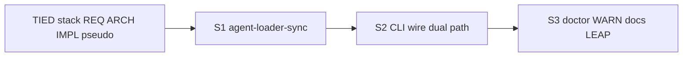

# PLAN — [REQ-TIED_AGENT_LOADER_REFRESH]

**Request token:** `REQ-TIED_AGENT_LOADER_REFRESH`  
**Workflow:** `@add-feature` (Cursor plan) → `@refine-plan` (this pass) → `@build-plan`  
**`plan_phase`:** `pre-implementation`  
**Adversarial depth:** `minimal` · **Gate policy:** `advisory`  
**Execution site:** TIED store repo (bootstrap)

---

## Problem statement (locked)

`tied-install --refresh` refreshes **`tied-bundle/`**, linked skills, MCP path fields, and **`tied-bundle/install.json`** store semver pin ([REQ-TIED_INSTALL_JSON_REFRESH_SEMVER](tied-project/citdp/CITDP-REQ-TIED_INSTALL_JSON_REFRESH_SEMVER.yaml)), but **root client `AGENTS.md` stays create-if-absent forever** once written.

That is **not** gated by version or mtime: [`installDbLayer`](../../../tools/bootstrap/lib/layers/db.mjs) and legacy [`bootstrap.mjs`](../../../tools/bootstrap/lib/bootstrap.mjs) only copy when `!fs.existsSync(dest)`.

**Symptom (e.g. hl7receiver):** `install.json` at **4.2.1** and refreshed `tied-bundle/docs/ai-principles.md` (no per-turn `TIEDv` stamp), while **client `AGENTS.md` still mandates `TIEDv4.0.0:`**. Cursor loads the stale loader via **`.cursorrules` → `AGENTS.md`**, so agents contradict refreshed methodology.

**Sponsor choice (locked):** Default bootstrap is **more aggressive** for **`AGENTS.md` only**—sync from store when client loader semver is **behind** store semver. Provide **`--preserve-agent-loader`** (and env mirror) to retain today’s create-if-absent behavior for brownfield/custom loaders.

---

## Scope

| In | Out |
| --- | --- |
| Semver-driven `AGENTS.md` sync on db layer + legacy bootstrap path | `.cursorrules`, `tied-project/config.yaml` (still create-if-absent) |
| CLI `--preserve-agent-loader`, `TIED_BOOTSTRAP_PRESERVE_AGENT_LOADER` | Client root `VERSION` overwrite on refresh |
| `agent-loader-sync.mjs` unit + install integration tests | `tied-project/agent-inject/` merge/composition |
| Operator WARN when `AGENTS.md` semver ≠ `install.json` pin | Mass-editing frozen `checklist-tracker.yaml` session-bootstrap copies |
| LEAP REQ/ARCH/IMPL + parent `REQ-TIED_SETUP` criterion | Parity A methodology tree changes |

---

## Locked decisions (refine-plan)

| ID | Decision | Rationale |
| --- | --- | --- |
| **D-SCOPE-AGENTS-ONLY** | Only **`AGENTS.md`** gets semver sync; other **`BASE_FILES`** unchanged | Sponsor scope |
| **D-SYNC-TRIGGER** | Update when client parsed semver **&lt;** store semver (`readStoreMethodologySemver`); skip when equal or client newer | Avoid clobbering fork/experiment; idempotent refresh |
| **D-UNPARSEABLE** | Client semver missing/invalid → **overwrite** from store (default) + WARN; skip when **`preserve`** | Stale loaders often predate version line discipline |
| **D-PRESERVE-FLAG** | **`--preserve-agent-loader`** / **`TIED_BOOTSTRAP_PRESERVE_AGENT_LOADER=1`** → create-if-absent only (today) | Explicit brownfield contract |
| **D-COPY-MECHANISM** | Use existing **`copyFileWithAttributes`** (modification WARN on non-midnight mtime) | Reuse [REQ-TIED_SETUP] managed copy semantics |
| **D-SEMVER-COMPARE** | Tuple compare `major.minor.patch` in bootstrap (no new npm dependency) | Keep bootstrap self-contained |
| **D-DUAL-ENTRY** | Wire **`syncAgentsMd`** from **`installDbLayer`** and legacy **`bootstrap.mjs`** BASE_FILES loop | Both install paths remain in use |
| **D-OPERATOR-WARN** | After install, if **`AGENTS.md`** semver ≠ **`install.json.store_methodology_version`** → **`sayWarn`** + refresh hint | Catches `--preserve` + stale loader drift |
| **D-LEAP-PARENTS** | Extend **`REQ-TIED_SETUP`** satisfaction criteria; depend on **`REQ-TIED_LAYERED_CLIENT_INSTALL`**, **`REQ-TIED_INSTALL_JSON_REFRESH_SEMVER`** | Traceability without duplicating layered install stack |

---

## Target behavior table

| Situation | Default | `--preserve-agent-loader` |
| --- | --- | --- |
| `AGENTS.md` missing | Copy from store | Same |
| Client semver **&lt;** store semver | Overwrite (`copyFileWithAttributes`) | Skip |
| Equal | Skip | Skip |
| Client semver **&gt;** store | Skip + diagnostic WARN | Skip |
| Unparseable client semver | Overwrite + WARN | Skip |

**Applies on:** any pass that runs **db layer** (initial install and **`--refresh`**).

---

## Build phases (`@build-plan`)



### Phase 0 — TIED records (before RED)

- Create **`REQ-TIED_AGENT_LOADER_REFRESH`**, **`ARCH-TIED_AGENT_LOADER_REFRESH`**, **`IMPL-TIED_AGENT_LOADER_REFRESH`**, semantic tokens via TIED MCP / `tied-cli`.
- Sidecar **`IMPL-TIED_AGENT_LOADER_REFRESH-pseudocode.md`** — **`SYNC_AGENTS_MD`** with PRE/POST/EFFECTS.
- LEAP touch **`IMPL-TIED_LAYERED_CLIENT_INSTALL-pseudocode.md`** (db layer calls sync).
- Draft CITDP → persist under `tied-project/citdp/` at **`persist-citdp-record`** only.

### Phase 1 — S1 Core sync (RED → GREEN)

| File | Change |
| --- | --- |
| **New** [`tools/bootstrap/lib/agent-loader-sync.mjs`](../../../tools/bootstrap/lib/agent-loader-sync.mjs) | `readClientAgentsSemver`, `compareSemverTuple`, `syncAgentsMd` |
| **New** `agent-loader-sync.test.mjs` | T1 table per [test-strategy.md](./test-strategy.md) |
| [`store-methodology-version.mjs`](../../../tools/bootstrap/lib/store-methodology-version.mjs) | Optional export shared `parseAgentsVersionLine` (DRY) |

### Phase 2 — S2 Wiring (RED → GREEN)

| File | Change |
| --- | --- |
| [`layers/db.mjs`](../../../tools/bootstrap/lib/layers/db.mjs) | AGENTS.md: call `syncAgentsMd`; other BASE_FILES unchanged |
| [`bootstrap.mjs`](../../../tools/bootstrap/lib/bootstrap.mjs) | Same for legacy install |
| [`install-layers.mjs`](../../../tools/bootstrap/lib/install-layers.mjs) | Parse `--preserve-agent-loader`; pass through `installTiedLayers` options |
| [`install-layers-core.mjs`](../../../tools/bootstrap/lib/install-layers-core.mjs) | Thread `preserveAgentLoader` into db layer |
| [`tied-install-help.mjs`](../../../tools/bootstrap/lib/tied-install-help.mjs) | Document flag |
| Extend `install-layers.integration.test.mjs` | T2 refresh updates stale AGENTS; preserve leaves bytes |

### Phase 3 — S3 Operator surface + close loop

| File | Change |
| --- | --- |
| `install-layers-core.mjs` or small `agent-loader-drift.mjs` | Post-manifest WARN when AGENTS ≠ install.json pin (T3) |
| [`tools/bootstrap/README.md`](../../../tools/bootstrap/README.md) | BASE_FILES table + flag |
| [`tied-bundle/docs/methodology-migration.md`](../../../tied-bundle/docs/methodology-migration.md) | Preservation matrix row for `AGENTS.md` |
| [`tied-project/vocab/tied-methodology.md`](../../vocab/tied-methodology.md) | Release checklist: witness AGENTS line after refresh |
| [`CHANGELOG.md`](../../../CHANGELOG.md) | Operator note |
| `tied_validate_consistency` · `lint_yaml` on changed project YAML |

---

## Satisfaction criteria (new REQ — draft for build)

| ID | Criterion | Metric |
| --- | --- | --- |
| **SC-ALR-SYNC** | Client `AGENTS.md` 4.0.0 + store 4.2.1 → refresh overwrites loader semver line to 4.2.1 | `agent-loader-sync.test.mjs` + integration |
| **SC-ALR-PRESERVE** | Same fixture + `--preserve-agent-loader` → bytes unchanged | integration test |
| **SC-ALR-SKIP-NEWER** | Client semver &gt; store → no overwrite | unit test |
| **SC-ALR-CLI** | `--help` lists `--preserve-agent-loader`; env documented | help snapshot / README |
| **SC-ALR-WARN** | After refresh, AGENTS semver ≠ install.json pin → bootstrap emits WARN | unit/integration T3 |

**Parent LEAP:**

- **`REQ-TIED_SETUP`** — add criterion: brownfield refresh syncs install-managed **`AGENTS.md`** when client semver lags store unless preserve flag.

---

## Module boundaries

```text
tools/bootstrap/lib/agent-loader-sync.mjs     # semver parse + sync decision + copy
tools/bootstrap/lib/layers/db.mjs           # layered install hook
tools/bootstrap/lib/bootstrap.mjs             # legacy install hook
tools/bootstrap/install-layers.mjs            # CLI flag
```

---

## Risk assessment

| Risk | Tier | Mitigation |
| --- | --- | --- |
| Sponsor-edited `AGENTS.md` wiped on store bump | **Reversible** (git) / **Costly** if uncommitted | `copyFileWithAttributes` WARN; **`--preserve-agent-loader`** |
| Client semver &gt; store (fork) blocks sync | Reversible | WARN only; document merge path |
| Legacy vs layered install drift | Reversible | Dual wire per **D-DUAL-ENTRY** |
| Tuple compare vs full semver spec | Low | Document: strict `^\d+\.\d+\.\d+$` only (same as store reader) |

---

## Verification (operator)

```bash
# Stale loader client (e.g. hl7receiver)
./tied-install.sh --refresh /path/to/client
grep 'TIED Methodology Version' /path/to/client/AGENTS.md
jq '.store_methodology_version' /path/to/client/tied-bundle/install.json

# Intentional custom loader
./tied-install.sh --refresh --preserve-agent-loader /path/to/client
```

---

## Plan-mode handoff

**Next:** `@build-plan` — Phase 0 TIED stack, then S1→S3 RED/GREEN per [test-strategy.md](./test-strategy.md).

**Disk:** [checklist-tracker.yaml](./checklist-tracker.yaml) · [CITDP draft](./CITDP-REQ-TIED_AGENT_LOADER_REFRESH.draft.yaml) · [evidence/session-handoff.md](./evidence/session-handoff.md)
