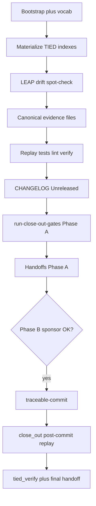

# plan-close-out — [REQ-TIED_BOUNDED_COMPOSITION]

**Plan status:** Refine pass **2** (2026-10-18) — ready for `@plan-close-out` execution.  
**Product:** Build Slices 0–5 complete ([session-handoff.md](evidence/session-handoff.md)).  
**Tracker:** [checklist-tracker.yaml](checklist-tracker.yaml)  
**Close-out test outline:** [test-strategy-close-out.md](test-strategy-close-out.md)  
**CITDP:** [CITDP-REQ-TIED_BOUNDED_COMPOSITION.yaml](CITDP-REQ-TIED_BOUNDED_COMPOSITION.yaml) · persisted [citdp/CITDP-REQ-TIED_BOUNDED_COMPOSITION.yaml](../../citdp/CITDP-REQ-TIED_BOUNDED_COMPOSITION.yaml)

**Constraints:** [plan-close-out skill](../../../tools/bundled-prompt-type-skills/plan-close-out/SKILL.md) — no `git add` / `git commit` in Phase A; `TIED_BASE_PATH` = `/Users/fareed/Documents/dev/chatgpt/stdd/tied-project`.

**Refine gate (pass 2):** `pre_implementation` **allowed** — [refine-plan-gate-result-pass2.json](evidence/refine-plan-gate-result-pass2.json) (build activation `bc-preimpl-20261018` stands).

---

## Refine (Touchpoint 1 — RESOLVE)

### Intent (one line)

Finish **process and machine close-out** for **[REQ-TIED_BOUNDED_COMPOSITION]**: materialize the TIED stack that build minted only to JSON, raise adherence reconcile to **band A**, replay unified close-out gates, add **CHANGELOG**, prepare **traceable-commit** — then commit the BC wave in Phase B so `close_out` may allow.

### Canonical terms

| Term | Meaning |
| --- | --- |
| **Machine close-out** | `merged_decision.allowed: true` **and** envelope `blocking_gap_count: 0` with `fail_on_error_gaps: true` at integrated depth |
| **BC wave** | Staged paths for one commit: bounded-composition module, envelope/working-root wiring, TIED tokens, vocab, citdp, working evidence, harness2 doc snapshot |
| **Mint debt** | Slice 0 wrote [evidence/mint-*.json](evidence/) but project indexes ([requirements.yaml](../../requirements.yaml), etc.) were never updated |
| **Dual-write** | Same pass updates `execution_evidence.completed` and `steps[].tracking.status` in the Tracker |

### Sponsor decisions (recorded)

| Decision | Choice | Ladder |
| --- | --- | --- |
| Close-out `run_id` (Phase A) | `bc-plan-close-out-20261018` | **Reversible** |
| Post-commit `run_id` (Phase B) | `bc-closeout-post-commit-20261018` | **Reversible** |
| Commit timing | Phase B in **same program** after Phase A + sponsor confirms staging | **Costly** — agent commits only when sponsor confirms message/scope |
| Product scope | **No new features** unless LEAP drift on replay | **Reversible** |
| `depth_tier` / `gate_policy` | **integrated** / **advisory** (locked from build) | Locked |
| Costly choices C1–C3 | Unchanged deferrals from build | See CITDP `leap_feedback` |

### Non-goals

- Methodology-composition-matrix Harness² row (C1)
- External executor binaries in repo (C2)
- Committing `tied-bundle/working/REQ-TIED_BOUNDED_COMPOSITION/adversarial-inquiry/` unless sponsor opts in
- Bundling unrelated workspace drift in the BC commit

### RESOLVE charter

Agent prepares evidence, CHANGELOG, and proposed commit message; sponsor owns final staging scope and Phase B commit timing.

---

## Plan (CITDP + test strategy)

### Change definition (close-out delta only)

| | Current | Desired |
| --- | --- | --- |
| **TIED indexes** | Mint JSON only; no REQ detail file on disk | Full REQ/ARCH/IMPL indexes + detail files |
| **Adherence** | Band **C** — missing canonical slug evidence | Band **A** |
| **CHANGELOG** | No BC bullet | [Unreleased] entry (PCR/CAE style) |
| **Machine close_out** | Blocked on `traceable-commit` | **Pass** after Phase B |
| **Handoff** | Build [session-handoff.md](evidence/session-handoff.md) only | + `plan-close-out-handoff.md`, `PLAN-CLOSE-OUT.md` |

### Gap evidence (authoritative)

| Gap | Receipt |
| --- | --- |
| Indexes empty | Grep `TIED_BOUNDED` absent from project index YAMLs |
| Band C | [run-close-out-gates-slice5.json](evidence/run-close-out-gates-slice5.json) reconcile score 69 |
| `traceable-commit` blocker | [close_out-gate-result-slice5.json](evidence/close_out-gate-result-slice5.json) |

### Risks (close-out wave)

| Risk | Mitigation |
| --- | --- |
| Claiming “done” from gate alone | Report **three completion signals** separately |
| Staging unrelated files | BC wave cheat sheet below; sponsor review before Phase B |
| `command_evidence` reconcile parse errors | Ensure `unit-test-green-evidence.md` cites stdout path as plain file_path ref where needed |
| Out-of-workspace plan URL in Tracker | Replace with [PLAN-CLOSE-OUT.md](PLAN-CLOSE-OUT.md) or [test-strategy.md](test-strategy.md) |

### Test strategy

Authority: [test-strategy-close-out.md](test-strategy-close-out.md) (replay). Full matrix: [test-strategy.md](test-strategy.md).

---

## Implement (execution order)



### 1. Bootstrap

- MCP `tied_config_get_base_path` → `tied-project/`.
- PRELOAD [agentstream.md](../../vocab/agentstream.md), [fidelity-research.md](../../vocab/fidelity-research.md), [quality-assurance.md](../../vocab/quality-assurance.md), [behavior-bounded-change-engineering.md](../../vocab/behavior-bounded-change-engineering.md), [pseudocode-and-citdp.md](../../vocab/pseudocode-and-citdp.md).

### 2. Materialize TIED stack (MCP-first)

From [evidence/mint-tokens-req.json](evidence/mint-tokens-req.json), [mint-tokens-arch.json](evidence/mint-tokens-arch.json), six `mint-IMPL-*.json`:

- Insert index rows + create detail files (REQ/ARCH/IMPL).
- Register tokens in [semantic-tokens.yaml](../../semantic-tokens.yaml).
- `lint_yaml` + `tied_validate_consistency`.

Sidecars already on disk: [implementation-decisions/IMPL-TIED_BOUNDED_*-pseudocode.md](../../implementation-decisions/).

### 3. LEAP sanity

Spot-check [mcp-server/src/bounded-composition/](../../../../mcp-server/src/bounded-composition/) vs sidecars; update sidecars only if drift. Confirm [docs/comparisons/tied-vs-harness2.md](../../../../docs/comparisons/tied-vs-harness2.md) implementation snapshot.

### 4. Canonical evidence (before gate replay)

| File | Content |
| --- | --- |
| `translate-sponsor-intent-evidence.md` | PLAN-HARNESS2-COMPARISON → six modules; link [tied-vs-harness2.md](../../../../docs/comparisons/tied-vs-harness2.md) |
| `session-bootstrap-evidence.md` | PRELOAD + TIED_BASE_PATH |
| `change-definition-evidence.md` | CITDP change_definition summary |
| `impact-discovery-evidence.md` | CITDP impact + impl_inventory |
| `risk-assessment-evidence.md` | integrated/advisory; C1–C3 |
| `test-strategy-evidence.md` | Pointer to [test-strategy.md](test-strategy.md) |
| `author-requirement-evidence.md` | REQ detail path after mint |
| `gate-pseudocode-validation-evidence.md` | [pseudocode-gate-slice0.json](evidence/pseudocode-gate-slice0.json) |
| `sub-adversarial-inquiry-pass-evidence.md` | `bc-preimpl-20261018` structural pass |
| `unit-test-green-evidence.md` | 45/45 + stdout ref |
| `composition-integration-evidence.md` | binding inventory validate slice5 |
| `three-way-alignment-unit-evidence.md` | PSA gate_mode six IMPL |
| `verification-gate-evidence.md` | `bc-verify-20261018` receipt |
| `verification-evidence-manifest.v1.json` | Replay command results |
| `gitignore-close-out-hygiene-evidence.md` | N/A or [.gitignore](../../../../.gitignore) delta |
| `sub-close-out-evidence-sync-evidence.md` | Phase A run_id + receipt path |
| `traceable-commit-evidence.md` | Prepared; Phase B completes commit |

Fix Tracker: remove `file:///Users/fareed/.cursor/plans/...` refs → in-repo [PLAN-CLOSE-OUT.md](PLAN-CLOSE-OUT.md).

### 5. Verification replay

See [test-strategy-close-out.md](test-strategy-close-out.md).

### 6. CHANGELOG (before user-facing release notes if added)

Insert [Unreleased] **Added** bullet in [CHANGELOG.md](../../../../CHANGELOG.md): tokens, `mcp-server/src/bounded-composition/`, 45 tests, proof boundaries (`default_off`, advisory shadow/divergence), CITDP link, `run_id=bc-plan-close-out-20261018`.

### 7. Unified close-out replay (Phase A)

```bash
node tools/bootstrap/templates/run-close-out-gates.mjs \
  --project-root /Users/fareed/Documents/dev/chatgpt/stdd \
  --request-token REQ-TIED_BOUNDED_COMPOSITION \
  --tracker-path tied-project/working/REQ-TIED_BOUNDED_COMPOSITION/checklist-tracker.yaml \
  --citdp-path tied-project/working/REQ-TIED_BOUNDED_COMPOSITION/CITDP-REQ-TIED_BOUNDED_COMPOSITION.yaml \
  --phase close_out \
  --run-id bc-plan-close-out-20261018 \
  --envelope-blocking --sync-dispositions --reconcile
```

Save: [evidence/closeout-run-close-out-gates-plan-close-out.json](evidence/closeout-run-close-out-gates-plan-close-out.json).

**Phase A completion signals:** process contract + adherence **pass** (band A target); machine close-out **partial** if `traceable-commit` still pending.

### 8. Handoffs Phase A (no commit)

| Artifact | Action |
| --- | --- |
| `evidence/plan-close-out-handoff.md` | Three completion signals |
| `evidence/session-handoff.md` | Plan-close-out wave, run_ids, resume |
| `citdp/CITDP-REQ-TIED_BOUNDED_COMPOSITION.yaml` | Sync if CITDP edited |

### Phase B — traceable-commit (same program)

1. Vocab **VALIDATE** (Touchpoint 3).
2. Stage **BC wave** only → `git commit` (hooks pass).
3. Mark **`traceable-commit`** completed (dual-write Tracker).
4. Re-run close_out with `--run-id bc-closeout-post-commit-20261018`.
5. `tied_verify` with update; `tied_validate_consistency`.
6. Refresh handoffs with commit SHA; machine close-out **pass** if gate allows.

### Gitignore ([PROC-GITIGNORE_CLOSE_OUT])

Document N/A or unstaged patterns in `gitignore-close-out-hygiene-evidence.md`. Do not commit inquiry trees by default.

### Proposed commit message (Phase B — sponsor only)

```
feat(mcp): TIED bounded composition modules (Harness²-inspired, default-off)

REQ-TIED_BOUNDED_COMPOSITION: pilot budget, trajectory evidence, read-only
divergence, draft lesson distillation, advisory shadow comparison, injectable
AgentDriver seam under mcp-server/src/bounded-composition/; envelope and
working-root wiring; six IMPL sidecars. Close-out run_id=bc-plan-close-out-20261018;
45 focused tests; binding inventory seven seams.

Proof boundaries: default_off_opt_in_only; shadow/divergence advisory not gate
authority; raw trajectories operator-local.

Refs: ARCH-TIED_BOUNDED_COMPOSITION, IMPL-TIED_BOUNDED_* 
```

### Staging scope (BC wave)

- `mcp-server/src/bounded-composition/**`
- `mcp-server/src/working-root.ts`, `mcp-server/src/request-evidence-envelope/**`, agentstream-related deltas from build
- `tied-project/requirements/`, `architecture-decisions/`, `implementation-decisions/` (BC tokens), `semantic-tokens.yaml`
- `tied-project/vocab/{agentstream,fidelity-research,quality-assurance}.md`
- `tied-project/citdp/CITDP-REQ-TIED_BOUNDED_COMPOSITION.yaml`
- `tied-project/working/REQ-TIED_BOUNDED_COMPOSITION/**`
- `docs/comparisons/tied-vs-harness2.md`, `CHANGELOG.md`, `.gitignore` if intentional

---

## Out of scope

- Phase A `git commit` / push
- C1 matrix edit; C2 external executors
- Optional methodology-learning experiment upsert

**Next command:** `@plan-close-out` (execute this plan).
