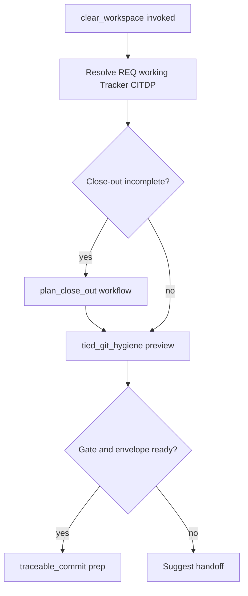

# [REQ-TIED_CLEAR_WORKSPACE_SKILL] Clear-workspace skill — refined plan

**Status:** Refined (2026-10-18). **Program:** [../PLAN-HANDOFF-CLEAR-WORKSPACE-SKILLS/PLAN.md](../PLAN-HANDOFF-CLEAR-WORKSPACE-SKILLS/PLAN.md)

**Invoke name:** **`clear-workspace`** (`/clear-workspace`, `@clear-workspace`).

---

## Intent

Standalone orchestrator skill that runs **as merited**:

1. **`tied_git_hygiene`** (preview-first; guarded apply only with sponsor allowlist)
2. **`@plan-close-out`** procedure when close-out artifacts or gates are missing
3. **Checklist `traceable-commit` prep** (vocab VALIDATE, staging map, gitignore hygiene bullets) when close-out is green — **commit only if sponsor explicitly requests**

When the workspace is not commit-ready, stop with blockers and suggest **`@handoff`**.

---

## TIED stack (mint at build-plan)

| Layer | Token |
| --- | --- |
| REQ | **REQ-TIED_CLEAR_WORKSPACE_SKILL** |
| ARCH | **ARCH-TIED_CLEAR_WORKSPACE_SKILL_BOUNDARY** — orchestrator; does not replace gates or MCP authority |
| IMPL | **IMPL-TIED_CLEAR_WORKSPACE_SKILL** — SKILL.md + `prompt-shared/clear-workspace-routing.md` + manifest |

**Manifest row (target):**

```json
{ "skillName": "clear-workspace", "storeDir": "tools/bundled-clear-workspace-skill" }
```

**Cross-refs:** [REQ-TIED_GIT_HYGIENE], [REQ-PROMPT_TYPE_GLOBAL_SKILLS] (`plan-close-out`), checklist **`traceable-commit`**, [gitignore-close-out-hygiene.md](../../../tools/bundled-prompt-type-skills/prompt-shared/gitignore-close-out-hygiene.md).

---

## Routing (normative copy in prompt-shared)

Authoritative decision tree lives in **`tools/bundled-prompt-type-skills/prompt-shared/clear-workspace-routing.md`** (installed with prompt-shared). SKILL.md links to it and states **Forbidden** alignments with plan-close-out (no unprompted commit).



---

## Non-goals

- New MCP tools
- Prompt-type leaf registration
- **`ammend-commit`** unless sponsor attaches staged-patch context separately

---

## Governing decisions

- **depth_tier:** minimal
- **gate_policy:** advisory

---

## Satisfaction criteria

| id | Criterion |
| --- | --- |
| `skill-body` | SKILL.md + shared routing doc |
| `manifest` | `clear-workspace` in standalone catalog |
| `boundaries` | No auto-commit; three completion signals not claimed without close-out |
| `test` | Bootstrap marker `/clear-workspace` |

---

## Declared change surface

- `tools/bundled-clear-workspace-skill/SKILL.md` (new)
- `tools/bundled-prompt-type-skills/prompt-shared/clear-workspace-routing.md` (new)
- `tools/bootstrap/manifest.json`
- Bootstrap tests (shared with handoff REQ wave)
- TIED project YAML
- `tied-project/vocab/project-operations-mcp.md`

**CITDP:** [CITDP-REQ-TIED_CLEAR_WORKSPACE_SKILL.yaml](./CITDP-REQ-TIED_CLEAR_WORKSPACE_SKILL.yaml)  
**Tracker:** [checklist-tracker.yaml](./checklist-tracker.yaml)  
**Tests:** [test-strategy.md](./test-strategy.md)
