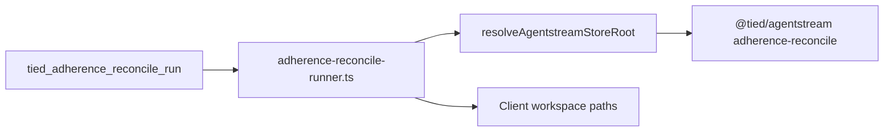

# PLAN — S4 linked-client adherence reconcile ([REQ-TIED_CLIENT_OPERATOR_TOOLING])

**Status:** Implemented (store) — verification 2026-11-06  
**Slice:** S4 (reopens parent REQ; S1–S3 closed 2026-11-01)  
**Request token:** `REQ-TIED_CLIENT_OPERATOR_TOOLING`  
**Adversarial depth:** `minimal`  
**Gate policy:** `advisory`  
**Sponsor context:** Linked client **hl7receiver** (`/Users/fareed/Documents/persante/repos/hl7receiver`) fails `tied_adherence_reconcile_run` because [`resolveAdherenceReconcileArgv`](../../../mcp-server/src/tools/adherence-reconcile-runner.ts) locates `@tied/agentstream` under the **client** tree. Store MCP already runs from `stdd/mcp-server/dist/index.js` with `TIED_STORE_ROOT` in `.cursor/mcp.json`.

**Related plans:** Parent [PLAN.md](PLAN.md) (S1–S3); Cursor mirror [linked_client_reconcile_resolve_704ac670.plan.md](../../../.cursor/plans/linked_client_reconcile_resolve_704ac670.plan.md).

---

## 1. Change definition (Refine)

| Field | Value |
|-------|--------|
| **current_behavior** | `resolveAdherenceReconcileArgv` uses `repo_root` or `findRepoRoot(cwd)` (requires client `mcp-server/package.json`) to find `mcp-server/packages/agentstream/dist/index.js`. [`run-close-out-gates.mjs`](../../../tools/bootstrap/templates/run-close-out-gates.mjs) passes `repo_root: projectRoot`. Linked clients have store MCP + `TIED_STORE_ROOT` on disk but no client `mcp-server/`. Operators patch with `ADHERENCE_RECONCILE_BIN` wrappers. [`tied-post-session.sh`](../../../scripts/tied-post-session.sh) still falls back to removed Go `cmd/adherence-reconcile`. |
| **desired_behavior** | Resolve **store root** independently of client layout via MCP module self-anchor (primary), then `TIED_STORE_ROOT` (MCP child env), then client `mcp.json` / bootstrap runtime config, then monolithic walk. Spawn reconcile subprocess with **`cwd = workspace`** (client project root). `tied_adherence_reconcile_run` and `run-close-out-gates --reconcile` succeed without `ADHERENCE_RECONCILE_BIN` when store agentstream dist is built. |
| **non_goals** | In-process reconcile (no subprocess); new MCP `store_root` arg (env-audit follow-on); copying `mcp-server` into clients; reopening Go agentstream. |
| **success_criterion_id** | `linked-reconcile-store-resolve` (new REQ satisfaction criterion) |

**Precedent:** [CITDP-REQ-TIED_JEV_DECISION_COPROCESSOR-STORE-DIST-LINKED-CLIENT](../../../tied-project/citdp/CITDP-REQ-TIED_JEV_DECISION_COPROCESSOR-STORE-DIST-LINKED-CLIENT.yaml) — package anchor + disk config for linked clients.

---

## 2. Impact analysis

| Layer | Artifacts |
|-------|-----------|
| **REQ** | LEAP [REQ-TIED_CLIENT_OPERATOR_TOOLING](../../../tied-project/requirements/REQ-TIED_CLIENT_OPERATOR_TOOLING.yaml): add criterion `linked-reconcile-store-resolve`; status `Implemented` → `In Progress` during build → `Implemented` at close-out |
| **ARCH** | LEAP [ARCH-TIED_CLIENT_OPERATOR_TOOLING](../../../tied-project/architecture-decisions/ARCH-TIED_CLIENT_OPERATOR_TOOLING.yaml): one sentence on store-vs-client root for reconcile spawn |
| **IMPL** | LEAP [IMPL-TIED_CLIENT_OPERATOR_TOOLING](../../../tied-project/implementation-decisions/IMPL-TIED_CLIENT_OPERATOR_TOOLING.yaml) + sidecar pseudo-code block `RESOLVE_AGENTSTREAM_STORE_ROOT` |
| **Parents (cross-ref only)** | [REQ-TIED_CHECKLIST_GATE_ENFORCEMENT], [REQ-TIED_RUNTIME_DISK_CONFIG], [REQ-TIED_UNIFIED_TOOLCHAIN] |
| **Code** | `mcp-server/src/tools/adherence-reconcile-runner.ts` (and optional `resolve-agentstream-store.ts`); `mcp-server/src/tools/index.ts` (tool description); `tools/bootstrap/templates/run-close-out-gates.mjs`; `scripts/tied-post-session.sh` |
| **Tests** | `adherence-reconcile-resolve.test.ts` or extend `adherence-reconcile-mcp.test.ts`; `run-close-out-gates-order.test.mjs` linked-client fixture |
| **Docs** | `CHANGELOG.md`, `mcp-server/packages/agentstream/README.md`, `mcp-control-env-audit.md` note |

### Module boundary



### Store resolution order (locked)

1. `ADHERENCE_RECONCILE_BIN` / legacy `AGENTSTREAM_BIN` sibling (unchanged).
2. **MCP self-anchor** — walk from `import.meta.url` (`dist/tools/adherence-reconcile-runner.js`) until `{store}/mcp-server/packages/agentstream/dist/index.js` exists.
3. **`process.env.TIED_STORE_ROOT`** when MCP injects from client `mcp.json` and dist exists.
4. **`resolveRuntimeIntrospection(workspace)`** / bootstrap `resolveTiedRuntimeConfig` from client root.
5. Monolithic `findRepoRoot` (embedded store in client).
6. Fail closed — operator message: `./build-workspace.sh`, `tied-install.sh --refresh`.

**API:** `repo_root` on `ReconcileRunInput` deprecated for binary lookup; use `workspace` for client `cwd` and disk introspection. Ignored or documented no-op for store path when self-anchor wins.

**S3 correction:** Parent PLAN S3 explicitly set `repo_root` to `projectRoot`; S4 **removes** that for spawn resolution (keep reconcile-after-persist ordering from S3).

---

## 3. Risk assessment

| Risk | Tier | Mitigation |
|------|------|------------|
| Self-anchor resolves wrong store when multiple trees on disk | Reversible | Prefer explicit `TIED_STORE_ROOT` / mcp.json when env disagrees with anchor; unit tests with isolated temp dirs |
| Subprocess `cwd` change affects relative path reads in reconcile CLI | Reversible | Reconcile CLI uses `--workspace` and absolute MCP args; RED fixture with relative vs absolute |
| Breaking operators who relied on `repo_root` forcing client-local dist | Reversible | Monolithic fallback retained; CHANGELOG |
| Stale MCP dist without agentstream package build | Costly if silent | Fail with build hint (existing pattern) |

**Counterexample:** MCP runner copied outside store tree (no anchor) — disk arm must succeed.  
**Falsification question:** Does reconcile still fail when only shell-exported `TIED_STORE_ROOT` is set (RDC ignores shell) but mcp.json is correct? Expect pass via MCP child env, not shell.

---

## 4. Test strategy (design only — RED in build-plan)

| ID | Type | Target | Proves |
|----|------|--------|--------|
| R1 | Unit | `resolveAdherenceReconcileArgv` / `resolveAgentstreamStoreRoot` | Self-anchor from dist module path |
| R2 | Unit | Temp linked client dir (`.cursor/mcp.json` + no client `mcp-server/`) | `runAdherenceReconcile` → `ok: true` minimal fixture |
| R3 | Unit | `repo_root: clientRoot` + `workspace: clientRoot` | Regression: does not break when deprecated field set |
| R4 | Unit | Existing Stage L pilot / legacy ledger tests | No monolithic regression |
| R5 | Bootstrap | `run-close-out-gates-order.test.mjs` | `--reconcile` without `repo_root` misuse |
| R6 | Manual | hl7receiver MCP tool | Sponsor smoke post-ship |

Fixture pattern: [`jev-harness-shared.test.ts`](../../../mcp-server/packages/agentstream/src/jev-harness-shared.test.ts).

**Commands (verification gate):**

```bash
cd mcp-server && npm test
node --test tools/bootstrap/templates/run-close-out-gates-order.test.mjs
```

---

## 5. Implementation sequence (build-plan)

1. Copy tracker [checklist-tracker-s4-linked-reconcile.yaml](checklist-tracker-s4-linked-reconcile.yaml); complete `change-definition` … `test-strategy` dispositions.
2. LEAP REQ/ARCH/IMPL + pseudo-code `RESOLVE_AGENTSTREAM_STORE_ROOT` (validate pseudo-code gate).
3. **RED** R1–R5.
4. Implement resolver + runner + close-out runner + `tied-post-session.sh`.
5. **GREEN**; LEAP parent REQ criterion; update MCP tool description.
6. Persist [CITDP-REQ-TIED_CLIENT_OPERATOR_TOOLING-s4-linked-reconcile.yaml](CITDP-REQ-TIED_CLIENT_OPERATOR_TOOLING-s4-linked-reconcile.yaml) → `tied-project/citdp/`; `lint_yaml`; `tied_validate_consistency`; CHANGELOG.

---

## 6. Gates

| Phase | Action |
|-------|--------|
| pre_implementation | Advisory `tied_checklist_gate_validate` with S4 tracker after TIED stack stub |
| verification | R1–R5 green |
| close_out | CITDP persist + hl7receiver smoke note in evidence |

---

## 7. Out of scope (S4)

- Optional MCP tool arg for bin path ([REQ-TIED_ENVIRONMENT_VARIABLE_POLICY] follow-on).
- Shared `@tied/runtime-disk` package extraction.
- Auto-build agentstream on reconcile failure.

---

## 8. Handoff

**Next:** `@build-plan` linked to this file and [checklist-tracker-s4-linked-reconcile.yaml](checklist-tracker-s4-linked-reconcile.yaml).

**Client rollout:** After store release, hl7receiver: `tied-install.sh --refresh`, rebuild store if needed, MCP restart — remove any local `ADHERENCE_RECONCILE_BIN` wrapper.
