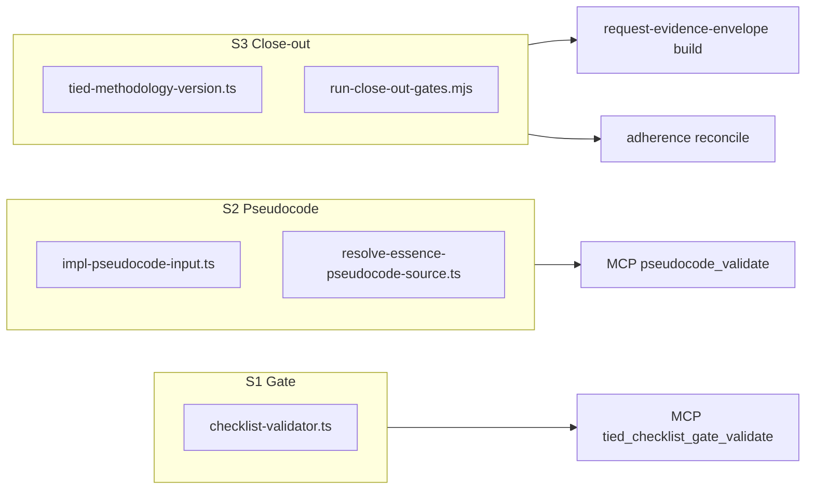
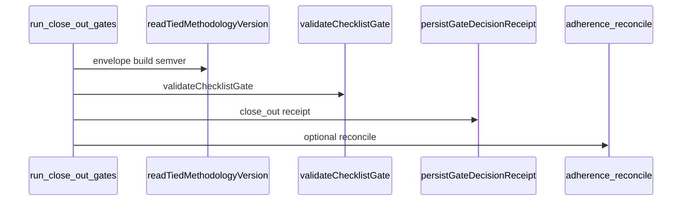

# PLAN — [REQ-TIED_CLIENT_OPERATOR_TOOLING]

**Status:** Implemented (S1–S3) — S4 in progress: [PLAN-s4-linked-reconcile.md](PLAN-s4-linked-reconcile.md)  
**S1–S3 handoff:** [plan-close-out-handoff.md](plan-close-out-handoff.md)  
**Request token:** `REQ-TIED_CLIENT_OPERATOR_TOOLING`  
**Adversarial depth:** `minimal` (tooling parity; no new integrated inquiry activation)  
**Gate policy:** `advisory` (inherits CITDP default for checklist gate enforcement)  
**Parent context:** wf-01 / `test-new-tied-client` operator pain ([TODO.md](../../../TODO.md) 2026-11-01)

---

## 1. Problem statement (Refine)

Fresh **TIED clients** hit three **independent** platform bugs that do not require product feature work in the client repo itself:

| Slice | Operator symptom | Canonical cause |
|-------|------------------|-----------------|
| **S1 — Gate / sub_procedures** | `missing_required_step:sub-adversarial-inquiry-pass` on trackers copied from the methodology template | Gate validation uses `trackerSteps()` (main `steps` only) in `validateTracker`, `validateTrackerSparse`, and `validateIntegratedParentChildSlugs` while the template keeps that slug under `sub_procedures` in `tied-bundle/docs/agent-req-implementation-checklist.yaml`. `listChecklistTrackerSteps` already merges both pools (JEV sufficiency uses it). |
| **S2 — Pseudocode path** | `pseudocode_validate` with a file path reports **zero blocks**; inline text works | Path resolution ([REQ-PSEUDOCODE_VALIDATE_PATH_INPUT]) is implemented but clients often pass paths **relative to repo root** (`tied-project/implementation-decisions/…`) while `TIED_BASE_PATH` is **`tied-project/`**, so resolution misses the real sidecar or reads an empty/wrong file. |
| **S3 — VERSION + close-out runner** | Unified `run-close-out-gates.mjs` fails without store `VERSION`; `--reconcile` misses gate receipts | `readTiedMethodologyVersion` throws when client root has no `VERSION`; cwd=store is a brittle workaround. Runner runs **reconcile before** gate receipt persist (~L347 vs ~L454), and hardcodes `REPO_ROOT`/`MCP_DIST` from the script file path (~L32–33, ~L361). |

**LEAP parents (update criteria / status, do not replace):**

- [REQ-TIED_CHECKLIST_GATE_ENFORCEMENT]
- [REQ-PSEUDOCODE_VALIDATE_PATH_INPUT]
- [REQ-TIED_SETUP] + [REQ-REQUEST_EVIDENCE_ENVELOPE]

---

## 2. CITDP — impact and modules

### 2.1 Impact analysis

| Layer | Tokens / artifacts |
|-------|-------------------|
| REQ | New `REQ-TIED_CLIENT_OPERATOR_TOOLING`; LEAP touch on three parents above |
| ARCH | `ARCH-TIED_CLIENT_OPERATOR_TOOLING` (client operator plane: gate, validate, envelope semver) |
| IMPL | `IMPL-TIED_CLIENT_OPERATOR_TOOLING` (+ optional LEAP on existing IMPL gate/path/setup) |
| Code | `mcp-server/src/checklist-validator.ts`, `impl-pseudocode-input.ts`, `resolve-essence-pseudocode-source.ts`, `tied-methodology-version.ts`, `tools/bootstrap/templates/run-close-out-gates.mjs`, optional `tied-install` VERSION materialization |
| Tests | `checklist-validator.test.ts`, `resolve-essence-pseudocode-source.test.ts`, `pseudocode-validate-path-mcp.test.ts`, `tied-methodology-version.test.ts`, new bootstrap test for runner ordering, extend `new-tied-client` smoke if feasible |
| Docs | `CHANGELOG.md`; client doc note via project working handoff (methodology `client-development-index.md` is store-owned — LEAP proposal or install refresh, not ad-hoc client edit) |

### 2.2 Module boundaries

Slices **S1–S3** ship in one REQ for operator narrative; implement and test **in order S1 → S2 → S3** (S3 depends on semver for envelope smoke).

### 2.3 Risk assessment

| Risk | Tier | Mitigation |
|------|------|------------|
| Merging `sub_procedures` into gate validation changes disposition semantics for duplicate slugs in both pools | Reversible | `listChecklistTrackerSteps` already dedupes by slug (main wins over sub in map order — verify and document in test) |
| Removing implicit **cwd** semver fallback breaks operators who relied on store cwd | Costly if undocumented | Replace with explicit **`TIED_STORE_ROOT`** / `install.json` `store_methodology_version`; document in CHANGELOG |
| Reconcile-after-persist changes one-shot `--reconcile` semantics | Reversible | Document: reconcile validates **ledger + on-disk receipts including this run** |
| Bootstrap VERSION write on refresh overwrites sponsor semver | Costly | **Create-if-absent only**; never overwrite existing client `VERSION` on `--refresh` |

---

## 3. Design decisions (locked for build)

### S1 — Gate

- **Do not** move `sub-adversarial-inquiry-pass` into main template `steps`.
- Switch **gate path** to `listChecklistTrackerSteps` in:
  - `validateTracker`
  - `validateTrackerSparse`
  - `validateIntegratedParentChildSlugs`
- **Follow-up (same slice):** align helpers that affect gate outcomes:
  - `slugCompletedInTracker` / `stepCompleted` (used by pseudocode gate history and envelope PSA hydration)
  - `collectTrackerSlugs` (canonical slug validation should see sub_procedure slugs)
- Keep `trackerSteps` exported for callers that intentionally need main-only (grep before green).

### S2 — Pseudocode path

- In `resolvePseudocodePathUnderTiedBase`, when `base` basename is `tied-project` or legacy `tied`, strip a leading `tied-project/` or `tied/` segment from relative paths before resolve.
- RED must assert **`blocks.length > 0`** and parity with inline for repo-relative path shape.
- LEAP: reopen [REQ-PSEUDOCODE_VALIDATE_PATH_INPUT] with criterion **repo-root-relative path under client**.

### S3 — VERSION + runner

**Semver resolution order (deterministic, no cwd luck):**

1. Walk ancestors from `project_root` and from `projectRootFromTiedBase(tied_base_path)` for file `VERSION`.
2. Read `tied-bundle/install.json` field **`store_methodology_version`** (already in install config schema).
3. Parse **`AGENTS.md`** line `**TIED Methodology Version**:` (reuse regex from `tools/bootstrap/lib/tied-baseline-commit-message.mjs`).
4. Throw with message listing attempted anchors (do **not** add `process.cwd()` as silent fallback).

**Bootstrap (greenfield):** on `tied-install`, write root `VERSION` from store semver **only if missing**.

**Runner (`run-close-out-gates.mjs`):**

- Resolve `MCP_DIST` from, in order: env `TIED_MCP_BIN` dirname → client `.cursor/mcp.json` `tied-yaml` args[0] → `TIED_STORE_ROOT` from MCP env → fail with build hint.
- Set reconcile `repo_root` to **`args.projectRoot`** (client), not template `REPO_ROOT`.
- Move **`--reconcile`** block to **after** `persistGateDecisionReceipt` when phase is `close_out` and persist is not skipped.
- Add **`run-close-out-gates-order.test.mjs`** (static parse or fixture) asserting reconcile follows persist in source.

---

## 4. Test strategy

| ID | Type | Command / file | Proves |
|----|------|----------------|--------|
| T1 | Unit | `mcp-server/src/checklist-validator.test.ts` | Sub slug only under `sub_procedures` satisfies required slugs |
| T2 | Unit | `resolve-essence-pseudocode-source.test.ts` | `tied-project/…` prefix normalization |
| T3 | MCP | `pseudocode-validate-path-mcp.test.ts` | Path vs inline block count parity |
| T4 | Unit | `tied-methodology-version.test.ts` | AGENTS + install.json fallback; no cwd |
| T5 | Bootstrap | `tools/bootstrap/templates/run-close-out-gates-order.test.mjs` | Reconcile after persist |
| T6 | E2E smoke | `scripts/test-new-tied-client` (disposable) | Gate + validate path from **client** cwd with `--project-root` = client |

**RED before GREEN** per [PROC-TIED_DEV_CYCLE]. Run `npm test` in `mcp-server` after each slice.

---

## 5. Implementation sequence (build-plan)

1. **TIED stack** — REQ/ARCH/IMPL + pseudocode sidecar + `semantic-tokens.yaml`; copy tracker to `tied-project/working/REQ-TIED_CLIENT_OPERATOR_TOOLING/checklist-tracker.yaml`.
2. **S1** — Tests T1 → gate validator changes → full checklist-validator suite.
3. **S2** — Tests T2–T3 → path normalization → LEAP parent REQ.
4. **S3** — Tests T4–T5 → semver + runner → optional install VERSION → envelope build smoke on tmp client fixture.
5. **Acceptance T6** — Record commands in CITDP `execution_evidence`.
6. **Close-out** — `lint_yaml`, `tied_validate_consistency`, `CITDP-REQ-TIED_CLIENT_OPERATOR_TOOLING.yaml`, CHANGELOG.

---

## 6. Gates (pre_implementation → verification)

| Phase | When | Tool |
|-------|------|------|
| pre_implementation | After TIED stack + test strategy in tracker | `tied_checklist_gate_validate` with minimal depth (no activation pairing) |
| verification | All tests green | Same + disposable client smoke evidence |
| close_out | CITDP + CHANGELOG | Unified runner on this REQ working folder |

**Note:** `tied_checklist_gate_validate` for this REQ is **blocked until** tracker copy exists and `change-definition` / `test-strategy` steps are disposition-complete — first build-plan action.

---

## 7. Out of scope

- Go `tools/agentstream/checklist` gate parity (TypeScript is authoritative for MCP/`tied gate check`).
- Moving sub-adversarial steps in methodology checklist YAML.
- Full wf-01 four-model demo re-run (optional evidence only).

---

## 8. Handoff

- **Execute with:** `/build-plan` using this file as the linked plan.
- **Cursor plan mirror:** `.cursor/plans/client_tied_tooling_fixes_ab82c67c.plan.md` (keep in sync when build-plan edits scope).
