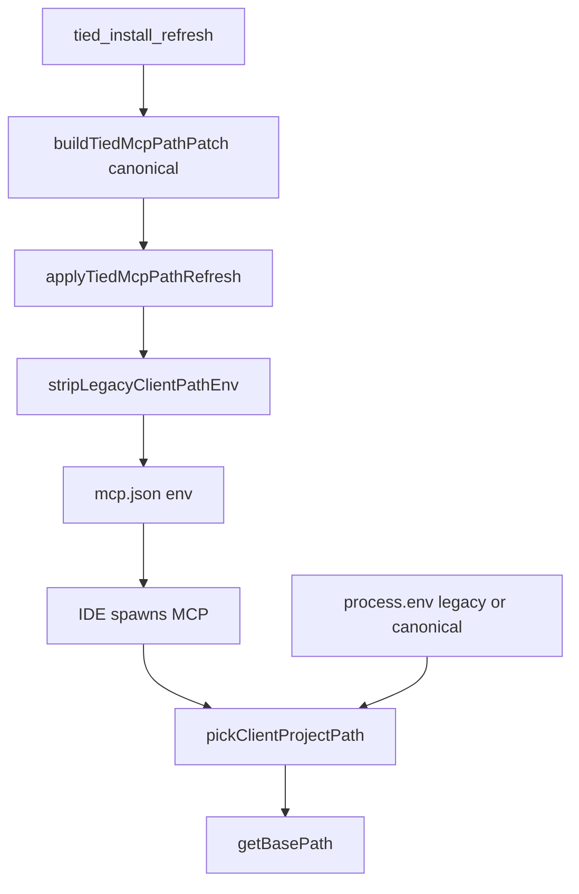

# PLAN — REQ-TIED_CLIENT_PATH_ENV_MIGRATION (refined)

**Prompt type:** refine-plan (pass 1 — 2026-10-29)  
**Linked Cursor plan:** `client_path_env_migration_192e4458.plan.md`  
**Sponsor decision:** [decision-record.md](decision-record.md) · vocab [tied-yaml-mcp.md](../../vocab/tied-yaml-mcp.md) § Recorded sponsor choice  
**Tracker:** [checklist-tracker.yaml](checklist-tracker.yaml)  
**CITDP (working):** [CITDP-REQ-TIED_CLIENT_PATH_ENV_MIGRATION.yaml](CITDP-REQ-TIED_CLIENT_PATH_ENV_MIGRATION.yaml)

---

## 1. Refine (Touchpoint 1 — RESOLVE)

| Sponsor / field term | Resolved meaning |
| --- | --- |
| **Auto-migration** | On **`tied-install`** and **`--refresh`**, MCP layer rewrites **`tied-yaml`** / **`tied-yaml-optin`** path env: set **`TIED_CLIENT_PROJECT_PATH`**, **`TIED_CLIENT_BUNDLE_PATH`** (linked), **`TIED_STORE_ROOT`** (linked); **delete** **`TIED_BASE_PATH`** and **`TIED_METHODOLOGY_BUNDLE_PATH`** from those entries |
| **New install** | Same code path as refresh when creating entries — **canonical keys only** in emitted env |
| **Dual-read** | Runtime resolves project/bundle path: **non-empty canonical env → else legacy env** (applies to `process.env` and values read from mcp.json before spawn) |
| **CLI parity** | [REQ-TIED_CLI_MCP_JSON_BASE_PATH](../../requirements/REQ-TIED_CLI_MCP_JSON_BASE_PATH.yaml) behavior unchanged except key names and read order |
| **Not in scope** | **`TIED_STORE_ROOT`** rename; editing historical **`working/**`** evidence; **`AGENTS.md`** rewrite |

**Vocabulary PRELOAD:** [tied-yaml-mcp.md](../../vocab/tied-yaml-mcp.md), [tied-methodology.md](../../vocab/tied-methodology.md) (two-folder layout).

**Token choice (locked):** dedicated **[REQ-TIED_CLIENT_PATH_ENV_MIGRATION]** (depends on **[REQ-TIED_CLI_MCP_JSON_BASE_PATH]**, **[REQ-TIED_LAYERED_CLIENT_INSTALL]**, **[REQ-TIED_TWO_FOLDER_LAYOUT]**). Do **not** fold into CLI REQ index row — keeps LEAP boundary clear.

### 1.1 Consequence ladder

| Choice | Ladder | Disposition |
| --- | --- | --- |
| Canonical-only mcp.json after refresh | **Costly** if MCP server lacks dual-read | **Accept** — ship server + bootstrap in **one store release**; document upgrade order in CHANGELOG |
| Indefinite **`TIED_BASE_PATH`** in **process.env** (CI) | **Reversible** | **Accept** — dual-read in pick helper |
| Strip legacy from mcp.json on refresh | **Locked** (sponsor) | **Deliver** |
| Dual-export legacy from **`resolve-tied-cli-env.mjs`** forever | **Costly** maintenance | **Reject** — export **canonical only**; legacy via env override only |
| Both canonical and legacy present in mcp.json with **different** values | **Costly misconfig** | **Mitigate** — refresh overwrites canonical from install layout; strip legacy; pick helper prefers canonical |

### 1.2 Depth and gates

| Field | Value |
| --- | --- |
| **`profile_depth`** / **`depth_tier`** | **minimal** |
| **`gate_policy`** | **advisory** |
| **`sub-adversarial-inquiry-pass`** | **not_applicable** (no integrated activation) |

---

## 2. Plan (CITDP)

### 2.1 End-to-end flow (normative target)



**Read order for mcp.json (unchanged):** `.cursor/mcp.json` then `.mcp.json`; first file with a **configured project path** (canonical **or** legacy) wins for CLI read ([IMPL-TIED_CLI_MCP_JSON_BASE_PATH](../../implementation-decisions/IMPL-TIED_CLI_MCP_JSON_BASE_PATH-pseudocode.md) LEAP update).

### 2.2 Module map

| Module | Responsibility |
| --- | --- |
| [tools/bootstrap/lib/tied-path-env.mjs](../../../tools/bootstrap/lib/tied-path-env.mjs) | Constants, **`pickClientProjectPath`**, **`pickClientBundlePath`**, **`stripLegacyClientPathEnv`**, **`buildCanonicalPathEnv`** |
| [mcp-server/src/tied-path-env.ts](../../../mcp-server/src/tied-path-env.ts) | Same semantics (keep in sync; add **`tied-path-env.test.ts`** + comment pointing to bootstrap twin) |
| [tools/bootstrap/lib/mcp-config.mjs](../../../tools/bootstrap/lib/mcp-config.mjs) | **`TIED_MCP_PATH_ENV_KEYS`**, **`buildTiedMcpServerEntry`**, **`buildTiedMcpPathPatch`**, **`applyTiedMcpPathRefresh`** |
| [tools/bootstrap/lib/layers/mcp.mjs](../../../tools/bootstrap/lib/layers/mcp.mjs) | **`extraEnv`** uses canonical bundle key |
| [tools/bootstrap/lib/mcp-base-path.mjs](../../../tools/bootstrap/lib/mcp-base-path.mjs) | MCP JSON + cwd resolution via pick helpers |
| [mcp-server/src/yaml-loader.ts](../../../mcp-server/src/yaml-loader.ts) | **`getBasePath`**, **`resolveBundledMethodologyPath`** |
| [mcp-server/packages/agentstream/src/tiedpreflight.ts](../../../mcp-server/packages/agentstream/src/tiedpreflight.ts) | Preflight path resolution |
| [mcp-server/src/tools/index.ts](../../../mcp-server/src/tools/index.ts) | **`tied_config_get_base_path`** response fields |

**Secondary touchpoints (implement pass):** [scripts/build-commands.sh](../../../scripts/build-commands.sh) (optional: export canonical or rely on dual-read), [tools/bootstrap/lib/layers/mcp-layer.test.mjs](../../../tools/bootstrap/lib/layers/mcp-layer.test.mjs), **`initializeTiedMcpConfig`** / README operator strings.

### 2.3 `tied_config_get_base_path` contract (lock in tests)

| Field | Meaning |
| --- | --- |
| **`base_path`** | Resolved writable root (unchanged semantics) |
| **`env_TIED_CLIENT_PROJECT_PATH`** | Raw canonical env or null |
| **`env_TIED_CLIENT_BUNDLE_PATH`** | Raw canonical bundle env or null |
| **`env_TIED_BASE_PATH`** | Legacy mirror when set (deprecated; null when only canonical) |
| **`bundle_root`** | Resolved methodology root (unchanged) |

### 2.4 TDD order (documentation-first)

1. **Author REQ / ARCH / IMPL** (+ pseudo-code blocks **`PICK_CLIENT_PROJECT_PATH`**, **`MIGRATE_MCP_PATH_ENV`**, LEAP **[IMPL-TIED_CLI_MCP_JSON_BASE_PATH]** read procedures).
2. **RED:** `tied-path-env` tests (bootstrap + mcp-server).
3. **RED:** dual-read in `yaml-loader` / `mcp-base-path`.
4. **RED:** `mcp-config` migration (canonical present, legacy absent after refresh).
5. **GREEN** implementation across boundaries.
6. **Agentstream preflight** + **`tied_config_get_base_path`**.
7. Docs: [tools/bootstrap/README.md](../../../tools/bootstrap/README.md), CHANGELOG, vocab status → **implemented**.
8. **`tied_validate_consistency`**, **`tied_verify`** when REQ tests wired.

### 2.5 Test strategy (summary)

See CITDP **`test_strategy`** for file-level cases. **Composition:** [tied-cli-invoke.mjs](../../../tools/bootstrap/lib/tied-cli-invoke.mjs) sets canonical env on spawn. **Fleet:** **`tied-install --targets … --refresh`** uses same **`installMcpLayer`** — no separate migrator.

### 2.6 Out-of-scope capture

- Optional JSON manifest **`tools/bootstrap/schemas/tied-client-path-env.v1.json`** listing canonical/legacy key names for doc generators — only if duplication pain appears in review.

---

## 3. Implement (when build-plan runs)

Follow [checklist-tracker.yaml](checklist-tracker.yaml) from **`author-requirement`** onward. Mutate **project** YAML via **tied-cli** only. Update [decision-record.md](decision-record.md) with REQ id after index create.

**Verification (pre-close-out):**

```bash
node --test tools/bootstrap/lib/tied-path-env.test.mjs tools/bootstrap/lib/mcp-config.test.mjs tools/bootstrap/lib/mcp-base-path.test.mjs
npm test --prefix mcp-server
# after TIED writes:
# .cursor/skills/tied-yaml/scripts/tied-cli.sh tied_validate_consistency '{}'
```

**Manual smoke:** `./tied-install.sh --refresh` on store repo; inspect `.cursor/mcp.json` for canonical keys only; MCP **`tied_config_get_base_path`**.

---

## 4. Gate status (refine-plan pass 1)

**`tied_checklist_gate_validate` `phase: pre_implementation`:** **`allowed: true`** (pass 1, minimal / advisory). Adversarial stub **`sub-adversarial-inquiry-pass`:** **`not_applicable`** — [evidence/not-applicable-receipt.v1.json](evidence/not-applicable-receipt.v1.json).

**Before RED/code (build-plan):** complete **`author-requirement`**, **`resolve-pseudocode`**, **`gate-pseudocode-validation`** on Tracker; re-run gate if CITDP or depth changes.

---

## Session handoff (2026-10-29)

Implementation landed in code/tests; see [evidence/session-handoff.md](evidence/session-handoff.md). **Next:** `/close-out` or manual commit after scoping dirty tree; run `tied-install --refresh` on this repo.
