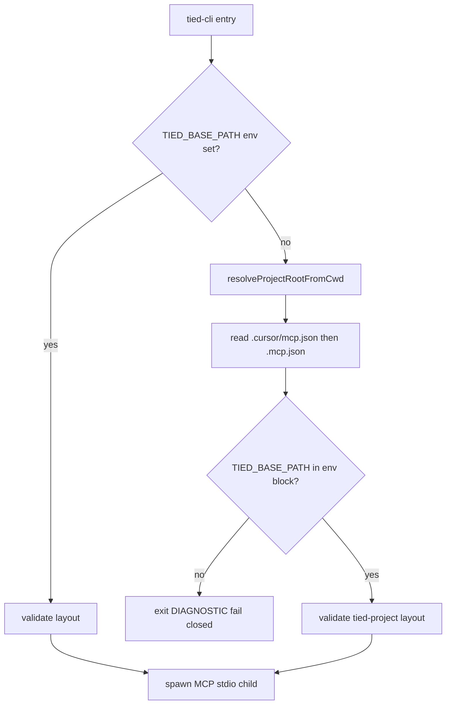

# PLAN — REQ-TIED_CLI_MCP_JSON_BASE_PATH (refined)

**Linked Cursor plan:** `gf-16_mcp.json_base_path_15f178d8.plan.md`  
**Prompt type:** refine-plan (pass 3 complete 2026-10-25)  
**Delivery:** **Implemented** — commit `5ba4086e` · close-out [`evidence/close-out-handoff.md`](evidence/close-out-handoff.md)  
**Tracker:** [`checklist-tracker.yaml`](checklist-tracker.yaml)  
**CITDP (working):** [`CITDP-REQ-TIED_CLI_MCP_JSON_BASE_PATH.yaml`](CITDP-REQ-TIED_CLI_MCP_JSON_BASE_PATH.yaml)  
**CITDP (persisted):** [`../../citdp/CITDP-REQ-TIED_CLI_MCP_JSON_BASE_PATH.yaml`](../../citdp/CITDP-REQ-TIED_CLI_MCP_JSON_BASE_PATH.yaml)

---

## 1. Refine (Touchpoint 1 — RESOLVE)

| Sponsor / field term | Resolved meaning |
| --- | --- |
| **Proxy feedback (GF-16)** | Kaizen ingest from client [traceable-commit-evidence](file:///Users/fareed/Documents/dev/test/1792937222-gf-16/tied-project/working/REQ-RECONCILIATION_ENGINE/evidence/traceable-commit-evidence.md) — wrong-tree CLI writes; not a product defect in reconciliation engine |
| **mcp.json canonical** | `mcpServers["tied-yaml"].env.TIED_BASE_PATH` in `.cursor/mcp.json` and/or repo-root `.mcp.json` as written by [mcp-config.mjs](../../../tools/bootstrap/lib/mcp-config.mjs) |
| **No client env dependency** | Quick-start path does not require `export TIED_BASE_PATH`; CLI must read the same values IDE MCP receives |
| **Fail closed** | No mcp.json or no `TIED_BASE_PATH` key → exit before MCP spawn; message cites `tied-install` / mcp config (`DIAGNOSTIC: TIED_CLI_MCP_BASE_PATH`) |
| **Optional env override** | `TIED_BASE_PATH` in process env wins for store CI and explicit operator override only |
| **project_root** | Git toplevel from cwd when inside a repo; else walk parents until a directory contains `.cursor/mcp.json` or `.mcp.json` |
| **Cursor MCP config** | `.cursor/mcp.json` — `initializeTiedMcpConfig` (create-only when absent) |
| **Claude MCP config** | Repo-root `.mcp.json` — `initializeClaudeMcpConfig` (create-if-absent or safe-merge `tied-yaml` only) |
| **Dual-harness client** | After full bootstrap, both files may exist; **`tied-install` writes the same `TIED_BASE_PATH`** to each — CLI does not choose Cursor vs Claude at runtime |

**Vocabulary PRELOAD:** [feedback-to-tied.md](../../vocab/feedback-to-tied.md), [project-operations-mcp.md](../../vocab/project-operations-mcp.md) (tied-cli, MCP config preservation).

**Consequence ladder:**

| Choice | Ladder | Disposition |
| --- | --- | --- |
| mcp.json as sole client default | **Locked** (sponsor) | **Delivered** |
| Fail closed without mcp.json | **Locked** (sponsor) | **Delivered** |
| Remove env override entirely | **Costly** | **Reject** — keep for store CI |
| Auto-create mcp.json on CLI run | **Costly** | **Out of scope** — bootstrap create-only |
| Divergent paths in Cursor vs Claude mcp files | **Costly misread** if hand-edited | **Mitigate:** read order + test; doc says keep both aligned |

### 1.1 Dual harness (Cursor and/or Claude)

CLI resolution is **harness-agnostic**: it reads JSON from disk, matching [readStoreRootFromProjectMcp](../../../tools/bootstrap/lib/layers/store.mjs) **file order** (that helper reads **`TIED_STORE_ROOT`**, not `TIED_BASE_PATH` — separate concern).

| Client layout | After `tied-install` | CLI behavior |
| --- | --- | --- |
| **Cursor only** | `.cursor/mcp.json` present | Read `TIED_BASE_PATH` from Cursor file |
| **Claude only** | `.mcp.json` present (no `.cursor/mcp.json`) | Read from repo-root `.mcp.json` |
| **Both** | Both present (typical full install) | Try **`.cursor/mcp.json` first**, then `.mcp.json`; if both define `tied-yaml.env.TIED_BASE_PATH` and values **differ**, **Cursor file wins** (document in SKILL + bootstrap README) |
| **Neither** | Install incomplete or wrong cwd | **Fail closed** — no YAML writes |

**Operator contract:** Quick-start does not require shell env. **At least one** install-managed mcp file with `tied-yaml` + `TIED_BASE_PATH` must exist before CLI mutation. IDE MCP for each harness still gets env from **that harness’s** spawn of the server; tied-cli **reconstructs** the same base path from the same files, not from harness selection.

**Related REQ:** [REQ-TIED_CLAUDE_HARNESS](../../requirements/REQ-TIED_CLAUDE_HARNESS.yaml) (Claude `.mcp.json` bootstrap); [REQ-TIED_SETUP](../../requirements/REQ-TIED_SETUP.yaml) (Cursor `.cursor/mcp.json`).

**Related tokens (cross-link, do not reopen Implemented status):** `REQ-TIED_HARNESS_PLATFORM_SEAM`, `REQ-TIED_TOOL_INPUT_COMPATIBILITY`, `REQ-TIED_LAYERED_CLIENT_INSTALL`, `REQ-TIED_SETUP`.

**Pollution note:** Stray `RECONCILIATION_ENGINE` indexes were **not** present at build-plan; no cleanup commit required for this REQ.

---

## 2. Plan (CITDP)

### 2.1 Resolution algorithm (normative — matches as-built)



**Module placement (as-built):** [mcp-base-path.mjs](../../../tools/bootstrap/lib/mcp-base-path.mjs) — exports `readTiedYamlEnvFromProjectMcp`, `readTiedBasePathFromProjectMcp`, `resolveProjectRootFromCwd`, `resolveTiedCliEnvFromCwd`, `validateTiedProjectLayout`, `failClosedMissingMcp`; constant `MCP_REL_PATHS`.

**Shell integration (as-built):** [resolve-tied-cli-env.mjs](../../../tools/bundled-tied-yaml-skill/scripts/resolve-tied-cli-env.mjs) imports bootstrap `mcp-base-path.mjs`, emits `export TIED_BASE_PATH=…`, optional `TIED_METHODOLOGY_BUNDLE_PATH`, and **`TIED_CLI_PROJECT_ROOT`**; [tied-cli.sh](../../../tools/bundled-tied-yaml-skill/scripts/tied-cli.sh) `eval`s that output **before** MCP spawn when env override unset. **`REPO_ROOT`** from script dir remains for **MCP binary / methodology store** resolution only.

**Also wired:** `tied.sh`, `feature-orchestrator.sh` (same env contract).

### 2.2 Impact

| Boundary | Change |
| --- | --- |
| Bootstrap lib | `mcp-base-path.mjs` + unit tests |
| Bundled skill scripts | `resolve-tied-cli-env.mjs` + `tied-cli.sh` resolver hook |
| Docs | SKILL, AGENTS, `tools/bootstrap/README.md` — dual mcp.json surfaces |
| Feedback | Store row **`fb-mvny01eb-my451g`** (GF-16 proxy) |
| Demos | Trial readout row 6 marked **Done** |

### 2.3 Depth

**minimal** / **advisory** — `sub-adversarial-inquiry-pass` **not_applicable** ([evidence/sub-adversarial-inquiry-pass-na.md](evidence/sub-adversarial-inquiry-pass-na.md)).

### 2.4 Test strategy (verified)

| File | Cases |
| --- | --- |
| `tools/bootstrap/lib/mcp-base-path.test.mjs` | Cursor file; Claude-only; both-present precedence; missing both; invalid JSON; layout validation |
| `tools/bootstrap/lib/tied-cli-invoke.test.mjs` | Temp client Cursor / Claude layouts; unset env → `tied_config_get_base_path` matches mcp |
| Shell / invoke | Fail closed without mcp; linked stub + client cwd regression |

Evidence: [`evidence/build-plan-verification-evidence.md`](evidence/build-plan-verification-evidence.md).

### 2.5 TIED artifacts

| Artifact | Status |
| --- | --- |
| REQ / ARCH / IMPL + semantic tokens | **On disk** — REQ **Implemented** |
| IMPL sidecar `RESOLVE_TIED_CLI_ENV`, `READ_TIED_BASE_FROM_MCP`, `FAIL_CLOSED_MISSING_MCP` | **Validated** at build-plan |
| Persisted CITDP under `tied-project/citdp/` | **Yes** |
| `tied_validate_consistency` / `tied_verify` | **Pass** (build-plan) |

### 2.6 Plan process tools (refine-plan)

| Check | Result |
| --- | --- |
| DAE / CRAP adjunct | Inactive |
| BBCE | **not_applicable** |
| JEV vocab shadow | **Skipped** (`jev.plan_skills` not enabled) |

**Gate invocation (pass 3):** Use **`tied_gate_check`** with `citdp_path` + `tracker_path` so the validator receives the **inner** CITDP body. Inline JSON with the top-level `CITDP-REQ-*` wrapper yields `malformed_citdp:adversarial_inquiry`.

**Skill boundary:** Refine updates planning artifacts only — no new production code in refine passes.

---

## 3. As-built delivery (complete)

| Step | Status |
| --- | --- |
| 0 | **`tied_feedback_add`** → **`fb-mvny01eb-my451g`** |
| 1 | REQ/ARCH/IMPL + sidecar + `pseudocode_validate` |
| 2 | `pre_implementation` gate → **allowed: true** (build-plan receipt) |
| 3–4 | RED → GREEN: `mcp-base-path.mjs` + shell wiring |
| 5 | Docs + CHANGELOG |
| 6 | Pollution re-check — none |
| 7 | CITDP persisted; verify + **`@close-out`** machine close-out |

**Follow-on (separate REQ):** [REQ-GF16-KAIZEN-OUTCOME-CLOSE](../REQ-GF16-KAIZEN-OUTCOME-CLOSE/PLAN.md) — Kaizen outcome record + **`tied_verify`** hygiene on this REQ.

**Commands (regression):**

```bash
node --test tools/bootstrap/lib/mcp-base-path.test.mjs
node --test tools/bootstrap/lib/tied-cli-invoke.test.mjs
```

---

## 4. Gate receipts

| Phase | Result | Receipt |
| --- | --- | --- |
| `pre_implementation` (refine pass 2) | **allowed: true** (minimal) | [`pre_implementation-2026-10-25T14-45-50-757Z.json`](gates/pre_implementation-2026-10-25T14-45-50-757Z.json) |
| `pre_implementation` (build-plan) | **allowed: true** | [`pre_implementation-2026-10-25T14-52-22-129Z.json`](gates/pre_implementation-2026-10-25T14-52-22-129Z.json) |
| `verification` (build-plan) | **allowed: true** | [`verification-2026-10-25T14-52-28-858Z.json`](gates/verification-2026-10-25T14-52-28-858Z.json) |
| `close_out` | **allowed: true** | Envelope blocking gaps **0** — [`evidence/close-out-handoff.md`](evidence/close-out-handoff.md) |
| `pre_implementation` (refine pass 3) | **allowed: true** | `tied_gate_check` on working CITDP + tracker (2026-10-25) |

---

## 5. Delta vs Cursor plan (pass 1)

| Area | Cursor plan | Refine pass 1 |
| --- | --- | --- |
| Structure | Single markdown plan | Store **PLAN.md + CITDP + Tracker** under `tied-project/working/REQ-TIED_CLI_MCP_JSON_BASE_PATH/` |
| project_root | Git or walk-up (vague) | **Normative flowchart** + git toplevel first |
| Bundle path | Unmentioned | Read **`TIED_METHODOLOGY_BUNDLE_PATH`** from mcp when present |
| Pollution | Asserted present | **Re-verify** at build-plan |
| Implement boundary | Combined | **Refine stops**; ingest + code on `@build-plan` |

---

## 6. Delta vs refine pass 1 (pass 2)

| Area | Pass 1 | Pass 2 |
| --- | --- | --- |
| Harness coverage | Mentioned both paths in one row | **§1.1 table** — Cursor-only, Claude-only, both, neither |
| Precedence | In CITDP test only | **Normative:** `.cursor/mcp.json` before `.mcp.json`; divergent values → Cursor wins |
| Tests | Generic “mcp.json” | Explicit **Claude-only** and **both-present** RED cases |
| Docs scope | SKILL + AGENTS | + **`tools/bootstrap/README.md`** dual-harness note |
| Cross-link | Layered install | + **`REQ-TIED_CLAUDE_HARNESS`** |

---

## 7. Delta vs refine pass 2 (pass 3 — post-close-out sync)

| Area | Pass 2 (pre-build) | Pass 3 (as-built) |
| --- | --- | --- |
| PLAN posture | Future `@build-plan` steps | **§3 As-built delivery** — commit `5ba4086e`, close-out pass |
| API surface | Three named exports | **`readTiedYamlEnvFromProjectMcp`**, layout validate, **`TIED_CLI_PROJECT_ROOT`** export |
| Resolver path | “New script under bootstrap or skill” | **`resolve-tied-cli-env.mjs`** imports **`tools/bootstrap/lib/mcp-base-path.mjs`** |
| store.mjs | “Mirror file order” | Explicit: same order; **`TIED_STORE_ROOT`** vs **`TIED_BASE_PATH`** |
| Gates | Refine-only pre_implementation | + verification + close_out + **`tied_gate_check`** invocation note |
| CITDP persist | “After build-plan” | **Done** — `tied-project/citdp/CITDP-REQ-TIED_CLI_MCP_JSON_BASE_PATH.yaml` |

**Pass 3 trigger:** PLAN still read as pre-implementation while REQ is **Implemented** and machine close-out completed; this pass aligns the linked plan with shipped behavior for handoff and LEAP readers.
