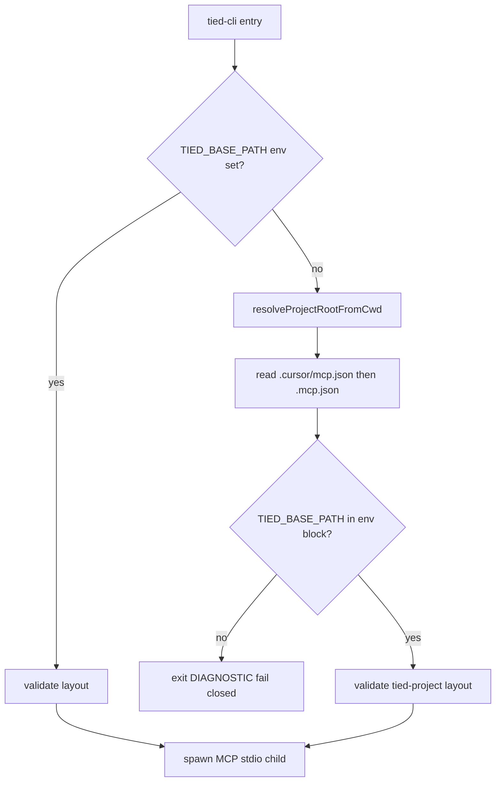

# PLAN — REQ-TIED_CLI_MCP_JSON_BASE_PATH (refined)

**Linked Cursor plan:** `gf-16_mcp.json_base_path_15f178d8.plan.md`  
**Prompt type:** refine-plan (pass 2 complete 2026-10-25)  
**Tracker:** [`checklist-tracker.yaml`](checklist-tracker.yaml)  
**CITDP (working):** [`CITDP-REQ-TIED_CLI_MCP_JSON_BASE_PATH.yaml`](CITDP-REQ-TIED_CLI_MCP_JSON_BASE_PATH.yaml)  
**Persist CITDP to `tied-project/citdp/`:** after `@build-plan` implementation

---

## 1. Refine (Touchpoint 1 — RESOLVE)

| Sponsor / field term | Resolved meaning |
| --- | --- |
| **Proxy feedback (GF-16)** | Kaizen ingest from client [traceable-commit-evidence](file:///Users/fareed/Documents/dev/test/1792937222-gf-16/tied-project/working/REQ-RECONCILIATION_ENGINE/evidence/traceable-commit-evidence.md) — wrong-tree CLI writes; not a product defect in reconciliation engine |
| **mcp.json canonical** | `mcpServers["tied-yaml"].env.TIED_BASE_PATH` in `.cursor/mcp.json` and/or repo-root `.mcp.json` as written by [mcp-config.mjs](../../../tools/bootstrap/lib/mcp-config.mjs) |
| **No client env dependency** | Quick-start path does not require `export TIED_BASE_PATH`; CLI must read the same values IDE MCP receives |
| **Fail closed** | No mcp.json or no `TIED_BASE_PATH` key → exit before MCP spawn; message cites `tied-install` / mcp config |
| **Optional env override** | `TIED_BASE_PATH` in process env wins for store CI and explicit operator override only |
| **project_root** | Git toplevel from cwd when inside a repo; else walk parents until a directory contains `.cursor/mcp.json` or `.mcp.json` |
| **Cursor MCP config** | `.cursor/mcp.json` — `initializeTiedMcpConfig` (create-only when absent) |
| **Claude MCP config** | Repo-root `.mcp.json` — `initializeClaudeMcpConfig` (create-if-absent or safe-merge `tied-yaml` only) |
| **Dual-harness client** | After full bootstrap, both files may exist; **`tied-install` writes the same `TIED_BASE_PATH`** to each — CLI does not choose Cursor vs Claude at runtime |

**Vocabulary PRELOAD:** [feedback-to-tied.md](../../vocab/feedback-to-tied.md), [project-operations-mcp.md](../../vocab/project-operations-mcp.md) (tied-cli, MCP config preservation).

**Consequence ladder:**

| Choice | Ladder | Disposition |
| --- | --- | --- |
| mcp.json as sole client default | **Locked** (sponsor) | Implement |
| Fail closed without mcp.json | **Locked** (sponsor) | Implement |
| Remove env override entirely | **Costly** | **Reject** — keep for store CI |
| Auto-create mcp.json on CLI run | **Costly** | **Out of scope** — bootstrap create-only |
| Divergent paths in Cursor vs Claude mcp files | **Costly misread** if hand-edited | **Mitigate:** read order + test; doc says keep both aligned |

### 1.1 Dual harness (Cursor and/or Claude)

CLI resolution is **harness-agnostic**: it reads JSON from disk, matching [readStoreRootFromProjectMcp](../../../tools/bootstrap/lib/layers/store.mjs) file order.

| Client layout | After `tied-install` | CLI behavior |
| --- | --- | --- |
| **Cursor only** | `.cursor/mcp.json` present | Read `TIED_BASE_PATH` from Cursor file |
| **Claude only** | `.mcp.json` present (no `.cursor/mcp.json`) | Read from repo-root `.mcp.json` |
| **Both** | Both present (typical full install) | Try **`.cursor/mcp.json` first**, then `.mcp.json`; if both define `tied-yaml.env.TIED_BASE_PATH` and values **differ**, **Cursor file wins** (document in SKILL + bootstrap README) |
| **Neither** | Install incomplete or wrong cwd | **Fail closed** — no YAML writes |

**Operator contract:** Quick-start does not require shell env. **At least one** install-managed mcp file with `tied-yaml` + `TIED_BASE_PATH` must exist before CLI mutation. IDE MCP for each harness still gets env from **that harness’s** spawn of the server; tied-cli **reconstructs** the same base path from the same files, not from harness selection.

**Related REQ:** [REQ-TIED_CLAUDE_HARNESS](../../requirements/REQ-TIED_CLAUDE_HARNESS.yaml) (Claude `.mcp.json` bootstrap); [REQ-TIED_SETUP](../../requirements/REQ-TIED_SETUP.yaml) (Cursor `.cursor/mcp.json`).

**Related tokens (cross-link, do not reopen Implemented status):** `REQ-TIED_HARNESS_PLATFORM_SEAM`, `REQ-TIED_TOOL_INPUT_COMPATIBILITY`, `REQ-TIED_LAYERED_CLIENT_INSTALL`, `REQ-TIED_SETUP`.

**Pollution note:** At refine time, stray `RECONCILIATION_ENGINE` indexes in store `tied-project/` were **not** present in YAML indexes (verify again at build-plan before cleanup step).

---

## 2. Plan (CITDP)

### 2.1 Resolution algorithm (normative for IMPL pseudo-code)



**Module placement:** `tools/bootstrap/lib/mcp-base-path.mjs` — export `readTiedBasePathFromProjectMcp`, `resolveProjectRootFromCwd`, `resolveTiedCliEnvFromCwd` (bundle path optional read).

**Shell integration:** New script `tools/bundled-tied-yaml-skill/scripts/resolve-tied-cli-env.mjs` (or under bootstrap) prints/export shell-safe assignments; `tied-cli.sh` sources result **before** line 77 REPO_ROOT defaulting (replace script-dir REPO_ROOT as authority for base path).

**Also wire:** `tied.sh`, `feature-orchestrator.sh` (same env contract).

### 2.2 Impact

| Boundary | Change |
| --- | --- |
| Bootstrap lib | New module + tests |
| Bundled skill scripts | Call resolver; remove silent store fallback |
| Docs | `tools/bundled-tied-yaml-skill/SKILL.md`, `AGENTS.md`, `tools/bootstrap/README.md` — dual mcp.json surfaces; de-emphasize mandatory export for clients |
| Feedback | Store `tied_feedback_add` with GF-16 proxy body (build-plan step 0) |
| Demos | Optional trial-readout follow-up row |

### 2.3 Depth

**minimal** / **advisory** — `sub-adversarial-inquiry-pass` **not_applicable** ([evidence/sub-adversarial-inquiry-pass-na.md](evidence/sub-adversarial-inquiry-pass-na.md)).

### 2.4 Test strategy (RED before code)

| File | Cases |
| --- | --- |
| `tools/bootstrap/lib/mcp-base-path.test.mjs` | Read from `.cursor/mcp.json`; read from `.mcp.json`; **Claude-only** (`.mcp.json` only); **both present** (precedence); missing both → null; invalid JSON |
| `tools/bootstrap/lib/tied-cli-invoke.test.mjs` (extend) | Temp client: **Cursor** mcp only, then **Claude-only** mcp; **unset** `TIED_BASE_PATH` env → `tied_config_get_base_path` matches file |
| Shell or invoke test | `tied-project/` without mcp → failure diagnostic |
| Fixture | Linked stub path under store + `cwd` = disposable client root |

### 2.5 TIED artifacts (before RED — build-plan)

1. MCP: `REQ-TIED_CLI_MCP_JSON_BASE_PATH`, `ARCH-*`, `IMPL-*` + semantic tokens  
2. IMPL sidecar: blocks `RESOLVE_TIED_CLI_ENV`, `READ_TIED_BASE_FROM_MCP`, `FAIL_CLOSED_MISSING_MCP` with token comments  
3. `pseudocode_validate`  
4. Re-run `tied_checklist_gate_validate` **`pre_implementation`** → expect **allowed: true** after tokens + pseudo-code  

### 2.6 Plan process tools (refine-plan)

| Check | Result |
| --- | --- |
| DAE / CRAP adjunct | Inactive (no diff-scoped CRAP this pass) |
| BBCE | **not_applicable** (bootstrap seam) |
| JEV vocab shadow | Advisory keywords: mcp.json, TIED_BASE_PATH, tied-cli |

**Skill boundary:** Refine pass stops before **Implement** — no `tied_feedback_add`, no REQ token MCP writes, no production code until `@build-plan`.

---

## 3. Implement (build-plan execution order)

| Step | Action |
| --- | --- |
| 0 | `tied_feedback_add` — methodology_improvement, GF-16 proxy, links to client evidence + trial readout |
| 1 | Create REQ/ARCH/IMPL via MCP; IMPL sidecar; `pseudocode_validate` |
| 2 | `pre_implementation` gate → **allowed: true** |
| 3 | RED: bootstrap unit + composition tests |
| 4 | GREEN: `mcp-base-path.mjs` + shell wiring |
| 5 | Docs + CHANGELOG |
| 6 | Verify stray pollution absent; else MCP delete client tokens from store tree |
| 7 | Persist CITDP; `lint_yaml`; `tied_validate_consistency`; verification + close_out |

**Commands (evidence):**

```bash
node --test tools/bootstrap/lib/mcp-base-path.test.mjs
node --test tools/bootstrap/lib/tied-cli-invoke.test.mjs
```

---

## 4. Gate receipts (refine-plan)

| Phase | Result | Receipt |
| --- | --- | --- |
| `pre_implementation` (pass 1) | **allowed: true** (minimal) | [`pre_implementation-2026-10-25T14-42-12-822Z.json`](gates/pre_implementation-2026-10-25T14-42-12-822Z.json) |
| `pre_implementation` (pass 2) | **allowed: true** (minimal) | [`pre_implementation-2026-10-25T14-45-50-757Z.json`](gates/pre_implementation-2026-10-25T14-45-50-757Z.json) |

Refine-stage gate passes with CITDP + Tracker + `sub-adversarial-inquiry-pass` NA evidence. **Re-run after** REQ/ARCH/IMPL and `gate-pseudocode-validation` at build-plan (expect new receipt hash).

---

## 5. Delta vs Cursor plan (pass 1)

| Area | Cursor plan | Refine pass 1 |
| --- | --- | --- |
| Structure | Single markdown plan | Store **PLAN.md + CITDP + Tracker** under `tied-project/working/REQ-TIED_CLI_MCP_JSON_BASE_PATH/` |
| project_root | Git or walk-up (vague) | **Normative flowchart** + git toplevel first |
| Bundle path | Unmentioned | Read **`TIED_METHODOLOGY_BUNDLE_PATH`** from mcp when present |
| Pollution | Asserted present | **Re-verify** at build-plan |
| Implement boundary | Combined | **Refine stops**; ingest + code on `@build-plan` |

---

## 6. Delta vs refine pass 1 (pass 2)

| Area | Pass 1 | Pass 2 |
| --- | --- | --- |
| Harness coverage | Mentioned both paths in one row | **§1.1 table** — Cursor-only, Claude-only, both, neither |
| Precedence | In CITDP test only | **Normative:** `.cursor/mcp.json` before `.mcp.json`; divergent values → Cursor wins |
| Tests | Generic “mcp.json” | Explicit **Claude-only** and **both-present** RED cases |
| Docs scope | SKILL + AGENTS | + **`tools/bootstrap/README.md`** dual-harness note |
| Cross-link | Layered install | + **`REQ-TIED_CLAUDE_HARNESS`** |
