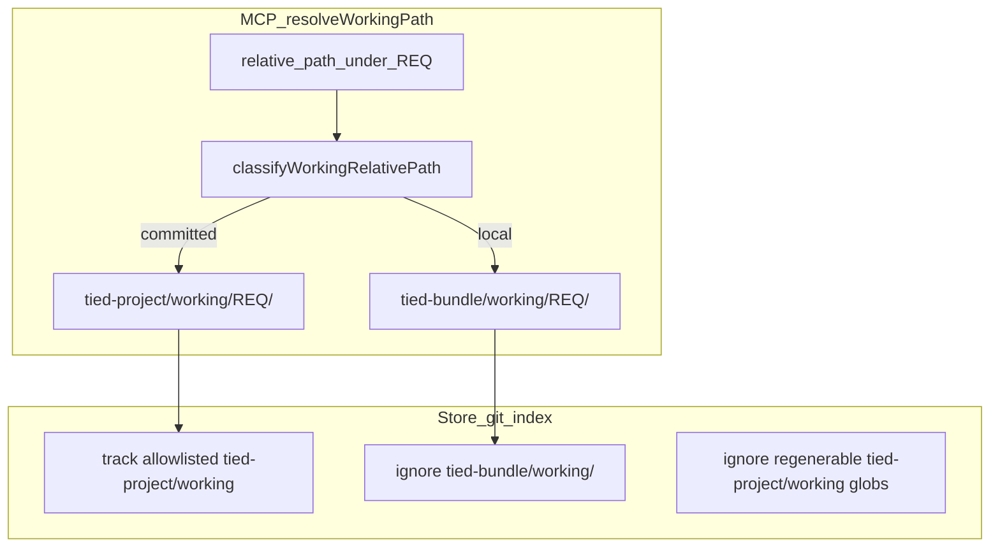

# REQ-TIED_COMMITTED_WORKING_GIT_HYGIENE — refine-plan output

**Sponsor locks (from Q&A):** wave migration (`git rm --cached` + on-disk keep); **new REQ** (not STORE_BUNDLE slice extension).

**Working folder (Implement):** [`tied-project/working/REQ-TIED_COMMITTED_WORKING_GIT_HYGIENE/`](tied-project/working/REQ-TIED_COMMITTED_WORKING_GIT_HYGIENE/) — copy this plan to `PLAN.md` after approval.

**Profile depth:** `minimal` · **Gate policy:** default checklist (no integrated adversarial inquiry unless impact discovery triggers §7 — this change is git/layout/tooling; stay minimal unless sponsor escalates).

---

## Refine (Touchpoint 1)

**Problem:** The store dogfoods thousands of files under [`tied-project/working/`](tied-project/working/). Policy ([`tied-bundle/docs/working-artifact-placement.md`](tied-bundle/docs/working-artifact-placement.md)) already splits **committed process evidence** vs **local regenerable** ([`tied-bundle/working/`](tied-bundle/working/)), but practice drifted:

- Legacy [`.gitignore`](.gitignore) ignores many patterns under root `working/` (symlink alias) but **does not mirror** most of [`EXPANDED_LOCAL_WORKING_GITIGNORE_GLOBS`](tools/bootstrap/lib/working-gitignore.mjs) onto `tied-project/working/**`.
- [`classifyWorkingRelativePath`](mcp-server/src/working-root.ts) treats `evidence/gate-*.json`, `evidence/pre_implementation-*.json`, etc. as **committed** because `gate-` is not a path prefix (only `gates/` and root-level `gate-`).
- Downstream **TIED users** never receive this tree via `tied-install`; they need **policy + tooling**, not store dogfood archives.

**Desired behavior:**

| Layer | Store git index | Runtime location for regenerable output |
| --- | --- | --- |
| Methodology | [`tied-bundle/docs/`](tied-bundle/docs/) (corpus) | N/A |
| Process rationale | Slim **committed** set under `tied-project/working/{TOKEN}/` | Same |
| Machine/regenerable | **Untracked** (ignored) | `tied-bundle/working/{TOKEN}/` via classifier |

**Non-goals:**

- Gitignore all of `tied-project/` (violates [REQ-TIED_TWO_FOLDER_LAYOUT](tied-project/requirements/REQ-TIED_TWO_FOLDER_LAYOUT.yaml) **SC-TFL-INVARIANT**).
- Delete on-disk evidence during migration (untrack only).
- Rewrite historical PLAN/CITDP prose or CHANGELOG links unless a link breaks after untrack (fix surgically).
- Change client INSTALL MANAGED `tied-bundle/` ignore ([`gitignore-block.mjs`](tools/bootstrap/lib/layers/gitignore-block.mjs)).

**Committed allowlist (keep tracked after wave):**

- `PLAN*.md`, `checklist-tracker*.yaml`, `handoffs/`, `CITDP-*.yaml` (draft), [`tied-project/working/evaluation/`](tied-project/working/evaluation/) policy corpora
- Facet markdown: `evidence/*-evidence.md`, `evidence/close-out-handoff.md`, `evidence/session-handoff.md`, `evidence/traceable-commit-evidence*.md`, `evidence/git-hygiene-receipt*.md`, `evidence/persist-citdp-record-evidence.md`
- Explicit **fixture pins** referenced by tests or regression manifests (relocate to [`mcp-server/test/fixtures/`](mcp-server/test/fixtures/) when they are regenerable JSON but must stay in CI — same pattern as [REQ-TIED_STORE_BUNDLE_GIT_POLICY](tied-project/requirements/REQ-TIED_STORE_BUNDLE_GIT_POLICY.yaml))

**Regenerable denylist (untrack + ignore + route local):**

- Mirror store globs from [`working-gitignore.mjs`](tools/bootstrap/lib/working-gitignore.mjs) `EXPANDED_LOCAL_WORKING_GITIGNORE_GLOBS` with prefix `tied-project/working/` (plus existing lines 104–112, 171–173 in `.gitignore` — consolidate into managed block to avoid drift).
- Classifier additions in [`working-root.ts`](mcp-server/src/working-root.ts) / [`working-root.mjs`](tools/bootstrap/lib/working-root.mjs) / [`agentstream` copy`](mcp-server/packages/agentstream/src/working-root.ts): treat `evidence/gate-*`, `evidence/pre_implementation-*`, `evidence/verification-*`, `evidence/close_out-*`, and nested `/gate-` segments as **local** (align with ignore list).

**Costly choices (sponsor already locked):** full wave untrack — expect large diff stat; envelope paths in committed markdown may point at files that become local-only (acceptable if envelope JSON itself stays regenerable/ignored per existing rule line 104).

---

## CITDP (analysis — persist at close-out)

| Field | Draft |
| --- | --- |
| **Change type** | Infrastructure — closes WAP gray zone “large JSON under committed working” for store dogfood |
| **Depends on** | [REQ-TIED_TWO_FOLDER_LAYOUT](tied-project/requirements/REQ-TIED_TWO_FOLDER_LAYOUT.yaml), [REQ-TIED_WORKING_ARTIFACT_PLACEMENT](tied-project/requirements/REQ-TIED_WORKING_ARTIFACT_PLACEMENT.yaml), [REQ-TIED_STORE_BUNDLE_GIT_POLICY](tied-project/requirements/REQ-TIED_STORE_BUNDLE_GIT_POLICY.yaml) |
| **Blast radius** | [`.gitignore`](.gitignore), [`working-gitignore.mjs`](tools/bootstrap/lib/working-gitignore.mjs), [`working-root.ts`](mcp-server/src/working-root.ts), migration script, ~N tracked paths under `tied-project/working/`, tests that hardcode committed gate JSON paths |
| **Risks** | R1: Break tests/fixtures that assert git-tracked paths → inventory + relocate or `!` negation; R2: Envelope validate in CI expects committed envelope → already gitignored (line 104) — confirm no CI relies on tracked envelope; R3: Accidentally untrack evaluation corpus → explicit negation for `tied-project/working/evaluation/**` |
| **Test strategy** | RED: `committed-working-gitignore.test.mjs` (temp repo: regenerable path ignored, PLAN.md trackable); extend [`working-root.test.ts`](mcp-server/src/working-root.test.ts) for `evidence/gate-*` → local; migration inventory parity test; `npm test` / `test-all` subset; `tied_validate_consistency` at close-out |

**Tokens (Implement):** `REQ-TIED_COMMITTED_WORKING_GIT_HYGIENE`, `ARCH-TIED_COMMITTED_WORKING_GIT_HYGIENE`, `IMPL-TIED_COMMITTED_WORKING_GIT_HYGIENE` (e.g. `MIRROR_COMMITTED_WORKING_IGNORES`, `EXTEND_WORKING_CLASSIFIER_EVIDENCE_GATES`, `MIGRATE_TRACKED_REGENERABLE_COMMITTED_WORKING`).

**Gate:** Before RED tests, run `tied_checklist_gate_validate` with `phase: pre_implementation`, Tracker + draft CITDP under the REQ working folder.

---

## Implement (phased)

### Phase 0 — Bootstrap REQ workspace

- Mint tokens via TIED MCP (`tied_config_get_base_path` → this repo’s `tied-project/`).
- Copy plan → `PLAN.md`; per-task Tracker from [`agent-req-implementation-checklist.yaml`](tied-bundle/docs/agent-req-implementation-checklist.yaml); draft `CITDP-REQ-TIED_COMMITTED_WORKING_GIT_HYGIENE.yaml`.

### Phase 1 — Inventory (read-only script)

- New script: `tools/bootstrap/scripts/inventory-committed-working-regenerable.mjs`
  - Input: `git ls-files tied-project/working`
  - Classify each path: **keep** | **untrack** | **relocate_fixture** (match expanded globs + classifier)
  - Output: `tied-project/working/REQ-TIED_COMMITTED_WORKING_GIT_HYGIENE/evidence/migration-inventory.v1.json`
- Manual review pass on `relocate_fixture` bucket (EASAR evidence YAML/JSON, checklist gate regression manifest, JEV fixtures, claims-evidence pilots).

### Phase 2 — Policy in code (TDD)

1. **Classifier** — extend `LOCAL_WORKING_PREFIXES` or add explicit `evidence/` gate rules; sync TS + bootstrap `.mjs` + agentstream copy; update [`working-artifact-placement.md`](tied-bundle/docs/working-artifact-placement.md) table to state `evidence/gate-*` → local (no competing doc table elsewhere — [PROC-WORKING_ARTIFACT_PLACEMENT]).
2. **Gitignore** — add managed block `# BEGIN TIED COMMITTED WORKING REGENERABLE (managed)` in [`working-gitignore.mjs`](tools/bootstrap/lib/working-gitignore.mjs):
   - `buildCommittedWorkingRegenerableGlobs()` = map each `tied-bundle/working/...` entry in `EXPANDED_LOCAL_WORKING_GITIGNORE_GLOBS` → `tied-project/working/...`
   - Preserve existing negations (e.g. EDPC comprehension `!tied-project/working/REQ-TIED_EDPC_COMPREHENSION/evidence/**`)
   - Wire into `applyStoreGitignoreProfile` or dedicated `applyCommittedWorkingHygieneProfile` called from [`apply-store-gitignore-profile.mjs`](tools/bootstrap/scripts/apply-store-gitignore-profile.mjs)
3. **RED tests** before applying to root `.gitignore`.

### Phase 3 — Wave untrack

- `tools/bootstrap/scripts/migrate-tracked-committed-working-regenerable.mjs`:
  - Read inventory; `git rm --cached` for **untrack** paths; optional `git mv` to `tied-bundle/working/...` when file should remain near REQ for operator UX (classifier-local paths)
  - For **relocate_fixture**: `git mv` → `mcp-server/test/fixtures/committed-working/...` and update test imports
- Run [`splitLocalWorkingEvidence`](tools/bootstrap/lib/migrate-layout.mjs) dry-run/report for any REQ top-level dirs still mis-placed (`gates/`, `adversarial-inquiry/`, etc.)

### Phase 4 — Consumer fixes

- Grep-driven updates: tests referencing untracked gate JSON under `tied-project/working/.../evidence/` (e.g. methodology-conformance pairing, adherence ledger paths).
- [`install-resource-matrix`](tools/bootstrap/lib/render-install-resource-matrix.mjs) / WAP: document **asymmetric** store rule — regenerable globs under **both** roots; clients still commit slim `tied-project/working` only.
- Vocab RECORD: **committed working regenerable profile** (store-only gitignore block name).

### Phase 5 — Close-out

- `lint_yaml` on changed TIED YAML; `tied_validate_consistency`
- Envelope backfill optional (regenerable); facet markdown summarizing migration counts
- Traceable commit scoped to hygiene + doc + test fixture moves (exclude unrelated REQ trees like open `REQ-TIED_OPEN_ONTOLOGIES_WAVE3`)

---

## Tracker highlights (copy full checklist in Implement)

| Slug | Notes |
| --- | --- |
| `session-bootstrap` | PRELOAD working-artifact-placement |
| `change-definition` / `impact-discovery` | Inventory blast radius |
| `risk-assessment` | R1 fixtures; wave untrack = costly, sponsor-approved |
| `test-strategy` | Temp-repo gitignore + classifier tests |
| `gate-pre_implementation` | MCP gate before Phase 2 RED |
| `gitignore-close-out-hygiene` | Classify strays post-migration |
| `traceable-commit` | Large stat; message explains untrack-not-delete |

---

## Success criteria (REQ satisfaction draft)

- SC-CWGH-IGNORE: `git check-ignore` covers representative regenerable paths under `tied-project/working/` in temp repo test.
- SC-CWGH-CLASSIFIER: `evidence/gate-foo.json` resolves to `tied-bundle/working/{REQ}/...` in `resolveWorkingPath` tests.
- SC-CWGH-TRACKED-SHRINK: `git ls-files tied-project/working \| wc -l` drops materially vs inventory baseline (target threshold recorded in inventory).
- SC-CWGH-FIXTURE-PARITY: All moved pins covered by tests; CI green.
- SC-CWGH-DOCS: WAP gray zone + client-development-index link updated.

---

## Forbidden (refine-plan skill)

No automatic git commit/push in plan execution until sponsor `traceable-commit`; no `pbpaste`/`pbcopy`.
