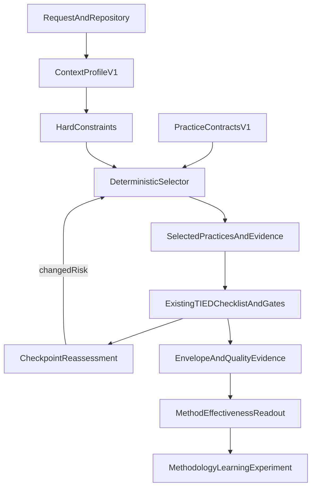

# REQ-TIED_CONTEXT_ADAPTIVE_ENGINEERING — program plan

**Linked Cursor plan:** `context-adaptive-tied_8292d200.plan.md`  
**Research bridge:** [docs/methodologies/context-adaptive-software-engineering.md](../../../docs/methodologies/context-adaptive-software-engineering.md) (CASE / EDSE)  
**Composition boundary:** [docs/comparisons/methodology-composition-matrix.md](../../../docs/comparisons/methodology-composition-matrix.md)  
**CITDP (analysis):** [CITDP-REQ-TIED_CONTEXT_ADAPTIVE_ENGINEERING.yaml](./CITDP-REQ-TIED_CONTEXT_ADAPTIVE_ENGINEERING.yaml)  
**Tracker:** [checklist-tracker.yaml](./checklist-tracker.yaml)  
**Test strategy:** [test-strategy.md](./test-strategy.md)  
**Vocab:** [tied-project/vocab/context-adaptive-engineering.md](../../vocab/context-adaptive-engineering.md)

**Refine-plan pass:** 2 · **2026-10-17** · **build-plan:** in progress ([evidence/build-plan-progress-20261018.md](./evidence/build-plan-progress-20261018.md))  
**Slice 0 runbook:** [evidence/slice0-build-plan-entry.md](./evidence/slice0-build-plan-entry.md) · **Pre-impl gate:** **`allowed: true`** [receipt](./gates/pre_implementation-2026-10-18T05-08-37-210Z.json)

## Sponsor decisions (resolved for v1)

| Decision | Choice |
| --- | --- |
| Scope | Evidence-backed **subset** of CASE (§6–§9, §13); TIED remains center of gravity |
| Activation | **Opt-in** MCP tools only; no default checklist/gate/assurance-profile change |
| Selector | **Deterministic rules** (CASE §6.2); no AI policy engine in v1 |
| Depth / gates | **`depth_tier: integrated`**, **`profile_depth: integrated`**, **`gate_policy: advisory`** |
| Dogfood | **[REQ-TIED_EASAR_RECOVERY]** fixed workflow vs **Condition B** rule-selected overlay on comparable slices |
| Costly (deferred) | Default adaptive selection; mandatory new checklist step; LangGraph runtime; full Essence catalog |

## Bounded deliverable

Adopt CASE as an **optional, evidence-driven layer** around existing TIED controls—not a replacement methodology.

### Proposed TIED tokens (RESOLVE before mint)

| Layer | Token |
| --- | --- |
| REQ | **REQ-TIED_CONTEXT_ADAPTIVE_ENGINEERING** |
| ARCH | **ARCH-TIED_CONTEXT_ADAPTIVE_ENGINEERING** (authority boundary + artifact model) |
| IMPL | **IMPL-TIED_CONTEXT_ADAPTIVE_CONTRACTS**, **_PROFILE**, **_SELECTOR**, **_REASSESS**, **_EVAL_LINK** |
| PROC | **PROC-CONTEXT_ADAPTIVE_PRACTICE** (compose existing slugs; no parallel mega-checklist) |

## Seed practice library (5–8 contracts, v1)

Map `PRACTICE-*` IDs to existing TIED procedures/tools (finalize bindings at `author-architecture`):

| PRACTICE ID | TIED binding (initial) |
| --- | --- |
| `PRACTICE-PSEUDOCODE-FIRST` | `[PROC-PSEUDOCODE_VALIDATION]`, `pseudocode_validate` / `pseudocode_analyze` |
| `PRACTICE-STRICT-TDD` | `[PROC-TIED_DEV_CYCLE]`, unit RED-before-GREEN |
| `PRACTICE-MODULE-VALIDATION` | `[REQ-MODULE_VALIDATION]`, independent module tests |
| `PRACTICE-COMPOSITION-BEFORE-E2E` | Composition tests before MCP wiring |
| `PRACTICE-INTEGRATED-INQUIRY` | `[REQ-TIED_ADVERSARIAL_INQUIRY]`, `sub-adversarial-inquiry-pass` when depth integrated |
| `PRACTICE-REQUEST-EVIDENCE-ENVELOPE` | `[REQ-REQUEST_EVIDENCE_ENVELOPE]`, envelope build/validate |
| `PRACTICE-EASAR-RECOVERY-SLICE` | `[PROC-EASAR_RECOVERY]`, EASAR receipts (dogfood) |
| `PRACTICE-METHODOLOGY-LEARNING-PILOT` | `[REQ-METHODOLOGY-LEARNING-EXPERIMENT]`, pairing tools |

Methodology-owned YAML seeds install via **tied-bundle/resources** + bootstrap manifest; client overrides out of scope for v1.

## Versioned artifacts (schemas frozen at author-architecture)

| Artifact | Must prove |
| --- | --- |
| `practice-contract.v1` | Applicability, prerequisites, compatibility edges, limitations, proof boundary |
| `context-profile.v1` | Dimensions `LOW\|MEDIUM\|HIGH\|UNKNOWN`; **`UNKNOWN` ≠ `LOW`** |
| `selection-receipt.v1` | Deterministic for identical inputs; hard constraints dominate |
| `reassessment-receipt.v1` | Prior snapshot preserved; explicit action enum |
| Method-effectiveness readout | Links via pairing; **no single composite score** |

**Context profile dimensions (v1):** uncertainty, criticality, coupling, concurrency, observability, reversibility, environmental, rate-of-change, security — see [context-adaptive-engineering.md](../../vocab/context-adaptive-engineering.md). **`UNKNOWN` is never treated as `LOW`.**

**Selector evaluation order (resolve in IMPL pseudo-code):**

1. Mandatory hard constraints (security profile, integrated depth, envelope blocking gaps when armed).
2. Practice applicability signals vs profile dimensions.
3. Prerequisites satisfied (missing → reject with explicit rule id).
4. Compatibility / execution-order edges (incompatible pair → reject).
5. Stable tie-break (contract id lexicographic order).

**Placement:** committed rationale under `tied-project/working/`; regenerable inquiry/gates under `tied-bundle/working/` per [working-artifact-placement.md](../../../tied-bundle/docs/working-artifact-placement.md).

## Implementation slices

| Slice | Work | Status |
| --- | --- | --- |
| **0** | Structural inquiry + `pre_implementation` | **done** (`cae-structural-pre-impl-20261018`) |
| **1** | TIED mint + pseudo-code sidecars | **done** (build-plan 2026-10-18) |
| **2** | Pure modules + unit TDD | **done** (eval-link + composition tests green) |
| **3** | MCP `context_adaptive_*` registration | **done** (4 tools + handler composition tests) |
| **4** | EASAR dogfood + methodology-learning pilot | **done** ([evidence/cae-easar-dogfood-pilot.v1.json](./evidence/cae-easar-dogfood-pilot.v1.json)) |
| **5** | Verification + close-out (three completion signals) | **done** — verify + `@plan-close-out` ([closeout-run-close-out-gates-final.json](./evidence/closeout-run-close-out-gates-final.json)) |

### Slice 0 (build-plan entry)

Authoritative checklist: [evidence/slice0-build-plan-entry.md](./evidence/slice0-build-plan-entry.md). Use [gate-tracker-pre-implementation.yaml](./gate-tracker-pre-implementation.yaml) as `tracker_path` when calling the gate.

**Refine-plan gates (pass 1–2):** `pre_implementation` remains **`allowed: false`** until Slice 0 completes inquiry + pseudo-code gate — expected at integrated depth. Latest diagnostics: [evidence/refine-plan-gate-result.json](./evidence/refine-plan-gate-result.json).

## MCP surface (vocabulary RESOLVE before register)

| Tool | Behavior |
| --- | --- |
| `context_adaptive_practice_validate` | Read-only contract validation |
| `context_adaptive_profile_validate` | Read-only profile validation |
| `context_adaptive_select_practices` | Deterministic selection receipt; optional explicit output path |
| `context_adaptive_reassess` | Snapshot compare + action enum |

**Forbidden:** silent edits to project TIED YAML, checklist completion, or methodology policy.

## Code layout (proposed)

- `mcp-server/src/context-adaptive/` — pure modules + fixtures
- `mcp-server/src/tools/context-adaptive-*.ts` — thin wrappers
- `tied-bundle/resources/context-adaptive/practices/` — seed library

## Acceptance criteria (summary)

See CITDP `success_criteria` (`SC-CAE-*`). Highlights:

- Deterministic selection; conservative UNKNOWN handling; auditable reassessment
- Module validation before composition; composition tests before MCP
- EASAR dogfood with baseline vs selected arms; no causal improvement claim
- Full regression green; no v1 change to default checklist/gate behavior

## Explicitly deferred

AI method override; LangGraph; full Essence; SPC/DORA/CMMI scorecards; mandatory checklist activation; EASAR portable export (separate program).

## Handoff

After sponsor accepts this plan: **`@build-plan`** with [checklist-tracker.yaml](./checklist-tracker.yaml) and working-folder CITDP. Re-confirm TIED base path; refresh all gates after any scope change; completion only via **`plan-close-out`** (three completion signals).
