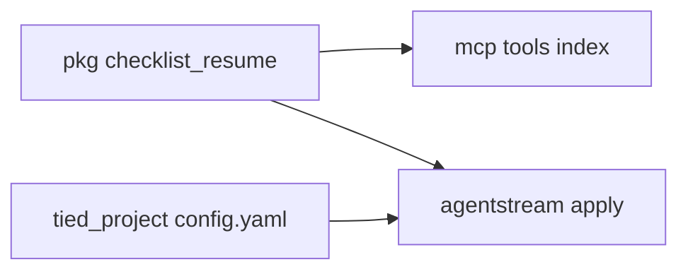
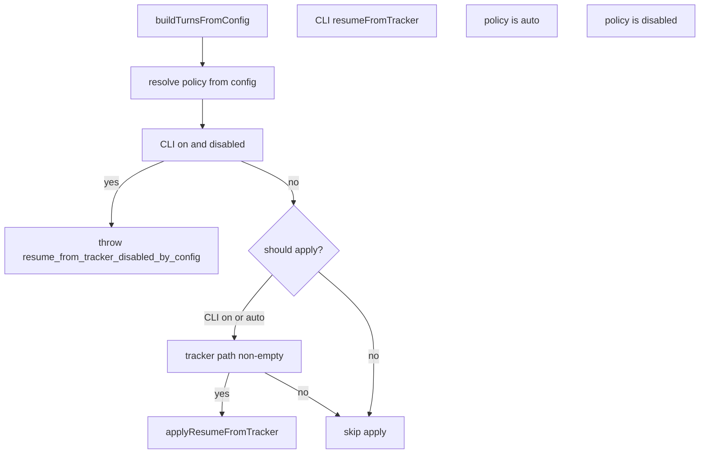

# PLAN — LEAP unify checklist-controller-resume

**Request token:** `REQ-TIED_DURABLE_CHECKLIST_CONTROLLER`  
**Parent program:** [REQ-TIED_INTENT_CONTROL_PLANE](../REQ-TIED_INTENT_CONTROL_PLANE/evidence/session-handoff.md) handoff item 2  
**Linked Cursor plan:** `leap_checklist_resume_unify_264d4e63.plan.md`  
**Record identity:** `depth_tier: minimal` · `gate_policy: advisory` · `profile_depth: not_measured`  
**Tokens:** [REQ-TIED_DURABLE_CHECKLIST_CONTROLLER] · [ARCH-TIED_DURABLE_CHECKLIST_CONTROLLER] · [IMPL-TIED_DURABLE_CHECKLIST_CONTROLLER] · [REQ-TIED_INTENT_CONTROL_PLANE]

---

## 1. Refine (Touchpoint 1 — RESOLVE)

### Intent

Close documented LEAP debt: two copies of `checklist-controller-resume.ts` and unwired `checklist.resume_from_tracker`. Deliver **one** canonical module plus **config-aware** agentstream apply, without changing MCP read-tool semantics.

### Resolved terms

| Term | Resolution |
| --- | --- |
| **Authoritative Tracker** | Checklist tracker YAML (`checklist-tracker.v1`) with step dispositions |
| **Pure resume plan** | `deriveChecklistResumePlan` + tracker load/parse (no `DryRunConfig` mutation) |
| **Apply resume** | `applyResumeFromTracker` — mutates `cfg.firstTurn` / optional `cfg.sessionId` |
| **Config policy** | Tri-state from `tied-project/config.yaml` key `checklist.resume_from_tracker` |

### Config semantics (accepted)

| `checklist.resume_from_tracker` | `--resume-from-tracker` | `--checklist-tracker-yaml` | Behavior |
| --- | --- | --- | --- |
| absent | off | any | No apply (Wave 4 default) |
| absent | on | required | Apply (Wave 4 CLI path) |
| `true` | off | non-empty | **Auto-apply** when building turns |
| `true` | on | non-empty | Apply (CLI redundant but allowed) |
| `false` | off | any | No apply |
| `false` | on | any | **Fail closed** — error `resume_from_tracker_disabled_by_config` |

**MCP** `tied_checklist_controller_resume_plan`: unchanged — explicit tool call, no config gate.

**Remove** dead `isChecklistResumeFromTrackerEnabled` (default-true, zero call sites). Replace with shared `resolveResumeFromTrackerPolicy(record)` in `@tied/checklist-resume`.

### Consequence ladder

| Decision | Class | Default |
| --- | --- | --- |
| New workspace package vs relative import | Reversible | `@tied/checklist-resume` package (matches existing `packages/*` layout) |
| Config absent = CLI-only | Reversible | Yes — avoids silent auto-resume for existing batches |
| `false` blocks CLI flag | Costly for operators who relied on CLI-only | **Accept** — config is project policy; document in README |
| Add `checklist` to strict project-config schema | Reversible defer | Out of scope this slice |

---

## 2. Plan — CITDP analysis

### change_definition

- **current_behavior:** Identical resume logic duplicated in `mcp-server/src/checklist-controller-resume.ts` and `mcp-server/packages/agentstream/src/checklist-controller-resume.ts`; agentstream applies resume only when `--resume-from-tracker` is set; unused MCP helper reads config but nothing calls it.
- **desired_behavior:** Single `@tied/checklist-resume` module consumed by MCP tools and agentstream; agentstream honors `checklist.resume_from_tracker: true` for auto-apply and `false` to block CLI resume; CITDP / session-handoff divergences cleared.
- **non_goals:** Repo-root `project-identity.v1.yaml`; marker_only fixture refresh (ICP handoff item 3); strict schema registration for `checklist` in `tied-project-config.ts`.
- **success_criteria:**
  - No duplicate `checklist-controller-resume.ts` under `mcp-server/src` or `agentstream/src`
  - `npm test --prefix mcp-server` green
  - `tied_validate_consistency` clean on touched project YAML
  - REQ criterion added for config-driven auto-resume

### impact_analysis

- **modules:** `mcp-server/packages/checklist-resume` (new); `mcp-server/package.json`; `mcp-server/packages/agentstream` (`run-pipeline-prep`, new `checklist-resume-config.ts`); `mcp-server/src/tools/index.ts`; delete two duplicate sources; move unit tests into package.
- **tied_tokens_affected:** REQ/ARCH/IMPL-TIED_DURABLE_CHECKLIST_CONTROLLER; leap_feedback on CITDP-REQ-TIED_INTENT_CONTROL_PLANE.
- **tied_tokens_new:** none.

### risk_analysis

- **Regression:** Wrong `first_turn` after unify — mitigated by moving existing five unit tests unchanged into package.
- **Build order:** First time `@tied/mcp` `src/` imports a workspace package — mitigated by `exports` in package.json and root `npm run build` (workspaces build before/alongside root `tsc`); local dev: build checklist-resume once if IDE complains.
- **Behavior change:** Only when sponsor sets `checklist.resume_from_tracker: true` — opt-in, documented.

### test_strategy

1. **Unit (package):** Port [checklist-controller-resume.test.ts](../../../mcp-server/src/checklist-controller-resume.test.ts) → `packages/checklist-resume/src/checklist-controller-resume.test.ts`; add `resolveResumeFromTrackerPolicy` cases.
2. **Unit (agentstream):** `checklist-resume-config.test.ts` — temp repo + `tied-project/config.yaml`; `shouldApplyResumeFromTracker(cfg)` matrix (table in §1).
3. **Unit (agentstream):** Existing `apply-resume-from-tracker.test.ts` — imports from `@tied/checklist-resume`.
4. **Integration:** `npm test --prefix mcp-server` full suite.
5. **TIED:** `lint_yaml` on changed YAML; `tied_validate_consistency`.

### CITDP artifact paths

- **Working (pre-implement):** `tied-project/working/REQ-TIED_DURABLE_CHECKLIST_CONTROLLER/CITDP-REQ-TIED_DURABLE_CHECKLIST_CONTROLLER-LEAP-UNIFY.yaml` (create at plan lock)
- **Persist after implement:** merge leap_feedback fix into `tied-project/citdp/CITDP-REQ-TIED_INTENT_CONTROL_PLANE.yaml` or add child CITDP under `tied-project/citdp/` per project policy

### Tracker

Copy `tied-bundle/docs/agent-req-implementation-checklist.yaml` →  
`tied-project/working/REQ-TIED_DURABLE_CHECKLIST_CONTROLLER/agent-req-implementation-checklist.yaml`  
before RED; run `tied_checklist_gate_validate` with `phase: pre_implementation` (minimal depth — no adversarial artifact bundle required).

---

## 3. Architecture

### New package: `mcp-server/packages/checklist-resume`

| File | Purpose |
| --- | --- |
| `package.json` | `"name": "@tied/checklist-resume"`, `"exports": { ".": "./dist/checklist-controller-resume.js" }` or explicit subpaths |
| `tsconfig.json` | Same as `@tied/yaml-cli` |
| `src/checklist-controller-resume.ts` | Pure resume + tracker IO (from current MCP copy, minus MCP-only dead helper) |
| `src/resume-policy.ts` | `resolveResumeFromTrackerPolicy`, `readChecklistSection` |
| `src/*.test.ts` | Unit tests |

**Dependencies:** `js-yaml` only (agentstream + MCP already use it).

### Consumer wiring

| Location | Action |
| --- | --- |
| [mcp-server/package.json](../../../mcp-server/package.json) | `"@tied/checklist-resume": "*"` in dependencies |
| [mcp-server/src/tools/index.ts](../../../mcp-server/src/tools/index.ts) | `import { ... } from "@tied/checklist-resume"` |
| [mcp-server/src/checklist-controller-resume.ts](../../../mcp-server/src/checklist-controller-resume.ts) | **Delete** |
| [mcp-server/src/checklist-controller-resume.test.ts](../../../mcp-server/src/checklist-controller-resume.test.ts) | **Delete** (moved to package) |
| [agentstream/package.json](../../../mcp-server/packages/agentstream/package.json) | workspace dep on `@tied/checklist-resume` |
| [apply-resume-from-tracker.ts](../../../mcp-server/packages/agentstream/src/apply-resume-from-tracker.ts) | Import from package |
| [agentstream checklist-controller-resume.ts](../../../mcp-server/packages/agentstream/src/checklist-controller-resume.ts) | **Delete** |
| **New** `checklist-resume-config.ts` | `readRepoConfig(workspace)`, `shouldApplyResumeFromTracker(cfg)`, `assertResumeConfigAllowsCli(cfg)` |
| [run-pipeline-prep.ts](../../../mcp-server/packages/agentstream/src/run-pipeline-prep.ts) | Before apply: assert config vs CLI; if `shouldApply`, call `applyResumeFromTracker` even when `!cfg.resumeFromTracker` |

### Apply decision flow

---

## 4. TIED / LEAP (documentation stack)

Update **before or in same PR as** code (LEAP order on divergence: IMPL → ARCH → REQ):

1. [IMPL-TIED_DURABLE_CHECKLIST_CONTROLLER-pseudocode.md](../../implementation-decisions/IMPL-TIED_DURABLE_CHECKLIST_CONTROLLER-pseudocode.md) — shared package; new block or PRE on `AGENTSTREAM_APPLY_RESUME` for config policy.
2. [IMPL-TIED_DURABLE_CHECKLIST_CONTROLLER.yaml](../../implementation-decisions/IMPL-TIED_DURABLE_CHECKLIST_CONTROLLER.yaml) — paths: `@tied/checklist-resume`, `checklist-resume-config.ts`.
3. [REQ-TIED_DURABLE_CHECKLIST_CONTROLLER.yaml](../../requirements/REQ-TIED_DURABLE_CHECKLIST_CONTROLLER.yaml) — satisfaction criterion for `checklist.resume_from_tracker: true`.
4. [agentstream README](../../../mcp-server/packages/agentstream/README.md) — config table row (mirror DAE/Jev style).
5. [session-handoff.md](../REQ-TIED_INTENT_CONTROL_PLANE/evidence/session-handoff.md) — mark item 2 done after verify.
6. CITDP `leap_feedback.divergences_from_analysis` — clear duplicate + config strings.

**Status:** Run `tied_verify` with update if verification-gated; else set REQ/IMPL metadata to reflect delivery after tests.

---

## 5. Implement (executable checklist)

**Gate:** `pre_implementation` allowed on Tracker + CITDP before step 1 below.

| Step | Action |
| --- | --- |
| 1 | `tied_config_get_base_path` → confirm `.../stdd/tied-project` |
| 2 | Create working Tracker + CITDP YAML; gate validate |
| 3 | RED: package + policy tests (fail on missing module) |
| 4 | Scaffold `@tied/checklist-resume`; `npm install` at `mcp-server` root |
| 5 | Move pure logic; green package tests |
| 6 | Wire MCP + agentstream; delete duplicates |
| 7 | Implement `checklist-resume-config.ts` + `run-pipeline-prep` integration; RED config tests green |
| 8 | LEAP YAML + pseudo-code via tied-yaml MCP / `tied-cli.sh` |
| 9 | `npm test --prefix mcp-server`; `tied_validate_consistency` |
| 10 | Persist CITDP; update ICP leap_feedback |

**Composition:** No new IPC; binding tested via agentstream unit tests + MCP tool tests (existing tool coverage in full suite).

---

## 6. Out of scope

- ICP handoff item 3 (`marker_only` yaml-loader fixtures)
- BBCE slice-map update unless plumb audit fails (advisory)
- New REQ token for shared package (document under existing IMPL)

---

## 7. Execution entry

Run **`build-plan`** against this file when ready to implement.
