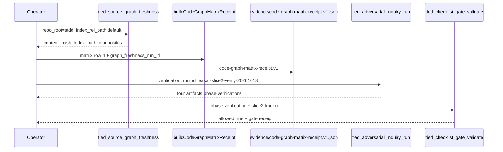

# Slice 2 E2E — code_graph matrix receipt (refine-plan 2026-10-18)

**Program:** [REQ-TIED_EASAR_RECOVERY](../PLAN.md) · **Criterion:** SC-EASAR-GRAPH  
**Prerequisite:** Slice 1 verification `allowed: true` (`run_id=easar-slice1-verify-20261018`)  
**Inquiry run_id (reserved):** `easar-slice2-verify-20261018` — use only for Slice 2 verification gate; do not reuse Slice 1 id.

## Refine (resolved)

| Topic | Resolution |
| --- | --- |
| **Scope** | End-to-end Slice 2 only: dogfood matrix row **#4** (`code_graph`), committed `code-graph-matrix-receipt.v1.json`, optional MCP wrapper, verification gate + envelope refresh. Slices 3–4 out of scope. |
| **Depth / policy** | Unchanged: `depth_tier: integrated`, `gate_policy: advisory`, `engagement: easar_full`, `mode: pilot`. |
| **Freshness id semantics** | `tied_source_graph_*` receipts expose `content_hash`, `index_path`, `diagnostics` — not an MCP `run_id`. EASAR field **`graph_freshness_run_id`** is an **operator correlation id** for the freshness invocation (convention: `easar-sg-freshness-{YYYYMMDD}` or first 16 hex of sha256 over canonical freshness JSON). |
| **Trace id semantics** | **`graph_trace_id`** optional: set when `tied_source_graph_trace` is part of proof; for row 4 (composition no-mutation test), omit or set to `n/a-composition-only`. |
| **Index path** | Default store dogfood: `tied-bundle/reports/source-graph/source-graph-index.v1.json` ([REQ-TIED_SOURCE_GRAPH_COMPREHENSION] LEAP). |
| **BFIE validator** | `code_graph` is already allowed in `intent-elevation.ts`. Slice 2 does **not** require new enum work; matrix **Location** cites test path + committed receipt path. |
| **Stage 3 (Track C / fidelity)** | PROC-only sequencing between graph and claims; **not** in Slice 2 E2E. |

### Refinement findings (codebase-verified)

| Finding | Build implication |
| --- | --- |
| `buildCodeGraphMatrixReceipt` + unit test exist | Composition/MCP + dogfood receipt file remain |
| Only `tied_easar_inventory_receipt_build` on MCP surface | Add `tied_easar_code_graph_matrix_receipt_build` mirroring inventory handler |
| Dogfood matrix has single `code_graph` row (#4) | One receipt artifact suffices for MVP; generalize builder for N rows later |
| Slice 1 inquiry scope bound inventory block | Slice 2 verification needs new scope hash on `BUILD_CODE_GRAPH_MATRIX_RECEIPT` (+ MCP block when added) |

### Reversible vs costly

| Choice | Ladder |
| --- | --- |
| Dogfood on stdd store repo only | Reversible |
| Optional MCP tool vs CLI-only receipt build | Reversible (prefer MCP for envelope parity with Slice 1) |
| Extending BFIE validator to require receipt path in matrix cells | **Costly** — defer; use Location + evidence file + manifest refs |

---

## Plan (CITDP / test strategy)

### Satisfaction mapping

| SC | Slice 2 deliverable |
| --- | --- |
| SC-EASAR-GRAPH | Row #4 + `evidence/code-graph-matrix-receipt.v1.json` with `graph_freshness_run_id`, `index_path`, optional `graph_trace_id` |
| SC-EASAR-TESTS | RED composition test for MCP/build path; extend manifest |
| SC-EASAR-GATES | Verification gate with **distinct** `run_id`; tracker [../gate-tracker-slice2-verification.yaml](../gate-tracker-slice2-verification.yaml) |

### TDD sequence (strict order)

1. **IMPL pseudo-code** — add `BUILD_EASAR_CODE_GRAPH_RECEIPT_MCP` block with PRE/POST ([PROC-IMPL_PSEUDOCODE_TOKENS]); run `pseudocode_validate`.
2. **RED** — `graph-matrix-receipt-mcp.test.ts`: build receipt from live `tied_source_graph_freshness` on store `repo_root`, assert schema + bindings.
3. **GREEN** — `graph-matrix-receipt-mcp.ts` + register MCP tool in `tools/index.ts`.
4. **Dogfood** — run freshness on `/Users/fareed/Documents/dev/chatgpt/stdd`; write [code-graph-matrix-receipt.v1.json](./code-graph-matrix-receipt.v1.json); update matrix row #4 Location footnote to reference receipt.
5. **Inquiry** — `tied_adversarial_inquiry_run` `phase: verification`, `run_id: easar-slice2-verify-20261018`, scope: literal `BUILD_CODE_GRAPH_MATRIX_RECEIPT` block id (+ MCP block when enrolled).
6. **Gate** — `tied_checklist_activation_collect` → `tied_checklist_gate_validate` with [gate-tracker-slice2-verification.yaml](../gate-tracker-slice2-verification.yaml); persist gate JSON under [../gates/](../gates/).
7. **Envelope** — `request_evidence_envelope_build` / validate with `fail_on_error_gaps: false`; append slice-2 row to [verification-evidence-manifest.v1.json](./verification-evidence-manifest.v1.json).

### Test matrix (Slice 2)

| Kind | Name | RED | GREEN |
| --- | --- | --- | --- |
| unit | matrix-code-graph-receipt | (done) row binds freshness id | existing `easar-receipts.test.ts` |
| composition | code-graph-receipt-mcp | handler calls freshness + emits receipt file | `graph-matrix-receipt-mcp.test.ts` |
| composition | source-graph-readonly | (regression) graph MCP does not mutate project YAML | existing `source-graph-composition.test.ts` cited by row #4 |

**Lint:** `npm test --prefix mcp-server -- easar-receipts source-graph` · `npm run lint:ts --prefix mcp-server`

---

## Implement (build-plan handoff)



### Files to touch (expected)

| Action | Path |
| --- | --- |
| add | `mcp-server/src/easar-receipts/graph-matrix-receipt-mcp.ts` |
| add | `mcp-server/src/easar-receipts/graph-matrix-receipt-mcp.test.ts` |
| edit | `mcp-server/src/tools/index.ts` (register MCP tool) |
| edit | `tied-project/implementation-decisions/IMPL-TIED_EASAR_RECEIPTS-pseudocode.md` |
| add | `tied-project/working/REQ-TIED_EASAR_RECOVERY/evidence/code-graph-matrix-receipt.v1.json` |
| edit | `tied-project/working/REQ-TIED_EASAR_RECOVERY/evidence/intent-elevation-matrix.md` (row #4 citation) |
| add | `evidence/sub-adversarial-inquiry-pass-slice2-verification.md`, gate payloads mirroring Slice 1 |
| edit | `tied-project/working/REQ-TIED_EASAR_RECOVERY/checklist-tracker.yaml` on slice 2 complete |

### Commands (operator)

```bash
npm test --prefix mcp-server -- easar-receipts source-graph
npm run build --prefix mcp-server
# tied-cli tied_source_graph_freshness '{"repo_root":"/Users/fareed/Documents/dev/chatgpt/stdd"}'
# tied-cli tied_easar_code_graph_matrix_receipt_build '{ ... }'   # after GREEN
# tied-cli tied_adversarial_inquiry_run @evidence/slice2-verification-inquiry-payload.json
# tied-cli tied_checklist_gate_validate @evidence/gate-validate-slice2-verification-payload.json
# tied-cli request_evidence_envelope_build '{ "request_token": "REQ-TIED_EASAR_RECOVERY", ... }'
```

### Proof boundaries (unchanged)

- Observed matrix rows are not REQ authority.
- Static TS/JS graph only; freshness is advisory stale diagnostics.
- Receipt builders must not mutate `tied-project/*.yaml` indexes.

---

## Refine gate status

| Check | Result |
| --- | --- |
| Sponsor slice-2 E2E scope | Resolved (this document) |
| Program `pre_implementation` | **allowed: true** (committed [pre_implementation gate](../gates/pre_implementation-2026-10-18T02-15-41-747Z.json)) — depth/policy unchanged; no loop-back |
| Slice 2 verification | **Not run** — build-plan executes after RED/GREEN |
| CITDP persist to `tied-project/citdp/` | Still deferred to program close-out |

**Next step:** `@build-plan` using this document as the Slice 2 authority (not Slice 3/4).
