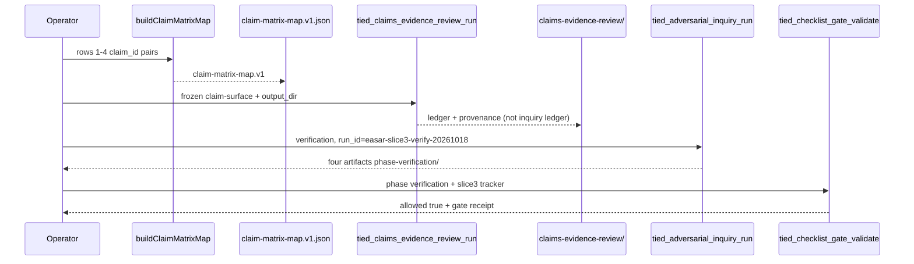

# Slice 3 E2E — claims choreography (refine-plan 2026-10-18)

**Program:** [REQ-TIED_EASAR_RECOVERY](../PLAN.md) · **Criteria:** SC-EASAR-CLAIMS, SC-EASAR-PROC (Stage 3–4 sequencing doc)  
**Prerequisite:** Slice 2 verification `allowed: true` (`run_id=easar-slice2-verify-20261018`)  
**Inquiry run_id (reserved):** `easar-slice3-verify-20261018` — use only for Slice 3 verification gate; do not reuse Slice 1–2 ids.

## Refine (resolved)

| Topic | Resolution |
| --- | --- |
| **Scope** | End-to-end Slice 3 only: committed `claim-matrix-map.v1.json`, dogfood **claims-review** run under `tied-project/working/REQ-TIED_EASAR_RECOVERY/claims-evidence-review/`, optional MCP wrapper, Stage 3 **PROC** operator sequence doc, verification gate + envelope refresh. Slice 4 reflexion out of scope. |
| **Depth / policy** | Unchanged: `depth_tier: integrated`, `gate_policy: advisory`, `engagement: easar_full`, `mode: pilot`. |
| **claim.id namespace** | Use **generic** `claim.id` strings (16-char hex or stable slug) as in `[REQ-TIED_CLAIMS_EVIDENCE_REVIEW]` — **not** portable `CLM-*` prefixes (not implemented in claims-review today). |
| **Matrix linkage** | `claim-matrix-map.v1` entries are `{ claim_id, matrix_row_number }` with **unique** claim_id and unique row (`buildClaimMatrixMap` already enforces). Dogfood maps matrix rows **#1–#4** to claim ids on a frozen `claim-surface.v1.json` derived from the **Claim** column text in [intent-elevation-matrix.md](./intent-elevation-matrix.md). |
| **Claims output root** | **`tied-project/working/REQ-TIED_EASAR_RECOVERY/claims-evidence-review/{cer_run_id}/`** — distinct from adversarial inquiry under `tied-bundle/working/.../adversarial-inquiry/` (ledger separation per EASAR §7.5). |
| **Stage 3 (Track C / fidelity)** | **PROC-only** for this slice: committed [slice3-stage3-proc-choreography.md](./slice3-stage3-proc-choreography.md) sequences Track C sidecar prompt → fidelity audit prompt → claims review; **no** merged mega-prompt or new MCP for Track C in MVP. |
| **BFIE / matrix authority** | Matrix rows stay **`observed`**; claims-review classifies against frozen surface only — no REQ promotion in Slice 3. |

### Refinement findings (codebase-verified)

| Finding | Build implication |
| --- | --- |
| `buildClaimMatrixMap` + duplicate `claim_id` unit test exist | Extend unit coverage (duplicate row, sort order); add composition + dogfood receipt file |
| No `tied_easar_*` MCP for claim map yet | Add `tied_easar_claim_matrix_map_build` mirroring inventory / code-graph MCP (write + envelope patch) |
| `tied_claims_evidence_review_run` writes ledgers under caller `output_dir` | Composition test uses EASAR working path + `request_token: REQ-TIED_EASAR_RECOVERY` |
| CITDP test matrix names `NORMALIZE_CLAIM_MATRIX_IDS` | Align to IMPL block **`BUILD_CLAIM_MATRIX_MAP`** (+ new **`BUILD_EASAR_CLAIM_MATRIX_MAP_MCP`**) in pseudo-code before RED |
| Slice 2 deferred claims working-root choreography | **In scope** for Slice 3 |

### Reversible vs costly

| Choice | Ladder |
| --- | --- |
| Dogfood claim surface from matrix rows 1–4 only | Reversible |
| MCP tool vs CLI-only map write | Reversible (prefer MCP for envelope parity) |
| Auto-generate claim ids from Claim column hash vs manual id list in map | Reversible (prefer **deterministic hash** helper for stable anchors) |
| Extending claims-review to require map file on every run | **Costly** — defer; map is EASAR receipt + validation helper |
| Merging adversarial finding-ledger into claims ledgers | **Costly** — forbidden |

---

## Plan (CITDP / test strategy)

### Satisfaction mapping

| SC | Slice 3 deliverable |
| --- | --- |
| SC-EASAR-CLAIMS | [claim-matrix-map.v1.json](./claim-matrix-map.v1.json) + tests; claims-review artifacts under `claims-evidence-review/` |
| SC-EASAR-PROC | [slice3-stage3-proc-choreography.md](./slice3-stage3-proc-choreography.md) (Stage 3 prompt order) |
| SC-EASAR-TESTS | RED composition: map + claims-review path; extend manifest |
| SC-EASAR-GATES | Verification gate with **`easar-slice3-verify-20261018`**; tracker [../gate-tracker-slice3-verification.yaml](../gate-tracker-slice3-verification.yaml) |

### TDD sequence (strict order)

1. **IMPL pseudo-code** — add `BUILD_EASAR_CLAIM_MATRIX_MAP_MCP` with PRE/POST ([PROC-IMPL_PSEUDOCODE_TOKENS]); token comments on `BUILD_CLAIM_MATRIX_MAP`; run `pseudocode_validate`.
2. **RED** — extend `easar-receipts.test.ts` (happy-path map, duplicate matrix row); add `claim-matrix-choreography.test.ts`: frozen claim surface + map entries for rows 1–4 → `runClaimsEvidenceReview` → ledger paths under EASAR working root.
3. **GREEN** — `claim-matrix-map-mcp.ts` (or equivalent) + register `tied_easar_claim_matrix_map_build` in `tools/index.ts`; optional `deriveClaimIdFromMatrixClaimText` helper for stable ids.
4. **Dogfood** — build [claim-matrix-map.v1.json](./claim-matrix-map.v1.json); run `tied_claims_evidence_review_run` with dogfood `claim-surface-easar.v1.json` + static stubs referencing matrix **Location** paths; persist under `claims-evidence-review/easar-cer-dogfood-20261018/`.
5. **PROC doc** — commit [slice3-stage3-proc-choreography.md](./slice3-stage3-proc-choreography.md) (links to bundled Track C + fidelity audit prompts).
6. **Inquiry** — `tied_adversarial_inquiry_run` `phase: verification`, `run_id: easar-slice3-verify-20261018`, scope: literal `BUILD_CLAIM_MATRIX_MAP` + `BUILD_EASAR_CLAIM_MATRIX_MAP_MCP` block ids (compute revisions at build via `pseudocode_analyze` / inquiry graph).
7. **Gate** — `tied_checklist_activation_collect` → `tied_checklist_gate_validate` with [gate-tracker-slice3-verification.yaml](../gate-tracker-slice3-verification.yaml); persist gate JSON under [../gates/](../gates/).
8. **Envelope** — `request_evidence_envelope_build` / validate with `fail_on_error_gaps: false`; append slice-3 row to [verification-evidence-manifest.v1.json](./verification-evidence-manifest.v1.json).

### Test matrix (Slice 3)

| Kind | Name | RED | GREEN |
| --- | --- | --- | --- |
| unit | claim-matrix-map | map sorts entries; rejects duplicate row | `easar-receipts.test.ts` |
| composition | claim-matrix-choreography | CER run + map agree on claim_id for matrix # | `claim-matrix-choreography.test.ts` |
| composition | claims-evidence-readonly | (regression) CER does not write audited `tied-project/*.yaml` | existing `claims-evidence-review.composition.test.ts` pattern |
| composition | claim-matrix-mcp | MCP writes map under working evidence | `claim-matrix-map-mcp.test.ts` (new) |

**Lint:** `npm test --prefix mcp-server -- easar-receipts claims-evidence-review` · `npm run lint:ts --prefix mcp-server`

---

## Implement (build-plan handoff)



### Files to touch (expected)

| Action | Path |
| --- | --- |
| add | `mcp-server/src/easar-receipts/claim-matrix-map-mcp.ts` |
| add | `mcp-server/src/easar-receipts/claim-matrix-map-mcp.test.ts` |
| add | `mcp-server/src/easar-receipts/claim-matrix-choreography.test.ts` |
| edit | `mcp-server/src/tools/index.ts` (register MCP tool) |
| edit | `tied-project/implementation-decisions/IMPL-TIED_EASAR_RECEIPTS-pseudocode.md` |
| add | `tied-project/working/REQ-TIED_EASAR_RECOVERY/evidence/claim-matrix-map.v1.json` |
| add | `tied-project/working/REQ-TIED_EASAR_RECOVERY/evidence/claim-surface-easar.v1.json` (dogfood freeze input) |
| add | `tied-project/working/REQ-TIED_EASAR_RECOVERY/evidence/slice3-stage3-proc-choreography.md` |
| add | `tied-project/working/REQ-TIED_EASAR_RECOVERY/claims-evidence-review/...` (generated; gitignore or commit summary refs per placement policy) |
| add | `evidence/sub-adversarial-inquiry-pass-slice3-verification.md`, gate payloads mirroring Slice 2 |
| edit | `tied-project/working/REQ-TIED_EASAR_RECOVERY/PLAN.md`, [session-handoff.md](./session-handoff.md) on slice 3 complete |

### Commands (operator)

```bash
npm test --prefix mcp-server -- easar-receipts claims-evidence-review
npm run build --prefix mcp-server
# tied-cli tied_easar_claim_matrix_map_build '{ "request_token": "REQ-TIED_EASAR_RECOVERY", ... }'
# tied-cli tied_claims_evidence_review_run '{ "request_token": "REQ-TIED_EASAR_RECOVERY", "output_dir": "tied-project/working/REQ-TIED_EASAR_RECOVERY/claims-evidence-review/easar-cer-dogfood-20261018", ... }'
# tied-cli tied_adversarial_inquiry_run @evidence/slice3-verification-inquiry-payload.json
# tied-cli tied_checklist_gate_validate @evidence/gate-validate-slice3-verification-payload.json
# tied-cli request_evidence_envelope_build '{ "request_token": "REQ-TIED_EASAR_RECOVERY", ... }'
```

### Proof boundaries (unchanged)

- Observed matrix rows are not REQ authority.
- Claims-review ledgers must not merge adversarial `finding-ledger.jsonl`.
- Receipt builders and CER orchestration must not mutate `tied-project/*.yaml` indexes.

---

## Refine gate status

| Check | Result |
| --- | --- |
| Sponsor slice-3 E2E scope | Resolved (this document) |
| Program `pre_implementation` | **allowed: true** (unchanged depth/policy — [pre_implementation gate](../gates/pre_implementation-2026-10-18T02-15-41-747Z.json)) |
| Slice 3 verification | **Not run** — `@build-plan` executes after RED/GREEN |
| CITDP persist to `tied-project/citdp/` | Still deferred to program close-out |

**Next step:** `@build-plan` using this document as Slice 3 authority (not Slice 4).
