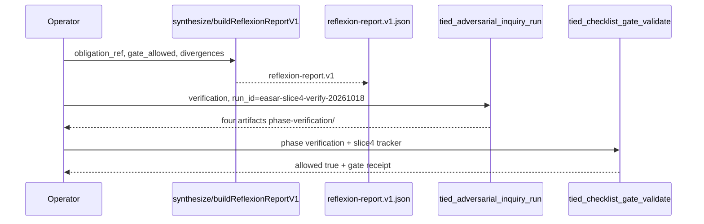

# Slice 4 E2E — reflexion synthesis (refine-plan 2026-10-18)

**Program:** [REQ-TIED_EASAR_RECOVERY](../PLAN.md) · **Criteria:** SC-EASAR-REFLEX, SC-EASAR-TESTS (Stage 6)  
**Prerequisite:** Slice 3 verification `allowed: true` (`run_id=easar-slice3-verify-20261018`)  
**Inquiry run_id (reserved):** `easar-slice4-verify-20261018` — use only for Slice 4 verification gate; do not reuse Slice 1–3 ids.

## Refine (resolved)

| Topic | Resolution |
| --- | --- |
| **Scope** | End-to-end Slice 4 only: committed `reflexion-report.v1.json`, export-only synthesis from inquiry **obligation** + **gate allowed** + optional ARCH ↔ graph **divergence** rows; dogfood **verification** inquiry scoped to reflexion IMPL blocks and EASAR receipt modules under `mcp-server/` (includes checklist gate / engagement facet seam); verification gate + envelope refresh. Program **close_out**, docs-index todo, slices 5–6 out of scope. |
| **Depth / policy** | Unchanged: `depth_tier: integrated`, `gate_policy: advisory`, `engagement: easar_full`, `mode: pilot`. |
| **Stage 6 semantics** | EASAR Stage 6 = independent verify + reflexion-model report ([methodology §6.3 Stage 6](../../../../docs/methodologies/evidence-assured-software-architecture-recovery.md)). TIED maps portable `verification-report.json` to **obligation-report** + **gate-result** + **export-only** `reflexion-report.v1` — not a merge of `finding-ledger.jsonl` into claims-review. |
| **Synthesis inputs** | **`gate_allowed`** from slice verification gate-result or explicit MCP input; **`obligation_report_ref`** path (relative under working/adversarial-inquiry); **`adversarial_ledger_ref`** optional **pointer only**; **`divergences[]`** optional rows `{ arch_token, summary, graph_evidence_ref?, severity }` derived from dogfood `[ARCH-TIED_EASAR_ARTIFACT_MODEL]` vs committed [code-graph-matrix-receipt.v1.json](./code-graph-matrix-receipt.v1.json) / matrix row #4 — human-readable summaries, not ledger import. |
| **Inquiry dogfood surface** | Repository subset: `mcp-server/src/easar-receipts/`, `mcp-server/src/checklist-validator.ts`, `mcp-server/src/easar-receipts/engagement-facet.ts` (engagement facet). Inquiry **scope** binds literal IMPL blocks **`BUILD_REFLEXION_REPORT_V1`** + new **`BUILD_EASAR_REFLEXION_REPORT_MCP`** (revisions computed at RED via `pseudocode_analyze` / inquiry graph — same discipline as Slice 3). |
| **CITDP naming drift** | CITDP test matrix row `SYNTHESIZE_REFLEXION_REPORT_V1` → align to pseudo-code block **`BUILD_REFLEXION_REPORT_V1`** during build-plan (LEAP on CITDP test_strategy only if matrix text changes). |

### Refinement findings (codebase-verified)

| Finding | Build implication |
| --- | --- |
| `buildReflexionReportV1` + minimal unit test in `easar-receipts.test.ts` | Extend RED: schema invariants, golden fixture, composition from inquiry artifact paths |
| No `tied_easar_*` MCP for reflexion yet | Add `tied_easar_reflexion_report_build` mirroring inventory / graph / claim MCP (write + envelope patch) |
| Slices 1–3 receipts + CER dogfood committed | Dogfood reflexion cites existing evidence paths; no new claims-review run required for Slice 4 |
| `BUILD_REFLEXION_REPORT_V1` lacks ARCH/REQ token comment on block | Add token comments + new MCP block with PRE/POST before RED; run `pseudocode_validate` |
| Slice 3 verification overwrote shared `phase-verification/` inquiry dir | Slice 4 inquiry run uses **new** `run_id` and replaces/regenerates phase-verification artifacts for pairing at gate (expected integrated discipline) |

### Reversible vs costly

| Choice | Ladder |
| --- | --- |
| Dogfood divergences: one ARCH token vs graph receipt info row | Reversible |
| MCP tool vs CLI-only reflexion write | Reversible (prefer MCP for envelope parity) |
| Helper `synthesizeReflexionFromObligationPaths` vs inline MCP only | Reversible (prefer small pure helper next to `reflexion-report-v1.ts` for composition tests) |
| Auto-diff all ARCH YAML vs graph index | **Costly** — defer; MVP = operator-supplied divergence list + obligation ref |
| Merging finding-ledger lines into `divergences[]` body | **Costly** — forbidden (pointer ref only) |
| Blocking envelope `fail_on_error_gaps` before program close-out | **Costly** — defer to close_out (unchanged) |

---

## Plan (CITDP / test strategy)

### Satisfaction mapping

| SC | Slice 4 deliverable |
| --- | --- |
| SC-EASAR-REFLEX | [reflexion-report.v1.json](./reflexion-report.v1.json) — `export_only: true`, ledger separation |
| SC-EASAR-TESTS | RED composition: inquiry artifacts → reflexion receipt; extend [verification-evidence-manifest.v1.json](./verification-evidence-manifest.v1.json) |
| SC-EASAR-GATES | Verification gate **`easar-slice4-verify-20261018`**; tracker [../gate-tracker-slice4-verification.yaml](../gate-tracker-slice4-verification.yaml) |

### TDD sequence (strict order)

1. **IMPL pseudo-code** — token comments on `BUILD_REFLEXION_REPORT_V1`; add **`BUILD_EASAR_REFLEXION_REPORT_MCP`** with PRE/POST/EFFECTS ([PROC-IMPL_PSEUDOCODE_TOKENS]); run `pseudocode_validate`.
2. **RED** — extend `easar-receipts.test.ts` (required fields, `export_only`, rejects missing `obligation_report_ref` at MCP layer); add `reflexion-choreography.test.ts`: fixture obligation + gate paths → `buildReflexionReportV1` / synthesize helper → JSON matches schema; add `reflexion-report-mcp.test.ts` for MCP write under working evidence.
3. **GREEN** — `reflexion-report-mcp.ts` + register **`tied_easar_reflexion_report_build`** in `mcp-server/src/tools/index.ts`; optional pure `synthesizeReflexionReportV1FromInputs` in `reflexion-report-v1.ts`.
4. **Dogfood** — build [reflexion-report.v1.json](./reflexion-report.v1.json) with `inquiry_run_id: easar-slice4-verify-20261018`, refs to Slice 4 inquiry obligation path, at least one info divergence e.g. `ARCH-TIED_EASAR_ARTIFACT_MODEL` receipt-versioning vs graph static index limits.
5. **Inquiry** — `tied_adversarial_inquiry_run` `phase: verification`, `run_id: easar-slice4-verify-20261018`, scope: literal `BUILD_REFLEXION_REPORT_V1` + `BUILD_EASAR_REFLEXION_REPORT_MCP` block ids (payload template [slice4-verification-inquiry-payload.json](./slice4-verification-inquiry-payload.json) — **fill revisions at RED**).
6. **Gate** — `tied_checklist_activation_collect` → `tied_checklist_gate_validate` with [gate-tracker-slice4-verification.yaml](../gate-tracker-slice4-verification.yaml); persist gate JSON under [../gates/](../gates/).
7. **Envelope** — `request_evidence_envelope_build` / validate with `fail_on_error_gaps: false`; append slice-4 row to verification manifest.

### Test matrix (Slice 4)

| Kind | Name | RED | GREEN |
| --- | --- | --- | --- |
| unit | reflexion-report-v1 | schema + export_only; ledger ref not copied into divergences | `easar-receipts.test.ts` |
| composition | reflexion-choreography | obligation ref + gate_allowed → committed-shaped report | `reflexion-choreography.test.ts` |
| composition | reflexion-mcp | MCP writes reflexion under working evidence | `reflexion-report-mcp.test.ts` |
| regression | easar-receipts-s1-s3 | prior slice tests still pass | existing easar + claims + source-graph tests |

**Lint:** `npm test --prefix mcp-server -- easar-receipts claims-evidence-review source-graph checklist-validator` · `npm run lint:ts --prefix mcp-server`

---

## Implement (build-plan handoff)



### Files to touch (expected)

| Action | Path |
| --- | --- |
| add | `mcp-server/src/easar-receipts/reflexion-report-mcp.ts` |
| add | `mcp-server/src/easar-receipts/reflexion-report-mcp.test.ts` |
| add | `mcp-server/src/easar-receipts/reflexion-choreography.test.ts` |
| edit | `mcp-server/src/easar-receipts/reflexion-report-v1.ts` (optional synthesize helper) |
| edit | `mcp-server/src/tools/index.ts` (register MCP tool) |
| edit | `tied-project/implementation-decisions/IMPL-TIED_EASAR_RECEIPTS-pseudocode.md` |
| add | `tied-project/working/REQ-TIED_EASAR_RECOVERY/evidence/reflexion-report.v1.json` |
| add | `tied-project/working/REQ-TIED_EASAR_RECOVERY/evidence/slice4-verification-inquiry-payload.json` (scope revisions at RED) |
| add | `tied-project/working/REQ-TIED_EASAR_RECOVERY/evidence/gate-validate-slice4-verification-payload.json` (mirror Slice 3 shape) |
| add | `tied-project/working/REQ-TIED_EASAR_RECOVERY/evidence/sub-adversarial-inquiry-pass-slice4-verification.md` |
| add | `tied-project/working/REQ-TIED_EASAR_RECOVERY/evidence/slice4-verification-gate.md` |
| edit | `tied-project/working/REQ-TIED_EASAR_RECOVERY/PLAN.md`, [session-handoff.md](./session-handoff.md) on slice 4 complete |

### Commands (operator)

```bash
npm test --prefix mcp-server -- easar-receipts claims-evidence-review source-graph checklist-validator
npm run build --prefix mcp-server
# tied-cli tied_easar_reflexion_report_build '{ "request_token": "REQ-TIED_EASAR_RECOVERY", "inquiry_run_id": "easar-slice4-verify-20261018", ... }'
# tied-cli tied_adversarial_inquiry_run @evidence/slice4-verification-inquiry-payload.json
# tied-cli tied_checklist_gate_validate @evidence/gate-validate-slice4-verification-payload.json
# tied-cli request_evidence_envelope_build '{ "request_token": "REQ-TIED_EASAR_RECOVERY", ... }'
```

### Proof boundaries (unchanged)

- Observed matrix rows are not REQ authority.
- Reflexion synthesis must not import finding-ledger lines into claims-review artifacts.
- Receipt builders must not mutate `tied-project/*.yaml` indexes.
- Envelope error gaps remain non-blocking until program close_out.

---

## Refine gate status

| Check | Result |
| --- | --- |
| Sponsor slice-4 E2E scope | Resolved (this document) |
| Program `pre_implementation` | **allowed: true** (unchanged — [pre_implementation gate](../gates/pre_implementation-2026-10-18T02-15-41-747Z.json)) |
| Slice 3 verification | **allowed: true** — prerequisite satisfied ([slice3-verification-gate.md](./slice3-verification-gate.md)) |
| Slice 4 verification | **Not run** — `@build-plan` executes after RED/GREEN |
| CITDP persist to `tied-project/citdp/` | Still deferred to program close-out |

**Next step:** `@build-plan` using this document as Slice 4 authority (then program close_out planning).
