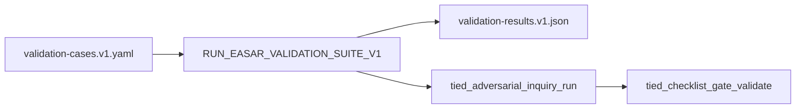

# Slice 5 E2E — validation task corpus (refine-plan 2026-10-18)

**Program:** [REQ-TIED_EASAR_RECOVERY](../PLAN.md) · **EASAR stage:** 7 (validate through executable tasks)  
**Criteria (proposed LEAP):** **SC-EASAR-VALIDATION** — bounded repository comprehension task bank + `validation-results.v1.json` receipt  
**Prerequisite:** Slice 4 verification **done** (`run_id=easar-slice4-verify-20261018`, [slice4-verification-gate.md](./slice4-verification-gate.md)); program MVP close_out **done** (`e02716de`, `run_id=easar-close-out-20261018`)  
**Inquiry run_id (reserved):** `easar-slice5-verify-20261018` — Slice 5 verification only; do not reuse Slice 1–4 or close_out ids.

## Refine (resolved)

| Topic | Resolution |
| --- | --- |
| **Scope** | End-to-end **Slice 5 only:** committed **`validation-cases.v1.yaml`** (portable `validation-cases.yaml` map) + **`validation-results.v1.json`** (portable `validation-results.json`) under `tied-project/working/REQ-TIED_EASAR_RECOVERY/evidence/`; deterministic **graders** over **stdd** dogfood surface (`mcp-server/src/easar-receipts/`, `[REQ-TIED_SOURCE_GRAPH_COMPREHENSION]` reports, committed slices 1–4 receipts). Optional **envelope row** for stdd in `tied-project/working/evaluation/evaluation-corpus.v1.yaml` is **out of scope** for Slice 5 MVP (batch-collect corpus stays envelope-gap tooling, not comprehension tasks). Slice 6 export adapter remains deferred. |
| **Depth / policy** | Unchanged: `depth_tier: integrated`, `gate_policy: advisory`, `engagement: easar_full`, `mode: pilot`. Slice 5 adds a **verification** gate only; **program close_out is not invalidated** until sponsor opts into a LEAP re-close (costly). |
| **Stage 7 semantics** | EASAR Stage 7 = independently prepared assessment tasks with trustworthy expectations ([methodology §Stage 7](../../../../docs/methodologies/evidence-assured-software-architecture-recovery.md)). TIED maps portable **`validation-cases.yaml`** → **`validation-cases.v1.yaml`**; **`validation-results.json`** → **`validation-results.v1.json`** with per-task pass/fail, grader id, and evidence refs — **not** LLM free-form scoring as a blocking gate. |
| **Task shape (SWE-QA-aligned, bounded)** | Each case: `task_id`, `prompt` (human-readable question), `grader` (`source_graph_trace` \| `symbol_ref` \| `receipt_field` \| `test_file_assertion` \| `mcp_tool_registry`), `inputs` (paths, tokens, symbol ids), `expected` (structured oracle). Minimum **8** cases spanning: inventory receipt fields, graph-matrix receipt ↔ freshness, claim-matrix map ids, reflexion `export_only`, engagement facet error code, one cross-module “feature” question answered via graph trace + test path. |
| **Grader contract** | Graders call existing MCP/library surfaces read-only (`tied_source_graph_trace`, receipt parsers, `tools/index.ts` tool name set, vitest file globs). **No** new network, **no** LLM-as-judge in Slice 5 MVP. Failed tasks record `investigation_ref` optional pointer only. |
| **Inquiry dogfood surface** | Repository subset: `mcp-server/src/easar-receipts/**`, `mcp-server/src/checklist-validator.ts`, `mcp-server/src/source-graph/**` (read-only). Inquiry **scope** binds literal IMPL blocks **`BUILD_VALIDATION_CASES_V1`**, **`RUN_EASAR_VALIDATION_SUITE_V1`**, **`BUILD_EASAR_VALIDATION_RESULTS_MCP`** (block ids filled at RED via `pseudocode_analyze` / inquiry graph — same discipline as Slices 3–4). |
| **C2 supersession (slice-local)** | Parent CITDP non_goal deferred SWE-QA bank for **MVP slices 0–4** only. Sponsor **`/refine-plan slice 5`** re-opens **Stage 7 child plan** under the same `[REQ-TIED_EASAR_RECOVERY]` umbrella without forking layout. |

### Refinement findings (codebase-verified)

| Finding | Build implication |
| --- | --- |
| No `validation-cases` / `validation-results` receipt modules in `easar-receipts/` | Add schema + builders parallel to `inventory-v1.ts` / `reflexion-report-v1.ts` |
| `evaluation-corpus.v1.yaml` rows are envelope batch clients, not comprehension tasks | Do **not** overload corpus rows as Stage 7 cases; keep cases under REQ working evidence |
| `test_adequacy_validate` checks control metadata only | CITDP `test_strategy` documents adequacy profile for new tests; graders remain deterministic |
| `tied_verify` already gates REQ status | Slice 5 verification extends manifest; optional `tied_verify` update after slice gate — program REQ stays **Implemented** until LEAP adds SC + verify pass |
| IMPL pseudo-code ends at reflexion MCP blocks | Append Stage 7 blocks with token comments before RED |

### Reversible vs costly

| Choice | Ladder |
| --- | --- |
| 8 vs 12 dogfood tasks | Reversible (start 8) |
| YAML vs JSON for cases file | Reversible (prefer YAML for operator edit, JSON receipt for results) |
| MCP `tied_easar_validation_suite_run` vs CLI script | Reversible (prefer MCP for envelope parity) |
| Import external SWE-QA task pack | **Costly** — defer; cite arXiv:2509.14635 in case `references` only |
| LLM-as-judge for open-ended prompts | **Costly** — forbidden in Slice 5 MVP |
| Blocking 85/100 rollup from validation pass rate | **Costly** — forbidden; report pass rate in receipt only |
| Re-run full program `close_out` after Slice 5 | **Costly** — default slice-level verification + handoff; sponsor must confirm for LEAP re-close |

---

## Plan (CITDP / test strategy)

### Child CITDP (draft — persist at build-plan close)

| Field | Value |
| --- | --- |
| `change_request_id` | `REQ-TIED_EASAR_RECOVERY` (slice 5 extension) |
| `record_status` | `draft` until build-plan persist |
| `desired_behavior` | Stage 7 validation cases + results receipts; deterministic graders; slice verification gate |
| `non_goals` | SWE-QA full benchmark import; LLM judges; portable export (slice 6) |
| `depth_tier` | `integrated` |
| `gate_policy` | `advisory` |
| `test_strategy` | RED unit (schema, grader contracts) → composition (cases → results) → MCP write → dogfood run on stdd |

### Satisfaction mapping

| SC | Slice 5 deliverable |
| --- | --- |
| SC-EASAR-VALIDATION (LEAP) | [validation-cases.v1.yaml](./validation-cases.v1.yaml) + [validation-results.v1.json](./validation-results.v1.json) |
| SC-EASAR-TESTS | Extend [verification-evidence-manifest.v1.json](./verification-evidence-manifest.v1.json) with slice-5 row |
| SC-EASAR-GATES | Verification gate **`easar-slice5-verify-20261018`**; tracker [../gate-tracker-slice5-verification.yaml](../gate-tracker-slice5-verification.yaml) |

### TDD sequence (strict order)

1. **LEAP (minimal)** — add **SC-EASAR-VALIDATION** to `[REQ-TIED_EASAR_RECOVERY]` satisfaction_criteria; extend `[IMPL-TIED_EASAR_RECEIPTS]` pseudo-code with **`BUILD_VALIDATION_CASES_V1`**, **`RUN_EASAR_VALIDATION_SUITE_V1`**, **`BUILD_EASAR_VALIDATION_RESULTS_MCP`**; run `pseudocode_validate`.
2. **RED** — `validation-cases-v1.test.ts` (schema, min case count, grader enum); `validation-suite.test.ts` (fixture cases + mock graph/receipt inputs → all pass/fail); `validation-results-mcp.test.ts` (MCP writes under working evidence).
3. **GREEN** — `validation-cases-v1.ts`, `validation-suite.ts`, `validation-results-v1.ts`, `validation-results-mcp.ts`; register **`tied_easar_validation_suite_run`** (name TBD at GREEN) in `mcp-server/src/tools/index.ts`.
4. **Dogfood** — author [validation-cases.v1.yaml](./validation-cases.v1.yaml) for stdd; run suite → [validation-results.v1.json](./validation-results.v1.json) with `git_rev` pinned to post-MVP commit (≥ `e02716de`), links to [inventory.v1.json](./inventory.v1.json), [code-graph-matrix-receipt.v1.json](./code-graph-matrix-receipt.v1.json), [claim-matrix-map.v1.json](./claim-matrix-map.v1.json), [reflexion-report.v1.json](./reflexion-report.v1.json).
5. **Inquiry** — `tied_adversarial_inquiry_run` `phase: verification`, `run_id: easar-slice5-verify-20261018`, scope: new IMPL blocks (payload [slice5-verification-inquiry-payload.json](./slice5-verification-inquiry-payload.json) — **fill revisions at RED**).
6. **Gate** — `tied_checklist_activation_collect` → `tied_checklist_gate_validate` with [gate-tracker-slice5-verification.yaml](../gate-tracker-slice5-verification.yaml); persist gate JSON under [../gates/](../gates/).
7. **Envelope** — patch/build envelope with `fail_on_error_gaps: false` for slice pass; document in [session-handoff.md](./session-handoff.md).

### Test matrix (Slice 5)

| Kind | Name | RED | GREEN |
| --- | --- | --- | --- |
| unit | validation-cases-v1 | schema + grader ids | `validation-cases-v1.test.ts` |
| unit | validation-results-v1 | stable content_hash; per-task rows | same module tests |
| composition | validation-suite | fixture 2-case suite → results shape | `validation-suite.test.ts` |
| composition | validation-mcp | MCP writes results under working evidence | `validation-results-mcp.test.ts` |
| regression | easar-receipts-s1-s4 | prior slice tests still pass | existing easar + graph + checklist tests |

**Lint:** `npm test --prefix mcp-server -- easar-receipts validation claims-evidence-review source-graph checklist-validator` · `npm run lint:ts --prefix mcp-server`

---

## Implement (build-plan handoff)



### Files to touch (expected)

| Action | Path |
| --- | --- |
| add | `mcp-server/src/easar-receipts/validation-cases-v1.ts` |
| add | `mcp-server/src/easar-receipts/validation-suite.ts` |
| add | `mcp-server/src/easar-receipts/validation-results-v1.ts` |
| add | `mcp-server/src/easar-receipts/validation-results-mcp.ts` |
| add | `mcp-server/src/easar-receipts/validation-*.test.ts` |
| edit | `mcp-server/src/tools/index.ts` |
| edit | `tied-project/implementation-decisions/IMPL-TIED_EASAR_RECEIPTS-pseudocode.md` |
| edit | `tied-project/requirements/REQ-TIED_EASAR_RECOVERY.yaml` (SC-EASAR-VALIDATION) |
| add | `tied-project/working/REQ-TIED_EASAR_RECOVERY/evidence/validation-cases.v1.yaml` |
| add | `tied-project/working/REQ-TIED_EASAR_RECOVERY/evidence/validation-results.v1.json` |
| add | `tied-project/working/REQ-TIED_EASAR_RECOVERY/evidence/slice5-verification-inquiry-payload.json` |
| add | `tied-project/working/REQ-TIED_EASAR_RECOVERY/evidence/gate-validate-slice5-verification-payload.json` |
| add | `tied-project/working/REQ-TIED_EASAR_RECOVERY/evidence/sub-adversarial-inquiry-pass-slice5-verification.md` |
| add | `tied-project/working/REQ-TIED_EASAR_RECOVERY/evidence/slice5-verification-gate.md` |
| add | `tied-project/working/REQ-TIED_EASAR_RECOVERY/gate-tracker-slice5-verification.yaml` |
| edit | `tied-project/working/REQ-TIED_EASAR_RECOVERY/PLAN.md`, [session-handoff.md](./session-handoff.md) on slice 5 complete |
| edit | `tied-project/vocab/easar-recovery.md` (validation corpus terms) |

### Commands (operator)

```bash
npm test --prefix mcp-server -- easar-receipts validation claims-evidence-review source-graph checklist-validator
npm run build --prefix mcp-server
# tied-cli tied_easar_validation_suite_run '{ "request_token": "REQ-TIED_EASAR_RECOVERY", "cases_path": "...", "repo_root": "..." }'
# tied-cli tied_adversarial_inquiry_run @evidence/slice5-verification-inquiry-payload.json
# tied-cli tied_checklist_gate_validate @evidence/gate-validate-slice5-verification-payload.json
```

### Proof boundaries (unchanged)

- Validation pass rate is **not** a substitute for checklist gate authority or envelope blocking policy.
- Graders must not mutate `tied-project/*.yaml` indexes.
- Failed comprehension tasks do not auto-promote matrix rows to REQ.
- Observed task outcomes are evidence only until sponsor promotion slugs run.

---

## Refine gate status

| Check | Result |
| --- | --- |
| Sponsor Slice 5 E2E scope | Resolved (this document) |
| Program MVP `close_out` | **done** — `e02716de` / `easar-close-out-20261018` (unchanged) |
| Slice 4 verification | **done** — prerequisite satisfied |
| Slice 5 IMPL pseudo-code | **done** — Stage 7 blocks in pseudo-code sidecar |
| Slice 5 verification | **done** — `allowed: true` · [slice5-verification-gate.md](./slice5-verification-gate.md) · `run_id=easar-slice5-verify-20261018` |
| Program `close_out` | **unchanged** — MVP close_out remains authoritative |

**Next step:** Optional Slice **6** refine-plan (portable export) or sponsor LEAP program re-close if envelope must reflect Slice 5.
