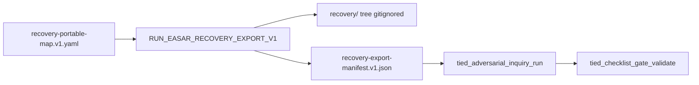

# Slice 6 E2E — portable `recovery/` export adapter

**Refine passes:** 2026-10-19 (initial) · **2026-10-18 pass 2** (post `plan-new-feature`, codebase reconcile)  
**Program:** [REQ-TIED_EASAR_RECOVERY](../PLAN.md) · **EASAR stage:** 9 publish / maintain (portable serialization per [methodology §6.2](../../../../docs/methodologies/evidence-assured-software-architecture-recovery.md))  
**Criteria:** **[SC-EASAR-EXPORT]** — read-only mapper from §6.1 canonical paths → §6.2 `recovery/` layout + committed **`recovery-export-manifest.v1.json`** (enrolled in [REQ-TIED_EASAR_RECOVERY.yaml](../../../requirements/REQ-TIED_EASAR_RECOVERY.yaml))  
**Prerequisite:** Slice 5 verification **done** (`run_id=easar-slice5-verify-20261018`, [slice5-verification-gate.md](./slice5-verification-gate.md)); slices 0–5 receipts committed (≥ `7d62523a`)  
**Inquiry run_id (reserved):** `easar-slice6-verify-20261019` — Slice 6 verification only; do not reuse Slice 1–5 or close_out ids.

## Implementation status (2026-10-18)

| Phase | Status | Evidence |
| --- | --- | --- |
| LEAP + IMPL Stage 9 blocks | **done** | [IMPL-TIED_EASAR_RECEIPTS-pseudocode.md](../../../implementation-decisions/IMPL-TIED_EASAR_RECEIPTS-pseudocode.md) |
| RED/GREEN (export module) | **done** | `recovery-export-v1.ts`, `recovery-export-mcp.ts`, `recovery-export*.test.ts` (23/23 easar-receipts tests) |
| MCP `tied_easar_recovery_export_build` | **done** | `mcp-server/src/tools/index.ts` |
| Dogfood map + manifest | **done** | [recovery-portable-map.v1.yaml](./recovery-portable-map.v1.yaml), [recovery-export-manifest.v1.json](./recovery-export-manifest.v1.json) (7 entries, 6 gaps, 0 errors @ `git_rev` 75f41a15) |
| Verification inquiry + gate | **done** | [slice6-verification-gate.md](./slice6-verification-gate.md) · `run_id=easar-slice6-verify-20261019` |
| CITDP persist (non_goal trim) | **done** | [CITDP-REQ-TIED_EASAR_RECOVERY.yaml](../CITDP-REQ-TIED_EASAR_RECOVERY.yaml) → `tied-project/citdp/` |
| Program re-close | **waived** (default) | MVP `close_out` `easar-close-out-20261018` stands |

Session log: [plan-new-feature-slice6-evidence.md](./plan-new-feature-slice6-evidence.md).

---

## Refine (resolved)

| Topic | Resolution |
| --- | --- |
| **Scope** | End-to-end **Slice 6 only:** deterministic **read-only** export adapter + **`recovery-export-manifest.v1.json`** under `tied-project/working/REQ-TIED_EASAR_RECOVERY/evidence/`; optional operator **`output_dir`** writes portable tree **outside git** (default under `tied-bundle/working/REQ-TIED_EASAR_RECOVERY/recovery-export/{run_id}/`). **No** repo-root `recovery/` commit; **no** methodology YAML mutation. |
| **Depth / policy** | Unchanged: `depth_tier: integrated`, `gate_policy: advisory`, `engagement: easar_full`, `mode: pilot`. Slice 6 adds a **verification** gate only; **program MVP close_out** (`easar-close-out-20261018`) **not invalidated** unless sponsor opts into LEAP program re-close (costly). |
| **Stage 9 semantics** | EASAR §6.2 is an **external auditor / non-TIED engagement** serialization target. TIED canonical paths remain authoritative ([ARCH-TIED_EASAR_ARTIFACT_MODEL](../../../architecture-decisions/ARCH-TIED_EASAR_ARTIFACT_MODEL.yaml) decision **`portable-export-readonly`**). Export **copies or transforms** committed receipts and working markdown; **`export_only: true`** on manifest matches reflexion/validation discipline. |
| **MVP mapping (dogfood stdd)** | **Required slots:** `inventory.json`, `evaluation/validation-cases.yaml`, `evaluation/validation-results.json`, `evaluation/verification-report.json` (from reflexion adapter), `scope.md` (PLAN excerpt), `manifest.yaml` (from manifest receipt). **Optional:** `structure.json` from source-graph index when present. **Explicit `gaps[]`** for unmapped §6.2 paths — see live manifest. |
| **Canonical map artifact** | Committed **`recovery-portable-map.v1.yaml`**: portable path → canonical source + transform id (`copy_json`, `copy_yaml`, `markdown_excerpt`, `reflexion_to_verification_report`, `from_manifest_receipt`). Paths in map are **relative to** `tied-project/working/REQ-TIED_EASAR_RECOVERY/` except repo-root paths (`tied-bundle/reports/...`). |
| **Inquiry dogfood surface** | `mcp-server/src/easar-receipts/recovery-export*.ts` + tests; read-only committed evidence. Verification **scope** binds IMPL blocks **`BUILD_RECOVERY_EXPORT_MANIFEST_V1`**, **`RUN_EASAR_RECOVERY_EXPORT_V1`**, **`BUILD_EASAR_RECOVERY_EXPORT_MCP`** with revision-suffixed ids (author full graph payload like [slice4-verification-inquiry-payload.json](./slice4-verification-inquiry-payload.json) at `@build-plan`). |
| **C2 supersession (slice-local)** | Parent CITDP `non_goals` deferred portable export for first cycle; Slice 6 re-opens Stage 9 under same `[REQ-TIED_EASAR_RECOVERY]` umbrella. Persist CITDP update at traceable-commit only. |

### Refinement findings (codebase-verified, pass 2)

| Finding | Implication |
| --- | --- |
| Export module **landed** (`recovery-export-v1.ts` holds map load, transforms, and `buildRecoveryExportManifestV1`; no separate `recovery-export-run.ts`) | `@build-plan` verification focuses on inquiry + gate, not greenfield TDD |
| Dogfood manifest lists **7** entries including optional `structure.json` | Regenerable source-graph copy is non-blocking (`required: false` in map) |
| `reflexion_to_verification_report` emits `verification-report.v1` with `divergences_count` only | No finding-ledger merge — align inquiry fidelity specs to export-only boundary |
| `from_manifest_receipt` generates minimal `manifest.yaml` summary | Full envelope embedding remains future reversible enhancement |
| CITDP persisted non_goal still lists slice 6 deferred | Update at **build-plan persist** / traceable-commit |
| Optional `recovery-export-run.test.ts` not authored | Composition covered by `recovery-export-v1.test.ts` + MCP test; add run test only if export tree regression gaps appear |

### Reversible vs costly

| Choice | Ladder |
| --- | --- |
| MVP map: 6 required portable slots vs full §6.2 tree | Reversible (start minimal map + explicit gaps) |
| Default output under `tied-bundle/working/…` vs operator temp dir | Reversible (prefer gitignored working root) |
| MCP `tied_easar_recovery_export_build` vs CLI script | **Resolved:** MCP (envelope patch parity) |
| Emit `claims.jsonl` from claim-matrix-map only vs full CER run dir | Reversible (MVP: gap only) |
| Copy entire `docs/methodologies/` into `recovery/docs/` | **Costly** — forbidden; scope.md excerpt only |
| Commit exported `recovery/` under `tied-project/` | **Costly** — forbidden (ARCH portable-export-readonly) |
| Re-run full program `close_out` after Slice 6 | **Costly** — default slice-level verification + handoff |
| Blocking export completeness (all §6.2 files) as gate | **Costly** — forbidden; manifest `gaps[]` + mapper tests + dogfood run |

---

## Plan (CITDP / test strategy)

### Child CITDP (draft — persist at build-plan close)

| Field | Value |
| --- | --- |
| `change_request_id` | `REQ-TIED_EASAR_RECOVERY` (slice 6 extension) |
| `record_status` | `draft` until build-plan persist |
| `desired_behavior` | Read-only portable export adapter; manifest receipt; slice verification gate |
| `non_goals` | Repo-root git `recovery/`; mutating TIED indexes; full §6.2 completeness gate; LLM-generated docs in export tree |
| `depth_tier` | `integrated` |
| `gate_policy` | `advisory` |
| `test_strategy` | Unit (map + manifest hash) → MCP write → dogfood export on stdd → verification inquiry |

**Trackers:** build [checklist-tracker-slice6-build.yaml](../checklist-tracker-slice6-build.yaml) · verification [gate-tracker-slice6-verification.yaml](../gate-tracker-slice6-verification.yaml) · tests [test-strategy-slice6.md](../test-strategy-slice6.md) · risk [risk-assessment-slice6.md](./risk-assessment-slice6.md)

### Satisfaction mapping

| SC | Slice 6 deliverable |
| --- | --- |
| SC-EASAR-EXPORT | [recovery-portable-map.v1.yaml](./recovery-portable-map.v1.yaml) + [recovery-export-manifest.v1.json](./recovery-export-manifest.v1.json) |
| SC-EASAR-TESTS | Extend [verification-evidence-manifest.v1.json](./verification-evidence-manifest.v1.json) with slice-6 row (at verification gate) |
| SC-EASAR-GATES | Verification gate **`easar-slice6-verify-20261019`**; tracker [gate-tracker-slice6-verification.yaml](../gate-tracker-slice6-verification.yaml) |

### Portable map (MVP — dogfood, authoritative)

| Portable path (§6.2) | Canonical source | Transform |
| --- | --- | --- |
| `inventory.json` | `evidence/inventory.v1.json` | `copy_json` |
| `evaluation/validation-cases.yaml` | `evidence/validation-cases.v1.yaml` | `copy_yaml` |
| `evaluation/validation-results.json` | `evidence/validation-results.v1.json` | `copy_json` |
| `evaluation/verification-report.json` | `evidence/reflexion-report.v1.json` | `reflexion_to_verification_report` |
| `scope.md` | `PLAN.md` | `markdown_excerpt` |
| `manifest.yaml` | `generated-from-manifest-receipt` | `from_manifest_receipt` |
| `structure.json` (optional) | `tied-bundle/reports/source-graph/source-graph-index.v1.json` | `copy_json` |

### TDD sequence (strict order)

| Step | Status |
| --- | --- |
| 1. LEAP — SC-EASAR-EXPORT + IMPL Stage 9 blocks + `pseudocode_validate` | **done** |
| 2. RED — `recovery-export-v1.test.ts`, `recovery-export-mcp.test.ts` | **done** |
| 3. GREEN — export modules + `tied_easar_recovery_export_build` | **done** |
| 4. Dogfood — map + manifest on stdd | **done** |
| 5. Inquiry — `tied_adversarial_inquiry_run` `phase: verification`, `run_id: easar-slice6-verify-20261019` | **done** ([slice6-verification-inquiry-payload.json](./slice6-verification-inquiry-payload.json)) |
| 6. Gate — activation collect → `tied_checklist_gate_validate` + gate JSON under [../gates/](../gates/) | **done** ([verification-2026-10-18T08-56-08-007Z.json](../gates/verification-2026-10-18T08-56-08-007Z.json)) |
| 7. Envelope — patch/build; update [session-handoff.md](./session-handoff.md) on slice complete | **deferred** (program envelope unchanged; slice manifest row only) |

### Test matrix (Slice 6)

| Kind | Name | Status |
| --- | --- | --- |
| unit | recovery-export-v1 | **pass** — map schema, transforms, stable hash, gaps |
| unit | recovery-export-mcp | **pass** — manifest write under working evidence |
| composition | export tree via `output_dir` | **optional** — defer unless gate finds gap |
| regression | easar-receipts-s1-s5 | **pass** — 23 tests |

**Lint / build:** `npm test --prefix mcp-server -- recovery-export easar-receipts` · `npx tsc -b --prefix mcp-server`

---

## Implement (build-plan handoff)



### Files (expected vs actual)

| Action | Path | Status |
| --- | --- | --- |
| add | `mcp-server/src/easar-receipts/recovery-export-v1.ts` | **done** |
| add | `mcp-server/src/easar-receipts/recovery-export-mcp.ts` | **done** |
| add | `mcp-server/src/easar-receipts/recovery-export-v1.test.ts` | **done** |
| add | `mcp-server/src/easar-receipts/recovery-export-mcp.test.ts` | **done** |
| — | ~~`recovery-export-run.ts`~~ | **N/A** — run logic in `recovery-export-v1.ts` |
| edit | `mcp-server/src/tools/index.ts` | **done** |
| edit | `tied-project/implementation-decisions/IMPL-TIED_EASAR_RECEIPTS-pseudocode.md` | **done** |
| edit | `tied-project/requirements/REQ-TIED_EASAR_RECOVERY.yaml` | **done** |
| add | `evidence/recovery-portable-map.v1.yaml` | **done** |
| add | `evidence/recovery-export-manifest.v1.json` | **done** |
| add | `evidence/slice6-verification-inquiry-payload.json` | **done** |
| add | `evidence/gate-validate-slice6-verification-payload.json` | **done** |
| add | `evidence/sub-adversarial-inquiry-pass-slice6-verification.md` | **done** |
| add | `evidence/slice6-verification-gate.md` | **done** |
| add | `gate-tracker-slice6-verification.yaml` | **done** |
| edit | `../PLAN.md`, session-handoff on slice 6 complete | **done** (PLAN; handoff optional) |
| edit | `tied-project/vocab/easar-recovery.md` | **done** |

### Commands (operator)

```bash
npm test --prefix mcp-server -- easar-receipts recovery-export
npx tsc -b --prefix mcp-server
# Dogfood (repeatable):
# tied-cli tied_easar_recovery_export_build '{ "request_token": "REQ-TIED_EASAR_RECOVERY", "map_path": "tied-project/working/REQ-TIED_EASAR_RECOVERY/evidence/recovery-portable-map.v1.yaml", "project_root": "/Users/fareed/Documents/dev/chatgpt/stdd", "manifest_output_path": "tied-project/working/REQ-TIED_EASAR_RECOVERY/evidence/recovery-export-manifest.v1.json", "output_dir": "tied-bundle/working/REQ-TIED_EASAR_RECOVERY/recovery-export/easar-slice6-dogfood-20261019", "git_rev": "HEAD" }'
# @build-plan:
# tied-cli tied_adversarial_inquiry_run @evidence/slice6-verification-inquiry-payload.json
# tied-cli tied_checklist_gate_validate @evidence/gate-validate-slice6-verification-payload.json
```

### Proof boundaries (unchanged)

- Export completeness is **not** a substitute for checklist gate authority or envelope blocking policy.
- Export must not mutate `tied-project/*.yaml` indexes or merge adversarial and claims ledgers.
- Missing canonical sources surface as manifest **`errors[]`** or documented **`gaps[]`**, not silent empty files (except optional regenerable copies).
- Observed export trees under `tied-bundle/working/` are regenerable evidence, not committed source of truth.

---

## Refine gate status

| Check | Result |
| --- | --- |
| Sponsor Slice 6 E2E scope | Resolved (this document) |
| Program MVP `close_out` | **done** — `e02716de` / `easar-close-out-20261018` (unchanged) |
| Slice 5 verification | **done** — prerequisite satisfied |
| Slice 6 IMPL pseudo-code | **done** — Stage 9 blocks in sidecar |
| Slice 6 code + dogfood manifest | **done** — see implementation status |
| `pre_implementation` (program) | **done** — [pre_implementation-2026-10-18T02-15-41-747Z.json](../gates/pre_implementation-2026-10-18T02-15-41-747Z.json) `allowed: true` (Slice 6 extends enrolled stack; no new enrollment gate) |
| Refine loop-back (pass 2) | Scope/depth/policy **unchanged** — verification tracker dispositions for inquiry/gate remain **pending**; no invalidate of completed TDD evidence |

**Next step:** `@build-plan` Slice 6 verification — inquiry `easar-slice6-verify-20261019`, gate validate, CITDP persist, optional manifest row in verification-evidence-manifest.

**Costly choice (sponsor):** Program LEAP **re-close** after Slice 6 vs slice-only verification (default: slice-only).
