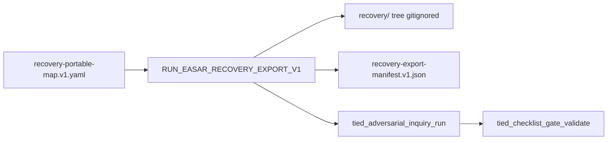

# Slice 6 E2E — portable `recovery/` export adapter (refine-plan 2026-10-19)

**Program:** [REQ-TIED_EASAR_RECOVERY](../PLAN.md) · **EASAR stage:** 9 publish / maintain (portable serialization per [methodology §6.2](../../../../docs/methodologies/evidence-assured-software-architecture-recovery.md))  
**Criteria (proposed LEAP):** **SC-EASAR-EXPORT** — read-only mapper from §6.1 canonical paths → §6.2 `recovery/` layout + committed **`recovery-export-manifest.v1.json`** receipt  
**Prerequisite:** Slice 5 verification **done** (`run_id=easar-slice5-verify-20261018`, [slice5-verification-gate.md](./slice5-verification-gate.md)); slices 0–5 receipts committed (≥ `7d62523a`)  
**Inquiry run_id (reserved):** `easar-slice6-verify-20261019` — Slice 6 verification only; do not reuse Slice 1–5 or close_out ids.

## Refine (resolved)

| Topic | Resolution |
| --- | --- |
| **Scope** | End-to-end **Slice 6 only:** deterministic **read-only** export adapter + **`recovery-export-manifest.v1.json`** under `tied-project/working/REQ-TIED_EASAR_RECOVERY/evidence/`; optional operator **`output_dir`** writes portable tree **outside git** (default under `tied-bundle/working/REQ-TIED_EASAR_RECOVERY/recovery-export/{run_id}/`). **No** repo-root `recovery/` commit; **no** methodology YAML mutation. |
| **Depth / policy** | Unchanged: `depth_tier: integrated`, `gate_policy: advisory`, `engagement: easar_full`, `mode: pilot`. Slice 6 adds a **verification** gate only; **program MVP close_out** (`easar-close-out-20261018`) **not invalidated** unless sponsor opts into LEAP program re-close (costly). |
| **Stage 9 semantics** | EASAR §6.2 is an **external auditor / non-TIED engagement** serialization target. TIED canonical paths remain authoritative ([ARCH-TIED_EASAR_ARTIFACT_MODEL](../../../architecture-decisions/ARCH-TIED_EASAR_ARTIFACT_MODEL.yaml) decision **`portable-export-readonly`**). Export **copies or transforms** committed receipts and working markdown; **`export_only: true`** discipline matches reflexion and validation receipts. |
| **MVP mapping (dogfood stdd)** | **Required slots** for Slice 6 MVP: `inventory.json` ← [inventory.v1.json](./inventory.v1.json); `evaluation/validation-cases.yaml` ← [validation-cases.v1.yaml](./validation-cases.v1.yaml); `evaluation/validation-results.json` ← [validation-results.v1.json](./validation-results.v1.json); `evaluation/verification-report.json` ← adapter from [reflexion-report.v1.json](./reflexion-report.v1.json) (+ optional gate ref metadata, **no** finding-ledger body); `scope.md` ← excerpt from [../PLAN.md](../PLAN.md) + request token; `manifest.yaml` ← generated from manifest receipt. **Explicit `gaps[]`** in manifest for unmapped §6.2 paths (e.g. `component-catalog.yaml`, `behavior-catalog.yaml`, full `docs/` tree, `claims.jsonl` full ledger, `grade-report.json`) — document rationale per §7.1 maturity. |
| **Canonical map artifact** | Committed machine map **`recovery-portable-map.v1.yaml`** (portable relative path → canonical source path + transform id: `copy_json`, `copy_yaml`, `markdown_excerpt`, `reflexion_to_verification_report`, `envelope_subset`). Single source for RED tests and operator docs. |
| **Inquiry dogfood surface** | Repository subset: `mcp-server/src/easar-receipts/**` (export module only), read-only access to committed evidence paths. Inquiry **scope** binds literal IMPL blocks **`BUILD_RECOVERY_EXPORT_MANIFEST_V1`**, **`RUN_EASAR_RECOVERY_EXPORT_V1`**, **`BUILD_EASAR_RECOVERY_EXPORT_MCP`** (block ids filled at RED via `pseudocode_analyze` / inquiry graph — same discipline as Slices 3–5). |
| **C2 supersession (slice-local)** | Parent CITDP `non_goals` deferred portable export for **MVP slices 0–4** and SWE-QA bank for first cycle. Sponsor **`/refine-plan slice 6`** re-opens **Stage 9 child plan** under the same `[REQ-TIED_EASAR_RECOVERY]` umbrella without forking layout. |

### Refinement findings (codebase-verified)

| Finding | Build implication |
| --- | --- |
| Receipt builders exist for slices 1–5; **no** export mapper module | Add `recovery-export-v1.ts`, `recovery-export-mcp.ts` parallel to validation/reflexion MCP |
| `reflexion-report.v1` already **`export_only: true`** | Verification-report adapter copies/transforms JSON; never merges `finding-ledger.jsonl` |
| `request-evidence-envelope.v1.json` is in-repo manifest analogue | Optional `manifest.yaml` embeds envelope `identity` + producer rows for mapped artifacts only |
| `tied-bundle/reports/source-graph/source-graph-index.v1.json` is regenerable | Export may **copy by path** at run time; manifest records `content_hash` + `source_kind: regenerable` |
| `[ARCH-TIED_EASAR_ARTIFACT_MODEL]` accepts export-only serializer | LEAP **SC-EASAR-EXPORT** + IMPL Stage 9 blocks before RED |
| CITDP persisted non_goal still lists slice 6 deferred | Update at **build-plan persist** (LEAP); refine-plan does not mutate persisted CITDP |

### Reversible vs costly

| Choice | Ladder |
| --- | --- |
| MVP map: 6 required portable slots vs full §6.2 tree | Reversible (start minimal map + explicit gaps) |
| Default output under `tied-bundle/working/…` vs operator temp dir | Reversible (prefer gitignored working root) |
| MCP `tied_easar_recovery_export_build` vs CLI script | Reversible (prefer MCP for envelope parity) |
| Emit `claims.jsonl` from claim-matrix-map only vs full CER run dir | Reversible (MVP: map-only lines; gap full evidence.jsonl) |
| Copy entire `docs/methodologies/` into `recovery/docs/` | **Costly** — forbidden; scope.md excerpt only |
| Commit exported `recovery/` under `tied-project/` | **Costly** — forbidden (ARCH portable-export-readonly) |
| Re-run full program `close_out` after Slice 6 | **Costly** — default slice-level verification + handoff |
| Blocking export completeness (all §6.2 files) as gate | **Costly** — forbidden; manifest `gaps[]` + gate on mapper tests + dogfood run |

---

## Plan (CITDP / test strategy)

### Child CITDP (draft — persist at build-plan close)

| Field | Value |
| --- | --- |
| `change_request_id` | `REQ-TIED_EASAR_RECOVERY` (slice 6 extension) |
| `record_status` | `draft` until build-plan persist |
| `desired_behavior` | Read-only portable export adapter; manifest receipt; slice verification gate |
| `non_goals` | Repo-root git `recovery/`; mutating TIED indexes; full §6.2 completeness gate; LLM-generated docs in export tree |
| `depth_tier` | `integrated` |
| `gate_policy` | `advisory` |
| `test_strategy` | RED unit (map schema, transform helpers) → composition (fixture evidence dir → output tree + manifest) → MCP write → dogfood export on stdd |

### Satisfaction mapping

| SC | Slice 6 deliverable |
| --- | --- |
| SC-EASAR-EXPORT (LEAP) | [recovery-portable-map.v1.yaml](./recovery-portable-map.v1.yaml) + [recovery-export-manifest.v1.json](./recovery-export-manifest.v1.json) |
| SC-EASAR-TESTS | Extend [verification-evidence-manifest.v1.json](./verification-evidence-manifest.v1.json) with slice-6 row |
| SC-EASAR-GATES | Verification gate **`easar-slice6-verify-20261019`**; tracker [../gate-tracker-slice6-verification.yaml](../gate-tracker-slice6-verification.yaml) |

### Portable map (MVP — dogfood)

| Portable path (§6.2) | Canonical source | Transform |
| --- | --- | --- |
| `inventory.json` | `evidence/inventory.v1.json` | `copy_json` (drop internal-only fields optional) |
| `evaluation/validation-cases.yaml` | `evidence/validation-cases.v1.yaml` | `copy_yaml` |
| `evaluation/validation-results.json` | `evidence/validation-results.v1.json` | `copy_json` |
| `evaluation/verification-report.json` | `evidence/reflexion-report.v1.json` | `reflexion_to_verification_report` |
| `scope.md` | `../PLAN.md` | `markdown_excerpt` (program + slice table) |
| `manifest.yaml` | generated | `from_manifest_receipt` |

**Regenerable optional copy (non-blocking):** `structure.json` ← `tied-bundle/reports/source-graph/source-graph-index.v1.json` when present at export time.

### TDD sequence (strict order)

1. **LEAP (minimal)** — add **SC-EASAR-EXPORT** to `[REQ-TIED_EASAR_RECOVERY]` satisfaction_criteria; extend `[IMPL-TIED_EASAR_RECEIPTS]` pseudo-code with **`BUILD_RECOVERY_EXPORT_MANIFEST_V1`**, **`RUN_EASAR_RECOVERY_EXPORT_V1`**, **`BUILD_EASAR_RECOVERY_EXPORT_MCP`**; run `pseudocode_validate`.
2. **RED** — `recovery-export-v1.test.ts` (map loads, required slots, gap list stable); `recovery-export-run.test.ts` (temp fixture dir mimicking evidence → portable tree + manifest hash); `recovery-export-mcp.test.ts` (MCP writes manifest under working evidence, output_dir gitignored).
3. **GREEN** — `recovery-export-v1.ts`, `recovery-export-run.ts`, `recovery-export-mcp.ts`; register **`tied_easar_recovery_export_build`** in `mcp-server/src/tools/index.ts`.
4. **Dogfood** — author [recovery-portable-map.v1.yaml](./recovery-portable-map.v1.yaml); run export against stdd with `git_rev` ≥ `7d62523a` → [recovery-export-manifest.v1.json](./recovery-export-manifest.v1.json) listing copied paths, content hashes, and documented gaps.
5. **Inquiry** — `tied_adversarial_inquiry_run` `phase: verification`, `run_id: easar-slice6-verify-20261019`, scope: new IMPL blocks (payload [slice6-verification-inquiry-payload.json](./slice6-verification-inquiry-payload.json) — **fill revisions at RED**).
6. **Gate** — `tied_checklist_activation_collect` → `tied_checklist_gate_validate` with [gate-tracker-slice6-verification.yaml](../gate-tracker-slice6-verification.yaml); persist gate JSON under [../gates/](../gates/).
7. **Envelope** — patch/build envelope with `fail_on_error_gaps: false` for slice pass; document in [session-handoff.md](./session-handoff.md).

### Test matrix (Slice 6)

| Kind | Name | RED | GREEN |
| --- | --- | --- | --- |
| unit | recovery-export-v1 | map schema + transform ids | `recovery-export-v1.test.ts` |
| unit | recovery-export-manifest | stable `content_hash`; gaps non-empty for MVP | same module tests |
| composition | recovery-export-run | fixture evidence → expected portable files | `recovery-export-run.test.ts` |
| composition | recovery-export-mcp | MCP writes manifest; optional output_dir | `recovery-export-mcp.test.ts` |
| regression | easar-receipts-s1-s5 | prior slice tests still pass | existing easar + validation tests |

**Lint:** `npm test --prefix mcp-server -- easar-receipts recovery-export validation claims-evidence-review source-graph checklist-validator` · `npm run lint:ts --prefix mcp-server`

---

## Implement (build-plan handoff)



### Files to touch (expected)

| Action | Path |
| --- | --- |
| add | `mcp-server/src/easar-receipts/recovery-export-v1.ts` |
| add | `mcp-server/src/easar-receipts/recovery-export-run.ts` |
| add | `mcp-server/src/easar-receipts/recovery-export-mcp.ts` |
| add | `mcp-server/src/easar-receipts/recovery-export*.test.ts` |
| edit | `mcp-server/src/tools/index.ts` |
| edit | `tied-project/implementation-decisions/IMPL-TIED_EASAR_RECEIPTS-pseudocode.md` |
| edit | `tied-project/requirements/REQ-TIED_EASAR_RECOVERY.yaml` (SC-EASAR-EXPORT) |
| add | `tied-project/working/REQ-TIED_EASAR_RECOVERY/evidence/recovery-portable-map.v1.yaml` |
| add | `tied-project/working/REQ-TIED_EASAR_RECOVERY/evidence/recovery-export-manifest.v1.json` |
| add | `tied-project/working/REQ-TIED_EASAR_RECOVERY/evidence/slice6-verification-inquiry-payload.json` |
| add | `tied-project/working/REQ-TIED_EASAR_RECOVERY/evidence/gate-validate-slice6-verification-payload.json` |
| add | `tied-project/working/REQ-TIED_EASAR_RECOVERY/evidence/sub-adversarial-inquiry-pass-slice6-verification.md` |
| add | `tied-project/working/REQ-TIED_EASAR_RECOVERY/evidence/slice6-verification-gate.md` |
| add | `tied-project/working/REQ-TIED_EASAR_RECOVERY/gate-tracker-slice6-verification.yaml` |
| edit | `tied-project/working/REQ-TIED_EASAR_RECOVERY/PLAN.md`, [session-handoff.md](./session-handoff.md) on slice 6 complete |
| edit | `tied-project/vocab/easar-recovery.md` (export adapter terms) |

### Commands (operator)

```bash
npm test --prefix mcp-server -- easar-receipts recovery-export validation claims-evidence-review source-graph checklist-validator
npm run build --prefix mcp-server
# tied-cli tied_easar_recovery_export_build '{ "request_token": "REQ-TIED_EASAR_RECOVERY", "map_path": "tied-project/working/REQ-TIED_EASAR_RECOVERY/evidence/recovery-portable-map.v1.yaml", "project_root": "/Users/fareed/Documents/dev/chatgpt/stdd", "manifest_output_path": "tied-project/working/REQ-TIED_EASAR_RECOVERY/evidence/recovery-export-manifest.v1.json", "output_dir": "tied-bundle/working/REQ-TIED_EASAR_RECOVERY/recovery-export/easar-slice6-dogfood-20261019" }'
# tied-cli tied_adversarial_inquiry_run @evidence/slice6-verification-inquiry-payload.json
# tied-cli tied_checklist_gate_validate @evidence/gate-validate-slice6-verification-payload.json
```

### Proof boundaries (unchanged)

- Export completeness is **not** a substitute for checklist gate authority or envelope blocking policy.
- Export must not mutate `tied-project/*.yaml` indexes or merge adversarial and claims ledgers.
- Missing canonical sources surface as manifest **`errors[]`** or **`gaps[]`**, not silent empty files (except documented optional regenerable copies).
- Observed export trees under `tied-bundle/working/` are regenerable evidence, not committed source of truth.

---

## Refine gate status

| Check | Result |
| --- | --- |
| Sponsor Slice 6 E2E scope | Resolved (this document) |
| Program MVP `close_out` | **done** — `e02716de` / `easar-close-out-20261018` (unchanged) |
| Slice 5 verification | **done** — prerequisite satisfied |
| Slice 6 IMPL pseudo-code | **pending** — Stage 9 blocks at build-plan RED |
| `pre_implementation` (program) | **done** — [pre_implementation-2026-10-18T02-15-41-747Z.json](../gates/pre_implementation-2026-10-18T02-15-41-747Z.json) `allowed: true` (Slice 6 extends enrolled stack; no new enrollment gate) |

**Next step:** `@build-plan` Slice 6 (or operator TDD from this handoff).
