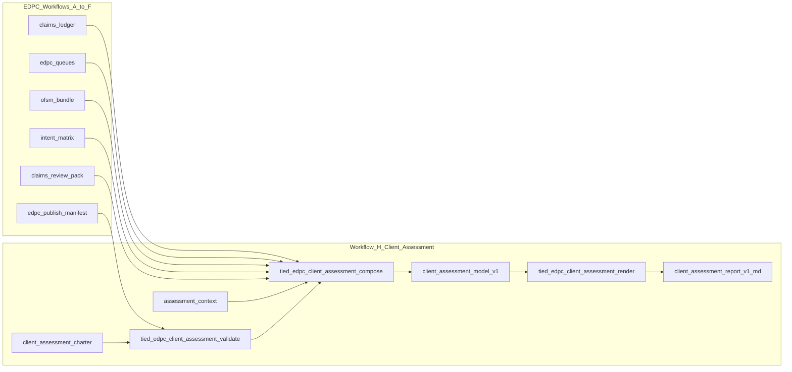

# EDPC client assessment report workflow

**Refine-plan pass:** 1 · **2026-10-19**  
**Program REQ (platform):** `[REQ-TIED_EDPC_CLIENT_ASSESSMENT]` (to be minted at build-plan)  
**Pilot engagement (external):** `REQ-CHARTVIEWER-BROWNFIELD_EDPC_COMPREHENSION`  
**Tracker:** [checklist-tracker-refine.yaml](file:///Users/fareed/Documents/dev/chatgpt/stdd/tied-project/working/REQ-TIED_EDPC_CLIENT_ASSESSMENT/checklist-tracker-refine.yaml)  
**CITDP:** [CITDP-REQ-TIED_EDPC_CLIENT_ASSESSMENT.yaml](file:///Users/fareed/Documents/dev/chatgpt/stdd/tied-project/working/REQ-TIED_EDPC_CLIENT_ASSESSMENT/CITDP-REQ-TIED_EDPC_CLIENT_ASSESSMENT.yaml)  
**Test strategy:** [test-strategy.md](file:///Users/fareed/Documents/dev/chatgpt/stdd/tied-project/working/REQ-TIED_EDPC_CLIENT_ASSESSMENT/test-strategy.md)  
**Risk:** [evidence/risk-assessment-refine-pass1.md](file:///Users/fareed/Documents/dev/chatgpt/stdd/tied-project/working/REQ-TIED_EDPC_CLIENT_ASSESSMENT/evidence/risk-assessment-refine-pass1.md)  
**Hard dependency:** [PLAN-slice-d-workflow-d-prod-ops.md](file:///Users/fareed/Documents/dev/chatgpt/stdd/tied-project/working/REQ-TIED_EDPC_COMPREHENSION/PLAN-slice-d-workflow-d-prod-ops.md) (consume OFSM/publish contracts; do not duplicate Slice D)

---

## Refine (resolved)

- **EDPC comprehension:** Workflows A–G and the closed Chart Viewer SCM, including [`edpc-publish-manifest.v1.json`](file:///Users/fareed/Documents/persante/repos/261016/chartviewer/tied-project/working/REQ-CHARTVIEWER-BROWNFIELD_EDPC_COMPREHENSION/evidence/edpc/edpc-publish-manifest.v1.json).
- **Workflow H (TIED PROC label):** Methodology [§18](file:///Users/fareed/Documents/dev/chatgpt/stdd/tied-bundle/docs/EDPC_Methodology_and_Workflows.md) names the **consulting assessment framework**, not a lettered workflow. TIED **`[PROC-EDPC_CLIENT_ASSESSMENT]`** is the choreography **after Workflow F** (and before or alongside **G** refresh): charter → context → validate → compose → human review → render → handoff. Vocab row **Workflow H** is RECORD target in H1 (`edpc-comprehension.md`).
- **§17 deliverable 6:** `technical-summary.v1.md` is the audience-facing **technical and decision summary**; **CAM v1** is the inspectable intermediate model (not a separate EDPC deliverable on the SCM).
- **Client assessment:** EDPC §18 consulting layer — business significance, risk priority, options, actions. Does not certify health, security, compliance, or business value.
- **Client Assessment Model (CAM v1):** `evidence → finding → significance → action`, plus domain status, confidence, limitations, follow-up.
- **Report:** Deterministic Markdown — **Understand, Trust, Protect, Change, Decide**, then 20 client-question domains, uncertainty, actions, traceability.
- **Handoff:** Canonical CAM/report under `tied-project/working/{REQ}/evidence/reports/`; committed reader copy under `docs/assessments/`.
- **Chart Viewer boundary:** `source_static`, `production_touch: none`, D-lite OFSM. Runtime usage, current health, performance, cost, security assurance, compliance → `unknown`, `deferred`, or explicit out-of-scope.
- **Inspection boundary:** Chart Viewer H0/H2 run in the **client repo** or from sponsor-exported bundles. Platform refine/build agents do not treat external paths as approved inspection unless the sponsor opens that scope.

The first report is generated from existing evidence before platform tooling is relied upon. Reusable platform workflow follows. MCP tools remain deterministic JSON-in/JSON-out; they do not read or write arbitrary client paths.

### Refine pass 1 additions

- **Compose inputs (explicit JSON payload, v1):** `charter`, `assessment_context` (overlay), `publish_manifest`, `claims_ledger` rows, `edpc_queues`, `ofsm_bundle` (optional D-lite stub), `intent_matrix` excerpt, `claims_review_pack` excerpt, optional `request_evidence_envelope` summary — all passed inline to handlers (same pattern as `buildEdpcPublishManifest`).
- **Adversarial vs EDPC claims:** Six advisory **envelope** findings stay in meta-assessment / open-review actions; do not merge into `claims-ledger.v1.yaml` rows.
- **Parallel tracks:** **H0 + H2** (Chart Viewer handoff) may proceed while **H1 + H3** (stdd platform) run TDD; **H6** requires both and a fixture golden match.
- **Slice D gate:** Compose rules that interpret OFSM health classifications must align with merged Slice D validators or document stub-only behavior in fixtures until Slice D lands.

---

## Evidence-based refinement findings

- Chart Viewer has SCM shell, claims ledger, OFSM stub, queues, matrix, publish manifest, envelope — missing §17 item 6 client summary.
- EDPC modules are pure functions behind thin MCP handlers; assessment code stays under `mcp-server/src/edpc/` without filesystem I/O.
- Slice D in stdd is a **dependency contract**, not duplicated scope.
- Pilot must audit composed EASAR receipt lineage and freshness; stale refs → limitations, not silent fixes.
- Six advisory envelope findings → plain-language uncertainty/actions, not resolved defects.
- No separate Chart Viewer process REQ unless sponsor wants an independent verification gate.

---

## Problem / gap

Workflow **F** stops at [`tied_edpc_publish_build`](file:///Users/fareed/Documents/dev/chatgpt/stdd/mcp-server/src/edpc/publish-build.ts). Chart Viewer has SCM but no client-facing assessment mapping EDPC outputs to 20 business domains and five decision outcomes.

Methodology: [EDPC §17–18](file:///Users/fareed/Documents/dev/chatgpt/stdd/tied-bundle/docs/EDPC_Methodology_and_Workflows.md). Finding template: Evidence / Finding / Significance / Action.

Ordered outcomes:

1. Chart Viewer report now (consultant supplies significance/actions).
2. Platformize via templates + pure assessment modules — no claim-graph DB, no unconstrained report agent.

---

## Target architecture

**Repository split**

| Layer | Repo | What |
| --- | --- | --- |
| Platform REQ/IMPL/MCP/templates/PROC | **stdd** | Reusable tooling + methodology enrollment |
| Engagement evidence + handoff | **Each client** (e.g. chartviewer) | Context, CAM, report under `evidence/reports/`, `docs/assessments/*` |

Extend `[ARCH-TIED_EDPC_ARTIFACT_MODEL]` with CAM/report bundle linked by assessment manifest; no duplicate EDPC receipt bytes.

---

## New TIED tokens (platform)

| Layer | Token | Role |
| --- | --- | --- |
| REQ | **`REQ-TIED_EDPC_CLIENT_ASSESSMENT`** | EDPC §18 enrollment in TIED MCP + PROC |
| ARCH | **`ARCH-TIED_EDPC_CLIENT_ASSESSMENT_MODEL`** | CAM schema, domain scope matrix, render views, handoff rules |
| IMPL | **`IMPL-TIED_EDPC_CLIENT_ASSESSMENT`** | validate / compose / render |
| PROC | **`[PROC-EDPC_CLIENT_ASSESSMENT]`** | Workflow **H** after **F** |
| Vocab | Extend `tied-project/vocab/edpc-comprehension.md` | CAM, Workflow H, handoff path |

**Acceptance criteria**

- **SC-CAM-SOURCE** — CAM composition requires a valid publish manifest and preserves source revision, tier, observation window, receipt refs, and publish gaps.
- **SC-CAM-TIER** — source-static output cannot promote Observed or Verified health/trust claims; missing runtime evidence is rendered as unknown or a named gap.
- **SC-CAM-LINKS** — every material finding has evidence references, confidence, limitations, and either significance/action or an explicit consultant-required gap.
- **SC-CAM-DOMAINS** — all 20 domains are present with `sampled`, `investigated`, `deferred`, or `excluded` status and rationale.
- **SC-CAM-DECISIONS** — all five outcome sections distinguish evidence-backed conclusions from consultant decisions.
- **SC-CAM-RENDER** — identical CAM input produces identical Markdown without invented claims or nondeterministic ordering.
- **SC-CAM-HANDOFF** — working report and `docs/assessments/` copy identify the same CAM revision, baseline, tier, and generation date.
- **SC-CAM-FRESHNESS** — changed baseline or unresolved receipt references produce an explicit stale/refresh gap.

Depends on **`[REQ-TIED_EDPC_COMPREHENSION]`**; no product code changes in target repos.

---

## Versioned artifacts

**Platform templates** (under `tied-bundle/templates/`):

- `edpc-client-assessment-charter.v1.example.yaml` — audience, decisions, tier, baseline, 20-domain scope, and handoff path.
- `edpc-assessment-context.v1.example.yaml` — consultant-owned business context, usage, ownership, cost, risk appetite, and action priorities.
- `edpc-client-assessment-model.v1.example.yaml` — CAM schema with evidence, finding, significance, action, confidence, limitations, and gaps.
- `edpc-client-technical-summary.v1.example.md` — five decisions, 20 domains, assessment questions, limitations, and traceability appendix.

**Per engagement** (`tied-project/working/{REQ}/evidence/reports/`):

- `assessment-charter.v1.yaml`
- `assessment-context.v1.yaml`
- `assessment-model.v1.yaml`
- `assessment-manifest.v1.json`
- `technical-summary.v1.md`

The client handoff is a committed copy at `docs/assessments/{slug}.md`. MCP returns normalized objects and rendered text; the client workflow writes the two committed files.

---

## Domain → EDPC source mapping (compose rules v1)

Compose walks `edpc-publish-manifest.receipt_refs` and pulls normalized rows into CAM findings. Initial rule set (expand in IMPL pseudo-code):

Composition preserves provenance. Consultant context may add business interpretation but cannot upgrade evidence classification:

- `sampled` or `investigated`: requirements, architecture, dependencies, maintainability, change impact, technical debt, future viability, and modernization options where receipt evidence supports them.
- `deferred` or `unknown`: actual usage, current health, performance/capacity, cost/efficiency, recovery readiness, and development effectiveness when only `source_static` evidence exists.
- `consultant_required`: business value, investment priorities, ownership, risk appetite, and significance/actions requiring sponsor context.
- `meta-assessment`: coverage, confidence, unresolved questions, evidence gaps, freshness, and what additional evidence would change a decision.

| Domain | Primary inputs | Typical `source_static` posture |
| --- | --- | --- |
| 1 Business value | slice REQ index, matrix approved rows, overlay | **sampled** + overlay |
| 2 Fitness for purpose | matrix dispositions, claims ledger vs slice REQ | **investigated** (change-locality) |
| 3 Actual usage | — | **deferred** (gap) |
| 4 Current health | OFSM / health snapshot | **deferred** or unknown-only (Chart Viewer stub) |
| 5 Hidden risk | reflexion, claims review, adversarial finding-ledger (advisory) | **sampled** |
| 6 Failure consequences | OFSM failure_modes, matrix integration rows | **sampled** |
| 7 Recovery readiness | OEE register, overlay | **deferred** partial |
| 8 Security/compliance | OEE, overlay; no compliance attestation | **sampled** + disclaimer |
| 9 Data integrity | matrix SQL/OEE rows, claims | **sampled** |
| 10 Operational dependencies | inventory, claim-map, integrations slice | **investigated** |
| 11 Maintainability | graph coverage gaps (reflexion), BBCE | **investigated** |
| 12 Change impact | BBCE slice-map, matrix proof boundaries | **investigated** |
| 13 Performance/capacity | — | **deferred** |
| 14 Cost/efficiency | overlay | **deferred** unless overlay |
| 15 Technical debt | reflexion warns, matrix rows | **sampled** |
| 16 Knowledge/ownership | charter sponsor_note, overlay | **sampled** |
| 17 Dev effectiveness | tier gap (no CI Observed at static) | **deferred** |
| 18 Future viability | stack/version from baseline lock | **sampled** |
| 19 Modernization options | matrix + queues action items | **sampled** |
| 20 Investment priorities | overlay + ranked findings | **consultant** |

Meta-assessment section (six “questions about the assessment”) derives from CAM `coverage_measures`, publish/OFSM gaps, and `evidence_gap` queue items—e.g. Chart Viewer `G-001` runtime Observed deferred.

---

## MCP surface (stdd)

| Tool | Responsibility |
| --- | --- |
| `tied_edpc_client_assessment_validate` | Charter domain matrix; tier-legal wording; publish manifest; overlay schema; freshness |
| `tied_edpc_client_assessment_compose` | EDPC refs + overlay → CAM + manifest |
| `tied_edpc_client_assessment_render` | CAM → deterministic Markdown |

Fail-closed: no blanket health/trust; observation window or `unknown` for Trust/Protect; stale baseline/unresolved receipt refs → refresh gap.

Register in `mcp-server/src/tools/index.ts`; RED tests use `mcp-server/test/fixtures/edpc/cam/`.

---

## Procedure: future client playbook

Add **`[PROC-EDPC_CLIENT_ASSESSMENT]`** to `tied-bundle/docs/processes.md` after Workflow F (steps 1–9 unchanged from prior draft).

---

## Chart Viewer pilot (“generate now”)

Engagement: **`REQ-CHARTVIEWER-BROWNFIELD_EDPC_COMPREHENSION`**. Steps 1–7 unchanged; emphasize sponsor-approved repo access for step 1 audit.

---

## Implementation sequence

| Id | Track | Work |
| --- | --- | --- |
| **H0** | Pilot | Chart Viewer evidence audit → first-report inputs |
| **H1** | Platform | REQ/ARCH/IMPL, pseudo-code, templates, PROC, vocab |
| **H2** | Pilot | Hand-authored technical summary + `docs/assessments/` copy |
| **H3** | Platform | RED validate |
| **H4** | Platform | RED compose |
| **H5** | Platform | RED render + MCP registration |
| **H6** | Both | Regenerate via tools, golden vs pilot, verification/close-out |

**Pattern reuse:** Deterministic render like `feature_view_render`, scoped to EDPC receipt refs.

**Gates:** `depth_tier` / `profile_depth`: `integrated`; `gate_policy`: `advisory`. Fresh `run_id` for adversarial inquiry before Workflow H RED (not Slice D or v1 comprehension runs).

---

## Costly vs reversible choices

(Unchanged from prior draft.)

---

## Plan (CITDP summary)

| Field | Value |
| --- | --- |
| `change_request_id` | `REQ-TIED_EDPC_CLIENT_ASSESSMENT` |
| `depth_tier` / `profile_depth` | `integrated` |
| `gate_policy` | `advisory` |
| Eligibility | External Chart Viewer evidence; MCP expansion; documented handoff writes outside MCP |
| Dependency | `REQ-TIED_EDPC_COMPREHENSION` publish + Slice D OFSM contracts |
| Non-goals | Claim DB; MCP filesystem I/O; PDF v1; certifying value/health/compliance |

Full analysis: [CITDP-REQ-TIED_EDPC_CLIENT_ASSESSMENT.yaml](file:///Users/fareed/Documents/dev/chatgpt/stdd/tied-project/working/REQ-TIED_EDPC_CLIENT_ASSESSMENT/CITDP-REQ-TIED_EDPC_CLIENT_ASSESSMENT.yaml).

---

## Implement (build-plan entry)

**Do not start RED or code until:**

1. `tied_checklist_gate_validate` **`phase: pre_implementation`** returns `allowed: true` with identity-bound inquiry artifacts for `REQ-TIED_EDPC_CLIENT_ASSESSMENT`.
2. `IMPL-TIED_EDPC_CLIENT_ASSESSMENT-pseudocode.md` passes `pseudocode_validate` (`gate_mode: true`).
3. Tracker copy updated from [checklist-tracker-refine.yaml](file:///Users/fareed/Documents/dev/chatgpt/stdd/tied-project/working/REQ-TIED_EDPC_CLIENT_ASSESSMENT/checklist-tracker-refine.yaml) with `sub-adversarial-inquiry-pass` and `gate-pseudocode-validation` completed.

**Refine-plan gate snapshot (2026-10-19):** `pre_implementation` **`allowed: false`** — expected. Diagnostics: `tracker_sparse`, `missing_required_step:sub-adversarial-inquiry-pass`, `missing_required_step:gate-pseudocode-validation`, `integrated_depth_requires_pairing`, `activation_pairing_incomplete`. Resolve at build-plan start via `tied_adversarial_inquiry_run` + activation collect, then re-validate.

**Build-plan invocation:** `@build-plan` with this linked plan or [PLAN.md mirror](file:///Users/fareed/Documents/dev/chatgpt/stdd/tied-project/working/REQ-TIED_EDPC_CLIENT_ASSESSMENT/PLAN-refine-pass1.md).

**Close-out:** `plan-close-out` must pass `phase: close_out` gate and three completion signals per `completion-signals-handoff.md`.
