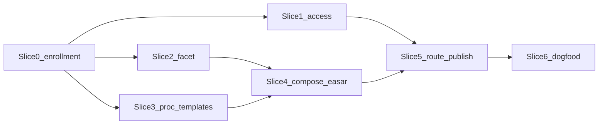

# REQ-TIED_EDPC_COMPREHENSION — program plan

**Methodology:** [docs/methodologies/EDPC_Methodology_and_Workflows.md](../../../docs/methodologies/EDPC_Methodology_and_Workflows.md)  
**Composition:** [methodology-composition-matrix.md](../../../docs/comparisons/methodology-composition-matrix.md) · EASAR recovery slice · [brownfield-intent-elevation.md](../../../tied-bundle/docs/brownfield-intent-elevation.md)  
**CITDP (analysis):** [CITDP-REQ-TIED_EDPC_COMPREHENSION.yaml](./CITDP-REQ-TIED_EDPC_COMPREHENSION.yaml)  
**Tracker:** [checklist-tracker.yaml](./checklist-tracker.yaml)  
**Test strategy:** [test-strategy.md](./test-strategy.md)  
**Risk:** [evidence/risk-assessment-refine-pass1.md](./evidence/risk-assessment-refine-pass1.md)

**Refine-plan pass:** 1 · **2026-10-19** · **build-plan:** in progress (Slice 0 enrollment + Slices 1–5 MCP; Slice 6 dogfood draft)  
**Session handoff:** [evidence/session-handoff.md](./evidence/session-handoff.md) (2026-10-19, `@handoff`)

## Sponsor decisions (locked for v1)

| Decision | Choice |
| --- | --- |
| Deliverable depth | **Orchestration only** — file artifacts + MCP validate/route/publish; no claim-graph DB |
| EASAR relationship | **EDPC supersedes engagement naming** (`edpc_full` primary; `easar_full` deprecated alias) |
| Three codebase conditions | Mapped to **`evidence_access_tier`** (see below) |
| depth / gates | **`depth_tier: integrated`**, **`profile_depth: integrated`**, **`gate_policy: advisory`** (match EASAR/CASE pilots) |
| Production touch (Tier 2) | Charter field **`production_touch`**; default **`none`** |
| CASE overlay | **Deferred v1.1** — `execution_access` dimension + `PRACTICE-EDPC-*` after core EDPC tools ship |

### Sponsor condition → tier mapping

| Sponsor condition | `evidence_access_tier` | Primary EDPC workflows (v1) |
| --- | --- | --- |
| Source only; cannot compile, test, or execute | **`source_static`** | A, B (static inventory), C (read/trace), F (publish with gaps) |
| Access + compile + test + execute; no source edits | **`toolchain_readonly`** | A, B, C, D (staging/local ops evidence), F; E read-only impact |
| Access + compile + test + **modify** source | **`source_change`** | All A–G as chartered; E + target-repo `[PROC-AGENT_REQ_CHECKLIST]` when changing code |

---

## Refine (resolved terms)

| Term | Canonical meaning |
| --- | --- |
| **EDPC** | Evidence-Driven Program Comprehension — bounded investigation producing a versioned **Software Comprehension Model (SCM)** |
| **SCM (v1)** | **`scm-snapshot-shell.v1.yaml`** index + **`claims-ledger.v1.yaml`** + pointers to EASAR/brownfield receipts — not a graph database |
| **Target repository** | Codebase under investigation (may differ from TIED store repo) |
| **TIED store repo** | Where `[REQ-TIED_EDPC_COMPREHENSION]` is implemented (this repository) |
| **Evidence-access tier** | Hard cap on agent/tool actions against the **target** repo |

**Claim-classification guardrails** (enforced by `tied_edpc_access_validate` + publish builder):

- **`source_static`:** material claims → Declared / Derived / Unknown only; Observed/Verified → **`evidence_gap`** queue unless tier elevated.
- **`toolchain_readonly`:** Observed from build/test/run receipts; Verified requires independent check (claims review, tests, parsers).
- **`source_change`:** Workflow **E** + authorized edits; REQ promotion still via `[PROC-BROWNFIELD_INTENT_ELEVATION]` dispositions.

---

## Tracker metadata (authoritative facet)

Reuse **`brownfield_intent_elevation.mode`** (`pilot` \| `strict` \| `report_only`). Add engagement + EDPC block:

```yaml
brownfield_intent_elevation:
  mode: pilot
  engagement: edpc_full   # easar_full → deprecated alias, same validation rules

edpc_engagement:
  evidence_access_tier: toolchain_readonly
  target_repository_root: "/absolute/path/to/target"
  production_touch: none   # none | read_only | approved_execute
  charter_path: tied-project/working/REQ-TIED_EDPC_COMPREHENSION/evidence/edpc/engagement-charter.v1.yaml
  access_matrix_path: tied-project/working/REQ-TIED_EDPC_COMPREHENSION/evidence/edpc/evidence-access-matrix.v1.yaml
```

**Do not** add a parallel `recovery_engagement.mode` (same reversible choice as EASAR C1).

---

## Workflow A–G → TIED checklist / tools (choreography)

`[PROC-EDPC_COMPREHENSION]` references these slugs/tools only — no duplicate mega-checklist.

| EDPC workflow | Goal | TIED entry (existing) | Tier gate |
| --- | --- | --- | --- |
| **A** Commission | Charter, scope, access | `change-definition`, `risk-assessment`; templates `edpc-engagement-charter.v1.yaml` | All |
| **B** Baseline | Inventory, architecture map | `brownfield-baseline-lock`, `evidence-inventory`; **`[PROC-EASAR_RECOVERY]`** slices 0–2; `tied_scoped_analysis_run`, `inventory.v1` | static+ |
| **C** Deep slice | Bounded Q answer | Source graph MCP, Track C sidecars, `tied_claims_evidence_review_run` | static+ (Derived); toolchain for Observed checks |
| **D** Failure / ops | Health, incidents, blind spots | Fidelity/adversarial when integrated; **runtime evidence** only if charter + tier ≥ `toolchain_readonly` | Not in v1 dogfood scope (slice 6) |
| **E** Change impact | Up/downstream effects | BBCE advisory + scoped analysis; **edits** only at `source_change` | E analysis at tier 2; mutations tier 3 |
| **F** Verify / publish | SCM release | `tied_edpc_publish_build`, envelope + `tied_checklist_gate_validate` verification | All |
| **G** Refresh | Stale claim invalidation | Document triggers; **`tied_edpc_workflow_route`** reprioritize — no continuous daemon in v1 | All |

**Example routes** (deterministic table lives in `IMPL-TIED_EDPC_ORCHESTRATION` pseudo-code):

- “What does this module do?” → B → C → F  
- “Can we safely replace the database?” → B → C → E → D → F (D/E depth per tier)

---

## Semantic tokens

| Layer | Token |
| --- | --- |
| REQ | **`REQ-TIED_EDPC_COMPREHENSION`** |
| ARCH | **`ARCH-TIED_EDPC_ARTIFACT_MODEL`** |
| IMPL | **`IMPL-TIED_EDPC_ACCESS`**, **`IMPL-TIED_EDPC_ORCHESTRATION`**, **`IMPL-TIED_EDPC_PUBLISH`**, **`IMPL-TIED_EDPC_ENGAGEMENT_FACET`** |
| PROC | **`PROC-EDPC_COMPREHENSION`** |
| Legacy | **`PROC-EASAR_RECOVERY`** — nested under EDPC B; engagement alias only |

### Satisfaction criteria (REQ)

- **SC-EDPC-TIER** — three tiers enforced fail-closed by `tied_edpc_access_validate`
- **SC-EDPC-FACET** — `edpc_full` requires `mode: pilot|strict`; `easar_full` alias emits deprecation diagnostic
- **SC-EDPC-ROUTE** — `tied_edpc_workflow_route` deterministic for identical inputs
- **SC-EDPC-SCM** — publish manifest lists gaps; EDPC §16 minimum fields present or explicit `gaps[]`
- **SC-EDPC-COMPOSE** — SCM shell references EASAR receipts without duplicating bytes
- **SC-EDPC-SUPERSEDE** — `REQ-TIED_EASAR_RECOVERY` linked `superseded_by` EDPC; receipts/tests remain green

---

## Versioned artifacts

Path: `tied-project/working/{REQ-TOKEN}/evidence/edpc/` ([working-artifact-placement.md](../../../tied-bundle/docs/working-artifact-placement.md))

| File | Role |
| --- | --- |
| `engagement-charter.v1.yaml` | Workflow A |
| `evidence-access-matrix.v1.yaml` | Tier + capability flags + `production_touch` |
| `edpc-queues.v1.yaml` | Five queues (EDPC §5) |
| `scm-snapshot-shell.v1.yaml` | SCM index + receipt refs |
| `claims-ledger.v1.yaml` | EDPC claim rows (§4 required fields subset) |
| `edpc-publish-manifest.v1.json` | Workflow F freeze |

**Relationship to brownfield matrix:** `claims-ledger` holds investigation claims; [intent elevation matrix](../../../tied-bundle/templates/brownfield-evidence-to-intent-matrix.md) remains the **promotion** path (`observed` → `approved` REQ). ARCH doc must state merge rules — do not dual-write without LEAP.

---

## MCP / CLI (v1)

| Tool | Module (proposed) |
| --- | --- |
| `tied_edpc_access_validate` | `mcp-server/src/edpc/access-validate.ts` |
| `tied_edpc_engagement_validate` | extend [engagement-facet.ts](../../../mcp-server/src/easar-receipts/engagement-facet.ts) → `edpc-engagement-facet.ts` |
| `tied_edpc_workflow_route` | `mcp-server/src/edpc/workflow-route.ts` |
| `tied_edpc_publish_build` | `mcp-server/src/edpc/publish-build.ts` |

All **read-only** on project TIED YAML (same contract as EASAR receipt builders).

---

## Implementation slices



| Slice | Out of scope / defer |
| --- | --- |
| 0 | — |
| 1–5 | Workflow D full prod ops; continuous G daemon; agentstream tier preflight |
| 6 | Dogfood **A+B+F** only on **stdd** at `toolchain_readonly`; D/E documented as follow-on slices |

---

## v1 non-goals

- Persisted graph DB for EDPC §4 relationships  
- LangGraph EDPC orchestrator (compose checklist only)  
- Replacing `[PROC-AGENT_REQ_CHECKLIST]` for target-repo feature work  
- Health/certification claims without tier-appropriate evidence  
- Removing EASAR receipt schemas or breaking `easar_full` without alias period  

---

## Proof boundary

EDPC in TIED v1 proves **tier-bounded investigation choreography and inspectable artifacts** — not target-system health, ISO compliance, or universal comprehension (EDPC §16–19).

---

## EASAR supersession migration (implementation checklist)

1. Add `EDPC_FULL_ENGAGEMENT = "edpc_full"`; map `easar_full` → same code path + `deprecated_engagement_alias:easar_full` diagnostic.  
2. Rename exports: `edpcFullEngagementActive()` primary; keep `easarFullEngagementActive` as thin wrapper.  
3. Update gate tracker fixtures under `REQ-TIED_EASAR_RECOVERY/working` → add parallel `edpc_full` fixtures; keep `easar_full` regression tests.  
4. Docs: client-development-index scenario row; brownfield-intent-elevation.md engagement section; easar-recovery.md → pointer to edpc-comprehension.md.  
5. LEAP: `REQ-TIED_EASAR_RECOVERY` `related_requirements.superseded_by` + cross-refs in EDPC REQ satisfaction criteria.

---

## Implement gate (build-plan)

Before RED tests:

1. Mint tokens + IMPL pseudo-code sidecars with `[PROC-IMPL_PSEUDOCODE_TOKENS]` comments.  
2. `pseudocode_validate` gate_mode on new IMPL blocks.  
3. `tied_checklist_gate_validate` **`pre_implementation`** with Tracker + CITDP + integrated activation when armed.  
4. Optional: `tied_gate_check` / DAE CRAP when CITDP enables diff-scoped CRAP.

See [test-strategy.md](./test-strategy.md).
