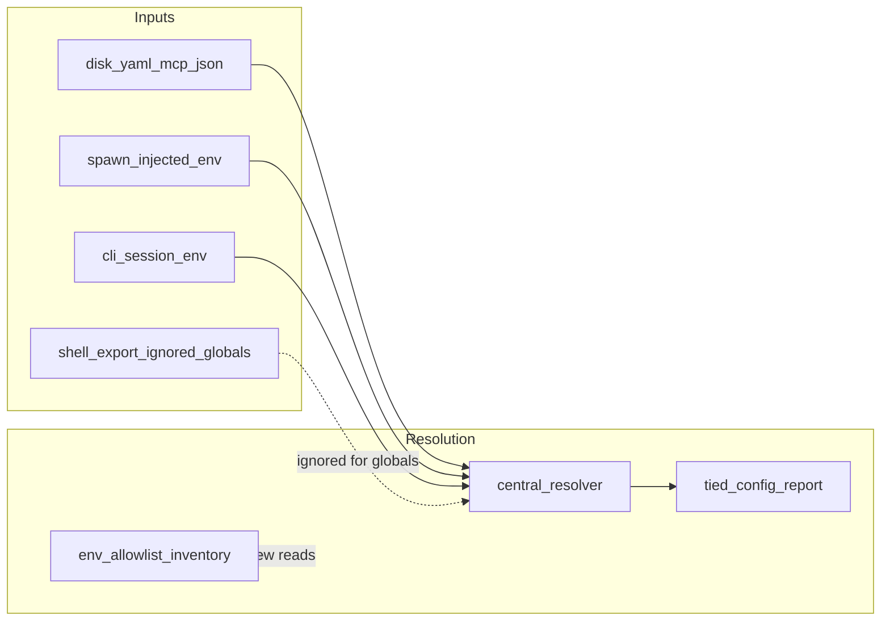

# [REQ-TIED_ENVIRONMENT_VARIABLE_POLICY] — environment variable usage policy (refined)

**Refined:** 2026-11-04 pass 2 (`refine-plan`, **TIED lane**)  
**Linked entry:** [PLAN.md](./PLAN.md)  
**Source:** [PRINCIPLE.md](./PRINCIPLE.md) ← [TODO.md](../../../../TODO.md) L1173–1199  
**CITDP:** [CITDP-REQ-TIED_ENVIRONMENT_VARIABLE_POLICY.yaml](./CITDP-REQ-TIED_ENVIRONMENT_VARIABLE_POLICY.yaml)  
**Tracker:** [agent-req-implementation-checklist.yaml](./agent-req-implementation-checklist.yaml)  
**Test strategy:** [test-strategy.md](./test-strategy.md)

**Depth / gates:** `profile_depth: minimal`, `gate_policy: advisory`, `depth_tier: minimal`  
**Pre-implementation gate:** `allowed` — receipt under `tied-bundle/working/REQ-TIED_ENVIRONMENT_VARIABLE_POLICY/gates/pre_implementation-2026-11-04T22-33-30-295Z.json`  
**Sponsor locks:** hybrid enforcement; **parent** REQ with **`REQ-TIED_RUNTIME_DISK_CONFIG`** as **`depends_on`** child.

---

## Refine — selection and RESOLVE

| Need | Drift risk | In v1? |
| --- | --- | --- |
| Single normative product policy for new env introduction | **High** — fragmented REQs + TODO draft only | **Yes** |
| Mechanical block on every `process.env` read | **High** — large migration | **No** (strict tier deferred) |
| Umbrella over disk config (RDC) | **Medium** — duplicate prose in RDC | **Yes** — parent REQ + LEAP `depends_on` on RDC |
| Methodology `ai-principles.md` change | **Low** scope creep | **No** |

**Canonical terms:** see [tied-product-configuration.md](../../vocab/tied-product-configuration.md).

**Reversible choices (defaults for implement)**

| Decision | Default |
| --- | --- |
| REQ token | **REQ-TIED_ENVIRONMENT_VARIABLE_POLICY** |
| Allowlist file location after promote | `tools/bootstrap/fixtures/tied-env-allowlist/env-allowlist.v1.yaml` (committed) + working copy archived |
| Env catalog doc | `docs/tied-first-party-env-catalog.md` generated/maintained from allowlist |
| Inventory scanner | Bootstrap `node --test` only in v1 (no MCP tool) |
| CONFIG_REPORT | **No new tool** — SC-EVPOL-OBSERVE satisfied by citation + catalog cross-links to existing report keys |
| AGENTSTREAM_* keys | Expand allowlist during GREEN pass when scanner finds production reads |

**Costly choice (sponsor confirmed)**

- **Parent REQ** over **[REQ-TIED_RUNTIME_DISK_CONFIG](../../requirements/REQ-TIED_RUNTIME_DISK_CONFIG.yaml)** requires LEAP index update on RDC (`depends_on` parent) without changing RDC satisfaction criteria semantics.

**Accepted ambiguity**

- Full allowlist completeness is proven by GREEN inventory pass, not at refine time.

### Configuration plane (ARCH draft)

| Plane | Examples | Policy (rules) |
| --- | --- | --- |
| **Disk / install** | `.tied/store.yaml`, `.cursor/mcp.json` (refresh) | 1, 5 — primary for global paths and operator toggles ([REQ-TIED_RUNTIME_DISK_CONFIG](../../requirements/REQ-TIED_RUNTIME_DISK_CONFIG.yaml)) |
| **MCP tools / CLI** | `tied_config_report`, feature orchestrator flags | 3 — operational control; env must not be sole surface (gap audit SC-EVPOL-GAP-AUDIT) |
| **Spawn-injected env** | mcp.json `env` block | 2, 5 — allowed when install-managed; not operator `export` |
| **CLI session** | `TIED_CLI_IMPL_ESSENCE_*`, metrics path overrides | 2 — temporary transport |
| **Secrets** | `JEV_API_KEY` | 2, 8 — env OK; never in committed mcp.json |
| **Shell export (global)** | `TIED_STORE_ROOT`, `TIED_MCP_BIN` in parent shell | **Ignored** for resolution (RDC); rule 4 |



### LEAP — child REQ (on `@add-feature`)

Add to [REQ-TIED_RUNTIME_DISK_CONFIG.yaml](../../requirements/REQ-TIED_RUNTIME_DISK_CONFIG.yaml) `related_requirements.depends_on` (prepend):

```yaml
depends_on:
  - "REQ-TIED_ENVIRONMENT_VARIABLE_POLICY"
  - "REQ-TIED_CLI_MCP_JSON_BASE_PATH"
  # ... existing entries unchanged
```

Parent REQ `related_requirements.related_to` includes RDC, CONFIG_REPORT, CLI MCP JSON, YAML style.

### REQ detail outline (author-requirement)

Copy [PRINCIPLE.md](./PRINCIPLE.md) body into requirement detail `directive` field; add `satisfaction_criteria` IDs from table below; `category: Infrastructure`, `priority: P1`, `status: Planned` until verify.

### Known production env gaps (refine inventory)

**Agentstream (non-test `.ts`):** `AGENTSTREAM_CLAUDE_LIVE_OK`, `AGENTSTREAM_CLAUDE_STRICT_MCP`, `AGENTSTREAM_CLAUDE_KEEP_PERMISSIONS`, `AGENTSTREAM_HARNESS_TRACE`, `AGENTSTREAM_HARNESS_TRACE_PATH` — add to allowlist during GREEN pass ([env-allowlist.v1.yaml](./env-allowlist.v1.yaml)).

---

## Plan — CITDP summary

### Change definition

| | |
| --- | --- |
| **Current** | Env usage policy exists only in TODO.md; enforcement is partial via RDC, CLI/MCP path REQs, and ad hoc reviews ([TODO 10-07](../../../../TODO.md), [TODO 10-09](../../../../TODO.md)). |
| **Desired** | Umbrella **[REQ-TIED_ENVIRONMENT_VARIABLE_POLICY]** with full directive in REQ detail; committed **allowlist + catalog**; **inventory test** blocks undocumented production reads; RDC explicitly **depends_on** parent; gap audit for MCP control-via-env. |

### Impact

| Module | Change |
| --- | --- |
| `tied-project/requirements/REQ-TIED_ENVIRONMENT_VARIABLE_POLICY.yaml` | **New** |
| `tied-project/architecture-decisions/ARCH-TIED_ENVIRONMENT_VARIABLE_POLICY.yaml` | **New** — configuration plane, precedence, spawn vs shell |
| `tied-project/implementation-decisions/IMPL-TIED_ENVIRONMENT_VARIABLE_POLICY.yaml` + pseudocode sidecar | **New** — inventory scanner contract |
| `tied-project/requirements/REQ-TIED_RUNTIME_DISK_CONFIG.yaml` | **LEAP** — add `depends_on: REQ-TIED_ENVIRONMENT_VARIABLE_POLICY` |
| `tools/bootstrap/lib/tied-env-allowlist-inventory.mjs` | **New** |
| `tools/bootstrap/lib/tied-env-allowlist-inventory.test.mjs` | **New** RED→GREEN |
| `docs/tied-first-party-env-catalog.md` | **New** |
| `tied-project/vocab/tied-product-configuration.md` | **RECORD** (done at refine) |
| `tied-project/working/REQ-TIED_ENVIRONMENT_VARIABLE_POLICY/evidence/mcp-control-env-audit.md` | **New** (audit) |

### Success criteria (REQ draft)

| ID | Criterion | Metric |
| --- | --- | --- |
| **SC-EVPOL-TEXT** | REQ detail embeds rules 1–8 + design test | Detail file review |
| **SC-EVPOL-CATALOG** | Catalog lists every allowlist entry with class + owner REQ | `docs/tied-first-party-env-catalog.md` |
| **SC-EVPOL-INVENTORY** | Undocumented production env read fails test | `node --test tools/bootstrap/lib/tied-env-allowlist-inventory.test.mjs` |
| **SC-EVPOL-OBSERVE** | Operators can inspect effective settings + sources | Existing `tied-config-report` / `tied_config_report` (cite in parent REQ) |
| **SC-EVPOL-RDC-LINK** | RDC `depends_on` parent REQ | `tied_validate_consistency` traceability |
| **SC-EVPOL-GAP-AUDIT** | MCP control-via-env audit committed | `evidence/mcp-control-env-audit.md` |

### Implementation phases

1. **`@add-feature`** — Author REQ/ARCH/IMPL + pseudocode; LEAP RDC link; `semantic-tokens.yaml`.
2. **RED** — Inventory test fails on intentional undocumented key fixture.
3. **GREEN** — Implement scanner; expand [env-allowlist.v1.yaml](./env-allowlist.v1.yaml) until repo clean.
4. **Catalog** — Publish `docs/tied-first-party-env-catalog.md`; link from `mcp-server/README.md` snippet.
5. **Gap audit** — SC-EVPOL-GAP-AUDIT evidence.
6. **`@close-out`** — Persist CITDP to `tied-project/citdp/`; verify; optional TODO.md pointer replacing duplicate principle block.

### Non-goals (v1)

- Editing `tied-bundle/docs/ai-principles.md`.
- Removing MCP JSON `env` blocks (spawn-injected env remains).
- `tied_project_lint` integration (defer unless trivial after inventory lands).

---

## Recommended close-out steps

1. `tied_validate_consistency`
2. `lint_yaml` on changed project YAML
3. Vocab VALIDATE — `tied-product-configuration.md` vs REQ/catalog
4. CHANGELOG bullet under Infrastructure
5. TODO.md: replace principle block with link to REQ detail

---

## Handoff

- **Next:** `@add-feature` using this folder as linked plan input.
- **Then:** `@build-plan` for RED/GREEN inventory and catalog.
