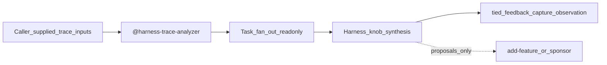

# Implementation plan — LangChain harness Phase 3 (matrix row + trace analyzer)

| Field | Value |
| --- | --- |
| **request_token** | `REQ-TIED_HARNESS_LANGCHAIN_PHASE3` |
| **working_slug** | `REQ-TIED_HARNESS_LANGCHAIN_PHASE3` |
| **Primary source** | [langchain-harness-engineering-vs-tied-agent-management.md](../../../docs/comparisons/langchain-harness-engineering-vs-tied-agent-management.md) (Phase 3 sponsor promotion) |
| **Linked Cursor plan** | `/Users/fareed/.cursor/plans/langchain_phase_3_promotion_01bdd01a.plan.md` |
| **CITDP** | [CITDP-REQ-TIED_HARNESS_LANGCHAIN_PHASE3.yaml](../../citdp/CITDP-REQ-TIED_HARNESS_LANGCHAIN_PHASE3.yaml) |
| **Tracker** | [checklist-tracker.yaml](checklist-tracker.yaml) |
| **Test strategy** | [test-strategy.md](test-strategy.md) |
| **depth_tier** | `minimal` |
| **gate_policy** | `advisory` |
| **methodology_surface_change_class** | `prompt_type_workflow` (`surface_ref`: `harness-trace-analyzer`) |
| **methodology_surface_experiment_link** | `mle-htol-pilot-20261021-001` (compose: new `surface_ref` **harness-trace-analyzer** on existing HTOL pilot row; no new experiment id on this pass) |
| **Operator interruption budget** | No new gate MCP; no LangSmith; matrix + skill + enrollment constants only |

---

## 1. Refine (Touchpoint 1 — RESOLVE)

### Intent authority

- **Sponsor intent:** Deliver LangChain comparison **Phase 3** after sponsor promotion: **methodology-composition-matrix §2 row 15** plus **`@harness-trace-analyzer`** (LangChain Trace Analyzer **compose** pattern with normative Task fan-out), on top of closed Phase 1–2 HTOL stack.
- **Sponsor choice (resolved):** Matrix row **and** product skill (not row-only).
- **RESOLVE charter:** Slice order and test filenames may change; intent authority stays with compose-don't-replace (Kaizen observations + outreach row, not gate authority).

### RESOLVE table

| External / informal | TIED preferred term / surface | Notes |
| --- | --- | --- |
| Trace Analyzer Skill (3-step) | **`@harness-trace-analyzer`** | Caller-supplied paths only; no LangSmith fetch |
| Quick post-batch review | **`@harness-trace-review`** | Unchanged Loop 2 path |
| Matrix promotion | **§2 row 15** | Contract **14 → 15**; LEAP SC-MCM-DOC |
| Terminal Bench / 66.5% | **LangChain-reported** / **`not_measured`** | Row `sponsor_notes` + skill Forbidden |

**PRELOAD:** [feedback-to-tied.md](../../vocab/feedback-to-tied.md), [prompt-composer.md](../../vocab/prompt-composer.md), [harness-trace-observation-loop.md](../../../tied-bundle/docs/harness-trace-observation-loop.md), [external-service-three-wave-comparison-template.md](../../../tied-bundle/docs/external-service-three-wave-comparison-template.md).

**Compose authority:**

- [REQ-TIED_HARNESS_TRACE_OBSERVATION_LOOP](../../requirements/REQ-TIED_HARNESS_TRACE_OBSERVATION_LOOP.yaml) (Phase 1)
- [REQ-TIED_HARNESS_TRACE_LEARNING_PILOT](../../requirements/REQ-TIED_HARNESS_TRACE_LEARNING_PILOT.yaml) (Phase 2)
- [REQ-TIED_HARNESS_PLATFORM_SEAM](../../requirements/REQ-TIED_HARNESS_PLATFORM_SEAM.yaml)
- [REQ-TIED_METHODOLOGY_COMPOSITION_MATRIX](../../requirements/REQ-TIED_METHODOLOGY_COMPOSITION_MATRIX.yaml) (LEAP row count)

### Skill choice (operator)

| Situation | Invoke |
| --- | --- |
| Single batch, few failure modes, fast Kaizen capture | `@harness-trace-review` |
| Multi-failure trace batch, need parallel classification before synthesis | `@harness-trace-analyzer` |
| REQ/ARCH/IMPL or gate-affecting change | `add-feature` / `build-plan` / sponsor — not either harness skill alone |

### Adversarial depth and gate policy

| Field | Value | Rationale |
| --- | --- | --- |
| `depth_tier` | **minimal** | Docs + skill + enrollment constants |
| `gate_policy` | **advisory** | No checklist authority change |
| `research_profile` | **read-only** | Comparison + operator recipes |
| `eligibility_triggers_matched` | **none** | No integrated waiver |
| `integrated_waiver` | **n/a** | |

### Consequence ladder

| Decision | Ladder | Disposition |
| --- | --- | --- |
| Phase 3 matrix row 15 + analyzer skill | **Costly** | **Do** (sponsor `/add-feature` + refine-plan 2026-10-21) |
| LEAP matrix SC row count 14→15 | **Reversible** | **Do** with REQ-TIED_METHODOLOGY_COMPOSITION_MATRIX update |
| PROMPT_TYPE_LEAF_IDS harness ids | **Reversible** | **Do** (fixes Phase 2 enrollment advisory gap) |
| LangSmith automation | **Costly** | **Defer** |
| Claim HTOL **improved** from analyzer adoption | **Costly** | **Do not** on implement pass |

---

## 2. CITDP

**Record:** [CITDP-REQ-TIED_HARNESS_LANGCHAIN_PHASE3.yaml](../../citdp/CITDP-REQ-TIED_HARNESS_LANGCHAIN_PHASE3.yaml)

---

## 3. Compose-don't-replace contract

| Harness / outreach (tune here) | Platform-adjacent authority (do not replace) |
| --- | --- |
| Matrix §2 row 15 mechanism draft cells | **`tied_checklist_gate_validate`** outcomes |
| `@harness-trace-analyzer` synthesis proposals | Project REQ/ARCH/IMPL via **TIED MCP** |
| Task fan-out readonly analysis | **`tied_verify`**, LEAP, checklist slugs |
| Kaizen **`tied_feedback_capture_observation`** | Gate receipts for implement-complete claims |

**Enrollment advisory (post-implement):** Read-only **`tied_methodology_production_system_enrollment_validate`** with `surface_ref: harness-trace-analyzer` (and confirm `harness-trace-review` no longer `ENROLLMENT_INVALID_PROMPT_TYPE`).

---

## 4. Draft §2 row 15 (implement copies into matrix)

| Column | Draft content |
| --- | --- |
| **#** | 15 |
| **Framework** | LangChain harness engineering (empirical trace loop) |
| **Loop(s)** | 1–2 |
| **Disposition** | **Composable** |
| **TIED center of gravity** | Trace-driven **harness knob** tuning (prompt, tools, middleware analogs) vs platform-adjacent proof (gates, MCP YAML, **`tied_verify`**) |
| **Evidence refs** | [LangChain harness × TIED](../../../docs/comparisons/langchain-harness-engineering-vs-tied-agent-management.md), [HTOL guide](../../../tied-bundle/docs/harness-trace-observation-loop.md), [HTOL Loop 3 charter](../../../tied-bundle/docs/harness-trace-learning-experiment-charter.md), [Traefik row 13 seam](../../../docs/comparisons/traefik-harness-platform-vs-tied-agent-management.md) |
| **vocabulary** | [feedback-to-tied.md](../../vocab/feedback-to-tied.md); harness-trace failure-mode taxonomy |
| **intent_stack** | `@harness-trace-review`; `@harness-trace-analyzer`; **`tied_feedback_capture_observation`** |
| **change_analysis** | CITDP on matrix/skill edits; **LangChain-reported metric overclaim** failure class |
| **implementation_proof** | RED/GREEN doc/skill tests; enrollment unit test for harness surface_ref |
| **anti_drift** | Label **LangChain-reported** metrics; gate receipts ≠ LangSmith traces |
| **improvement_loop** | Kaizen Loop 2; optional Loop 3 HTOL pilot (**not_measured** until cohort) |
| **sponsor_notes** | **Composable:** Terminal Bench / LangSmith product stack **Defer**; pair row **14** (Cursor telemetry) for live ops vs row **15** (empirical bench trace loop); vendor scores **LangChain-reported** only |

**Row 14 trim (implement):** Point Cursor pairing to **row 15** instead of duplicating LangChain trace/benchmark narrative in `improvement_loop` / `sponsor_notes`.

---

## 5. Phased slices (build-plan executes)

| Order | Slice | Primary deliverable |
| ---: | --- | --- |
| 1 | **F** | REQ/ARCH/IMPL minted at refine-plan; pseudo-code gate |
| 2 | **B-test** | RED → GREEN: `methodology-composition-matrix-langchain-row.test.mjs` |
| 3 | **B** | Matrix row 15 + LangChain Phase 3 **Implemented** + LEAP SC-MCM-DOC |
| 4 | **C-test** | RED → GREEN: `harness-trace-analyzer-skill.test.mjs` + guide doc test markers |
| 5 | **C** | `harness-trace-analyzer/SKILL.md`, HTOL guide outer-loop section, prompt-type inventory |
| 6 | **D** | `PROMPT_TYPE_LEAF_IDS` + enrollment unit tests (TDD) |
| 7 | **E** | Cross-links: client-development-index; optional cursor comparison |

**Forbidden:** LangSmith adapters; auto YAML from synthesis; gate waiver language; Terminal Bench as TIED effectiveness.

---

## 6. Behavioral model

---

## 7. Test strategy

See [test-strategy.md](test-strategy.md). **RED first:** matrix row + analyzer skill + guide marker tests before GREEN content.

---

## 8. Implement handoff

Run **`/build-plan`** on this PLAN after **`pre_implementation` gate allowed**.

**Refine-plan (2026-10-21):** PLAN + CITDP + Tracker + REQ/ARCH/IMPL + IMPL pseudo-code → pre_implementation receipt under `gates/`. **No** matrix/skill/test file GREEN edits in refine pass.

---

## 9. Gate status (refine-plan)

**`pre_implementation` gate (2026-10-21):** `tied_checklist_gate_validate` → **`allowed: true`**, `depth: minimal`, `gate_policy: advisory`. Receipt: [pre_implementation-2026-10-21T06-49-35-242Z.json](gates/pre_implementation-2026-10-21T06-49-35-242Z.json).

**Gate compose note:** Pass `evidence.methodologySurfaceExperimentBasePath` = absolute `tied-project/` when validating (same pattern as Phase 2 HTOL pilot). CITDP links **`mle-htol-pilot-20261021-001`** with compose `surface_ref` **harness-trace-analyzer**; implement does **not** require a new experiment id unless sponsor scopes one.

**Refine-plan deliverables:** PLAN, CITDP, Tracker, test-strategy, REQ/ARCH/IMPL tokens, IMPL pseudo-code (`pseudocode_validate` gate_mode ok). **No** matrix/skill RED/GREEN in refine pass.

**Build-plan (2026-10-21):** Slices B–E implemented; bootstrap + enrollment + prompt-type e2e green. **Verification gate:** [verification-2026-10-21T07-04-35-634Z.json](gates/verification-2026-10-21T07-04-35-634Z.json) (`allowed: true`). Handoff: [evidence/build-plan-handoff.md](evidence/build-plan-handoff.md).

**Close-out (2026-10-21):** `run_id=lc-p3-close-out-2026-10-21` — envelope unblocked via NA receipt backfill; [evidence/close-out-handoff.md](evidence/close-out-handoff.md). Traceable commit pending sponsor staging.
