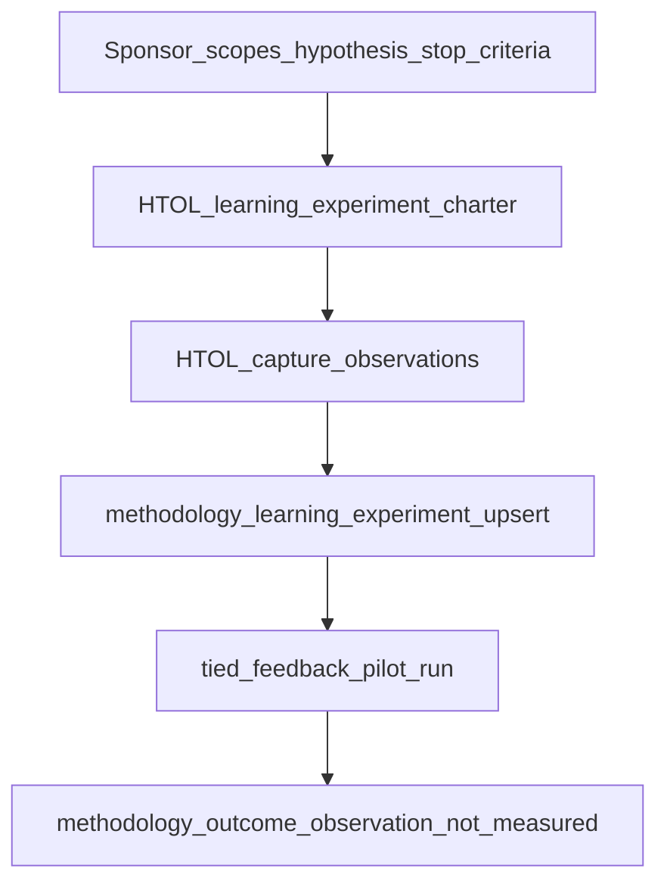

# Implementation plan — Harness trace learning pilot (LangChain comparison Phase 2)

| Field | Value |
| --- | --- |
| **request_token** | `REQ-TIED_HARNESS_TRACE_LEARNING_PILOT` |
| **working_slug** | `REQ-TIED_HARNESS_TRACE_LEARNING_PILOT` |
| **Primary source** | [langchain-harness-engineering-vs-tied-agent-management.md](../../../docs/comparisons/langchain-harness-engineering-vs-tied-agent-management.md) (Phase 2 Loop 3) |
| **Linked Cursor plan** | `/Users/fareed/.cursor/plans/htol_phase_2_pilot_88cb172f.plan.md` |
| **CITDP** | [CITDP-REQ-TIED_HARNESS_TRACE_LEARNING_PILOT.yaml](../../citdp/CITDP-REQ-TIED_HARNESS_TRACE_LEARNING_PILOT.yaml) |
| **Tracker** | [checklist-tracker.yaml](checklist-tracker.yaml) |
| **Test strategy** | [test-strategy.md](test-strategy.md) |
| **depth_tier** | `minimal` |
| **gate_policy** | `advisory` |
| **methodology_surface_change_class** | `prompt_type_workflow` (`surface_ref`: `harness-trace-review`) |
| **methodology_surface_experiment_link** | `mle-htol-pilot-20261021-001` (persist at implement Slice C before verification) |
| **Operator interruption budget** | No new gate MCP; no LangSmith; pilot metrics analysis-only |

---

## 1. Refine (Touchpoint 1 — RESOLVE)

### Intent authority

- **Sponsor intent:** Deliver LangChain comparison **Phase 2**: a **bounded, sponsor-run** Loop 3 methodology learning experiment for whether **@harness-trace-review** / HTOL observations improve harness outcomes—with **stop criteria**, denominators, and **`not_measured` / inconclusive** until a real cohort exists.
- **Sponsor choice (resolved):** Charter + templates **and** store dogfood enrollment on this repo (not charter-only).
- **RESOLVE charter:** Slice order and example filenames may change; intent authority stays with Loop 3 compose on closed Phase 1 HTOL stack and explicit non-goals (no vendor bench claims, no gate authority).

### RESOLVE table

| External / informal | TIED preferred term / surface | Notes |
| --- | --- | --- |
| LangChain outer loop | **Loop 3 PDSA** on HTOL effectiveness | Not product middleware |
| Bounded experiment | **`methodology-learning-experiment.v1`** | [methodology-experiments.yaml](../../methodology-experiments.yaml) via MCP upsert |
| Pilot metrics | **`tied_feedback_pilot_run`** → `feedback-pilot.v1` | Analysis evidence only |
| Cohort | **`tied_feedback_capture_observation`** entries | **`compatibility_key`** = `capture_schema\|privacy_tier` |
| HTOL cohort tag (optional) | **`context.denominator_fingerprint: htol-v1`** | Additive doc/skill slice for tighter selection |

**PRELOAD:** [feedback-to-tied.md](../../vocab/feedback-to-tied.md), [quality-assurance.md](../../vocab/quality-assurance.md) (pilots, stop criteria), [harness-trace-observation-loop.md](../../../tied-bundle/docs/harness-trace-observation-loop.md), [methodology-surface-enrollment-advisory.md](../../../tools/bundled-prompt-type-skills/prompt-shared/methodology-surface-enrollment-advisory.md).

**Compose authority (unchanged):**

- [REQ-TIED_HARNESS_TRACE_OBSERVATION_LOOP](../../requirements/REQ-TIED_HARNESS_TRACE_OBSERVATION_LOOP.yaml) (Phase 1)
- [REQ-METHODOLOGY-LEARNING-EXPERIMENT](../../requirements/REQ-METHODOLOGY-LEARNING-EXPERIMENT.yaml)
- [REQ-METHODOLOGY-KAIZEN-EXPERIMENT-BRIDGE](../../requirements/REQ-METHODOLOGY-KAIZEN-EXPERIMENT-BRIDGE.yaml)
- [REQ-KAIZEN-FEEDBACK-PILOT](../../requirements/REQ-KAIZEN-FEEDBACK-PILOT.yaml)

### Adversarial depth and gate policy

| Field | Value | Rationale |
| --- | --- | --- |
| `depth_tier` | **minimal** | Charter + templates + doc test + MCP compose on existing tools |
| `gate_policy` | **advisory** | No checklist authority change |
| `research_profile` | **read-only** | Local comparison + operator recipes |
| `eligibility_triggers_matched` | **persistence** (dogfood upsert) | **depth_change_waiver** in CITDP — sponsor linked plan 2026-10-21 |
| `integrated_waiver` | **n/a** | No integrated inquiry at minimal depth |

### Consequence ladder

| Decision | Ladder | Default |
| --- | --- | --- |
| Phase 2 charter + templates + store dogfood | **Reversible** | **Do** (this REQ) |
| Optional skill `denominator_fingerprint` hint | **Reversible** | **Do** doc-only if time; else defer in Slice E |
| Claim HTOL **improved** outcomes from dogfood run | **Costly** | **Do not** on implement pass |
| Phase 3 matrix row | **Costly** | **Defer** |
| LangSmith automation | **Costly** | **Defer** |

---

## 2. CITDP

**Record:** [CITDP-REQ-TIED_HARNESS_TRACE_LEARNING_PILOT.yaml](../../citdp/CITDP-REQ-TIED_HARNESS_TRACE_LEARNING_PILOT.yaml)

---

## 3. Compose-don't-replace contract

| Harness / Loop 3 (tune here) | Platform-adjacent authority (do not replace) |
| --- | --- |
| HTOL learning charter + templates | **`tied_checklist_gate_validate`** outcomes |
| **`tied_methodology_learning_experiment_upsert`** enrollment | Project REQ/ARCH/IMPL via **TIED MCP** |
| **`tied_feedback_pilot_run`** analysis JSON | **`tied_verify`**, LEAP promotion, checklist slugs |
| Optional kaizen bridge draft review | Gate receipts for implement-complete claims |

**Enrollment advisory:** After Slice C upsert, optional read-only **`tied_methodology_production_system_enrollment_validate`** with `production_system_surface: prompt_type_workflow`, `surface_ref: harness-trace-review`.

---

## 4. Phased slices (add-feature / build-plan executes)

| Order | Slice | Primary deliverable |
| ---: | --- | --- |
| 1 | **F** (tokens) | REQ/ARCH/IMPL minted at refine-plan; full pseudo-code before RED |
| 2 | **D-test** | RED → GREEN: [harness-trace-learning-experiment-charter-doc.test.mjs](../../../tools/bootstrap/lib/harness-trace-learning-experiment-charter-doc.test.mjs) |
| 3 | **A** | [harness-trace-learning-experiment-charter.md](../../../tied-bundle/docs/harness-trace-learning-experiment-charter.md) — mirror [incident-revert-evaluation-corpus.md](../../../tied-bundle/docs/incident-revert-evaluation-corpus.md) pilot bounds pattern |
| 4 | **B** | `htol-methodology-learning-experiment.v1.example.yaml`, `htol-feedback-pilot-spec.v1.example.yaml` under [tied-bundle/templates/](../../../tied-bundle/templates/) |
| 5 | **C** | Dogfood **`mle-htol-pilot-20261021-001`** via MCP upsert + evidence JSON under `evidence/` |
| 6 | **D-run** | One **`tied_feedback_pilot_run`**; outcome **`not_measured`** or **`inconclusive`** only |
| 7 | **E** | Cross-links: HTOL guide Loop 3 section, LangChain Phase **2** row → **Implemented**, client-development-index, feedback-to-tied |

**Forbidden:** LangSmith adapters; new MCP gate tools; auto LEAP from pilot; Terminal Bench as TIED effectiveness; **`improved`** outcome without sponsor countermeasure.

---

## 5. Behavioral model (sponsor-run, machine-assist)

---

## 6. Test strategy

See [test-strategy.md](test-strategy.md). **RED first:** failing charter doc contract test before Slice A final text.

---

## 7. Implement handoff

Run **`/add-feature`** implement or **`/build-plan`** on this PLAN after **`pre_implementation` gate allowed**.

**Refine-plan (2026-10-21):** PLAN + CITDP + Tracker + REQ/ARCH/IMPL stubs + IMPL pseudo-code gate → pre_implementation receipt under `gates/`. **No** charter/template/test file edits in refine pass.

---

## 8. Gate status (refine-plan)

**`pre_implementation` gate (2026-10-21):** `tied_checklist_gate_validate` → **`allowed: true`**, `depth: minimal`, `gate_policy: advisory`. Receipt: [pre_implementation-2026-10-21T06-16-12-831Z.json](gates/pre_implementation-2026-10-21T06-16-12-831Z.json).

**Gate compose note:** `methodology_surface_experiment_link` required a structural **`tied_methodology_learning_experiment_upsert`** for `mle-htol-pilot-20261021-001` before pre_implementation (evidence: [methodology-learning-experiment-upsert-refine.v1.json](evidence/methodology-learning-experiment-upsert-refine.v1.json)). Charter/templates remain implement slices.

**Implement (build-plan 2026-10-21):** Charter, templates, cross-links, dogfood upsert, pilot evidence (IncompatibleCohort documented); charter doc test green. **Verification gate:** [verification-2026-10-21T06-24-58-859Z.json](gates/verification-2026-10-21T06-24-58-859Z.json) (`allowed: true`). **Close-out (2026-10-21):** [close-out-handoff.md](evidence/close-out-handoff.md) — `run_id=htol-lp-close-out-2026-10-21`, envelope blocking gaps 0.
