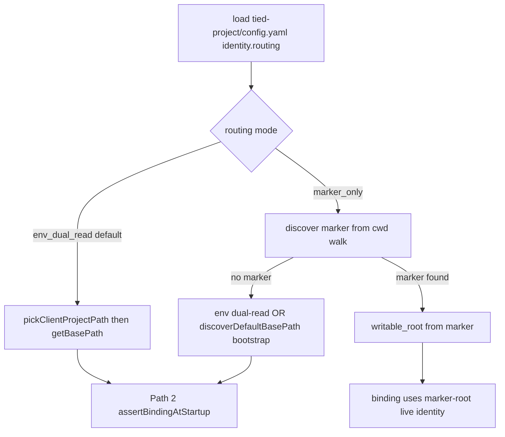

# PLAN — Wave 6: Path 3 marker-only routing

**Prompt type:** refine-plan (2026-10-30)  
**Program:** [REQ-TIED_INTENT_CONTROL_PLANE](../../requirements/REQ-TIED_INTENT_CONTROL_PLANE.yaml) (post Waves 1–5 close-out)  
**Handoff:** [session-handoff.md](evidence/session-handoff.md) item 2  
**Prior routing:** Path 2 shipped via [REQ-TIED_PROJECT_IDENTITY_WRITE_BINDING](../../requirements/REQ-TIED_PROJECT_IDENTITY_WRITE_BINDING.yaml) — env dual-read resolves `getBasePath()`, then startup/per-write **bind** to marker (fail closed on drift).

---

## 1. Refine (Touchpoint 1 — RESOLVE)

| Term | Resolved meaning |
| --- | --- |
| **Path 2 (current)** | [REQ-TIED_CLIENT_PATH_ENV_MIGRATION](../../requirements/REQ-TIED_CLIENT_PATH_ENV_MIGRATION.yaml) **dual-read** at runtime → `pickClientProjectPath` → `getBasePath()`; [write binding](../../implementation-decisions/IMPL-TIED_PROJECT_IDENTITY_WRITE_BINDING.yaml) rejects when resolved root or live `project_id` ≠ `project-identity.v1.yaml`. |
| **Path 3 (this wave)** | **Marker-only routing:** when enabled, **`getBasePath()` authoritative source is the on-disk marker’s `writable_root`**, not `TIED_CLIENT_PROJECT_PATH` / legacy `TIED_BASE_PATH`. Wrong IDE env becomes a **diagnostic hint**, not the writable root. |
| **REQ-CTRL-001 completion** | Handoff P0 “wrong-project writes rejected” is **partial** under Path 2 (misconfig fails closed). Path 3 **closes the operator story**: one checked-in marker + repo discovery beats stale `mcp.json` env. |
| **Owning slice (BBCE)** | `mcp-server/src/yaml-loader.ts` (`getBasePath` cache), `project-identity-write-binding.ts`, `tied-path-env.ts` (read-only for diagnostics), `tools/bootstrap/lib/mcp-base-path.mjs`, tied-cli env resolution, `tied_config_get_base_path` JSON contract. **Not** bundle path policy (still env dual-read for `TIED_CLIENT_BUNDLE_PATH` unless a follow-on). |

### 1.1 Behavior contract (normative target)

| Phase | `identity.routing` | Resolution order |
| --- | --- | --- |
| **Bootstrap** (no marker) | any | Unchanged: env dual-read → cwd discovery → `ensureProjectIdentityMarker` (Wave 1). |
| **Steady state** | `env_dual_read` (default) | Current Path 2 — **no behavior change**. |
| **Steady state** | `marker_only` | 1) Walk up from `process.cwd()` (bounded depth, same spirit as `discoverDefaultBasePath`) for `tied-project/project-identity.v1.yaml` (or legacy `tied/` sibling layout via [tied-layout.ts](../../../mcp-server/src/tied-layout.ts)). 2) Validate marker schema + `requirements.yaml` at `writable_root`. 3) Set `cachedBasePath = marker.writable_root`. 4) **Do not** call `pickClientProjectPath` for the writable root. |

**Path 2 binding under Path 3:** `markerMatchesLive` must compute **live** `project_id` from **marker `writable_root`**, not from env-resolved root. Per-write guard stays on `writeSerializedAtomic` + sidecar hook; startup mismatch from “env ≠ marker” **must not** occur when routing is marker-only and marker is valid.

### 1.2 Config surface (proposed)

| Key | Values | Default | Ladder |
| --- | --- | --- | --- |
| `identity.routing` | `env_dual_read` \| `marker_only` | `env_dual_read` | **Costly** to flip default store-wide; **reversible** per client via `tied-project/config.yaml` |
| `identity.write_binding` | boolean | `true` (existing) | Unchanged; opt-out still disables guards |

Schema LEAP: extend `tied-project-config.v1` with `identity.routing` enum; document in [tied-yaml-mcp.md](../../vocab/tied-yaml-mcp.md).

### 1.3 Consequence ladder

| Choice | Ladder | Refine disposition |
| --- | --- | --- |
| Default `marker_only` for all clients | **Costly** (breaks CI relying on env override) | **Reject** — opt-in per repo first; store dogfood second |
| Cwd-upward marker discovery in monorepos | **Costly** (nearest marker wins) | **Accept** with tests + diagnostic when multiple markers within search cone; document RISK-010 multi-root |
| Ignore env entirely with no marker | **Costly** (silent wrong tree) | **Reject** — fall back to env/discovery; fail closed if enforce on and marker required |
| Remove dual-read from codebase | **Costly** | **Reject** — dual-read remains for bootstrap, CLI, and `env_dual_read` mode ([REQ-TIED_CLIENT_PATH_ENV_MIGRATION](../../requirements/REQ-TIED_CLIENT_PATH_ENV_MIGRATION.yaml)) |
| `tied_config_get_base_path` exposes ignored env | **Reversible** | **Accept** — add `routing_mode`, `base_path_source: marker \| env \| discover` |

### 1.4 Sponsor decisions (locked 2026-10-30)

See [sponsor-decisions-wave6-path3-evidence.md](evidence/sponsor-decisions-wave6-path3-evidence.md): **Path 3 selected** — S1 yes (dogfood `marker_only`), S2 cwd walk, S3 legacy `tied/` support.

**Hygiene (orthogonal, not Path 3):** MCP may still report legacy `env_TIED_BASE_PATH` pointing at a non-client tree; align `.cursor/mcp.json` to [REQ-TIED_CLIENT_PATH_ENV_MIGRATION](../../requirements/REQ-TIED_CLIENT_PATH_ENV_MIGRATION.yaml) canonical keys — Path 3 reduces impact but does not replace config hygiene.

### 1.5 Depth and gates

| Field | Value |
| --- | --- |
| **`depth_tier`** | `integrated` (persistence + AI tool boundary; same program as umbrella CITDP) |
| **`gate_policy`** | `advisory` |
| **CITDP record** | New working file `CITDP-REQ-TIED_PROJECT_IDENTITY_MARKER_ROUTING.yaml` → persist under `tied-project/citdp/` at Wave 6 close-out |
| **`pre_implementation` gate** | Required on **build-plan** after tokens + pseudo-code on disk (not in this refine pass) |

**Vocabulary RECORD:** [tied-yaml-mcp.md](../../vocab/tied-yaml-mcp.md) — **marker-only routing**, **path routing mode**, **base path source**.

---

## 2. Plan — CITDP sketch

| Section | Content |
| --- | --- |
| `change_request_id` | `REQ-TIED_PROJECT_IDENTITY_MARKER_ROUTING` (proposed) |
| `current_behavior` | Wrong `TIED_CLIENT_PROJECT_PATH` in IDE env causes Path 2 **startup mismatch** even when marker points at the intended repo. |
| `desired_behavior` | With `identity.routing: marker_only`, MCP and tied-cli resolve writable root from marker; mutations target marker tree; diagnostics show env ignored. |
| `non_goals` | Marker-only for bundle path; OS sandbox; deleting env dual-read; repo-root `project-identity.v1.yaml` (session constraint). |
| `success_criteria` | Tests: wrong env + valid marker → mutating tools succeed on marker root; `binding_status: ok`; `tied_config_get_base_path` reports `routing_mode`; default mode regression green. |
| `eligibility_triggers_matched` | `persistence`, `ai_enabled_tool_boundary`, `external_input` (handoff REQ-CTRL-001) |

**LEAP targets:** [ARCH-TIED_PROJECT_IDENTITY](../../architecture-decisions/ARCH-TIED_PROJECT_IDENTITY.yaml) (Path 3 no longer deferred); [REQ-TIED_INTENT_CONTROL_PLANE](../../requirements/REQ-TIED_INTENT_CONTROL_PLANE.yaml) wave table; umbrella CITDP remove Path 3 from `non_goals` at close-out.

---

## 3. New TIED tokens (Wave 6 — mint on build-plan)

| Token | Role |
| --- | --- |
| **REQ-TIED_PROJECT_IDENTITY_MARKER_ROUTING** | Path 3: marker authoritative writable root when configured |
| **ARCH-TIED_PROJECT_IDENTITY_MARKER_ROUTING** | Discovery + cache + diagnostics; depends on ARCH-TIED_PROJECT_IDENTITY + ARCH-TIED_PROJECT_IDENTITY_WRITE_BINDING |
| **IMPL-TIED_PROJECT_IDENTITY_MARKER_ROUTING** | `RESOLVE_TIED_BASE_PATH`, `DISCOVER_IDENTITY_MARKER`, PRE/POST/FAILURE_MODES; LEAP `getBasePath` pseudo-code in IMPL-TIED_FILES if needed |

Cross-ref: parent [REQ-TIED_INTENT_CONTROL_PLANE](../../requirements/REQ-TIED_INTENT_CONTROL_PLANE.yaml); supersedes deferred bullet in persisted [CITDP-REQ-TIED_INTENT_CONTROL_PLANE.yaml](../../citdp/CITDP-REQ-TIED_INTENT_CONTROL_PLANE.yaml) `non_goals` only after Wave 6 ships.

---

## 4. Module map

| Module | Change |
| --- | --- |
| [mcp-server/src/yaml-loader.ts](../../../mcp-server/src/yaml-loader.ts) | Branch in `getBasePath()` before env pick when `marker_only`; cache invalidation unchanged via `clearBasePathCache` |
| [mcp-server/src/project-identity-write-binding.ts](../../../mcp-server/src/project-identity-write-binding.ts) | Live identity + binding status when routed root ≠ env pick |
| [mcp-server/src/tied-project-config.ts](../../../mcp-server/src/tied-project-config.ts) | Parse `identity.routing` |
| [mcp-server/src/tools/index.ts](../../../mcp-server/src/tools/index.ts) | Extend `tied_config_get_base_path` fields |
| [tools/bootstrap/lib/mcp-base-path.mjs](../../../tools/bootstrap/lib/mcp-base-path.mjs) | Parity for tied-cli spawn |
| [.cursor/skills/tied-yaml/scripts/tied-cli.sh](../../../.cursor/skills/tied-yaml/scripts/tied-cli.sh) | Document marker-only discovery (behavior via shared server) |

**Reuse:** `discoverDefaultBasePath` depth bound; `PROJECT_IDENTITY_MARKER_BASENAME`; existing write-binding hooks (no second guard layer).

---

## 5. Test strategy (TDD order)

| # | Focus |
| --- | --- |
| 1 | `tied-project-config` — parse `identity.routing`, default `env_dual_read` |
| 2 | `project-identity-marker-routing.test.ts` — discover marker upward; invalid marker fail closed |
| 3 | `yaml-loader` — marker_only + env pointing at **wrong** tied-project → `getBasePath()` equals marker `writable_root` |
| 4 | Write binding — mutating path under marker root succeeds; `bindingStatus() === ok` |
| 5 | Regression — default mode unchanged (existing `project-identity-write-binding.test.ts` + yaml-loader dual-read tests) |
| 6 | Composition — `tied_config_get_base_path` JSON contract snapshot |
| 7 | tied-cli smoke — one mutating read-only-safe tool with mismatched env (optional composition) |

**Battery:** `npm test --prefix mcp-server`; `npx tsc -b`; `lint_yaml` on new TIED YAML; `tied_validate_consistency`.

**CASE hooks:** CASE-003 (wrong identity) — Path 3 demonstrates recovery when marker is correct; document residual risk when marker itself is wrong tree.

---

## 6. Implement (build-plan sequence — do not execute in refine-plan)

1. PRELOAD [tied-yaml-mcp.md](../../vocab/tied-yaml-mcp.md), [fidelity-research.md](../../vocab/fidelity-research.md), [quality-assurance.md](../../vocab/quality-assurance.md).
2. Copy Tracker stub: `checklist-tracker-wave6-path3.yaml` from [checklist-tracker.yaml](checklist-tracker.yaml) header template; set `execution_evidence.request` to `REQ-TIED_PROJECT_IDENTITY_MARKER_ROUTING`.
3. Mint REQ/ARCH/IMPL + pseudo-code sidecar; `pseudocode_validate`.
4. Author working CITDP; run `pre_implementation` + structural adversarial inquiry.
5. RED tests (table §5).
6. GREEN routing + config + diagnostics; LEAP ARCH-TIED_PROJECT_IDENTITY + binding module comments.
7. Dogfood: set `identity.routing: marker_only` in [config.yaml](../../config.yaml) if sponsor S1 = yes.
8. Verification gate → `tied_verify` → `tied_validate_consistency` → persist CITDP → update [gap-matrix-req-ctrl-mapping.md](gap-matrix-req-ctrl-mapping.md) (REQ-CTRL-001 **complete**).
9. Close-out envelope under `evidence/` when claiming Wave 6 complete.

---

## 7. Tracker copy outline

- **Source:** `tied-bundle/docs/agent-req-implementation-checklist.yaml`
- **Target:** `tied-project/working/REQ-TIED_INTENT_CONTROL_PLANE/checklist-tracker-wave6-path3.yaml`
- **Fields:** `execution_evidence.request: REQ-TIED_PROJECT_IDENTITY_MARKER_ROUTING`; link envelope `evidence/request-evidence-envelope-wave6.v1.json` (create at build-plan)
- **Entry step:** `session-bootstrap` → `change-definition` with explicit Path 3 scope
- **Invalidate:** Prior Wave 1–5 gate dispositions do **not** carry; fresh `pre_implementation` for Wave 6

---

## 8. Out of scope / follow-ons

- LEAP: unify duplicate `checklist-controller-resume.ts` copies (handoff item 3)
- Bundle marker-only routing
- Automatic `tied-install` flip to `marker_only` without sponsor per repo
