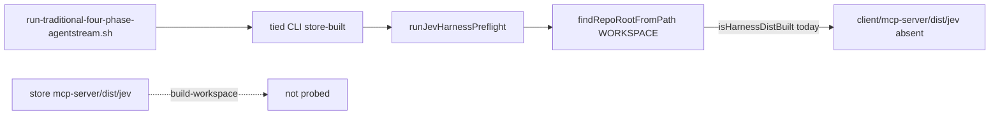

# PLAN — JEV harness store-dist resolution (linked client + four-phase) — refine pass 2

| Field | Value |
| --- | --- |
| **Request** | Durable fix: agentstream **harness dist gate** must load `mcp-server/dist/jev/*` from the **TIED store** when `-w` is a **linked disposable client**; traditional four-phase wrapper clears W5 harness env unless explicitly testing W5. |
| **Linked Cursor plan** | `jev_store_dist_resolution_afe12c26.plan.md` (refined here for `@build-plan`) |
| **Parent program** | [REQ-TIED_JEV_DECISION_COPROCESSOR](../../../requirements/REQ-TIED_JEV_DECISION_COPROCESSOR.yaml) (Implemented; LEAP follow-on slice **JEV-HARNESS-STORE-DIST-LINKED**) |
| **Prior slice** | [CITDP-REQ-TIED_JEV_DECISION_COPROCESSOR-G2-DIST-2C.yaml](../../../citdp/CITDP-REQ-TIED_JEV_DECISION_COPROCESSOR-G2-DIST-2C.yaml) (2C hard-stop — dist path assumed monolithic repo) |
| **Related operator plan** | [PLAN-refine-pass1.md](../PLAN-TRADITIONAL-FOUR-PHASE-AGENTSTREAM/PLAN-refine-pass1.md) (four-phase agentstream scaffold) |
| **profile_depth** | `minimal` |
| **gate_policy** | `advisory` |
| **Research / assurance** | baseline-functional; no integrated adversarial inquiry for this bounded path-resolution fix |

---

## Refine — resolved decisions

| Topic | Resolution |
| --- | --- |
| **Root cause** | [`resolveProjectRootForJev`](../../../../mcp-server/packages/agentstream/src/jev-harness-shared.ts) doubles as **dist loader root**; for linked clients that root has no `mcp-server/`. Store build (`./build-workspace.sh`) is correct but probed at the wrong tree. |
| **Split responsibilities** | **Client project root** (manifest, `jev.agentstream_harness`, tool-guard **`workspace`** per W4) stays `resolveProjectRootForJev(cfg)`. **Store root** (dist probe/load) is new `resolveJevHarnessDistStoreRoot(cfg, env)`. |
| **`TIED_MCP_BIN` math** | Value is `…/mcp-server/dist/index.js`. **Store root** = three `path.dirname` steps (not two): `dist` → `mcp-server` → **store**. |
| **Package anchor** | From compiled [`jev-harness-shared.js`](../../../../mcp-server/packages/agentstream/dist/jev-harness-shared.js): four levels up from `packages/agentstream/dist/` → store root (covers `node mcp-server/packages/cli/dist/index.js agentstream -w CLIENT` with no env). |
| **2C behavior** | Unchanged: harness on + no resolvable dist → exit **1** + stable hint. Only **which directory** is probed changes. |
| **Four-phase trials** | **Reversible:** wrapper **`unset AGENTSTREAM_JEV_HARNESS`** before exec unless **`TRADITIONAL_FOUR_PHASE_JEV_HARNESS=1`**. WF matrix default = no W5. |
| **New top-level REQ** | **No** — acceptance criterion + CITDP follow-on under existing [REQ-TIED_JEV_DECISION_COPROCESSOR]. |
| **Rename `resolveProjectRootForJev`** | **Optional** alias `resolveJevClientProjectRoot` for docs only; avoid wide export churn unless implementer adds re-export with deprecation comment. |

---

## Problem (normative)



**Observed failure:** `./scripts/run-traditional-four-phase-agentstream.sh --dry-run` with disposable `WORKSPACE` under `~/Documents/dev/test`, operator shell `AGENTSTREAM_JEV_HARNESS=1`, green store build → `agentstream: jev harness enabled but mcp-server/dist/jev not built`.

**Also affected:** [`jev-context-log-pruning-stream.ts`](../../../../mcp-server/packages/agentstream/src/jev-context-log-pruning-stream.ts) dist paths using the same monolithic assumption.

---

## Design — `resolveJevHarnessDistStoreRoot`

**Probe file (canonical):** `{storeRoot}/mcp-server/dist/jev/harness-tool-guard.js` (same as [G2/2C](../../../citdp/CITDP-REQ-TIED_JEV_DECISION_COPROCESSOR-G2-DIST-2C.yaml)).

**Resolution order** (first root where probe file exists wins; else fail closed):

| Step | Source | Rule |
| --- | --- | --- |
| 1 | Monolithic workspace | `clientRoot = findRepoRootFromPath(cfg.workspace) \|\| resolve(cfg.workspace)`; if probe exists under `clientRoot`, use it. |
| 2 | `TIED_MCP_BIN` | Absolute path to `…/mcp-server/dist/index.js` → store root = `dirname³(mcpBin)`. |
| 3 | `TIED_REPO_ROOT` | Absolute; require `join(root, "mcp-server/dist/index.js")` exists → use `root`. |
| 4 | Package anchor | `fileURLToPath(import.meta.url)` in `jev-harness-shared` → four parents from `packages/agentstream/dist/*` → store root. |
| 5 | — | No further fallback; `isHarnessDistBuilt` false → 2C message. |

**Call-site wiring:**

| Module | Change |
| --- | --- |
| [`jev-harness-shared.ts`](../../../../mcp-server/packages/agentstream/src/jev-harness-shared.ts) | Add resolver; `harnessDistModulePath(storeRoot)`, `isHarnessDistBuilt(cfg, env)`, `loadJevHarnessDistModule(cfg, env)` |
| [`jev-harness-preflight.ts`](../../../../mcp-server/packages/agentstream/src/jev-harness-preflight.ts) | Dist checks use store root; enablement still uses `cfg.workspace` |
| [`jev-harness-live-tool-gate.ts`](../../../../mcp-server/packages/agentstream/src/jev-harness-live-tool-gate.ts) | Load dist from store root; **`workspace` for evaluateHarnessToolCall** remains `resolveProjectRootForJev(cfg)` |
| [`jev-context-log-pruning-stream.ts`](../../../../mcp-server/packages/agentstream/src/jev-context-log-pruning-stream.ts) | Pruner + resolve-jev-api-key dist paths via store root helper |

**Operator message** ([`formatHarnessDistMissingMessage`](../../../../mcp-server/packages/agentstream/src/jev-harness-shared.ts)):

- Primary hint: run **`./build-workspace.sh`** from the **TIED store** that owns the running CLI (not `cd mcp-server` inside a disposable client).
- Secondary: set **`TIED_MCP_BIN`** / **`TIED_REPO_ROOT`** when using a linked client (matches [bootstrap e2e](../../../../mcp-server/src/e2e/bootstrap-and-load.test.ts)).

**Non-goals:**

- Auto-build dist; change harness opt-in defaults; reopen REQ Implemented status; promote W5 to production-default ([G2/2C non_goals](../../../citdp/CITDP-REQ-TIED_JEV_DECISION_COPROCESSOR-G2-DIST-2C.yaml)).

---

## Four-phase harness policy

**Script:** [`run-traditional-four-phase-agentstream.sh`](../../../../scripts/run-traditional-four-phase-agentstream.sh)

```bash
# Default: WF trials are not W5 harness tests
if [[ "${TRADITIONAL_FOUR_PHASE_JEV_HARNESS:-}" != "1" ]]; then
  unset AGENTSTREAM_JEV_HARNESS
fi
```

| Env | Meaning |
| --- | --- |
| (default) | W5 harness env cleared; dry-run/live four-phase ignores operator-global `AGENTSTREAM_JEV_HARNESS` |
| `TRADITIONAL_FOUR_PHASE_JEV_HARNESS=1` | Preserve harness enablement; requires store dist resolution fix + green `./build-workspace.sh` |

**Docs to update:**

| File | Content |
| --- | --- |
| [PLAN-refine-pass1.md](../PLAN-TRADITIONAL-FOUR-PHASE-AGENTSTREAM/PLAN-refine-pass1.md) | Subsection **Jev W5 harness** + `@build-plan` checklist row |
| [catalog-traditional-workflow-trial-prompts.md](../../../../docs/demos/catalog-traditional-workflow-trial-prompts.md) | Automated agentstream table row (harness off by default) |
| [agentstream README](../../../../mcp-server/packages/agentstream/README.md) | Linked client + store CLI dist prerequisite |
| [decision-copilot.md](../../../vocab/decision-copilot.md) | **Harness dist module** row: store root vs client workspace |

---

## CITDP (persist after implementation)

**File:** `tied-project/citdp/CITDP-REQ-TIED_JEV_DECISION_COPROCESSOR-STORE-DIST-LINKED-CLIENT.yaml`

**change_definition (draft):**

- **current_behavior:** Harness dist gate probes `{findRepoRootFromPath(workspace)}/mcp-server/dist/jev/` only; linked disposable clients never see store-built dist; misleading `cd mcp-server && npm run build` hint from client cwd.
- **desired_behavior:** Dist gate resolves **store root** via monolithic probe, `TIED_MCP_BIN`, `TIED_REPO_ROOT`, or agentstream package anchor; 2C hard-stop when harness on and store dist absent; four-phase wrapper unsets `AGENTSTREAM_JEV_HARNESS` unless `TRADITIONAL_FOUR_PHASE_JEV_HARNESS=1`.
- **success_criteria:** SC-JEV-HARNESS-DIST-STORE-LINKED-CLIENT (see below).

**impact (blast radius):**

- `mcp-server/packages/agentstream/src/jev-harness-shared.ts` (+ new `jev-harness-shared.test.ts`)
- `jev-harness-preflight.ts`, `jev-harness-preflight.test.ts`
- `jev-harness-live-tool-gate.ts` (load path only)
- `jev-context-log-pruning-stream.ts` (+ test if added)
- `scripts/run-traditional-four-phase-agentstream.sh`
- Operator docs listed above
- `IMPL-TIED_JEV_DECISION_COPROCESSOR-pseudocode.md` — block **`RESOLVE_JEV_HARNESS_DIST_STORE_ROOT`**
- REQ detail criterion; ARCH note (dist loader ≠ agent workspace)

**risk_assessment:**

| Decision | Ladder | Notes |
| --- | --- | --- |
| Store-root resolution order | Reversible | Unit-tested; wrong order fails tests before merge |
| Wrapper unset harness | Reversible | Opt-in flag restores prior operator env |
| Changing missing-dist message | Reversible | Operator-facing text only |

---

## Test strategy (RED before code)

**Metric token (proposed):** **SC-JEV-HARNESS-DIST-STORE-LINKED-CLIENT** — `jev-harness-shared.test.ts` + extended `jev-harness-preflight.test.ts`.

| # | Test | Assert |
| --- | --- | --- |
| 1 | New `jev-harness-shared.test.ts` | Client temp dir with `tied-bundle/docs/agent-req-implementation-checklist.yaml`, **no** `mcp-server/`; fake store tree with `mcp-server/dist/jev/harness-tool-guard.js`; `TIED_MCP_BIN` → store → resolver finds dist |
| 2 | Same file | `TIED_REPO_ROOT` arm |
| 3 | Same file | Package anchor arm (no env; fake store layout relative to test import path or injectable anchor helper for test) |
| 4 | `jev-harness-preflight.test.ts` | Harness on, client-only workspace, store dist via env → **exit 0** (regression for dry-run failure) |
| 5 | Existing G2/2C tests | Monolithic tempDir with local `mcp-server/dist/jev` still pass |
| 6 | `jev-harness-preflight.test.ts` | Harness on, no dist anywhere → still **exit 1** |
| 7 | Optional | Context pruning dist path uses store root |
| 8 | Optional | `tools/bootstrap/run-traditional-four-phase-harness-env.test.mjs` — spawn wrapper with `AGENTSTREAM_JEV_HARNESS=1`, assert unset in child (if cheap); else manual evidence |

**Commands:**

```bash
cd mcp-server && npm run test -w @tied/agentstream
# after YAML edits
# tied-cli tied_validate_consistency + lint_yaml on changed tied-project files
```

---

## TIED stack updates (@build-plan)

| Layer | Action |
| --- | --- |
| **REQ** | Add criterion **SC-JEV-HARNESS-DIST-STORE-LINKED-CLIENT** to [REQ-TIED_JEV_DECISION_COPROCESSOR](../../../requirements/REQ-TIED_JEV_DECISION_COPROCESSOR.yaml) detail |
| **ARCH** | Note under [ARCH-TIED_JEV_DECISION_COPROCESSOR](../../../architecture-decisions/ARCH-TIED_JEV_DECISION_COPROCESSOR.yaml): harness dist loader uses store root; agent workspace for scope signals remains client root |
| **IMPL** | Pseudo-code **`RESOLVE_JEV_HARNESS_DIST_STORE_ROOT`**; update `RUN_JEV_HARNESS_PREFLIGHT*` PRE to name store vs client roots |
| **Tracker** | Copy checklist → `tied-project/working/REQ-TIED_JEV_DECISION_COPROCESSOR/agent-req-checklist-store-dist-linked-client.yaml` |

---

## Implementation sequence (@build-plan)

1. Copy Tracker; record `profile_depth` / `gate_policy` in CITDP draft.
2. RED: tests 1–6.
3. Implement `resolveJevHarnessDistStoreRoot` + wire call sites; update error message.
4. Wrapper unset + opt-in env.
5. Docs + vocab RECORD.
6. Persist CITDP YAML; LEAP pseudo-code; `lint_yaml`; `tied_validate_consistency`.
7. **`tied_checklist_gate_validate`** `pre_implementation` before merge claim (Tracker + CITDP).
8. Evidence artifacts under `tied-project/working/REQ-TIED_JEV_DECISION_COPROCESSOR/evidence/`:
   - `store-dist-linked-dry-run.stdout.txt` — four-phase `--dry-run` with parent `AGENTSTREAM_JEV_HARNESS=1` (default unset)
   - `store-dist-linked-harness-on.stdout.txt` — `TRADITIONAL_FOUR_PHASE_JEV_HARNESS=1` + built store + disposable client

---

## Success criteria (acceptance)

1. `./scripts/run-traditional-four-phase-agentstream.sh --dry-run` succeeds when parent shell has `AGENTSTREAM_JEV_HARNESS=1` (wrapper clears it).
2. Same script with `TRADITIONAL_FOUR_PHASE_JEV_HARNESS=1`, green `./build-workspace.sh` on store, linked disposable `WORKSPACE`: preflight **does not** emit missing-dist hard stop.
3. Store-as-`-w` monolithic runs unchanged.
4. Harness on + store dist truly missing → exit **1** (2C preserved).
5. **SC-JEV-HARNESS-DIST-STORE-LINKED-CLIENT** tests green.

---

## Out of scope

- Per-record model in batch YAML ([PLAN-refine-pass1](../PLAN-TRADITIONAL-FOUR-PHASE-AGENTSTREAM/PLAN-refine-pass1.md) out of scope list unchanged).
- MCP `tied_jev_*` tool changes (dist is agentstream-only loader).
- Copying `mcp-server/` into linked clients at install time.

---

## `@build-plan` entry checklist

- [ ] `./build-workspace.sh` green on store
- [ ] Tracker copied; CITDP draft reviewed
- [ ] RED tests committed before green implementation
- [ ] `pre_implementation` gate allowed on Tracker + CITDP
- [ ] Dry-run evidence paths recorded
- [x] Cross-link **Jev W5 harness** subsection added to [PLAN-refine-pass1.md](../PLAN-TRADITIONAL-FOUR-PHASE-AGENTSTREAM/PLAN-refine-pass1.md)
