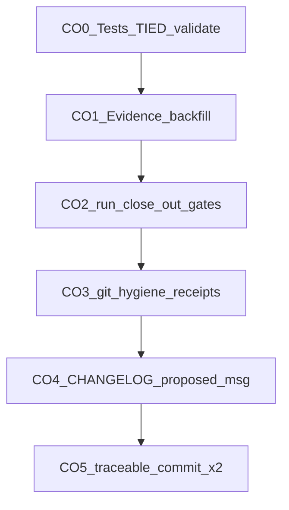

# Plan-close-out: brownfield client doc stack ([REQ-TIED_LAYERED_CLIENT_INSTALL])

| Field | Value |
| --- | --- |
| **Feature plan** | [PLAN.md](PLAN.md) (layered installer program) |
| **Close-out plan** | This file (refine pass **1**, 2026-10-17) |
| **Request token** | `REQ-TIED_LAYERED_CLIENT_INSTALL` |
| **CITDP (this pass)** | [CITDP-REQ-TIED_LAYERED_CLIENT_INSTALL-brownfield-doc-stack.yaml](../../citdp/CITDP-REQ-TIED_LAYERED_CLIENT_INSTALL-brownfield-doc-stack.yaml) |
| **Tracker** | [agent-req-implementation-checklist.yaml](agent-req-implementation-checklist.yaml) |
| **Depth / policy** | `minimal` / `advisory` (unchanged) |
| **Linked Cursor plan** | `lci_git-hygiene_close-out_05810061.plan.md` |

---

## Refine (2026-10-17)

**Resolved intent:** Implementation for brownfield methodology docs on linked install is **on disk** (manifest allowlist, factory integration test, contract test). Remaining work is **LEAP verification**, **machine close-out** (envelope + gates), **git hygiene receipts**, and **two traceable commits** (sponsor chose split).

**Canonical terms:**

| Term | Meaning this pass |
| --- | --- |
| **Brownfield doc stack** | `brownfield-intent-elevation.md`, `working-artifact-placement.md` in `DOCS_TO_COPY`; matrix template via `METHODOLOGY_TEMPLATES_TO_COPY` under `tied-bundle/` only |
| **Factory guard** | Linked `new-tied-client` pipeline must not create `tied-project/working/REQ-*` comprehension trees |
| **Git hygiene** | MCP `tied_git_hygiene` preview (`plan_close_out`); not a checklist slug — pairs with `gitignore-close-out-hygiene` then `traceable-commit` |
| **Machine close-out** | `close_out` gate `allowed: true` **and** envelope validate `fail_on_error_gaps: true` with zero blocking gaps |

**Sponsor defaults (reversible):**

| Decision | Choice | Notes |
| --- | --- | --- |
| Commit shape | **Two commits** | (1) feature, (2) hygiene pins |
| Adversarial depth | **minimal** | No integrated activation collect; `sub-adversarial-inquiry-pass` → **not_applicable** at close-out with CITDP cite |
| CITDP path for runner | **`tied-project/citdp/CITDP-REQ-TIED_LAYERED_CLIENT_INSTALL-brownfield-doc-stack.yaml`** | Not the umbrella LCI CITDP unless LEAP merges records |
| Commit actor | **Parent agent on sponsor ask** | plan-close-out / refine-plan do not commit |

**Gate probe (refine, 2026-10-17):** `tied_checklist_gate_validate` `phase: close_out` → `allowed: false` — `missing_required_step:sub-adversarial-inquiry-pass`, envelope not built (`request-evidence-envelope.v1.json:gaps`). **Expected until CO1–CO2.**

**Ambiguity accepted:** Pass 2 (fixture pins) has **no** full Tracker close-out; operational `chore(test)` commit with token footers only.

---

## Plan (CITDP + test strategy)

**Change definition (locked):** [CITDP brownfield record](../../citdp/CITDP-REQ-TIED_LAYERED_CLIENT_INSTALL-brownfield-doc-stack.yaml) — manifest + install path only; no full docs tree copy; no auto-seed of `tied-project/working/REQ-*`.

**Test strategy (must be green before close-out claims):**

```bash
cd mcp-server
npm test -- src/e2e/brownfield-client-doc-stack-contract.test.ts
npm test -- src/e2e/new-tied-client.test.ts
```

Capture stdout to `working/REQ-TIED_LAYERED_CLIENT_INSTALL/evidence/npm-test-brownfield-closeout.txt`.

**Commit 1 — stage exactly (2026-10-17 tree):**

| Path | Role |
| --- | --- |
| `mcp-server/src/e2e/brownfield-client-doc-stack-contract.test.ts` | Contract (new) |
| `mcp-server/src/e2e/new-tied-client.test.ts` | Integration |
| `tools/bootstrap/manifest.json` | Allowlist |
| `tools/bootstrap/lib/bootstrap.mjs` | `copyMethodologyTemplates` wiring |
| `tools/bootstrap/lib/layers/methodology.mjs` | Linked/full copy |
| `tools/bootstrap/lib/methodology-bundle.mjs` | Bundle paths |
| `tools/bootstrap/lib/sidecar-template.mjs` | Sidecar (if diff is LCI-related) |
| `tied-bundle/docs/methodology-migration.md` | Migration note § brownfield docs |
| `tied-project/citdp/CITDP-REQ-TIED_LAYERED_CLIENT_INSTALL-brownfield-doc-stack.yaml` | CITDP |
| `tied-project/requirements/REQ-TIED_LAYERED_CLIENT_INSTALL.yaml` | REQ |
| `tied-project/implementation-decisions/IMPL-TIED_LAYERED_CLIENT_INSTALL-pseudocode.md` | IMPL |
| `tied-project/working/REQ-TIED_LAYERED_CLIENT_INSTALL/install-resource-matrix.md` | Matrix |

**Commit 2 — hygiene pins (exclude from commit 1):**

| Path | Owning token (footer) |
| --- | --- |
| `mcp-server/test/fixtures/adversarial-inquiry-go-mode-b/.../request-evidence-envelope.v1.json` | Fixture |
| `mcp-server/test/fixtures/adversarial-inquiry-mode-b/.../request-evidence-envelope.v1.json` | Fixture |
| `mcp-server/test/fixtures/source-graph/mini-repo/tied-bundle/reports/source-graph/source-graph-index.v1.json` | Source-graph fixture |
| `tied-project/working/REQ-TIED_CHECKLIST_GATE_ENFORCEMENT/fixture-1787603099/regression-manifest.json` | `REQ-TIED_CHECKLIST_GATE_ENFORCEMENT` |
| `tied-project/working/REQ-TIED_JEV_CONTEXT_LOG_PRUNING/evidence/context-pruning-benchmark.v1.json` | `REQ-TIED_JEV_CONTEXT_LOG_PRUNING` |
| `tied-project/working/REQ-TIED_SETUP/ignore-generated-client-guides-tracker.yaml` | `REQ-TIED_SETUP` |

**Do not stage:** Regenerable `working/**/evidence/request-evidence-envelope.v1.json` for this REQ unless policy force-adds (default gitignore).

---

## Implement (close-out sequence)



### CO0 — Precond

- LEAP: IMPL pseudo-code ↔ manifest/tests; update REQ/ARCH if drift.
- `lint_yaml` on changed project YAML + CITDP.
- MCP `tied_validate_consistency`.

### CO1 — Evidence bootstrap

Create `tied-project/working/REQ-TIED_LAYERED_CLIENT_INSTALL/evidence/`:

- `request-evidence-envelope.v1.json` (build/backfill)
- `verification-evidence-manifest.v1.json` (after tests)
- Per-slug `*-evidence.md` stubs for slugs marked completed (verification-gate, persist-citdp-record, gitignore-close-out-hygiene, etc.)
- Mark `sub-adversarial-inquiry-pass` **not_applicable** with CITDP `depth_tier: minimal` rationale
- Dual-write: `execution_evidence.completed` + matching `steps[].tracking.status`

### CO2 — Unified close-out

```bash
node tools/bootstrap/templates/run-close-out-gates.mjs \
  --project-root /Users/fareed/Documents/dev/chatgpt/stdd \
  --request-token REQ-TIED_LAYERED_CLIENT_INSTALL \
  --tracker-path tied-project/working/REQ-TIED_LAYERED_CLIENT_INSTALL/agent-req-implementation-checklist.yaml \
  --citdp-path tied-project/citdp/CITDP-REQ-TIED_LAYERED_CLIENT_INSTALL-brownfield-doc-stack.yaml \
  --phase close_out \
  --envelope-blocking \
  --sync-dispositions \
  --reconcile
```

Report [three completion signals](tools/bundled-prompt-type-skills/prompt-shared/completion-signals-handoff.md). Label **incomplete** if any signal fails.

### CO3 — Git hygiene

- `tied_git_hygiene`: `{ "project_root": "...", "context_mode": "plan_close_out", "apply": false }`
- Write `evidence/git-hygiene-receipt-2026-10-17.md` (+ optional `-hygiene-pins.md` for pass 2)
- **Gitignore close-out:** N/A unless new ephemeral patterns (expect N/A)

### CO4 — plan-close-out artifacts

- Root `CHANGELOG.md` entry
- `evidence/proposed-commit-message.txt` (commit 1); second message in receipt or `proposed-commit-message-hygiene-pins.txt`
- **No** `git add` / `git commit`

### CO5 — traceable-commit (sponsor approval)

1. Stage commit 1 paths only → commit with PROC-COMMIT_MESSAGES + tokens: `REQ-TIED_LAYERED_CLIENT_INSTALL`, `REQ-TIED_BROWNFIELD_INTENT_ELEVATION`, `IMPL-TIED_LAYERED_CLIENT_INSTALL`, CITDP id.
2. Stage commit 2 paths → `chore(test): pin fixture and working evidence drift` with per-path REQ footers.
3. Update tracker `traceable-commit` disposition + typed `evidence_refs`.
4. No push unless asked.

---

## Proposed commit 1 message (draft)

```
feat(tied): install brownfield docs on linked clients

Extend manifest DOCS_TO_COPY and METHODOLOGY_TEMPLATES_TO_COPY so linked
installs ship brownfield-intent-elevation, working-artifact-placement, and
the evidence-to-intent matrix under tied-bundle only. Factory pipeline rejects
auto-seeded tied-project/working/REQ-* trees.

REQ-TIED_LAYERED_CLIENT_INSTALL REQ-TIED_BROWNFIELD_INTENT_ELEVATION
IMPL-TIED_LAYERED_CLIENT_INSTALL ARCH-TIED_LAYERED_CLIENT_INSTALL
CITDP-REQ-TIED_LAYERED_CLIENT_INSTALL-brownfield-doc-stack
```

---

## Risks

- **Envelope dual-write:** Empty `execution_evidence.completed` blocks close-out until CO1 sync.
- **Split commits:** Pass 2 bypasses unified envelope; acceptable for pin-only drift if footers cite owning REQ tokens.
